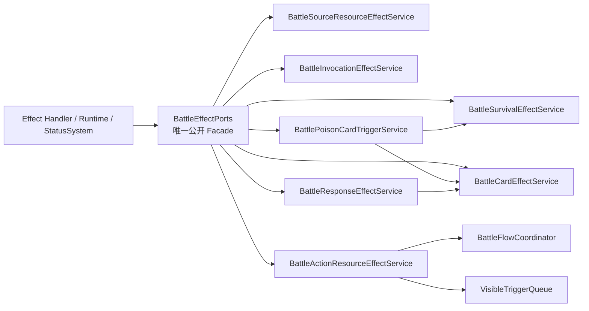
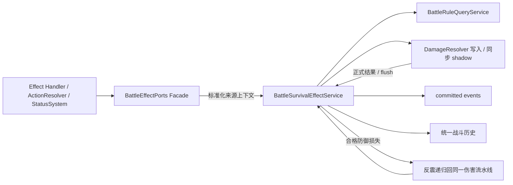
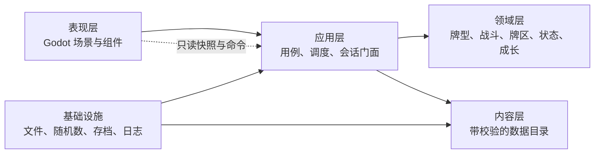

# 组合出招纵切代码架构审计

日期：2026-08-06
范围：`combo_duel_vslice/` 当前全部脚本、数据与测试
设计依据：`godot/docs/design-current/README.md` v0.30

> **2026-08-07 状态更新**
>
> 本文档记录 2026-08-06 的审计快照，下列结论已被后续改造推进，正文保留原判断以
> 便追溯：
>
> - 「P1：运行时字典契约仍缺少类型边界」—— core 与表现层之间的快照边界已完成
>   类型化。`BattleSnapshot`、`RunSnapshot` 与新增的 `BattleSideSnapshot` 改为
>   显式字段，`value(key, default)` 与 `section(key)` 已删除而非保留兼容。
>   S0 又在基线 `0555d0f` 完成 `CommandResult`、`RunProgressSnapshot`、`BattleEvent`、
>   `RunEvent` 与 `AiConversationSnapshot` 的当前边界类型化；旧 `BattleCommandResult`
>   已删除。规则结算层尚未形成稳定边界的内部字典不在本次清零范围。
> - 「P2：大型脚本式 UI 难维护」—— 表现层转发层已消除，`BattleValuePanel` 与
>   `ContentFailurePage` 已抽出组件，`ui/main.gd` 从 856 行降至 713 行。
> - 内容加载失败的静默降级已消除：组合根内容未通过校验时拒绝创建会话，
>   `BattleEffectPorts` 的四个依赖改为必需，删除全部 null 兜底分支。
> - `ContentValidator` 的效果规格校验已拆到 `EffectSpecValidator`。
> - 状态行为已采用数据绑定与小型处理器注册；`BattleEffectPorts._sides` 只由端口内部
>   持有，外部代码通过公开窄查询访问。
> - S0 最终验收已通过，当前执行阶段为 S1；大型战斗核心瘦身、状态系统继续拆分、
>   UI／美术、测试拆分和文档维护继续保留在长期轨道。
> - 2026-08-16 已接入 228 门正式功法；正文中的“107 门旧候选／9 门纵切样本”只描述
>   2026-08-06 审计当时的历史状态，不再作为当前内容口径。当前证据见
>   `docs/technique-content-status.md`。
>
> 当前流程、门禁与剩余债务见 `docs/development-workflow.md`。

### BattleEffectPorts／BattleActionService 阶段统一验收（2026-08-16）

BattleEffectPorts 五批 Facade 拆分与 BattleActionService 四批事务／牌型组／准备职责优化均已完成。
在进入 `StatusSystem` 重构前执行阶段性统一验收，未修改业务代码：项目加载 672 项通过，
`BattleActionTransaction` 专项 117 条断言通过，`quick` 7/7 组通过，当前完整测试发现集 `full` 31/31
组通过；设计一致性检查得到权威活跃 228 门、正式资源接入 228 门、待接入 0 门、错误 0 条。

最终项目加载和事务专项日志分别为 `/tmp/taiwu-stage-acceptance-project-load-01.log` 与
`/tmp/taiwu-stage-acceptance-battle-action-transaction-02.log`；quick 每组日志为
`/tmp/taiwu-stage-acceptance-quick-<组名>-<序号>.log`，full 每组日志为
`/tmp/taiwu-stage-acceptance-full-<组名>-<序号>.log`；设计一致性日志为
`/tmp/taiwu-stage-acceptance-design-consistency-03.log`。独立检查与设计检查 stdout 使用同名前缀
`.stdout`，quick／full stdout 使用对应 `.log.stdout`。所有进程均 headless、串行运行并写入不同的
显式 `/tmp` 日志；日志与 stdout 中没有 `Can't load script`、`File not found`、`Parse Error`、
`SCRIPT ERROR`、ObjectDB／RID 泄漏、orphan `StringName`／`NodePath`、资源泄漏或退出阶段错误，只有
已知非阻塞 macOS CA 证书警告。

该结果取代 BattleActionService 分批开发阶段“尚未运行 quick／full”的临时状态，作为
BattleEffectPorts 与 BattleActionService 优化完成、进入 `StatusSystem` 重构前的稳定行为基线。

### 心得成长规则合并与战斗内实时扩容（2026-08-17）

新增 `core/insight_growth_service.gd`，作为本局与战斗两种上下文共用的唯一心得规则
事实源。精确牌型合法性、当前容量、统一被动增量查询、九槽上限、正式非内建
候选过滤、已拥有／已装备去重、稳定排序与 RNG 选择、以及八牌型完整配装校验现只有
一份实现。服务只返回包含拟提交成长状态、拟提交已拥有集合、容量前后值、理论／实际
增量、查询回执和所得功法的方案，不自动装备功法。

`GrowthInventory.apply_insight_growth` 现只负责准备当前本局状态、委托服务，并在
方案成功后原子替换 `hand_technique_progression` 与 `learned_technique_ids`。
`BattleSide.apply_insight_growth` 是战斗工作状态提交适配器：它替换
`hand_technique_progression` 与 `owned_technique_ids`，然后保留完整 `source_metadata`
调用 `BattleEffectPorts.change_technique_slot_capacity`。容量修改仍只由
`BattleTechniqueSequenceEffectService → TechniqueSequenceBook` 完成，继续发布
`technique_slot_capacity_changed`，没有按功法、内功、物品或消耗品 ID 分支。

这条同步链意味着战斗内心得一旦成功，战斗工作状态的永久槽位与当前
`SequenceBook` 容量立即同时增长，后续预览、临时功法生成和尚未确认的行动都读取新容量。
“永久功法槽容量与当前战斗容量不一致”只是提交前的完整性校验，不是开战时冻结规则。
已确认行动的功法槽、P／P₀ 和牌型组快照仍保持不变；该快照边界不会冻结后续行动的永久成长。

战斗适配器在委托规则前捕获 RNG，并在容量端口失败时立即恢复成长字段、已拥有集合、
`SequenceBook` 完整快照与 RNG。容量端口自身仍是容量事件的事务边界：事件提交失败时它先
恢复容量，且不发布成功回执；成长适配器的快照恢复再确保任何失败端口实现都不留下
SequenceBook 部分修改。本批不改 `RunProgressSnapshot`、`BattleSetupService`、战斗结算或消耗品事务框架。
本批只执行 `git diff --check` 与 headless 项目加载，未运行 `quick`／`full`。最终加载日志为
`/tmp/taiwu-insight-growth-project-load-02.log`；`Can't load script`、`File not found`、
`Parse Error`、`SCRIPT ERROR` 与其他 `ERROR` 均无匹配。

### 战斗结果本局聚合原子提交（2026-08-17）

新增 `core/run_aggregate_transaction.gd` 与
`core/battle_outcome_commit_service.gd`。前者只负责捕获、提交和恢复一次
`RunSession` 业务变更涉及的完整内存状态，不理解胜负、奖励或被动规则；后者只负责
调用现有成长、被动、地图、奖励、终局、日志与事件能力，并把所有失败收束到同一个
rollback 出口。没有使用 `RunSaveData` 充当内存事务快照，也没有建立第二套成长或奖励算法。

聚合事务覆盖 `GrowthInventory.capture_mutation_state()`、`MapNavigationService` 的 seed／act／
graph／phase／current node／completed nodes、`ComboRunState` 的 terminal／修习开关与序号／
committed token、待领取奖励对象、待结算胜利结果、节点交互运行状态、
`StructuredGameLog` 内容与 serial、`RunEvent` 队列与 serial，以及本次提交相关的 persistent change
serial。地图的 graph 与 completed node 容器、终局附属数组、节点交互字典和事件队列均尽量
原地恢复；restore 不发送信号、不写日志、不重新生成奖励、不重新执行被动，也不推进 RNG。

胜利顺序固定为：验证正式战斗 DTO 与绝对进度 → begin 聚合事务 → 提交战斗进度 →
触发一次 `battle_completed` → 记录必要的 growth sync → 标记节点完成并进入
`awaiting_reward` → 建立确定性奖励包与胜利结果 → 写奖励日志和 RunEvent → commit。
战败使用同一前半段，然后建立 defeat terminal、终止本局并写终局日志与事件；
`unresolved_draw` 与 `scenario_error` 保持原语义，不应用缺失或不可信的战斗进度。

事务成功之后 `RunSession` 才发送一次 `_run_state.changed` 并关闭一次活动
`BattleSession`；`execute` 因唯一 persistent serial 变化只发布一次
`persistence_boundary_reached("resolve_battle_result")`，数据库／JSON 保存仍位于该稳定业务提交
之后。任一步失败会同时恢复成长、被动计数与来源标识、committed token、地图、奖励、终局、
日志和 RunEvent，且保留原 BattleSession 供重试；主动退出战斗的节点入口检查点语义未改变。
本批只补充聚焦契约测试，不运行 `quick`／`full`，统一回归继续留到全部底层批次完成后执行。
静态检查 `git diff --check` 通过；Godot 4.7.1 项目加载日志为
`/tmp/taiwu-run-aggregate-project-load-20260817-final.log`，未出现 `Can't load script`、
`File not found`、`Parse Error` 或 `SCRIPT ERROR`，仅有约定可忽略的 macOS CA 证书警告。

### 事件级被动来源执行快照（2026-08-17）

运行时删除了 `ComboRunState.node_passive_source_snapshot` 与
`node_passive_source_node_id` 及其节点入口冻结／清理方法。来源解析仍唯一复用
`PassiveRuleRuntime.capture_source_snapshot`、`PassiveRuleSourceResolver.sources_from_snapshot`
和 `RunPassiveEventContext.source_snapshot`，但快照只属于当前事件的 `ExecutionPlan`，不再
进入节点存档或聚合事务。永久来源变化对后续事件实时生效；同一事件内的执行顺序和来源集合
保持固定。奖励前的局部快照保证新奖励不会反向触发本次 `node_completed`，奖励提交成功后
该来源立即对下一事件可见。

### StatusSystem 状态历史职责首批迁出（2026-08-16）

新增 `core/statuses/status_history_service.gd`，作为所有状态子服务共用的唯一状态变化历史记录器。
它实际持有固定身份的 `history` 数组和下一个 serial，负责建立 `StatusChange`、生成深复制 snapshot、
按 limit 返回历史快照、通过 `ContentCatalog` 查询异状显示名、写入可选统一 `GameLog`，以及 reset 与
恢复后的 serial 重建。该服务只依赖 `ContentCatalog`、`StatusChange` 和可选 `GameLog`；不持有
`StatusSystem`、`CombatEngine`、`BattleSide`、`BattleEffectPorts`、`EffectExecutor`、
`TimingSystem`，也不知道异状生命周期、动态响应或延迟记录。

`StatusSystem` 保留公开 Facade 兼容。构造时创建历史服务，并令公开 `history` 字段指向
`status_history.history_entries()` 返回的同一个 Array 实例；之后 reset 和正式恢复只原地清空或 assign，
不替换数组。因此 `engine.status_system.history`、`history.is_empty()`、`history.size()` 和既有直接
`history.assign(...)` 调用继续有效。`history_snapshot`、`use_game_log` 与新增 `replace_history` 是薄委托；
初始化时传入的 `GameLog` 直接注入历史服务，后续日志替换也同步转发。原 `StatusChangeScript` preload、
`_serial`、`_game_log`、`_record_change` 和 `_status_name` 已从 Facade 删除，九个内部写入点直接调用
`status_history.record_change(...)`，没有复制历史算法。

`BattleSide.capture_passive_query_state()` 继续保存历史快照，但不再读取历史服务私有 serial；
`replace_passive_query_state()` 改为调用 `status_system.replace_history(...)`。正式恢复会先原地替换历史
内容，再扫描所有含 serial 的记录：下一 serial 为最大值加一，空历史从 0 开始。旧快照中即使仍带有
独立 `serial` 字段也不再作为事实源；恢复不写 `GameLog`，不追加新记录。这样历史内容与序号恢复只由
一个服务负责，`BattleSide` 不再越过 Facade 修改内部所有权。

本批没有修改真气异状增删／层数、`CardStateLifecycle`、`StatusBehaviorRegistry`、动态响应匹配、
延迟效果、战斗来源到期、功法抽牌统计或任何功法／内功／物品内容。`status_system.gd` 当前 1263 行，
`status_history_service.gd` 为 76 行。下一批拆分真气异状变更服务，只迁移异状变更编排，不改现有
合法性、生命周期与事件顺序。本批只运行静态检查和 headless 项目脚本加载，使用独立日志
`/tmp/taiwu-status-history-project-load-01.log`，最终加载覆盖 673 项，四类脚本／文件错误无匹配，
仅有已知非阻塞 macOS CA 证书警告；`quick`／`full` 未运行。

### StatusSystem 真气异状职责第二批迁出（2026-08-17）

新增 `core/statuses/card_anomaly_service.gd`，作为战斗状态路径中真气异状变更、数值查询和单张真气
生命周期的唯一编排服务。它独占 `CardStateLifecycle` 实例，负责 `card_numeric_modifier`、
`actor_hand_card_numeric_modifier`、`modify_card_contribution`、`effective_qi_value`，以及异状施加、
合法性查询、移除、转移、层数设置、进入弃牌堆清理和战斗开始／结束处理。依赖方向固定为
`StatusSystem → CardAnomalyService → ContentCatalog / CardStateLifecycle / StatusHistoryService`；新服务
不持有 `StatusSystem`、`CombatEngine`、双方集合、`EffectExecutor`、`TimingSystem`、行为注册表、响应
记录或延迟记录。

异状运行事件通过 `BattleEffectPorts` 的弱引用发布。`StatusSystem.use_effect_ports` 同时更新新服务的
`WeakRef`；施加、转移或移除后由新服务调用 `notify_response_event`，缺少 holder 时调用同一端口的
`locate_active_card`，因此没有形成
`StatusSystem → CardAnomalyService → BattleEffectPorts → StatusSystem` 的强引用环。历史写入继续只走
首批建立的 `StatusHistoryService`；metadata 只复制来源类别、稳定 ID、实例键、触发模式和行动令牌等
字符串字段，holder、actor、card 等运行时对象只存在于即时响应 payload，不进入长生命周期历史。

`StatusSystem` 保留全部既有公开方法与签名作为兼容 Facade，但不再保存异状算法或生命周期实例。
迁移并删除 `_change_history_metadata`、`_emit_card_anomaly_change`、`_card_anomaly_value`、
`_effective_qi_value`、`CardStateLifecycle` preload 和 `lifecycle` 字段；`CombatEngine` 也不再从 Facade
取出生命周期实例注入双方。施加顺序仍为合法性检查／写牌、写历史、发布 `card_anomaly_changed`；
转移仍为验证双方、目标施加成功、来源移除、依次写出／入两条历史、依次发布来源／目标事件；移除
仍先冻结 before，再删除、写历史和发布事件。`set_card_anomaly_layers` 继续只写历史，不额外发布变化
响应；燃尽已在2026-08-19生命周期平台机械迁移为`debuff/burned_out`，专用响应只投影该canonical
变化，有效真气值继续向下钳制为 0。

战斗时点的外层所有权没有变化。`StatusSystem` 继续在 `BattleTimingSystem` 注册战斗开始和结束处理器，
遍历双方及相关牌区并逐张调用 `on_card_battle_start`／`on_card_battle_end`；新服务不知道双方集合或时点
系统。进入弃牌堆仍只为本次实际清除的 state 写历史，战斗开始重塑与战斗结束总清理保留原历史结构。
真气行为分发、`resolve_played_card_anomalies`、动态响应匹配、延迟效果、战斗来源到期和功法抽牌统计
均继续留在 Facade。

迁移后 `status_system.gd` 为 1048 行，`card_anomaly_service.gd` 为 357 行。下一批拆分真气行为分发
服务，只迁移 `_dispatch_card_behaviors` 及其执行／排序辅助，不迁移动态响应、延迟记录或来源生命周期。
本批只执行静态检查和 headless 项目脚本加载，不运行 `quick`／`full`。最终加载使用独立日志
`/tmp/taiwu-status-anomaly-project-load-01.log`，覆盖 674 项；`Can't load script`、`File not found`、
`Parse Error` 与 `SCRIPT ERROR` 无匹配，仅有已知非阻塞 macOS CA 证书警告。

### StatusSystem 真气行为职责第三批迁出（2026-08-17）

新增 `core/statuses/card_status_behavior_service.gd`，作为真气异状行为收集、排序、执行、合格触发重演
与聚合的唯一服务。依赖方向固定为
`StatusSystem → CardStatusBehaviorService → ContentCatalog / CardAnomalyService /
StatusBehaviorRegistry / StatusBehaviorContext`；服务另外只持有可选 RNG、可选
`CardTriggerReplayService` 和 `BattleEffectPorts` 弱引用，不持有 `StatusSystem`、`CombatEngine`、
`TimingSystem`、动态响应／延迟记录、`StatusHistoryService` 或 `BattlePermissionService`。

`CardStatusBehaviorService` 独占正式运行路径的 `StatusBehaviorRegistry` 实例。`StatusSystem` 的公开
`behavior_registry` 字段在构造时指向该同一实例，现有测试、内容诊断和外部处理器注册不需要改调用。
`StatusBehaviorContext` 删除完整 `status_system` 字段，改为窄依赖 `card_anomaly_service`；
`CardStatusBehaviorHandler` 的有效真气读取、异状施加和异状移除均直接调用这一服务。效果写操作仍只
通过统一 `BattleEffectPorts` 完成，因此行为服务没有反向依赖 Facade。

`StatusSystem` 保留 `on_card_enter_discard_behaviors`、`on_card_enter_discard_late`、`on_card_drawn`、
`on_card_explicit_discard`、`resolve_played_card_anomalies`、`can_play_card`、`can_play_cards` 与
`permission_query` 的原签名作为薄 Facade。统一权限服务存在时 `can_play_card` 仍先调用它；权限服务
查询 StatusSystem provider 时，`permission_query` 直接委托行为服务的 `play_attempt`，不会再次进入
权限服务。`use_effect_ports`、`use_rng`、`use_card_trigger_replay_service` 继续由 Facade 接收并同步
转发；Facade 的 `_rng` 因现有 `BattleSide` 快照协议仍然保留。

稳定顺序和重演语义没有变化：entries 按 priority、status ID、behavior index 排序；普通执行前逐项
确认当前异状，首次成功执行的 entries 才组成重演链，重演不再检查首次过程中已经移除的异状。
`damage_holder_by_current_qi` 在首次执行前通过 `CardAnomalyService` 冻结有效真气，后续重演沿用同一
`frozen_amount`。`stop_card_behaviors` 立即截断当前链，blocked 使用或聚合，reason 只填充首个非空值。
合格映射仍只有 played→card_played、draw→card_drawn、explicit_discard→card_explicitly_discarded、
enter_discard→card_entered_discard、turn_end→turn_end；`enter_discard_late` 与 `turn_end_final` 不重演。

回合时点的外层所有权仍在 `StatusSystem`：TURN_END 在延迟效果结算后委托
`card_status_behavior_service.on_turn_end`，随后继续处理手牌上限和动态响应到期；TURN_END_FINAL 只做
空 actor 判断并委托 `on_turn_end_final`。牌区合法性与早期／晚期弃牌顺序继续由 `CardZoneService`
保证。本批从 Facade 删除 Registry／Context preload、五个行为分发私有算法、`_dispatch_card_turn_end`、
`_legacy_can_play_card` 算法和重演服务实际所有权。

迁移后 `status_system.gd` 为 866 行，`card_status_behavior_service.gd` 为 250 行。下一批拆动态响应注册
与执行服务，不迁移延迟记录、来源到期或功法抽牌统计。本批只运行静态检查和 headless 项目脚本加载，
不运行 `quick`／`full`。最终项目加载使用 `/tmp/taiwu-status-behavior-project-load-01.log`，覆盖 675 项；
`Can't load script`、`File not found`、`Parse Error` 与 `SCRIPT ERROR` 无匹配，仅有已知非阻塞 macOS
CA 证书警告。

### StatusSystem 动态响应职责第四批迁出（2026-08-17）

新增 `core/statuses/status_response_service.gd`，作为动态响应记录、注册时冻结、事件匹配、效果执行和
到期处理的唯一服务。它独占固定身份的 `response_records` 数组与 `ConditionSpecRegistry`，通过
`BattleEventCatalog` 拒绝未知事件，并冻结 actor／target、P／P₀、牌型结果、打出牌、牌型组快照、
captures、功法／来源身份、action／root／invocation／slot token、sequence book 和 source round。
依赖方向固定为 `StatusSystem → StatusResponseService → EffectContext / BattleEventCatalog /
ConditionSpecRegistry / StatusRecordIdAllocator / EffectExecutor`；`BattleEffectPorts` 只保存弱引用。服务不
持有 `StatusSystem`、`CombatEngine`、`TimingSystem`、延迟记录、真气异状／行为服务或状态历史服务。

`StatusSystem` 继续保留 `register_response`、`handle_response_event`、
`on_committed_event_for_responses` 的公开签名，但只委托新服务；原事件目录／条件注册表 preload、
`condition_registry`、注册算法、匹配算法、响应效果上下文建立和 TURN_END 到期循环均已删除。公开
`response_records` 在 Facade 初始化时指向 `status_response_service.records()` 返回的同一 Array，reset、
战斗结束清理和到期处理都只原地修改，因此测试、快照和既有外部读取继续有效。

响应执行继续在开始处理前冻结 matching 列表；`resolving` 记录不能递归触发自身，只有效果执行成功才
减少正数 `remaining_triggers`，负数仍表示不限次数，归零立即移除。每次执行以冻结 captures 为基础，
加入完整事件副本 `event`，并在存在对应字段时加入 `event_card` 与 `event_snapshot`。到期处理先冻结候选，
依次执行 `trigger_mode=response_expiry` 的 expiry effects，随后无条件移除原记录；本次 effects 新注册的
响应不会进入当前到期批次。

新增 `core/statuses/status_record_id_allocator.gd`，统一响应与尚未迁移的延迟记录 serial。响应及
`delay`、`hand-limit`、`decay-return`、`reflection`、`window-check` 全部调用
`next_id(prefix)`，继续得到 `prefix-000000` 格式并共享同一递增序列。`StatusSystem` 不再持有
`_delay_serial`，只公开 `runtime_record_serial` 与 `restore_runtime_record_serial`；`BattleSide` 仍保存旧协议
字段 `delay_serial`，但通过上述正式接口捕获／恢复，避免越过 Facade 读写私有状态。

`BattleResponseEffectService` 没有删除或合并。它仍属于 `BattleEffectPorts` 内部公开适配链，负责把
Effect Handler 的延迟／响应注册和事件通知转给 `StatusSystem` Facade；`StatusResponseService` 才是最终
实际记录、匹配、执行与到期所有者。TURN_END 外层顺序继续由 Facade 保证：延迟效果 → 真气行为 →
手牌上限修正移除 → 响应到期。

迁移后 `status_system.gd` 为 756 行，`status_response_service.gd` 为 204 行，
`status_record_id_allocator.gd` 为 22 行。下一批只拆延迟效果调度服务。本批未运行 `quick`／`full`；最终
headless 项目加载使用 `/tmp/taiwu-status-response-project-load-02.log`，覆盖 677 项，四类禁止错误关键字
无匹配，仅有已知非阻塞 macOS CA 证书警告。

### StatusSystem 延迟调度职责第五批迁出（2026-08-17）

新增 `core/statuses/status_delay_service.gd`，作为 `effect_chain`、`next_round_hand_limit`、
`defense_decay_return` 与 `no_life_loss_disruption` 四类延迟记录的唯一所有者和执行者。依赖方向固定为
`StatusSystem → StatusDelayService → EffectContext / StatusHistoryService /
StatusRecordIdAllocator / EffectExecutor`；`BattleEffectPorts` 只保存弱引用。服务不持有 `StatusSystem`、
`CombatEngine`、`TimingSystem`、动态响应、真气异状／行为、战斗流或邀战／来源生命周期实现。

`StatusDelayService` 独占固定身份的 `delayed_records` Array。`StatusSystem` 构造时令公开
`delayed_records` 字段指向 `records()` 返回的同一实例；`CombatEngine.delayed_effects`、`BattleSide`
状态快照、复制与 `assign` 恢复继续有效。reset 与战斗结束均调用服务的原地 `clear()`；前者随后清空响应
并最后 reset 共享 `StatusRecordIdAllocator`，后者返回延迟与响应记录清理总数。`delay`、`hand-limit`、
`decay-return`、`window-check` 继续和 `response`、`reflection` 共用同一 serial，存档协议字段
`delay_serial` 与正式恢复接口均未变化。

四类记录保持原语义。`effect_chain` 只接受 turn_end／after_normal_draw，冻结完整效果上下文，并在执行时
建立 `<source_action_token>:delay:<record_id>` 的独立 action token 与 `delayed` trigger mode；每次到期处理
后均消费 occurrence，只有 turn_end 写 `delay_resolve` 状态历史。`next_round_hand_limit` 在 source round
后一回合激活并于该 actor 当回合结束撤销。`defense_decay_return` 只冻结同一记录第一次观察到的自然衰减，
下一回合开始通过 `BattleEffectPorts.add_defense` 返还后移除。`no_life_loss_disruption` 按 action token
匹配行动结束结果，actor 实际生命损失不大于 0 时执行冻结效果，并在检查后无条件移除。

TURN_END 的夹层顺序没有封装成一个服务调用，仍由 `StatusSystem` 明确编排：

1. `status_delay_service.resolve_turn_end_effects(...)`
2. `card_status_behavior_service.on_turn_end(...)`
3. `status_delay_service.expire_turn_end_modifiers(...)`
4. `status_response_service.expire_turn_end(...)`

防御衰减时点同样先委托延迟服务捕获，再发布动态响应；行动结束先处理无生命损失记录，再发布动态
响应，随后才结算邀战和清理行动窗口反震／格挡来源。`register_reflection_expiry`、邀战、回合末和行动窗
来源到期、战斗结束角色资源清理及功法抽牌统计继续留在 Facade，作为下一批来源生命周期拆分范围。

迁移后 `status_system.gd` 为 569 行，`status_delay_service.gd` 为 320 行。本批未运行 `quick`／`full`；
首次项目加载 `/tmp/taiwu-status-delay-project-load-01.log` 捕获一处类型推断 Parse Error，修正后最终
`/tmp/taiwu-status-delay-project-load-02.log` 覆盖 678 项，`Can't load script`、`File not found`、
`Parse Error` 与 `SCRIPT ERROR` 无匹配，仅有已知非阻塞 macOS CA 证书警告。

### StatusSystem 战斗来源生命周期职责第六批迁出（2026-08-17）

新增 `core/statuses/combat_source_lifecycle_service.gd`，作为反震临时来源注册、邀战结算、行动窗口来源
到期、回合限时反震／反震真伤到期和战斗结束角色级来源清理的唯一编排服务。依赖方向固定为
`StatusSystem → CombatSourceLifecycleService → BattleEffectContext / StatusRecordIdAllocator /
EffectExecutor`；`BattleEffectPorts` 只保存弱引用。服务不持有 `StatusSystem`、`CombatEngine`、
`TimingSystem`、动态响应／延迟服务、真气异状／行为服务或任何功法／物品 Repository，也不建立第二套
来源记录。来源建立仍由 `BattleSourceResourceEffectService` 写入 `BattleSide`，伤害时的查询和消费仍由
`BattleSurvivalEffectService` 负责，新服务只处理其生命周期结束边界。

`StatusSystem.register_reflection_expiry` 保留原签名并薄委托。新服务继续从共享
`StatusRecordIdAllocator` 取得 `reflection-%06d` token，随后调用既有
`BattleEffectPorts.grant_reflection_source(...)`；不创建 `delayed_record` 或 `response_record`。
`use_effect_ports` 与 `use_effect_executor` 同步转发到新服务，Facade 不再自行保存效果端口弱引用或统一
执行器字段。

邀战记录继续由来源写入服务建立并保存在 `BattleSide.challenge_records`。结算只冻结选择
`waiting_for_action=false` 且 window ID 匹配的原记录，按 `difference=max(0, threshold-current)` 决定
`met_effects`／`effects` 分支；`resolution` 写回原记录，captures 追加 `challenge_result` 与
`challenge_difference`，效果上下文的 `trigger_mode` 固定为 `delayed`。效果链执行后继续写原公开历史、
发布 `challenge_resolved`，最后从原数组移除记录。

行动窗口的跨双方顺序是本服务的显式不变量：`StatusSystem` 先处理无生命损失延迟记录，再发布
`action_resolution_end` 动态响应，然后调用一次 `resolve_action_window`；该方法先为所有参与方结算邀战，
再为所有参与方调用 `expire_action_window_sources(window_id)`。不能按参与方交错执行“邀战 → 来源到期”，
否则双方共享同一窗口时会改变可观察顺序。反震／格挡到期逐条发布原 source changed 事件，且只有实际
有来源移除时才写 `source_expiry`／`战斗来源` 历史。

回合末入口仍由 `StatusSystem` 注册，`_on_combat_source_turn_end` 只检查 actor 并委托
`expire_round_sources`。后者继续调用 `BattleSide.tick_round_limited_sources()`，反震来源发布
`reflection_source_changed/expired`，反震真伤来源仍发布
`reflection_source_changed/true_damage_expired`。战斗结束时，Facade 在逐张真气处理前调用
`clear_battle_sources`，只清理直接功法值固定／百分比修正、连势、上一成功牌型、
`BattleSide.clear_combat_sources()` 所辖角色来源和 battle scope 来源标识；真气异状、临时真气、转移
真气归还及延迟／响应记录仍由原处理器负责。

迁移后 `status_system.gd` 为 475 行，`combat_source_lifecycle_service.gd` 为 176 行。下一步进行
`StatusSystem` 收尾审计，处理功法抽牌统计与剩余时点编排。本批未运行 `quick`／`full`；首次项目加载
`/tmp/taiwu-status-combat-source-project-load-01.log` 因四处动态计数类型推断 Parse Error 按规则失败，
修正后 `/tmp/taiwu-status-combat-source-project-load-02.log` 覆盖 679 项，四类禁止错误关键字无匹配，
仅有已知非阻塞 macOS CA 证书警告。

### StatusSystem 最终收口与运行状态协议（2026-08-17）

本批不再建立细碎状态服务。`StatusSystem` 的最终职责固定为：装配状态子服务并保留公开 Facade；注册
`BattleTimingSystem` 处理器；明示多个子服务之间不可交换的外层顺序；遍历双方真气完成战斗开始／结束；
保留 `BattlePermissionService` 兼容入口；持有少量功法抽牌统计；提供运行状态快照和恢复。功法抽牌统计
继续留在 Facade，因为它只有一次写入、一次查询和回合开始清理，是跨事件的正式公开战斗统计，没有
独立复杂算法；为它新建服务只会扩大依赖和存档装配面。

新增 `capture_runtime_state()` 与 `restore_runtime_state(state)` 作为唯一运行状态协议。捕获深复制延迟记录、
动态响应、状态历史与功法抽牌统计，并保存共享记录 serial 和已注入 RNG 的 state。恢复严格执行：原地
assign 延迟记录；原地 assign 响应记录；通过 `replace_history` 恢复历史并按最大历史 serial 重建下一值；
通过 `restore_runtime_record_serial` 恢复响应／延迟／反震共享记录序号；恢复抽牌统计；最后仅在 RNG 已
注入且保存值不小于 0 时恢复 RNG。恢复不执行效果、不重新匹配响应、不追加历史、不发布事件、不写
`GameLog`，并保持 `delayed_records`、`response_records` 与 `history` 三个公开 Array 的对象身份不变。

`BattleSide` 不再了解上述所有权细节。`capture_passive_query_state()` 只保存
`status_system.capture_runtime_state()` 的正式结果，`replace_passive_query_state()` 只调用
`status_system.restore_runtime_state(status_state)`；它不再读取 `_technique_draw_counts` 或 `_rng`，也不再
逐项 assign Facade 字段或调用 serial／历史恢复辅助。这样纯查询回滚、状态服务所有权和 RNG 恢复协议
全部收口在 `StatusSystem`，字段名仍兼容既有快照。

最终时点不变量保持不变。TURN_END 依次为延迟链、真气 turn_end 行为、手牌上限修正撤销、动态响应
到期，后续独立处理器再执行最终真气行为与回合来源到期。ACTION_RESOLUTION_END 依次为无生命损失
判断、行动完成响应、全部邀战结算、全部行动窗口来源清理。BATTLE_END 依次为临时转移真气归还、角色
来源与真气战斗状态清理、临时真气永久移除、延迟与响应记录清理。

`StatusSystem` 删除只在构造阶段保存、后续从未读取的 `content_catalog` 成员；`timing_system` 继续作为
明确的装配依赖保留。最终 `status_system.gd` 为 494 行。状态目录职责和行数为：
`status_history_service.gd` 76 行，唯一历史与历史 serial；`card_anomaly_service.gd` 357 行，唯一异状与
单张真气生命周期；`card_status_behavior_service.gd` 250 行，唯一行为收集／排序／执行／重演；
`card_status_behavior_handler.gd` 186 行，登记的具体通用行为；`status_behavior_context.gd` 58 行，行为
类型化上下文；`status_behavior_registry.gd` 44 行，行为 ID 注册与路由；
`status_response_service.gd` 204 行，唯一动态响应记录与匹配／到期；`status_delay_service.gd` 320 行，
唯一四类延迟记录与调度；`combat_source_lifecycle_service.gd` 176 行，唯一邀战及战斗来源生命周期；
`status_record_id_allocator.gd` 22 行，响应／延迟／反震共享记录 ID。下一阶段不再继续拆
`StatusSystem`，而是在这些既定所有权边界内演进。

最终统一回归确认该边界没有改变行为：项目加载 679 项，行动事务专项 117 条断言，BattleEffectPorts
五项专项合计 253 条断言，状态主契约 `battle-contracts` 845 条断言，含既有快照恢复的山系专项 460 条
断言；`quick` 7/7、当前完整发现集 `full` 31/31，设计一致性 228/228、待接入 0、错误 0。最终独立日志
使用 `/tmp/taiwu-status-final-project-load-01.log`、
`/tmp/taiwu-status-final-battle-action-transaction-02.log`、
`/tmp/taiwu-status-final-battle-survival-effects-03.log` 至
`/tmp/taiwu-status-final-battle-effect-finalization-07.log`、
`/tmp/taiwu-status-final-mountain-techniques-09.log`、
`/tmp/taiwu-status-final-battle-contracts-retry-10.log` 与
`/tmp/taiwu-status-final-design-consistency-11.log`；quick／full 使用
`/tmp/taiwu-status-final-quick-<组名>-<序号>.log` 和
`/tmp/taiwu-status-final-full-<组名>-<序号>.log`。所有最终日志及 stdout 排除已知 macOS CA 警告后，
脚本／资源加载、解析、运行、ObjectDB／RID、orphan 名称、资源泄漏与退出阶段错误均为 0。

状态契约首次运行只发现新增测试夹具把负 RNG state 当作可恢复值，与正式“仅恢复非负 state”协议冲突；
实现未修改，夹具固定为正值后专项和完整回归均通过。本批没有修改任何玩法值、内容数据、时点优先级、
延迟／响应记录结构、`BattleSide` 来源结构或 RNG 推进规则。

### BattleActionService 玩家行动准备职责迁出第四批（2026-08-16）

新增 `core/battle_action_preparation_service.gd`，把玩家 `BattleActionProposal` 从预览结果到正式冻结／
确认之间的独立职责从行动事务编排中迁出。它公开四个窄入口：`prepare_cooperation` 负责协同组的牌数、
主组重复用牌、目标牌型、异状、共享属性、权限与协同预览；`finalize_staged_proposal` 依次正式冻结主组
和协同组，复查启动权限、精确牌数和协同权限，冻结整次行动同气分析／投影，并提交各组功法值形成
receipt 后重算共享功法值；`confirm_finalized_proposal` 依次发送主组和协同组正式确认，任一失败先回滚
功法值形成事务；`rollback_power_formation` 为同步行动冻结后续失败提供显式补偿入口。

依赖方向保持为 `BattleActionService → BattleActionPreparationService → ActionResolver` 的准备窄能力。
准备服务另外只接收 player／enemy `BattleSide`、玩家 `SequenceBook`、统一预览回调和回合读取器；它不
持有 `CombatEngine`、事务、行动流、触发队列、UI 或 AI 控制器，也不移动牌区、消费行动、锁定意图、
执行效果或写入同气资源。牌型识别、预览数值和功法启动算法仍由 `ActionPreviewService`／
`ActionResolver` 保留唯一实现，没有复制到新服务。

同步行动的关键顺序没有封装进准备服务：`BattleActionService` 仍显式 stage 双方牌，先 finalize 玩家
提案，再 finalize 敌方锁定行动；两边都成功后先确认玩家、再确认敌方，随后才锁定意图、消费行动并
建立事务。所有失败分支继续按“功法值形成回滚 → 双方 staging 回滚 → 不开始事务”的原顺序收束。
敌方单方行动没有玩家提案或协同，继续直接使用既有敌方 finalize／confirm 入口。

迁移并删除的原私有函数为 `_prepare_cooperation`、`_refresh_same_qi_gain`、
`_finalize_staged_proposal`、`_confirm_finalized_proposal`、
`_commit_power_formation_transactions`、`_rollback_power_formation_transactions`、
`_query_cooperation_permission`、`_cooperation_cards_match`、`_refresh_cooperation_shared_power` 与
`_restore_individual_cooperation_power`；`ActionPreviewServiceScript`、`SameQiRuleScript` 和
`SequenceBookScript` 的无用 preload 也从 `BattleActionService` 移除。统一 `_execute_current_group`、
事务恢复、单方／同步 outcome、`BattleActionTransaction` 与 `StatusSystem` 本批均未修改。

`battle_action_service.gd` 当前 1223 行，集中 stage 后行动编排、唯一牌型组执行器、等待恢复、牌区提交、
行动完成同气实际结算和角色收尾；`battle_action_preparation_service.gd` 为 419 行，集中玩家提案准备与
冻结补偿。当前不建议立即拆出 outcome：单方与同步函数虽然共享“完成行动统计和结算同气”的概念，
但剩余代码主要承载敌方索引／行动锁／后续敌方调度、战斗状态通知和不同返回 DTO 等真实不对称行为；
若最后审计没有发现新的重复阶段链，应直接进入 `StatusSystem` 优化。

本批不运行 `quick`／`full`，只执行静态检查和项目脚本加载；最终加载覆盖 672 项，日志为
`/tmp/taiwu-battle-action-preparation-project-load-final-03.log`，stdout 为同名前缀 `.stdout` 文件。
`Can't load script`、`File not found`、`Parse Error` 与 `SCRIPT ERROR` 均无匹配，仅有已知非阻塞 macOS
CA 证书警告；完整统一回归继续延后。

### BattleActionService 唯一牌型组执行器第三批（2026-08-16）

四类实际牌型组——单方主组、同步主组、单方协同、同步行动中的协同——现在都由
`_execute_current_group` 推进唯一阶段链：结算 records，按统一 request 暂停／恢复，进入牌区提交阶段，
发送 `action_pre_commit` 或 `cooperation_pre_commit`，委托窄牌区提交策略，记录离场牌，进入并恢复
post_commit，标记组完成，完成全部 action records，然后进入下一协同组或行动 outcome。
`_continue_active_transaction` 只验证 phase 与 `group_effects`／`post_commit_effects` 游标是否匹配，再回到
该执行器；不再按 resolution mode 与 group kind 组合分派四套恢复函数。

`BattleActionTransaction.runtime_context` 明确分成两层。`action_context` 在整次事务内保留
resolution mode、player／enemy preview、主组触发结果、`enemy_will_act`、主组提交牌、双方累计提交牌、
协同组、下一个协同索引和最终结果所需字段；`current_group_context` 只描述当前 group kind、records、
previews、actor／target、是否使用同步伤害、提交策略、本组提交牌、协同定义和等待选择展示字段。
`begin_cooperation_group` 现在合并运行时上下文而不是丢弃行动层，并保留事务已经累计的主组提交牌 ID；
版本化 snapshot 继续完全排除 runtime context，因此不会暴露 Object、Callable 或服务引用。

组执行器不使用 Callable 配置器。合法差异只收窄为三种提交策略：单方主组提交 actor staging；同步主组
按原顺序提交玩家及实际行动敌方 staging；协同调用既有 `commit_cooperation_staging`。同步伤害布尔值
随当前组冻结，只有实际同步主组传入 true；协同始终为 false，不会重新进入已经 flush 的同步伤害层。
单方与同步 outcome 仍分别负责同气、敌方行动索引／锁、额外敌方行动调度、状态通知和既有结果 DTO，
这些是真正的角色差异，没有重新复制 resolve／commit／post_commit 阶段。

本批删除 `_resolve_solo_cooperation`、`_finish_solo_cooperation_resolution`、
`_finish_solo_cooperation_post_commit`、`_finish_synchronized_resolution`、
`_finish_synchronized_post_commit_values`、`_resolve_synchronized_player_cooperation`、
`_finish_synchronized_cooperation_resolution` 与 `_finish_synchronized_cooperation_post_commit`；连同第二批
已经删除的玩家／敌方单方重复函数，服务内 `resolve_action_records`、`resolve_post_commit_phase` 与
`finish_action_record` 各只剩一个阶段调用点。`battle_action_service.gd` 当前 1542 行；下一步只剩职责
拆分或收尾检查，然后进入 `StatusSystem` 优化。

本批不运行 `quick`／`full`，只执行静态检查和项目脚本加载。开发期项目加载日志为
`/tmp/taiwu-battle-action-group-project-load-dev-01.log`，最终复核日志为
`/tmp/taiwu-battle-action-group-project-load-final-02.log`，两次均覆盖 671 项。所有日志扫描
`Can't load script`、`File not found`、`Parse Error` 与 `SCRIPT ERROR` 均无匹配，仅有已知非阻塞 macOS
CA 证书警告；该门禁不是完整统一回归。

### BattleActionService 玩家／敌方单方事务合并第二批（2026-08-16）

`confirm_play` 与 `resolve_locked_enemy_action_once` 的公开签名和现有 `CombatEngine`／`BattleSession`
调用方式保持不变。玩家入口继续负责 `ActionProposal`、协同选择、玩家序列和整组确认；敌方入口继续
负责已经锁定的牌、敌方序列、敌方行动索引与锁失效错误。两边完成 stage／finalize／confirm、行动
次数消费和实际行动记录建立后，现在都进入 `_start_solo_action_transaction`，不再各自复制主组结算、
牌区提交、post_commit、等待恢复和行动完成流程。

统一单方运行上下文保存在 `BattleActionTransaction.runtime_context["solo_action"]`，明确冻结 actor、
target、preview、`BattleActionRecord`、sequence book、`player`／`enemy` 稳定角色、协同组、累计已提交
牌和公开结果字段映射。该上下文允许持有战斗内存对象，但 `BattleActionTransaction.snapshot()` 不公开
`runtime_context`；外部只能看到既有稳定参与方、记录快照、牌实例 ID、阶段、牌型组、恢复游标和公开
结果。上下文没有 Callable 配置器，通用流程直接读取 actor、target 与角色字段；角色适配只负责结果
键名，以及玩家状态通知、敌方行动索引／战斗状态／锁清理等真正不对称的收尾。

单方主组现在只有一条顺序：开始行动统计，结算行动记录，按统一 choice request 暂停／恢复，标记
组结算完成，提交 actor 待出区，记录离场牌，标记牌区提交，执行并恢复 post_commit，完成行动记录与
行动统计，按实际累计提交牌结算同气，最后完成并清理事务。玩家有协同组时仍进入原有单方协同牌型组；
敌方当前没有协同，直接完成。旧 `_finish_solo_player_resolution`、
`_finish_solo_player_post_commit`、`_finish_enemy_only_resolution` 与
`_finish_enemy_only_post_commit` 已删除，`_continue_active_transaction` 的单方主组恢复也不再比较
initiator 来选择玩家／敌方路径。

本批没有改动同步主组、同步协同、`ActionResolver` 效果算法、`BattleEffectPorts` 或
`StatusSystem`。同步行动与协同仍各自保留一套 resolution／post_commit 辅助函数，玩家单方协同也只
在最终阶段接回统一单方收尾；这些是下一批 `BattleActionService` 收敛范围，不在本批顺带重构。
本批只执行静态和项目脚本加载门禁，不运行 `quick`／`full`，完整回归继续延后到
`BattleActionService` 与 `StatusSystem` 全部优化完成。项目加载日志
`/tmp/taiwu-battle-action-solo-project-load-02.log` 覆盖 671 项；`Can't load script`、
`File not found`、`Parse Error` 与 `SCRIPT ERROR` 均无匹配，仅有已知非阻塞 macOS CA 证书警告。

### BattleEffectPorts 最终 Facade 收口第五批（2026-08-16）

`BattleEffectPorts` 的分批拆分已完成。它继续是 Effect Handler、`PassiveRuleRuntime`、
`ActionResolver`、`StatusSystem` 与功法运行时唯一依赖的公开效果能力 Facade；相对基线
`2eb37d7`，公开方法名、参数、默认值与返回结构保持不变。Facade 现在只负责内部服务装配、统一来源
参数规范化、双方窄查询、极薄委托和原结果返回，不再保存毒触发、行动资源、历练、消耗品或打出后
响应的实质领域算法。`battle_effect_ports.gd` 从 796 行缩至 742 行，全部函数签名机械对比为
115/115 一致；行数不是完成标准，保留的大部分内容来自稳定公开签名本身。

本批新增两个内聚服务：

- `effects/battle_poison_card_trigger_service.gd` 组合 `BattleCardEffectService` 与
  `BattleSurvivalEffectService`，集中冻结毒牌有效真气值、建立 `card_status` 来源、提交唯一毒伤
  流水线、成功后清毒，并在同步伤害真实 flush 后发送 `poison_trigger_completed`。生存服务不再根据
  毒事务 metadata 自行完成跨域事件；新服务不复制毒伤、异状或 receipt 算法，也不回指 Facade。
- `effects/battle_action_resource_effect_service.gd` 通过 `BattleFlowCoordinator` 正式窄入口写入额外
  行动，通过 `BattleSide` 既有能力写入战斗历练和共享消耗品栏，并从已装配
  `ConsumableRepository` 查询候选；它同时承接 `add_history` 的统一 `VisibleTriggerQueue` 窄写入口，
  不推进 `BattleActionService` 事务、不计算同气容量、不加载内容文件，也不建立日志通信或事件总线。

真气打出后的跨域顺序已经收口进 `BattleResponseEffectService`：它先委托
`BattleCardEffectService`／`StatusSystem` 结算打出异状，再通知 `CardReshapeBattleRuntime` 的
`card_played` 响应；`successful_on_play_ids` 和直接监听仍由后者保存。`notify_cards_played` 保留为既有
公开能力的薄兼容委托，`notify_poison_triggered` 仍有同步批量毒处理器正式调用，`add_history` 仍有
`StatusSystem` 来源到期与邀战生命周期正式调用，均不是可删除的测试空壳。

Facade 继续保留 `_draw_source_metadata` 与 `_effect_source_metadata` 作为受控兼容边界。结构化来源立即
交给 `EffectSourceProtocol`；旧字符串只在 Facade 转为正式来源结构。`draw_reason` 独立保存且不能反推
`source_kind`，本批没有扩大兼容值范围。内部服务只接收结构化来源或自身领域固定来源，不按功法、
内功、物品、状态或消耗品 ID 建立中央分支。

第五批开发期先执行最小专项门禁：
`/tmp/taiwu-battle-effect-final-project-load-dev-01.log` 在核心迁移后完成 669 项加载；新增专项后
`/tmp/taiwu-battle-effect-final-project-load-dev-02.log` 完成 670 项加载，
`/tmp/taiwu-battle-effect-final-specialized-dev-03.log` 首次通过 50 条断言。提交前最终复核使用
`/tmp/taiwu-battle-effect-final-project-load-final-04.log` 与
`/tmp/taiwu-battle-effect-final-specialized-final-05.log`。专项覆盖立即／重演／同步毒触发、receipt
幂等、来源 metadata、同步完成事件时点、打出异状与响应顺序、额外行动、历练、消耗品容量、统一
历史和旧来源兼容。

BattleEffectPorts 五批拆分完成后已经执行最终统一验收，不再延后完整回归：

- 项目加载：`/tmp/taiwu-battle-effect-final-acceptance-project-load-06.log`，670 项通过；
- 第五批专项：`/tmp/taiwu-battle-effect-final-acceptance-specialized-07.log`，50 条断言通过；
- `quick`：7/7 组通过，每组日志为
  `/tmp/taiwu-battle-effect-final-quick-<组名>-<序号>.log`；
- `full`：30/30 组通过，每组日志为
  `/tmp/taiwu-battle-effect-final-full-<组名>-<序号>.log`，其中包含五批 BattleEffectPorts 专项、
  功法运行时、战斗契约／规则、存档、AI、地图、UI 与全部正式功法专项；
- 设计一致性：`/tmp/taiwu-battle-effect-final-design-consistency-08.log`，权威活跃 228 门、数据接入
  228 门、待接入 0 门、错误 0 条。

所有 Godot 调用串行执行且使用独立显式 `/tmp` 日志。上述 Godot 日志及 quick／full 的 stdout
旁路日志统一扫描 `Can't load script`、`File not found`、`Parse Error`、`SCRIPT ERROR`、
`ObjectDB instances leaked at exit`、`Resources still in use at exit`、RID 泄漏、orphan
`StringName`／`NodePath`、资源泄漏和退出阶段错误，均无匹配；只有已知非阻塞 macOS CA 证书警告。
本阶段未修改任何正式功法资源、内容数据、公开 EffectSpec 操作码、数值或玩法顺序，当前 228 门
正式功法的内容与玩法语义保持不变。BattleEffectPorts 拆分阶段可以进入完成状态；后续
`BattleActionService` 与 `StatusSystem` 优化以本次 7/7 quick、30/30 full 基线为起点。

### BattleEffectPorts 效果调用／延迟／响应职责第四批迁出（2026-08-16）

`BattleEffectPorts` 继续作为 Effect Handler、`PassiveRuleRuntime`、`ActionResolver`、
`TechniqueAutoTriggerService` 与 `StatusSystem` 调用效果能力的唯一公开 Facade；公开方法名、参数、
默认值和返回结构保持不变。本批新增两个职责分离的内部服务：

- `effects/battle_invocation_effect_service.gd` 维护当前 `BattleEffectContext` 栈、按上下文隔离的即时
  效果插入队列、父子效果链命令预算继承、功法调用时点委托、序列变化 committed event 和当前功法
  重触回调；
- `effects/battle_response_effect_service.gd` 负责延迟效果、动态响应、下一回合手牌上限、防御衰减
  返还、反震到期、无生命损失打断等注册入口，以及 `CardReshapeBattleRuntime` 的直接真气监听窄入口。

两项服务是内部编排层，不重写领域算法。`EffectExecutor` 仍独占 continuation、等待选择恢复和效果
命令推进；`TechniqueInvocationService` 仍独占调用请求冻结、稳定槽位选择、递归保护、调用队列和
序列推进；`StatusSystem` 仍独占延迟／响应记录结构、正式事件匹配、到期扫描与效果恢复；
`CardReshapeBattleRuntime` 仍独占真气直接触发与重放行为。内部服务均不持有 `CombatEngine`，不回指
`BattleEffectPorts`，不按功法／内功／物品 ID 分支，也没有建立第二套即时队列、调用队列或事件系统。
`battle_effect_ports.gd` 从约 859 行缩至 796 行。

已迁出的 Facade 入口包括 `push_effect_context`、`pop_effect_context`、
`current_effect_context`、`schedule_immediate_effect`、`take_immediate_effects`、
`execute_effect_chain`、`use_effect_executor`、`use_technique_invocation_service`、
`invoke_sequence_technique`、`resolve_after_caller_advance`、
`resolve_technique_invocations_at_timing`、`emit_technique_sequence_changed`、
`use_hand_retrigger_callback`、`retrigger_current_hand_technique`、`register_delayed_effects`、
`register_response`、全部专用延迟注册入口、`notify_response_event`、`technique_draw_count`、
`successful_on_play_ids` 与直接真气监听注册／注销。Facade 保留原签名并只负责装配和委托。

`trigger_poison_card`、`notify_cards_played`、`notify_poison_triggered`、
`resolve_played_card_anomalies` 的跨服务编排、额外行动、战斗历练、战斗消耗品生成与通用历史入口仍
留在 Facade；本批没有拆分 `BattleActionService` 或 `StatusSystem`，没有清理 Repository，也没有
修改内容资源、公开 EffectSpec 操作码、数值或结算顺序。

本批只执行最小专项门禁。首次项目加载
`/tmp/taiwu-battle-effect-flow-project-load-dev-01.log` 因测试启动参数未放在 Godot 用户参数分隔符
之后而被测试基础设施拒绝；修正调用后开发期项目加载通过。专项首次运行
`/tmp/taiwu-battle-effect-flow-specialized-dev-04.log` 暴露新测试错误使用不可重触的散牌牌型，修正
夹具为对子后 `dev-05` 通过首轮专项，生产实现未因该失败调整。提交前最终复核使用
`/tmp/taiwu-battle-effect-flow-project-load-final-08.log` 完成 667 项加载，
`/tmp/taiwu-battle-effect-flow-specialized-final-09.log` 通过 42 条断言；专项覆盖上下文栈、即时队列顺序、自动功法
即时嵌套、Facade 即时调用、`after_caller_advance`／`action_end` 延后调用、等待选择恢复、延迟冻结值、
预提交／committed 动态响应、功法重触和直接真气监听。全部本批日志扫描 `Can't load script`、`File not found`、
`Parse Error` 与 `SCRIPT ERROR`。`quick`／`full` 本批没有运行，完整回归继续延后到全部结构优化完成后
统一执行。

### BattleEffectPorts 来源标识／连势／同气／战斗来源职责第三批迁出（2026-08-16）

`BattleEffectPorts` 继续作为 Effect Handler、`PassiveRuleRuntime`、`ActionResolver`、功法调用服务与
`StatusSystem` 唯一依赖的公开 Facade，公开方法名、参数默认值与返回结构保持不变。新增
`effects/battle_source_resource_effect_service.gd`，集中负责“来源化战斗资源的正式写入和公开变化”：
来源 marker 写入／转移／有序记录追加与消费，连势兼容入口与统一 `write_momentum` 委托，同气预估、
正式写入、幂等回执和 `same_qi_gain_resolved`，直接固定／百分比功法值修正，以及反震、反震真伤、
格挡和邀战来源的建立与生命周期 committed event。`battle_effect_ports.gd` 由约 1050 行缩至
859 行；Facade 中不再保留第二套 marker、momentum、same_qi 或战斗来源写入算法。

`BattleSourceResourceEffectService` 只持有现有 `StatusSystem` 响应窄入口、统一历史入口、
`SameQiGaugeService`、committed event 发布端口、回合读取器、`battle_instance_id`，以及当前行动窗口
ID、来源可绑定判断和关闭绑定窗口三个窄 `Callable`。它不持有 `CombatEngine`、
`BattleFlowCoordinator` 或 `BattleEffectPorts`，也不复制同气容量／额外行动算法。行动窗口事务仍由
`BattleSurvivalEffectService` 维护；新服务只通过窄窗口接口把反震／格挡／邀战来源绑定到合法窗口。
伤害发生后，生存服务继续独立读取、消费与结算格挡和反震，并由 `StatusSystem` 在既有时点推进邀战、
来源到期和公开事件，因此两个内部服务没有相互持有或循环依赖。

已迁出的 Facade 方法包括 `same_qi_projection`、`gain_same_qi`、`write_same_qi`、
`same_qi_receipts_for_action`、`use_same_qi_gauge_service`、`write_source_marker`、
`transfer_source_marker`、`append_source_marker_records`、`consume_source_marker_records`、
`add_momentum`、`set_momentum`、`write_momentum`、`set_reflection_percent`、
`grant_reflection_source`、`grant_reflection_true_damage_source`、`grant_block_source`、
`register_challenge`、`notify_source_changed`、`add_direct_power_fixed`、
`add_direct_power_percent`、`close_current_source_binding_window` 与来源变化事件私有辅助。
这些公开入口仍保留在 Facade 并只做委托。功法调用和序列变化、延迟效果、动态响应、直接真气监听、
额外行动、战斗历练、消耗品生成、通用效果上下文栈及 `trigger_poison_card` 仍留给后续批次；
`BattleActionService`、`StatusSystem` 内部结构、Repository 与内容数据均未修改。

本批只执行最小专项门禁。`/tmp/taiwu-battle-effect-source-project-load-01.log` 在核心迁移后完成
663 项加载，新增测试后 `/tmp/taiwu-battle-effect-source-project-load-02.log` 完成 664 项加载。
`/tmp/taiwu-battle-effect-source-specialized-03.log` 首次运行 46 条断言时发现专项自身把五次实际
marker 变化误写为六次，修正期望后 `/tmp/taiwu-battle-effect-source-specialized-04.log` 通过全部
46 条断言。专项直接覆盖来源标识地址／转移／有序记录、连势、直接功法值、同气只读预估与稳定
token 幂等、反震来源覆盖后恢复、格挡窗口绑定与生存服务消费、邀战建立／累计／结算事件。提交前
最终复核使用 `/tmp/taiwu-battle-effect-source-project-load-final-05.log` 与
`/tmp/taiwu-battle-effect-source-specialized-final-06.log`；全部本批日志按 `Can't load script`、
`File not found`、`Parse Error`、`SCRIPT ERROR` 扫描。`quick`／`full` 本批没有运行，待全部结构优化
完成后统一执行完整回归。

### BattleEffectPorts 牌区／真气／异状／临时重塑职责第二批迁出（2026-08-16）

`BattleEffectPorts` 继续作为 Effect Handler、`PassiveRuleRuntime`、`ActionResolver` 与
`StatusSystem` 唯一依赖的公开 Facade；相对基线 `5431d8a`，所有公开方法名与签名保持不变。
Facade 只为牌区写操作整理统一来源元数据和 `draw_reason`，随后委托新增的
`effects/battle_card_effect_service.gd`，调用方不直接依赖内部服务。

`BattleCardEffectService` 集中以下唯一实现：战斗双方真气实例定位和只读牌区查询；抽牌、洗牌、
随机／批量明确弃牌、同侧移动、跨侧临时转移、同步移动与原子交换；战斗临时普通真气的确定性
生成、虚无默认标记、随机夺取、林系优先回收和燃尽／炽气编排；目标查询；真气异状合法性、
施加、转移、移除和层数设置；临时强化、属性、牌阶及清理；有效真气值读取、打出异状结算和
行动确认时的重塑冻结。服务持有的依赖只有 `StatusSystem` 的现有真气状态窄能力、
`BattlePermissionService`、双方只读集合、统一战斗 RNG 和 `CardReshapeBattleRuntime` 弱引用；
没有接收完整 `CombatEngine`，也没有回指
`BattleEffectPorts`。所有牌区写入继续经过各方已经装配的 `CardZoneService`；显式同区重排仍可用
`place_on_zone_bottom`，跨区移动的`placement=bottom`则已并入`move_card`同一次目标写入，内部服务
不直接修改`BattleSide`的牌区数组，也不再移动后二次重排。

已迁出的 Facade 方法包括 `locate_active_card`、`side_holding_card`、`draw`、`shuffle_zone`、
`discard_random`、`discard_all`、`move_card`、`move_cards_synchronously`、
`transfer_cards_atomically`、`atomic_exchange_cards`、`zone_cards`、`place_on_draw_pile_top`、
`temporarily_remove_card`、`can_explicit_discard`、`generate_temporary_normal_card`、
`steal_random_normal_card`、`recover_forest_priority`、`burn_deck_then_heat_hand`、
`transfer_card_anomaly`、全部异状增删／合法性／层数入口、全部临时重塑入口、
`current_effective_qi`、`finalize_reshape_action`、`resolve_played_card_anomalies` 与
`query_effect_targets`。Facade 仍保留这些公开签名并负责来源规范化，不保留第二套抽牌、弃牌、
移动、异状或重塑算法。

`trigger_poison_card` 仍留在 Facade：它跨越真气状态、已经迁出的唯一毒伤流水线和毒触发事务，
继续通过公开委托调用卡牌服务与 `BattleSurvivalEffectService`，没有复制毒伤算法。
`notify_cards_played`、`notify_poison_triggered`、直接触发监听和成功打出记录仍留给后续
“延迟／响应／事件”批次；来源标识、连势与同气槽、反震／格挡／邀战来源建立、额外行动、战斗
历练、功法调用和通用日志／事件 Facade 也未迁移。`BattleActionService`、`StatusSystem` 内部结构、
Repository 和内容数据均未修改。`battle_effect_ports.gd` 由约 1248 行缩至约 1050 行。

本批只执行最小专项门禁。首次项目加载调用
`/tmp/taiwu-battle-effect-card-project-load-01.log` 因漏传测试启动模式被测试基础设施主动拒绝，
补齐 `--launch-mode=test` 后，
`/tmp/taiwu-battle-effect-card-project-load-02.log` 完成 661 项项目加载；
`/tmp/taiwu-battle-effect-card-specialized-03.log` 的 `battle-card-effects` 专项首次通过 54 条断言，
直接覆盖牌区移动／底部放置、同步弃牌、原子交换、目标查询、虚无、临时真气、战斗结束清理、
异状转移、临时重塑和毒异状跨服务结算。提交前最终复核使用
`/tmp/taiwu-battle-effect-card-project-load-final-04.log`（662 项）与
`/tmp/taiwu-battle-effect-card-specialized-final-05.log`（56 条断言）；错误关键字扫描只保留已知
macOS CA 证书警告。`quick`／`full` 本批没有运行，待 `BattleEffectPorts`、`BattleActionService` 与
`StatusSystem` 全部结构优化完成后统一执行完整回归。

### 牌区移动committed事实收口（2026-08-17）

`BattleEventCatalog.COMMITTED_EVENTS`现登记`card_moved`，并从`RESPONSE_ONLY_EVENTS`移除；它仍由
目录自动进入`DYNAMIC_RESPONSE_EVENTS`、`PassiveRuleHandlerRegistry`和
`BattleEffectsPassiveHandler`，没有本地Hook白名单。`CardZoneService`新增的内部冻结/发布边界是
唯一事实构造点，覆盖普通移动、抽牌/弃牌/正常打出、回收、生成、临时/永久移出、跨方转移、
批量转移、原子交换、显式归还、语义化顶/底重排和同步移动。初始化、预览/stage、失败请求、恢复
与战后清理不经过该边界。

事实公开`event_token/event_serial/action_token/round_number`、牌与来源牌实例、逻辑from/to、reason、
placement、from/to holder及ID、original owner、移动前快照、来源协议、各牌区和手牌before/after，
以及批次令牌/序号。普通效果目标仍只接受四个活动牌区；ConditionSpec事件字段另用event-zone口径
接受`generated/temporarily_removed/permanently_removed`，没有扩大普通移动目标。

发布顺序为牌状态生命周期→`card_moved`被动Hook→既有专项事实→同一冻结事实的动态响应。
`StatusResponseService`只跳过带`defer_dynamic_response`的即时committed桥接，由牌区边界在专项事实后
分发一次；不建立第二事件总线。双方都可观察同一事实，执行上下文则把效果actor绑定到各自来源
owner。同步批次先完成全批写入，随后按冻结逻辑计数发布；placement bottom也在同一次写入完成，
删除了`BattleCardEffectService`移动后的二次放底路径。

### 真气状态变化committed事实收口（2026-08-17）

`BattleEventCatalog.COMMITTED_EVENTS`新增唯一canonical Hook：`card_state_changed`。现有
`card_anomaly_changed`与`card_burned_out_changed`继续保留在`RESPONSE_ONLY_EVENTS`，但不再各自
读取`QiCard`拼装before/after；它们在canonical publication后从同一冻结事实投影。无实际变化时
三者均不发送，临时重塑只产生canonical事实，不会误触发异状legacy响应。

`CardAnomalyService`现为BattleRuntime真气状态唯一业务写入口。权威快照覆盖buff/debuff/state/mark
及层数/载荷，并覆盖临时enhancement/attribute/rank；rank使用完整
`rank_name/rank_order/base_qi`。唯一diff实现生成`changes`及added/removed/updated分组、各项
before/after和实际`layer_delta`。净化在一次操作中聚合全部旧异状与临时重塑移除和净化自身新增；
`removed_count`只计旧内容。转移先写完两张牌，再冻结并按`transfer_out→transfer_in`发布共享批次令牌
的两条事实，因此观察者不会看到半完成状态。

生产直写已经收口：`BattleCardEffectService`的临时重塑setter、`CardZoneService`的meridian删除、
`CardReshapeClearAnomaliesHandler.clear_anomalies`及状态行为的`set_state_layers`均改走
`StatusSystem/CardAnomalyService`。`BattleEffectPorts`相关方法新增向后兼容metadata参数，Effect
Handler传递统一`source_*`、source actor与action token。`CombatEngine`通过正式装配接口注入
committed service与回合读取器，不形成StatusSystem→Ports→StatusSystem事件服务查找环。

离手和入弃牌堆状态生命周期在同一聚合入口完成，时序为
`card_state_changed(lifecycle_remove)→card_moved→既有专项事实/响应`。战斗开始的明确重塑施加可发布，
初始装载、恢复、预览与战斗结束清理不发布。事实使用`observe_all_sides`，holder记录实际持牌方，
被动Invocation的owner仍是来源持有者。事件serial/receipt和CardAnomalyService operation serial均进入
现有事务快照恢复；没有新增递归队列或回滚器。

### BattleEffectPorts 伤害／防御／生命职责首批迁出（2026-08-16）

`BattleEffectPorts` 仍是 Effect Handler、`PassiveRuleRuntime`、`ActionResolver` 与
`StatusSystem` 唯一依赖的公开 Facade，原有公开方法名与签名保持不变。Facade 负责把
`source_kind`、`source_id`、`source_name`、`source_instance_key`、`trigger_mode` 和
`action_token` 整理为统一来源上下文，然后委托新增的
`effects/battle_survival_effect_service.gd`；调用方不直接持有内部服务。

`BattleSurvivalEffectService` 集中保存唯一伤害流水线：普通／真／毒伤正式写入，普通伤害
outgoing／incoming 查询，毒伤修正与防御介入，同步伤害冻结、动态值解析和 flush，格挡消费，
防御吸收，反震递归保护，`damage_resolved`／`damage_blocked`／`defense_reduced`／
`reflection_resolved` 与毒触发完成事件，伤害历史、行动伤害统计以及攻击段存活判断。防御增加、
直接削减和生命恢复也由同一服务执行各自查询、上限约束与 committed event，避免 Facade 与内部
服务保留两套算法。服务只持有 `DamageResolver`、`StatusSystem`、查询与 committed event 端口、
双方集合、回合读取器和统一触发历史入口；没有接收完整 `CombatEngine`，也没有回指
`BattleEffectPorts`。

反震来源、反震真伤来源、格挡来源和邀战记录的建立仍留在 Facade；服务只在伤害发生时读取、
消费或推进这些来源。牌区移动、真气生成／夺取／归还、真气异状与重塑、来源标识写入、连势与
同气、延迟效果、动态响应、功法调用和通用事件入口均未迁移；`BattleActionService` 与
`StatusSystem` 内部结构未修改。`battle_effect_ports.gd` 由约 1891 行缩至 1248 行，公开方法集合
与内容数据均未变化。

本批只执行最小专项门禁。首次项目加载日志
`/tmp/taiwu-battle-effect-damage-project-load-01.log` 暴露新服务类型注解的加载顺序 Parse Error，
当批修正后，`/tmp/taiwu-battle-effect-damage-project-load-02.log` 完成 660 项项目加载；
`/tmp/taiwu-battle-effect-damage-survival-tests-03.log` 的 `battle-survival-effects` 专项通过
59 条断言，直接覆盖普通／真／毒伤、防御增减、生命恢复、格挡、同步 flush、行动伤害统计与
反震。最终复核日志为 `/tmp/taiwu-battle-effect-damage-project-load-final-04.log` 与
`/tmp/taiwu-battle-effect-damage-survival-final-05.log`；按禁止模式扫描后仅保留已知 macOS CA
证书警告。`quick`／`full` 本批没有运行，待
`BattleEffectPorts`、`BattleActionService` 与 `StatusSystem` 全部结构优化完成后统一执行完整回归。

### 战斗效果来源中立协议（2026-08-16）

功法、内功与物品继续共用唯一 `EffectExecutor`、Effect Handler 注册表、
`BattleEffectPorts` 和领域服务，不建立内功或物品专用效果执行器。统一效果上下文固定公开
`source_kind`、`source_id`、`source_name`、`source_instance_key` 与 `trigger_mode`：

- `source_kind` 只描述内容或领域来源，稳定值为 `technique`、`inner_skill`、`item`、
  `card_status`、`card_reshape`、`rule`；
- `trigger_mode` 只描述执行方式，当前包括 `manual`、`automatic`、`invoked`、`echo`、
  `retrigger`、`delayed`、`response`、`response_expiry` 与 `direct`；
- `source_id`／`source_name` 表示来源内容身份与展示名；`source_instance_key` 表示当前装备槽、
  被动来源实例、真气状态实例或规则实例的稳定身份，不能用来源类别代替；
- `BattleEffectContext` 是唯一正式上下文；`TechniqueEffectContext` 只保留为继承前者的薄
  preload／`class_name` 兼容入口，不再拥有配置、恢复或来源逻辑。新代码只读统一来源字段。

抽牌统计只以结构化 `source_kind == "technique"` 判断功法效果抽牌；`draw_reason` 只保留牌区
动作原因，不能反推来源。主动、自动、调用、回响、重触和延迟功法因来源类别仍为
`technique` 而计入，内功、物品、真气异状、重塑、正常补牌和规则抽牌不计入。
`card_drawn`、伤害、牌区移动、异状响应及延迟记录均沿用同一来源元数据，等待选择 continuation
恢复时复用冻结上下文，不重复抽牌、记数或改变来源。

### 被动标准战斗效果统一入口（2026-08-16）

`battle_effects` 是来源中立的通用被动行为。内功与物品在 `action_resolve`、十个正式战斗
生命周期 Hook 或 `BattleEventCatalog.COMMITTED_EVENTS` 中声明普通 `effects`；内容加载时直接
复用 `EffectSpecValidator`、`EffectHandlerRegistry`、`ValueSpec`、`ConditionSpec` 与
`TargetQuery`，运行时建立 `PassiveRuleInvocation` 后交给同一个 `EffectExecutor →
BattleEffectPorts` 链。未知 op、未知规格、任意 Hook 字符串和内容伪造的执行来源／令牌都会在
加载期失败。`on_play_effects` 只保留兼容 behavior ID，其校验和计划结果均委托
`battle_effects`，没有第二套执行实现。

功法的 `action_resolve` 仍按唯一 `prepare → damage → zones → post_commit` 阶段目录与功法、
内功、物品的槽位顺序共同编排；生命周期及已提交事件 Hook 不套用功法阶段，而是按
Invocation 顺序执行一次有序效果链。查询 Hook 不在 `battle_effects` 的支持目录；
`action_preview` 只能对 `action_resolve` 配置调用 `EffectExecutor.summarize_intent`，不获得
`BattleEffectPorts`、战斗 RNG 或计数器写端口。已提交 Hook 不允许产生无人接管的选择挂起；
需要玩家选择的标准效果应在 `action_resolve` 中使用共享 continuation，以冻结候选、来源、
随机结果和恢复位置。

`BattlePassiveEffectPorts` 已删除，不保留任何战斗写命令。抽牌、弃牌、防御、伤害、牌区移动、临时移除、异状、
置顶、战斗历练、额外行动、同气与连势全部由普通 Effect Handler 调用 `BattleEffectPorts`。
未来只有无法预先形成效果数组的动态循环、不可拆分原子事务、依赖上一条真实写入结果的同步
决策，或尚无公共 EffectSpec 语义时，才可评估新增窄能力；触发来源或 Hook 不构成理由。

新增内功或物品的标准战斗效果应声明 `behavior.id = "battle_effects"`，配置只含正式 `hook`、
生命周期所需整数 `order` 与普通 `effects`。来源字段、`source_instance_key`、`trigger_mode`、
`event_token` 和 `action_token` 均由运行时注入；事件公开字段通过统一 `event` capture 供
ValueSpec／ConditionSpec 读取。来源标识效果允许 `technique`、`inner_skill` 与正式 `item` 来源；物品
只能访问自己已声明的marker，来源类别与实例键由运行时和`SourceMarkerAddressResolver`注入。非持有
来源、伪造kind/实例键或未声明marker会明确失败，运行时不得静默按功法或内功存储。

受控兼容债务只剩 `BattleEffectContext.technique_id`／`technique_name`。它们当前仍由
`TechniqueResolutionService` 的嵌套调用、`TechniqueSequenceEffectHandler` 的“当前功法”语义、
`StatusSystem` 的旧响应／延迟记录、`SourceMarkerAddressResolver` 的旧地址回退及少量嵌套效果
上下文读取；删除条件是这些记录和功法专属 Handler 改为显式的功法 payload，同时旧存档／测试
不再依赖兼容键。通用异状日志和反震显示已经改读 `source_name`，不会把内功或物品显示为空功法。

本批只统一被动效果执行入口：没有实现剩余 8 门功法，没有录入正式内功或物品，也没有修改
任何现有内容数值、功法资源或玩法公式。最终 `quick` 为 7/7，`full` 为 25/25；内容契约 1079、
功法运行时 197、battle-contracts 836 条断言通过。最终日志目录为
`/tmp/taiwu-passive-effects-quick-final-20260816-02` 与
`/tmp/taiwu-passive-effects-full-final-20260816-03`，除已知 macOS CA 证书警告外没有脚本加载、
文件缺失、解析、运行或资源残留错误。

### 首批4门特殊功法正式接入（2026-08-16）

本批仅正式接入`bomb_wind_empty_hand`、`pair_forest_dissipate_decay`、
`bomb_fire_break_city`和`high_mountain_shed_wall`。四门各自拥有独立`.tres`、稳定ID、
`formal_complete`与正式池资格；正式资源由211增至215，非内建正式功法由209增至213，五池为
56／49／34／34／40。`production_sequences.json`、敌人定义和生产敌人入口没有加入四门，
其余21门特殊候选仍未实现。

断流无手通过唯一阶段目录在`damage`阶段捕获敌方实时手牌数；弃腐续生复用选择、元数据、
消散与恢复，只在TargetQuery状态处理器中新增通用`anomaly_any` OR字段；破城焚关用既有
`current_defense` ValueSpec和`blockable=false`伤害元数据组合P+F；舍壁还生用battle来源标识、
`remove_defense(all=true,cause=direct_effect)`、向下取整恢复与防御效果组合。战斗结束生命周期
统一清理battle来源标识，中央流程、伤害、防御、牌区和事件系统均未出现功法ID分支。

专项104条、风353条、火267条、山439条、高牌338条、内容契约1078条断言通过；项目加载643
项，设计一致性215／215／待接入0／错误0，quick 7/7通过。最终quick日志目录为
`/tmp/taiwu-special4-quick-final-20260816-03`。

### 功法阶段目录与结算入口收敛（2026-08-16）

本次只收敛公共功法阶段和结算入口，不新增或实现 25 门特殊候选功法，也不改动牌区和真气
生命周期。权威行动规则先冻结唯一阶段顺序 `prepare → damage → zones → post_commit`，随后
新增 `TechniquePhaseCatalog` 作为阶段 ID、顺序、显式阶段解析和运行筛选的唯一目录。
Effect Handler 注册时必须声明目录内的默认阶段；`EffectSpecValidator` 会拒绝非字符串或未知
`effect.phase`，因此非法阶段不能再被运行时静默跳过。

`ActionResolver` 已删除备用 `_effects_for_phase` 和缺省阶段数组，只保留出牌事务、被动来源
编排、双方同步队列、牌区提交与 `group_end` 边界；同步伤害的 begin／flush 仍只包围唯一
`damage` 阶段，`post_commit` 仍由打出真气完成提交后显式进入。手动、自动和调用功法的条件／
启动权限现在共用 `TechniqueResolutionService.prepare_activation`；手动确认和特殊 `P₀` 注入
共用同一直接固定值、百分比查询与最终 `P` 计算；连势快照／结算、同气写入和阶段筛选也由
该服务或唯一阶段目录提供。`ActionResolver` 中原有连势备用实现已经删除。

自动或调用功法的等待选择继续使用同一个 `EffectExecutor` continuation，并由
`ActionResolver → BattleActionService → BattleSession.resolve_choice` 恢复。新增会话级匿名 probe
分别覆盖即时调用和自动事件触发：等待前先执行伤害、随机插入两份临时槽并移动目标；恢复后
RNG 状态、临时槽位集合、已冻结槽位身份和敌方生命均不再次变化。既有即时顺序
`乙→丁→丙→甲`、推进后顺序 `乙→丁→甲→丙` 与拒绝调用不移动槽位测试继续通过。

验证结果：内容契约 1077 条、功法运行直跑 338 条、功法运行分组 163 条；风 349、成长 213、
桥接 112、山 432、蛊毒 171、火 264 条专项断言全部通过。quick 7/7、full 24/24 通过，项目
加载覆盖 638 项；设计一致性为权威 211／数据 211／待接入 0／错误 0。最终门禁日志目录为
`/tmp/taiwu-phase-refactor-quick-final-20260816-01` 和
`/tmp/taiwu-phase-refactor-full-final-20260816-01`；设计检查日志为
`/tmp/taiwu-phase-refactor-design-consistency-final-20260816-01.log`。除已知 macOS CA 证书警告外，
没有脚本加载、文件缺失、解析或运行错误。

### TargetQuery 字段处理器注册框架（2026-08-16）

本次只重构目标查询筛选与校验框架，不改变四个牌区的存取／移动顺序，也不改变普通真气、
临时真气、虚无、异状或重塑的生命周期。原 `TargetQueryFieldCatalog`、
`EffectSpecValidator._validate_query_filters` 与 `EffectTargetQuery._matches` 分别维护字段名单、
参数结构和运行判断，capture 排除字段还由 `CardZoneEffectHandler` 预先改写，存在四处漂移风险。

现在 29 个实际 filters 字段全部登记在 `TargetQueryFieldRegistry` 的四组处理器中：身份／属性、
牌阶／有效真气、异状／重塑、运行权限／capture 排除。每个处理器用同一份字段定义声明名称和
参数校验，并负责对应的 `matches` 或集合后处理；注册表统一拒绝接口不完整、非法 ID 和重复
字段。`EffectSpecValidator` 与 `EffectTargetQuery` 只委托注册表，旧字段目录及运行时巨型分支
已经删除。新增筛选字段不再同步修改多个白名单和 switch。

`exclude_rank_orders_from_capture` 与 `exclude_base_attributes_from_capture` 现在直接读取统一运行
上下文的 captures 并参与逐牌匹配，不再转换为另一组筛选字段；这也令选择效果与牌区效果复用
同一语义。`duplicate_rank` 继续在初筛后执行集合后处理。查询牌区顺序、top／bottom／左右、
稳定并列顺序、注入 RNG 的普通随机与有效真气随机并列、limit 和选择不足策略均未改动。

验证覆盖注册完整性、重复／非法注册、动态字段一次注册即同时驱动校验与运行、内容加载未知
字段失败、有效属性与基础属性、临时牌阶与有效真气、异状与重塑、临时真气、虚无明确弃置
权限、异状施加权限、两类 capture 排除、稳定并列和随机确定性。`content-contracts` 1073 条、
风系专项 349 条、林系成长专项 213 条、功法运行专项 314 条断言通过；quick 7/7 通过，项目
加载覆盖 637 项。最终 quick 日志位于 `/tmp/taiwu-target-query-quick-final-20260816-01`。全部 Godot
调用使用独立 `/tmp` 日志；测试与门禁除已知 macOS CA 证书警告外没有脚本加载、文件缺失、
解析或运行错误。

### ValueSpec 处理器注册框架（2026-08-16）

本次只重构数值规格底层，不修改任何功法效果语义。`ValueSpecRegistry` 已从中央
`KIND_IDS` 名单升级为处理器注册框架：当前 67 个 kind 分别由算术／递归、捕获聚合、
战斗状态和来源标识四个模块登记；每个模块同时拥有本组 kind、字段结构校验与运行解析。
注册表统一检查处理器接口、稳定 ID 和重复注册，并把内容校验与运行解析路由到同一处理器。

`EffectSpecValidator.validate_amount_spec` 已删除 kind 分类和递归结构分支，只委托
`ValueSpecRegistry`；`EffectValueResolver` 已删除全部 kind `match`，只保留统一入口、
`ConditionSpec` 求值以及阵营、捕获集合、有效属性和临时重塑等公共上下文辅助。新增 kind
不再同时修改中央名单、校验 switch 和运行 switch。未注册 kind 在内容加载时返回稳定错误，
直接运行入口也会显式诊断，不再无声回落为 0。

既有 `add`、`subtract`、`multiply`、`max`、`conditional` 递归组合、除零钳制、
`floor`／`ceil`、功法值分数取整、事件／集合 capture、稳定槽位来源标识和装备来源标识聚合
均保持原语义。新增注册完整性、重复／非法注册、未知 kind、递归表达式、capture、来源标识、
正负边界取整和除零保护测试；`content-contracts` 1020 条、功法运行直跑 314 条、分组 139 条
通过。quick 7/7 通过，项目加载覆盖 633 项；最终 quick 日志位于
`/tmp/taiwu-value-quick-final2-20260816-1786812338`。全部 Godot 调用使用独立 `/tmp` 日志，
除已知 macOS CA 证书警告外没有脚本加载、文件缺失、解析、运行或退出期资源错误。

### ConditionSpec 与事件 filters 单一事实源（2026-08-16）

本次只重构条件框架，不新增或实现特殊功法。`ConditionSpecRegistry` 现在以字段定义表同时
登记条件字段、参数结构、递归规则和运行处理器；当前扫描到的 42 个实际条件字段均已纳入，
包括此前只存在于运行分支、未进入校验白名单的 `group_snapshot_flag_value`、
`group_has_no_common_attribute` 与 `group_all_active_permanent_reshape`。`all`、`any`、
`not` 的子条件由注册表递归校验和递归求值，未知或运行时结构非法的条件不会静默通过。

`EffectSpecValidator` 已删除条件字段、递归形状、属性、牌型与整数规则的平行判断，只把
校验请求及 `ValueSpec` 回调交给注册表；`EffectValueResolver` 已删除逐字段条件分支，只向
注册表提供数值解析回调。功法仓库的属性数量与纯属性启动条件也改走同一注册表，
`ContentValidator` 现在显式校验每门功法自身的 `condition`，不再只校验 `effect.when`。

事件 filters 采用同一登记模式，当前 57 个字段的类型、事件取值、比较方式和捕获引用解析
均由 `ConditionSpecRegistry` 的事件定义表驱动。`StatusSystem` 已删除
`card_instance_ids_from_capture`、`source_card_instance_ids_from_capture`、
`source_tokens_from_capture` 三套字段分支，动态响应、自动触发和格挡运行时共用同一匹配入口。
以后复用既有条件／事件处理类型的新字段只增加一条注册定义，不再同步修改多个字段白名单
和多个 switch。

验证证据：ConditionSpec／事件 filters 新增未知字段、内部结构、递归组合、功法自身条件、
捕获引用解析与运行匹配测试；`content-contracts` 935 条、功法运行直跑 314 条通过；quick
7/7 通过，项目加载检查覆盖 629 项。全部 Godot 进程使用独立 `/tmp` 日志，除已知 macOS
CA 证书警告外未出现脚本加载、文件缺失、解析或运行错误。

### 山系公共底层与49门正式接入（2026-08-14）

山系批次复用了冻结牌型组快照和窄效果端口，不在中央流程识别功法名称。`HandGroupSnapshot` 分别冻结主组／协同组的实际打出牌、计值牌、额外牌、C、基础值、当前有效值、可视属性、共同属性和成功打出时捕获集合；`EffectValueResolver` 与 `EffectTargetQuery` 提供额外牌有效值／数量、共同属性、基础值总和、精确牌型、上一成功牌型和同步敌方普通攻击投影。

反震由 `BattleSide.reflection_sources` 维护独立来源，最新有效来源覆盖、到期后恢复旧来源；`reflection_true_damage_sources` 独立控制反震真伤。`grant_reflection_source`、`grant_reflection_true_damage`、`reflection_resolved` 与来源变化历史事件由 `BattleEffectPorts` 提供。格挡来源只在合格敌方直接普通／真伤段进入防御前查询，真实同步 flush 才消费；邀战记录冻结 Q、P₀／P、目标和行动窗口，并按实际防御损失与生命损失推进。邀战现支持未达标与达标两条通用效果链，结算事件公开Q、X、差额、分支与来源令牌。

本批新增 `same_qi_gain_resolved`、防御自然衰减完成、回合开始、行动窗口结束等公共时点；同气收口、下一额外行动功法值修正、临时重塑、牌区回收与来源生命周期均由通用 Handler／响应记录完成。AI 通过语义标签估值 Provider 投影，UI 与历史公开当前反震、格挡和邀战，不添加任何山系功法 ID 分支。新增正式资源49个，A/B/C分类为10/8/31。

### 风林批次公共底层与正式接入（2026-08-15）

风林批次在通用牌区、状态和效果执行层新增寄脉占脉查询、虚无打出／明确弃置后消散、独立临时牌阶、冻结对子／三条组成集合、定向抽牌排除、展示重排、原子交换、同步弃置、实时手牌格挡后续效果、非递归功法回响、提交后效果阶段和战后原持有者归还。所有随机目标和等待选择都复用冻结上下文，预览不推进正式随机源。

继风林批次后，原批次新增40门火系资源；当前正式资源215个，非内建正式功法213门，分布56／49／34／34／40。`tests/test_fire_techniques.gd`现覆盖50个火系ID、连势／同气、燃尽、响应、原子跨阵营转移、炸弹K分支与破城焚关，中央流程没有功法ID分支。

整体功法审计后的桥接优化不新增资源：林·易形扩大为1至2张目标，风·断页按燃尽状态在强制抽取与明确弃置间分支，山·擂关在邀战达标时获得冻结C点连势，火·护势只简化公开说明。功法语义标签已由内容校验器冻结白名单，AI估值补齐临时牌阶、手牌塑形、下一门功法值、延迟效果与虚无标签，不添加功法ID分支。

## 结论

### 高牌公共接口扩展（2026-08-12）

高牌池接入新增了可复用的 `HandGroupSnapshot` 冻结快照：分别保存实际打出、计值牌、额外牌、冻结基础值、当前有效值、可视属性、同气交集和实际成功打出时牌集合；主组与协同组不共享快照。`EffectValueResolver`、`EffectTargetQuery`、`DamageEffectHandler` 和 `CollectionEffectHandler` 通过稳定查询／捕获协议读取这些事实，不按功法 ID 分支。

行动事务新增 `BattleTimingSystem.ACTION_RESOLUTION_END`。`BattleEffectPorts` 在单方或同步行动开始／完成边界统计双方实际伤害、生命损失与防御损失；镇山只消费该次结果。自然防御衰减保留、反震来源 token、延迟 P₀/P 与目标捕获、临时普通真气、牌库检视／重排和条件真伤均通过公共端口完成。

高牌形成前修正由 `ActionPreviewService.recalculate_confirmed_power` 在正式确认边界重建快照并冻结随机目标，固定修正经 `PowerCalculator.apply_direct_power_fixed` 进入最终 P，不改变 P₀、C、M 或牌型基准值。预览只读，不推进正式 RNG；同组重触沿用已冻结值。

### 蛊毒、成长与桥接公共接口扩展（2026-08-14）

伤害协议明确区分 `normal`、`true` 与 `poison`；毒伤通过独立介入查询结算，默认绕过普通防御、普通增减伤、连势增伤和反震，同时仍进入行动生命损失、死亡检查、同步伤害与结构化日志。毒牌触发完成事件携带冻结伤害值、实际生命损失、行动令牌与重演标记。

效果值与目标查询统一支持 H／D／T、毒牌数量与毒量、G／Q／R、捕获集合的 sum／max、当前防御、实际生命损失及成功对象数量。牌区端口提供清理前移动快照、批量成功集合、有限展示、可排序且可恢复的玩家选择；原子层数处理器负责转移、转换、平均分配与失败不扣来源。

来源安全响应记录覆盖毒触发完成、明确弃牌、入弃牌堆清理完成、下一完整回合、正常补牌后、防御保留后和完整回合结束。响应冻结来源功法、行动、牌实例与派生值，多来源独立叠加；协同限制、预览、AI 与正式锁定共用内容协议，不按功法 ID 分支。

当前项目具备合格的纵切架构基础，但尚未达到适合长期承载完整功法池、完整三层内容和大量状态组合的生产架构。

功法规模必须使用两套不混淆的口径：v0.30 当前三个权威功法池模块分别记录风林蛊毒
29 门、风运转 38 门、火反击 40 门活跃候选；当前 Godot 运行数据是 9 门纵切测试样本。
当前架构工作的目标是根据完整设计审计通用能力，建立可承载条件、时点、效果、目标、延迟、
多段与特殊流程的数据平台；本阶段不逐门录入其余候选，也不继续创作替代功法。

- 纵切阶段适用性：良好。
- 规则核心可测试性：良好。
- 数据驱动程度：良好。
- 模块边界清晰度：中等。
- UI 与战斗／本局核心解耦：良好。
- 面向完整内容规模的可扩展性：中等。
- 综合判断：`9.0 / 10`，属于“战斗与本局表现边界、统一内容契约、真气实例身份、重塑／异状生命周期、效果能力注册、行动解析和远程 AI 协议边界已经形成，战斗回合中心职责仍需继续收口”的架构。

“现代游戏架构”没有唯一固定形式。对当前项目最合适的目标不是引入大型框架或全局事件总线，而是保持 Godot 场景层轻量、规则层纯净，并建立清楚的依赖方向：

领域层不应依赖 UI、场景树或文件路径；UI 不应直接修改战斗与本局对象内部字段。

## 当前已有模块

### 1. 真气与牌型规则

- `qi_card.gd`：真气实例；分离基础定义 ID 与唯一实例 ID，并分别记录本局重塑（强化、品相、印记、其他）、战斗异状（标记、毒、状态、其他）及净化暂存区。
- `deck_factory.gd`：从基础牌组数据创建 52 张真气。
- `card_instance_id_factory.gd`：为复制或生成的同定义真气分配确定性唯一实例 ID。
- `qi_card_instance_data.gd`：版本化真气实例 DTO，区分本局持久数据和可选战斗临时数据，并通过统一目录校验全部引用。
- `card_state_lifecycle.gd`：读取状态定义中的生命周期策略，统一执行实际进入弃牌堆和战斗结束清理。
- `hand_evaluator.gd`：九种牌型识别和参与牌选择。
- `power_calculator.gd`：基础值、牌型基准值和功法值计算。

评价：边界清楚、基本无 UI 依赖，是当前最健康的模块组。定义身份、实例身份、状态持续层和本局完整牌组已经分开，牌型识别与数值计算使用静态纯函数，适合确定性测试。真气生命周期由 `CardStateLifecycle` 提供兼容底座，并由 `CardAnomalyService` 作为唯一战斗编排入口调用；`StatusSystem` 只保留公开 Facade 和外层时点遍历。

### 2. 战斗参与方与牌区

- `battle_side.gd`：生命、防御、四个牌区、层数、内功、功法库与消耗品。

评价：牌区操作集中是正确方向，但该对象同时承担战斗属性、背包、装备和成长数据，随着系统增加会变成第二个中心对象。

### 3. 功法、内功、消耗品与结算

- `content_catalog.gd`：统一加载十二份版本化内容，建立内容索引并提供深复制查询。
- `content_validator.gd`：集中校验必填字段、类型、ID、52 张真气、角色状态、重塑／异状类别与容量、标记生命周期、功法池、序列、操作码、递归数值规格和跨文件引用。
- `game_composition_root.gd`：应用组合根；创建共享内容目录、日志、初始构筑仓库、构筑装配器和战斗会话工厂，再为每局创建独立导航、成长和节点调度实例。
- `technique_definition.gd`、`technique_instance.gd`：所有功法共用的内容实体和运行时实例类型。
- `techniques.json`：独立功法资源清单与共用池映射；不再保存功法正文。
- `data/techniques/*.tres`：每门功法一个独立文件，当前 228 门正式功法从这里加载。
- `starter_builds.json`：当前唯一构筑显式声明 52 个基础真气 ID；`StarterBuildAssembler` 将其装配为 `RunDeck`，不再把构筑 ID 只当作快照标签。
- `node_rewards.json`：注册可扩展奖励类型，并只录入已确认的普通、精英、Boss 基础历练。
- `battle_statuses.json`：角色战斗状态定义；声明叠层、清理时点、数值修正与事件行为，不由战斗流程按状态 ID 分支。
- `card_states.json`：统一定义重塑、异状、单槽／多实例容量、标记生命周期、运行时身份修正与触发处理器。
- `technique_repository.gd`、`inner_skill_repository.gd`、`consumable_repository.gd`、`starter_build_repository.gd`：消费已校验定义并提供领域查询；独立文件读取仅作为兼容入口保留。
- `starter_build_assembler.gd`、`battle_session_factory.gd`：分别隔离构筑到本局牌组的装配和战斗会话的依赖创建。
- `reward_bundle.gd`、`node_reward_service.gd`：分别保存版本化待领取奖励并把整包交给一个本局原子事务；服务不按奖励类型或操作 ID 分支。
- `run_effects/`：战斗外本局效果的 Handler 协议、唯一注册表、事务上下文与完整成长库存工作副本；当前正式注册 `gain_experience` 和平台探针 `heal_life`。旧 `rewards/` 脚本只保留为路径兼容门面，不维护第二套分派。
- `sequence_book.gd`：精确牌型独立功法序列。
- `effect_executor.gd`：统一执行与预览汇总的 43 行兼容门面。
- `effects/technique_effect_context.gd`、`effects/battle_effect_ports.gd`：类型化功法上下文与唯一公开窄修改 Facade；正式处理器通过伤害、牌区、状态、流程能力访问战斗，不再从上下文字典取得完整引擎。
- `effects/battle_survival_effect_service.gd`：Facade 内部的伤害、防御与生命结算服务；集中同步伤害、查询、格挡、防御吸收、反震、细粒度事件、历史和行动伤害统计，不被 Effect Handler 直接依赖。
- `effects/target_query_field_registry.gd`、`effects/target_query_handlers/`：统一登记目标筛选字段、参数校验和逐牌／集合匹配；内容校验和运行查询不再维护平行字段名单。
- `effects/effect_target_query.gd`、`battle_choice_request.gd`：统一目标阵营、牌区、顺序、注册式筛选、冻结候选、数量边界和目标不足策略；玩家与敌方效果使用同一选择结果契约。
- `effects/technique_effect_continuation.gd`、`technique_effect_result.gd`：统一成功、失败与等待选择结果，保存效果下标、已完成结果和上下文引用并从原位置恢复。
- `effects/effect_handler_registry.gd`：操作码到能力处理器的注册、重复保护与未知操作拒绝。
- `effects/`：伤害、防御、牌区、真气异状、层数、流程／延迟六类处理器及共用数值解析器。
- `trigger_queue.gd`：同一时点排序与结算，并写入战斗日志通道。
- `game_log.gd`：统一结构化日志记录、稳定序号、通道过滤和只读副本；战斗、本局与系统日志共用契约但保持语义隔离。

评价：功法没有按名称硬编码进战斗控制器，目录会在进入玩法前拒绝内容拼写、引用和操作码错误。原中央 `match op` 已拆成七类能力处理器，新增操作不必继续扩大单一解释器。Technique Runtime v1 已移除正式处理器对完整引擎上下文的依赖，并完成目标筛选、候选冻结、玩家／AI 共用选择结果契约、触发队列暂停及战斗行动事务恢复。`BattleEffectPorts` 现在只持有伤害解析器、状态系统、行动流和触发队列；`ActionResolver` 通过该端口完成同步伤害和牌上异状结算，`StatusSystem` 也不再弱引用完整 `CombatEngine`。初始构筑现在由 `StarterBuildAssembler` 真正生成 `RunDeck`；组合根统一内容、日志和会话工厂。剩余风险是预览尚不能表达交互选择后的多分支结果，且 continuation 目前只支持战斗内存恢复，尚未进入中途存档。

### 4. 战斗会话、敌方与测试场景

- `battle_session.gd`：应用层战斗门面，接受结构化命令并提供快照和事件流。
- `battle_command_dto.gd`、`command_result.gd`：统一战斗命令输入，以及战斗／本局会话跨 core 边界共用的类型化命令结果。
- `battle_snapshot.gd`：供表现层读取的深复制状态快照。
- `battle_event.gd`：从触发历史和命令拒绝产生的结构化事件。
- `action_preview_service.gd`：独立完成选牌校验、牌型与功法值、功法条件、内功预计效果和公开意图，不依赖 UI 或场景树。
- `hand_result_dto.gd`、`action_preview_dto.gd`：牌型结果 v2 与行动预览 v4 类型化运行时契约；牌型结果只保存名称、强度与贡献牌，行动预览显式保存 C/N/M/P₀/P 及预计同气变化。
- `action_resolver.gd`：独立编排牌型组三阶段触发、左右顺序、效果队列、牌上烈毒与蛊印回库、待出区提交和结算日志；只依赖 `BattleEffectPorts` 与行动记录，序列推进注册为牌型组结束处理器。
- `same_qi_rule.gd`：保留具体功法条件所需的全组共同属性纯判断，并对整次行动的普通真气按实例去重、确定性枚举多属性分配，输出最大同气收益、分组、计数与 fingerprint。
- `same_qi_gauge_service.gd`：维护双方战斗态同气槽，以 `same_qi_capacity_query` 纯查询有效容量，并用稳定 token 幂等处理获得、阈值消耗、溢出和额外行动。
- `battle_action_service.gd`：统一编排玩家单方、敌我同步与敌方单方的行动事务，负责提案锁定、待出区提交、功法选择暂停／恢复，以及全部主组与协同组成功后一次性提交冻结同气收益；不生成内容或决定胜负。
- `battle_action_preparation_service.gd`：负责玩家提案的协同准备、整次行动同气冻结、主组／协同组正式冻结与确认，以及功法值形成 receipt 的提交和回滚；不移动牌区或开始行动事务。
- `battle_action_transaction.gd`：保存统一行动事务的冻结事实、阶段、暂停状态与稳定恢复游标，并提供不含运行时对象引用的版本化快照。
- `damage_resolver.gd`：提供普通／真／毒伤的纯数值写入、同步伤害 shadow 与攻击段存活原语；查询、格挡、事件、反震和历史由 `BattleSurvivalEffectService` 统一编排。
- `status_system.gd`、`status_change.gd`、`statuses/status_history_service.gd`、
  `statuses/card_anomaly_service.gd`、`statuses/card_status_behavior_service.gd`、
  `statuses/status_response_service.gd`、`statuses/status_delay_service.gd`、
  `statuses/combat_source_lifecycle_service.gd`、
  `statuses/status_record_id_allocator.gd`、
  `statuses/status_behavior_registry.gd`：Facade 统一状态时点与功法抽牌统计；历史、异状、行为、动态响应、
  延迟调度和战斗来源生命周期分别由独立服务持有唯一实现，响应、延迟与反震临时来源共享运行时记录
  ID；状态定义绑定通用处理器，中央系统不再点名具体状态 ID。
- `battle_action_proposal.gd`：统一玩家、脚本敌人和策略敌人的 v1 选牌提案 DTO，不包含实际结算权限。
- `battle_action_record.gd`：统一实际行动执行记录 DTO，保存参与方、牌型预览、顺序、回合、触发状态和捕获表；内部结算仍可通过属性访问，日志使用 `snapshot()`。
- `battle_timing_event.gd`、`battle_timing_system.gd`：统一十类战斗生命周期边界，以 `order + 注册序号` 调度处理器并保存结构化时点历史；战斗快照可读取该历史，内建处理器采用弱目标引用避免与战斗核心形成引用环。
- `battle_round_service.gd`：承接回合开始、战斗开始时点、双方补牌、行动窗口、回合结束和外部敌方行动收束；通过少量回调连接敌方行动与胜负更新，不复制战斗结算规则。
- `battle_consumable_service.gd`：负责消耗品获得、目标校验、心得／功法获取、强化和品相效果；`CombatEngine` 只保留兼容入口。
- `battle_outcome_service.gd`：负责胜负状态、战斗结束时点、终局行动清零、敌方锁定清理和一次性战斗结束日志。
- `battle_observation.gd`：限制策略控制器可见信息，不公开对方手牌内容或任一牌库顺序。
- `player_action_controller.gd`、`enemy_action_controller.gd`：分别生成玩家与敌方行动，但共同复用 `ActionPreviewService` 并输出相同提案。
- `battle_setup_service.gd`：统一装配内容仓库、标准牌组、初始功法库与脚本场景；同时保留本局成长快照到战斗、战斗结果回写本局的边界。
- `enemy_action_planning_service.gd`：统一敌方观察、脚本／Utility／远程候选、本地复核、行动锁定和公开计划投影，不执行出牌结算。
- `combat_engine.gd`：战斗组合根与兼容门面；回合、行动事务、消耗品、胜负、战斗建立、敌方规划、预览、伤害及状态分别委托领域服务。
- `enemy_combat_ai.gd`：枚举选牌，按硬优先级和数据驱动 Utility 特征评分；当前包含连击后续手牌机会成本，但尚未建立完整状态克隆和两回合搜索。
- `ai/enemy_candidate_features.gd`、`enemy_candidate_feature_projector.gd`：把本地完整合法提案转换为一步战略画像，聚合即时伤防、牌流、剩余手牌、真气状态和被动来源明细。
- `ai/enemy_ai_value_query_service.gd`、`enemy_card_state_value_provider.gd`：提供 `ai_action_value_query`、`ai_card_play_value_query`、`ai_card_retention_value_query` 纯查询端口；默认零贡献并验证不修改战斗、卡牌、计数器或 RNG。
- `ai/enemy_candidate_dominance_filter.gd`、`enemy_candidate_direction_classifier.gd`、`enemy_candidate_reducer.gd`：依次执行关键候选保护、严格帕累托淘汰、六方向代表和 MMR 去相似，把完整集合压缩为 1～5 项；第一版只做一步启发式未来估值。
- `ai/enemy_intent_public_projector.gd`：把压缩记录投影为冻结顺序的玩家“可能意图”，去除候选 ID、手牌实例、评分、隐藏计数和选中状态。
- `scripted_battle_scenario.gd`：确定性测试敌人和牌库配置。
- `ai/ai_battle_context.gd`、`ai_decision_observation.gd`：版本化远程 AI 战斗上下文与单窗口观察；递归移除对手隐藏手牌、牌库顺序、选牌草稿和随机种子。
- `ai/ai_history_projector.gd`、`ai_history_compactor.gd`：把统一日志／战斗事件投影为公开历史，递归脱敏隐藏随机目标，并按默认五个完整回合建立确定性工作摘要；本地完整事件不删除。
- `ai/ai_candidate.gd`、`ai_response_validator.gd`、`ai_decision_gateway.gd`：公开本地合法候选的主组与协同组，只接受匹配协议版本、决策 ID、状态哈希和候选 ID 的回答；非法回答可以携带结构化纠错重试，成功后只返回候选绑定的 `BattleActionProposal`。
- `ai/ai_battle_conversation.gd`、`ai_conversation_snapshot.gd`、`ai_conversation_store.gd`：积压无敌方行动窗口的公开历史，保存请求、回答、摘要和 Provider epoch，并在编码时递归移除凭据；持久化结果只用于单次战斗尝试的审计与回放，不作为战斗续接状态。
- `ai/ai_settings_service.gd`：文件配置基础设施；自动生成并读取 `user://ai/ai_settings.cfg`，隔离含密钥运行配置与无密钥公开快照。
- `ai/action_window_ai_coordinator.gd`：应用层异步窗口状态机；统一思考、确认门禁、超时取消、远程候选锁定、本地复核和同集合 Utility 降级。锁定后只公开“已准备”，不投影实际选择。
- `ai/battle_ai_adapter.gd`：战斗核到 AI 协议的适配器；组装上下文、观察、状态哈希、压缩后的主组／协同组候选、冻结可能意图与公开历史，避免 `BattleSession` 同时承担 DTO 投影。完整候选不会进入远程请求。
- `ai/providers/`：Provider 端口、确定性 Mock、运行设置、工厂与通用 OpenAI Chat Completions HTTP 适配器；默认 DeepSeek Flash，允许覆盖兼容端点、模型和厂商附加参数，凭据只进入运行时认证头。当前由本机配置文件代替设置页，Anthropic 协议适配器不在当前范围。

评价：逻辑可脱离 UI 运行，随机源可注入种子，这是明显优点。第七轮已完成远程 AI 协议与行动窗口接入：`BattleSession` 只决定何时开窗、门禁和推进单方行动，协议状态由 `ActionWindowAiCoordinator` 管理，观察与候选组装由 `BattleAiAdapter` 管理。回合生命周期已移至 `BattleRoundService`，行动事务已移至 `BattleActionService`，消耗品与终局清理已移至 `BattleConsumableService`、`BattleOutcomeService`，战斗建立与敌方规划已分别移至 `BattleSetupService`、`EnemyActionPlanningService`，远程 Provider 没有进入战斗领域层。`combat_engine.gd` 现在主要作为服务组合根、效果端口实现和旧调用兼容门面。

### 5. 地图、本局与节点内容

- `map_generator.gd`：确定性路线与房间类型生成。
- `run_state.gd`：组合地图导航与成长库存的兼容门面。
- `run_session.gd`：本局应用层门面，统一建局、节点、奖励领取、Boss 宝箱、修习、跨战斗成长同步、节点调度和结构化日志。
- `run_snapshot.gd`：地图／修习表现层使用的深复制只读投影。
- `run_event.gd`：建局、节点、修习、成长同步与命令拒绝的一次性事件。
- `map_navigation_service.gd`：独立管理地图状态、可达节点、节点开始／完成与换层。
- `growth_inventory.gd`：独立管理历练、构筑库存、修习购买和成长导入导出。
- `run_progress_snapshot.gd`：战斗与本局之间的深复制成长 DTO，消除两个会话之间的领域对象传递。
- `node_dispatcher.gd`、`node_dispatch_result.gd`：将节点和本局上下文转换为 v1 调度结果 DTO；旧本局门面继续通过 `dispatch()` 转换为字典。
- `reward_bundle.gd`、`node_reward_service.gd`：建立确定性奖励包和一次性发放边界；节点完成后进入 `awaiting_reward`，领取后才推进地图或 Boss 宝箱。
- `map_rules.json`、`node_content.json`：地图规则和节点内容映射。

评价：地图生成已与 UI 分离。地图和修习 UI 不再访问 `run_state.gd`；节点调度、奖励领取与修习定价均由本局会话校验。`RunSession` 从统一目录装配地图、节点、奖励与修习，并创建共享同一目录的战斗会话。奖励生成与成长写入不在 UI 或地图导航中完成，重复领取会被拒绝。`MapNavigationService` 与 `GrowthInventory` 已把路线和成长职责拆开，`RunState` 只保留兼容组合门面。

### 6. 表现层

- `run_main.gd`：大地图、修习、节点页面、战斗场景挂载。
- `map_view.gd`：地图绘制与命中测试。
- `main.gd`：完整战斗界面、输入和刷新。
- `qi_card_view.gd`、`felt_background.gd`：可复用卡牌和背景组件。

评价：已有少量可复用组件，但主要页面仍以单个脚本动态创建全部控件。战斗 UI 对 `engine`、地图 UI 对 `run_state` 的直接访问都已降至 0；状态读取使用深复制快照，修改通过会话命令。

### 7. 测试

- `tests/test_runner.gd`：133411 条确定性断言，覆盖内容契约、初始构筑真实牌组装配、组合根依赖复用、真气定义／实例身份、角色状态、重塑／异状容量、重塑开战生成异状、真实牌区弃牌清理、净化暂存／替换／恢复生命周期、延迟快照与状态历史、版本化实例 DTO、效果处理器注册、牌型、数值、行动解析、伤害、日志、快照、功法、本地／远程 AI 协议、DeepSeek／OpenAI 兼容 Provider 合同、异步窗口门禁、超时降级、战斗、地图、修习、调度、本局会话、奖励包生成、奖励领取门禁、重复领取保护和成长传输边界。

评价：覆盖面和确定性很好，是当前重构的安全网。缺点是 1558 行测试集中在一个文件中，运行时脚本错误可能发生在最终 PASS 输出之前，因此仍必须扫描 Godot 日志。

## 客观耦合指标

- `combat_engine.gd`：约 670 行；保留兼容 API 与服务组合，不依赖 Provider 或远程协议；效果能力通过 `BattleEffectPorts` 暴露。
- `battle_effect_ports.gd`：约 170 行；组合伤害、状态、牌区、行动、延迟和触发日志的最小修改端口。
- `battle_setup_service.gd`：约 100 行；集中内容仓库、标准牌组、脚本场景与跨战斗成长装配。
- `enemy_action_planning_service.gd`：205 行；集中敌方候选生成、复核、锁定和公开计划投影。
- `battle_action_service.gd`：1223 行；集中 stage 后的行动事务建立、唯一牌型组阶段执行器、三种窄牌区提交策略、单方／同步 outcome、可恢复选择、同气实际结算和角色收尾。提案准备已迁出，下一步只审计 outcome 边界，不把效果算法或 `StatusSystem` 搬入该服务。
- `battle_action_preparation_service.gd`：419 行；集中玩家提案的协同准备、正式冻结／确认、同气投影与功法值形成补偿，不持有行动事务或行动流。
- `battle_consumable_service.gd`：135 行；集中消耗品目标校验和数据效果执行。
- `battle_outcome_service.gd`：119 行；集中胜负判定和一次性战斗结束清理。
- `status_system.gd`：494 行；作为状态 Facade 继续注册并编排外层时点、真气战斗开始／结束、临时真气
  清理、转移真气归还、延迟／响应战斗结束清理、运行状态快照／恢复与功法抽牌统计，具体状态算法已
  迁入独立服务。
- `status_history_service.gd`：76 行；唯一持有状态历史数组与 serial，负责 `StatusChange` 快照、名称、
  `GameLog`、reset 和恢复重建。
- `card_anomaly_service.gd`：357 行；唯一编排真气异状数值、增删／转移／层数、异状事件和单张真气
  生命周期，只弱引用统一效果端口。
- `card_status_behavior_service.gd`：250 行；唯一编排真气异状行为收集、排序、执行、合格重演与聚合，
  独占 Registry、RNG 和重演服务引用，只弱引用统一效果端口。
- `status_response_service.gd`：204 行；唯一持有动态响应记录与条件注册表，负责注册冻结、事件匹配、
  效果执行、防重入、次数消费和回合结束到期，只弱引用统一效果端口。
- `status_delay_service.gd`：320 行；唯一持有四类延迟记录，负责上下文冻结、跨时点执行、手牌上限、
  防御衰减返还、行动结束判断、状态历史与原地清理，只弱引用统一效果端口。
- `combat_source_lifecycle_service.gd`：176 行；唯一编排反震临时来源注册、邀战结算、行动窗／回合来源
  到期与战斗结束角色级来源清理，只弱引用统一效果端口，不持有状态 Facade。
- `status_record_id_allocator.gd`：22 行；为响应与延迟记录分配共享递增 ID，并提供 reset 与存档 serial
  恢复边界。
- `action_resolver.gd`：集中三阶段触发、牌上毒异状、待出区提交和序列推进，并在统一日志替换时同步重绑可见触发队列。
- `effect_executor.gd`：由 229 行中央分支降为 43 行门面；六类处理器与注册表合计约 400 行，职责按能力隔离。
- `action_preview_service.gd`：118 行，集中行动预览的纯规则编排。
- `hand_result_dto.gd`、`action_preview_dto.gd`：牌型与行动预览的 v1 DTO；只在兼容边界转换为字典。
- `battle_action_proposal.gd`、`battle_action_record.gd`、`node_dispatch_result.gd`：行动提案、实际行动记录和节点调度结果的 v1 DTO。
- `battle_command_dto.gd`、`command_result.gd`、`battle_action_transaction.gd`：战斗命令、跨会话命令结果和统一行动事务的版本化 DTO。
- `damage_resolver.gd`：140 行，集中普通／真伤、同步缓冲与攻击段存活规则。
- `game_log.gd`：90 行，统一战斗／本局／系统日志结构和查询边界。
- `battle_session.gd`：约 550 行，包装命令、预览、只读快照、日志、事件流、成长 DTO 与 AI 窗口编排；AI DTO 投影已拆到 225 行的 `BattleAiAdapter`。
- `battle_round_service.gd`：约 180 行，承接回合生命周期；只通过回调触发敌方行动、胜负更新和表现层状态通知。
- `action_window_ai_coordinator.gd`：313 行，独立管理异步请求状态、门禁、超时、降级和会话结果。
- `main.gd`：1395 行，对 `engine` 的直接成员访问已由约 104 次降至 0。
- `run_session.gd`：约 430 行；包装本局命令、快照、事件、节点调度、核心定价和统一日志；基础依赖由组合根注入，默认构造仅保留兼容入口。
- `map_navigation_service.gd`：101 行；只管理地图导航与阶段。
- `growth_inventory.gd`：86 行；只管理经济和构筑成长。
- `run_state.gd`：136 行；组合两项领域服务并保留兼容属性。
- `run_progress_snapshot.gd`：16 行；负责成长数据深复制边界。
- `run_main.gd` 与 `map_view.gd`：对 `run_state` 的直接成员访问 0 次。
- `front_main.gd`：主菜单和初始构筑选择的 UI 适配器；从组合根读取构筑定义，确认后显式初始化注入依赖的 `RunMain`，避免同帧场景 `_ready` 时序造成未建局快照。
- `starter_build_repository.gd`：初始构筑查询边界；构筑定义来自 `ContentCatalog`，当前仅验证和提供 `standard_52`，不在控制器里硬编码牌组内容。
- 核心和 UI 脚本仍有大量字典 `.get()`；内容定义已在统一入口校验，但运行时命令、效果上下文与 DTO 仍需逐步收紧。
- 十二份内容文件已经由一个目录一次性加载和交叉校验；各仓库的文件读取仅为兼容入口，不再用于正式战斗／本局装配。

这些数字不单独代表错误，但共同说明当前依赖主要围绕少数中心对象和弱类型数据契约组织。

## 主要问题与风险排序

### 已完成：AI 信息协议 v3 与私有调优证据链

`BattleAiAdapter` 不再以少量手工字段和运行时 `hash()` 建立请求。`AiContentSemanticProjector` 只投影本场引用内容，`AiBattleStateProjector`／`AiVisibilityPolicy` 建立唯一敌我可见状态，`AiStableValueEncoder` 以规范 JSON + SHA-256 负责内容和决策指纹，`AiPublicThreatEstimator` 以公开构筑与历史为 F6B 保命画像提供非作弊近似。公开历史由白名单投影和状态差量组成，五回合压缩保留最近四次行动时序。

会话和调优数据物理分离：`user://ai/conversations/` 只保存发送给模型的公开上下文、历史、请求响应与规范化审计；`user://ai/traces/` 保存 F6B 完整候选诊断、公开／诊断候选映射、选择和实际结果，绝不进入远程请求、玩家快照或正式存档。`tools/run_ai_trace_report.gd` 只读汇总轨迹，空目录和损坏文件均有结构化结果。后续候选权重必须参考诊断、离线报告和试玩，不能只凭总胜率修改。

### 已完成 P0：战斗效果编排端口收窄

`CombatEngine` 的回合、行动、消耗品、终局、建立与敌方规划职责已经迁出；本轮已将 `ActionResolver` 和 `BattleEffectPorts` 与完整 `CombatEngine` 解耦。端口现在只组合以下能力：

- 同步伤害开始／刷新；
- 牌上真气异状结算；
- 角色状态与真气状态修改；
- 额外行动、延迟效果和结构化触发日志。

当前不需要继续增加一层全局事件总线。下一步应把牌型结果、预览、节点调度和应用命令中的运行时字典逐步替换为版本化 DTO，并为 DTO 增加字段契约测试。

### 已完成：实时功法槽容量与临时功法生成收口

`TechniqueSequenceBook` 现在同时保存每个精确牌型的实时容量、永久／临时实际实例、当前位置、稳定
`slot_instance_id`、插入序号和快照，是战斗功法槽状态的唯一事实源。空余容量不实例化空槽；旧
`configure()` 没有容量信息时按实际序列长度初始化，玩家进度入口则读取已经由
`TechniqueLoadoutPolicy` 校验的 `slot_count`。

`BattleTechniqueSequenceEffectService` 负责容量变化提交、`generate_temporary_techniques` 的
partial／atomic 批次编排、随机位置的一次性确定以及容量、生成和序列变化事件。Handler 只解析
ValueSpec 和请求，`BattleEffectPorts` 继续作为来源中立 Facade；调用服务不再拥有第二份序列事件
实现。临时功法占用已有容量，跨牌型资格由实例的 `host_sequence_qualified` 交回现有
`TechniqueRepository.conditions_met()`，不复制条件系统。战斗结束最终清理只释放临时实例，保留
本场通过心得获得的实时永久容量。

### 已缓解：本局牌组已成为权威状态

`GrowthInventory` 已持有完整 `RunDeck`，不再使用基础真气 ID 到少量字段的 `deck_modifiers`。`RunDeck` 保存 `QiCardInstanceData v3` 列表、实例 ID 序列及全部重塑；`BattleSetupService` 从它创建独立战斗实例，并在战后同步已知实例、新增的非临时实例和明确登记的永久移出，异状不会进入本局快照。

牌区移动现已收口到 `CardZoneService`；`BattleSide` 只保留兼容门面。永久删除、燃尽、临时夺取、归还和战斗内生成均有独立接口，不能靠“战斗结束时没在四个牌区”推断永久删除。敌方基础真气使用独立战斗实例命名空间，脚本场景继续按定义 ID 指定内容，避免跨阵营夺取后与玩家实例 ID 冲突。

### P1（进行中）：运行时字典契约仍缺少类型边界

静态内容定义已经统一校验；功法效果上下文、牌型结果、行动预览、行动提案、实际行动记录、节点调度结果、待恢复行动事务以及战斗命令输入／结果已建立类型化对象。`ActionPreviewService.preview_dto()` 以 `ActionPreviewDto v1` 为正式结果，`ActionResolver` 使用 `BattleActionRecord v1`，`NodeDispatcher.dispatch_dto()` 使用 `NodeDispatchResult v1`，`BattleSession.execute_dto()` 使用命令 DTO；现有调用通过兼容方法转换为字典，因此没有一次性破坏战斗、AI 和 UI。剩余奖励、地图命令和部分效果结算结果仍以字符串字典传递，拼写错误、缺失字段与错误类型仍可能到执行时才暴露。

### 已缓解：效果执行器中央大分支

15 个当前操作码已注册到七类能力处理器，未知操作与重复注册会明确失败。处理器修改状态已通过窄端口，不再直接获得完整 `engine`；通用目标查询与可恢复选择协议已经建立。后续应逐步减少处理器对完整 `BattleSide` 读取面的依赖，并把细粒度攻击、受击响应和通用延迟统一为事件驱动的注册协议。

### P2：大型脚本式 UI 难维护

两个主页面把布局创建、样式、输入、展示转换和场景流程写在同一脚本中。后续卡图、动画、响应式布局和多分辨率适配会放大维护成本。

### P2：测试组织和存档边界尚未建立

测试应按领域、战斗、地图、内容契约和 UI 集成拆分。完整单局还需要节点入口存档 DTO 与版本迁移测试；战斗中间状态已确认不保存或恢复。

## 建议补齐的目标模块

### 内容与基础设施层

- `ContentCatalog`：已建立第一版，统一持有并索引当前十二份内容。
- `ContentValidator`：已建立第一版，校验版本、必填字段、ID、重塑／异状容量与生命周期、引用、功法池、操作码和数值规格。
- `QiCardInstanceData`：已建立第一版，为之后的 `RunDeck`、存档和回放提供版本化实例边界。
- `ContentLoader`：当前文件读取仍在目录内部；内容来源扩展到资源包或 Mod 之前无需单独抽象。
- `RandomSource`：包装固定种子及派生种子，避免各模块自行设计混种公式。
- `SaveRepository` 与版本化 `RunSaveData`：负责单局保存、读取和迁移。

### 战斗领域与应用层

- `BattleSession`：已经建立第一版；战斗 UI 现只使用命令、预览、只读快照、日志与事件流。
- `BattleSetupService`：已建立第一版；根据本局成长快照与 `RunDeck` 建立玩家牌组和成长装配，并捕获战后本局进度。
- `ActionPreviewService`：已经建立，负责牌型、数值、功法条件、内功预计效果与公开意图。
- `ActionResolver`：已经建立第一版，负责牌型组、触发时点、牌上毒异状、牌区移动和序列推进。
- `BattleActionService`：已建立第一版；负责行动提案到牌区提交的事务、单方／同步结算、连击推进和功法选择恢复，`CombatEngine` 只保留兼容调用。
- `ActorTurnState + BattleFlowCoordinator`：已建立第一版；通用管理参与者行动资格、行动次数、当前／后续禁用、零合法手牌放弃、连击占用、意图锁定，以及单方／同步结算模式。
- `BattleRoundService`：已建立第一版；承接战斗开始、回合开始／结束、正常补牌、行动窗口和外部敌方回合收束，`CombatEngine` 保留兼容门面。
- `ConsumableUseService + ConsumableUseContext`：战斗内外消耗品使用的唯一用例编排；
  `RunConsumableUseContext` 与 `BattleConsumableUseContext` 只适配状态、目标区域、
  随机源和事务快照，不复制 Handler 顺序、unique、库存扣除或使用序号规则。
- `BattleConsumableService`：只负责战斗状态门禁、成功日志、一次状态通知和旧 UI
  结果投影；战斗内效果写入 `BattleSide` 工作状态，失败统一恢复 RNG、事件回执、
  战斗 Runtime 与日志，正式结算才通过 `RunProgressSnapshot` 提交。
- `BattleOutcomeService`：已建立第一版；负责胜负判定、战斗结束时点、行动清零和一次性清理。
- `BattleTimingSystem`：已建立第一版，统一十类生命周期时点、稳定处理器顺序、结构化历史、延迟到期、序列推进和战斗结束清理。
- `DamageResolver`：已建立第一版，负责普通伤害、真伤、连势、同步缓冲与攻击段存活判断；受击响应仍由 `StatusSystem`／`ActionResolver` 协调。
- `StatusSystem + StatusHistoryService + CardAnomalyService + CardStatusBehaviorService +
  StatusResponseService + StatusDelayService + CombatSourceLifecycleService +
  StatusRecordIdAllocator + StatusChange + StatusBehaviorRegistry`：已建立第一版；Facade 统一外层状态时点与
  功法抽牌统计，历史、异状、行为、动态响应、延迟调度和战斗来源生命周期分别由独立服务持有唯一实现，
  响应、延迟与反震临时来源通过统一分配器共享运行时记录 serial；状态定义通过内容绑定处理器及数值
  修正，新增复杂公共状态只增加小型注册处理器，不回填中央状态分支。
- `EffectHandlerRegistry`：已建立第一版，按 `op` 注册六类小型处理器，效果数据继续保持数据驱动。
- `BattleSnapshot`：已经建立第一版，覆盖生命、牌区、公开计划、卡牌、内功、消耗品、预览、日志和行动状态；后续以有校验的 ViewModel 逐步替代裸字典。
- `AiBattleConversation + AiDecisionGateway + AiProvider`：已经建立第一版；负责脱敏公开信息、历史增量与压缩、合法候选选择、纠错、持久化和 Provider 适配，不拥有战斗状态。
- `ActionWindowAiCoordinator + BattleAiAdapter`：已经建立并接入 `BattleSession`；每个实际行动窗口独立请求，无敌方机会时只积压历史，玩家确认受门禁保护，超时／非法失败切换本地 Utility，敌方单方连击继续开启下一窗口。

### 本局与地图应用层

- `RunSession`：已经建立第一版；本局门面、状态机、命令、事件和日志边界。
- `MapNavigationService`：已经建立第一版；负责可达节点、开始节点、完成节点与换层。
- `NodeDispatcher`：已经建立，继续只返回调度结果。
- `RewardBundle + NodeRewardService + RunMutationService`：负责基础节点奖励包、领取门禁与整包原子提交；操作由 `RunEffectHandlerRegistry` 统一分派。节点奖励完成后由本局会话统一结算功行生息，奖励服务本身不复制经济算法。
- `GrowthInventory`：已经建立第一版；负责历练、功法库、消耗品、完整 `RunDeck` 和修习购买记录。
- `RunDeck`：已经建立第一版；负责完整本局真气实例、复制、永久移出、快照校验、战斗实例化与跨战斗同步。
- `CardZoneService`：已经建立第一版；统一牌区移动、弃牌生命周期、临时移出、夺取归还、生成与永久移出登记。
- `PracticeService`：报价、购买、冥想、刷新与容量校验。
- `RunSnapshot`：已经建立第一版，供地图和修习 UI 只读展示。

### 表现层

- `RunController` 与 `BattleController`：把按钮输入转换为应用层命令。
- `RunPresenter` 与 `BattlePresenter`：把快照转换成界面文本和可见状态。
- 独立场景组件：生命条、状态栏、牌区、功法槽、消耗品槽、触发队列、修习商品卡、节点占位页。
- 共享 `Theme` 资源：统一颜色、边框、字号和按钮状态，减少页面内重复 `_box()`。

## 推荐演进顺序

1. `ActionPreviewService`、`DamageResolver`、`BattleRoundService`、`BattleActionService`、`BattleConsumableService`、`BattleOutcomeService`、`BattleSetupService`、`EnemyActionPlanningService` 与 `BattleEffectPorts` 已完成第一版；行动预览、提案、行动记录、节点调度、待恢复事务和战斗命令 DTO 已建立，下一步收紧奖励与地图应用命令契约。
2. `RunSession`、`RunSnapshot`、`RunEvent`、`MapNavigationService`、`GrowthInventory` 与 `RunProgressSnapshot` 已完成第一轮。
3. `ContentCatalog + ContentValidator` 已完成第一版；后续新增内容类型必须先扩展目录契约与失败测试，再批量录入。
4. 效果处理器注册表与六类能力分组已完成第一版。
5. 真气内容骨架、定义／实例身份、重塑／异状生命周期、版本化 DTO、`RunDeck` 与 `BattleSetupService` 已完成第一版；完整本局牌组现为跨战斗权威状态。
6. `CardZoneService` 已完成第一版，普通弃置、明确弃掉、回收、蛊印回库、燃尽、临时夺取、归还、永久移出和战斗内生成现有统一语义，并接入 `RunDeck` 同步边界。
7. “战斗系统收口包”的通用行动调度、行动生成分层、`BattleTimingSystem` 与 `StatusSystem` 已完成第一版；敌我共享资源、预览、时点、状态与结算核，玩家输入、脚本敌人与 Utility AI 使用独立控制器。
8. 独立远程 AI 协议、应用层行动窗口门禁、本地复核、超时降级和 Mock 端到端闭环已完成第一版。
9. DeepSeek 默认设置、通用 OpenAI Chat Completions HTTP Provider、稳定战斗提示词和凭据隔离已完成第一版；下一步建立玩家 AI 设置页与非凭据配置持久化，再进行用户授权的真实网络联调。
10. 战斗 AI 会话的脱敏审计落盘已经完成；下一阶段按系统纵向推进正式功法、内功、物品与修习接口，UI 组件、回放和测试拆分随对应产品系统推进。

这个顺序允许每一步都由现有确定性测试保护，并避免为了追求架构形式而中断可玩纵切。

## 五批战斗事务底层改造最终验收（2026-08-17）

验收范围为 `633f052`、`4d781c9`、`3da43e3`、`3e938da`、`f2bbc9a`。最终结论是：
五批改造已经组成一条完整业务链，可以进入功法、内功和物品内容接入阶段；当前没有需要先行
继续拆类或建立新 Runtime 的架构阻断项。

### 三层状态所有权

| 层 | 核心类 | 所有权与代码证据 |
|---|---|---|
| 已提交本局状态 | `RunSession`、`ComboRunState`、`GrowthInventory`、`RunDeck`、`MapNavigationService` | `RunSession.progress_snapshot()` 只从 `GrowthInventory` 建立入口快照；`RunSession._apply_battle_progress_snapshot()` 只在正式结果事务中合入绝对进度。 |
| 战斗工作状态 | `BattleSide`、玩家 `TechniqueSequenceBook` | `BattleSetupService.apply_non_deck_progress()` 装入，`capture_progress()` 捕获；`BattleSide` 持有可提交字段的工作副本，心得成功后同步当前 SequenceBook。 |
| 纯战斗运行状态 | `BattleSession`、`CombatEngine`、`ActionResolver`、`CardZoneService`、`StatusSystem` 及其子服务、战斗时点／响应／临时计数服务 | 这些对象只进入战斗 Runtime 捕获与回滚；正式提交边界只读取 `BattleSession.player_progress_snapshot()`，不会序列化完整战斗现场。 |

不存在第四份平行成长状态。`GrowthInventory.apply_to_battle_side()` 和
`sync_from_battle_side()` 是兼容入口，但都委托 `BattleSetupService`；消耗品 Handler 中的
`context.growth` 在 Run Context 指向工作副本，在 Battle Context 指向 `BattleSide`，不持有或修改
`RunSession.growth`。

### 五个唯一事实源

| 唯一事实源 | 职责 | 合理的适配／Facade |
|---|---|---|
| `RunProgressSnapshot + BattleSetupService` | 唯一可提交战斗进度 DTO 及唯一 GrowthInventory↔BattleSide 字段映射；RunDeck 同步仍过滤临时、夺取、异状和临时重塑。 | `GrowthInventory.apply_to_battle_side/sync_from_battle_side`、`BattleSession.player_progress_snapshot` 只委托。 |
| `InsightGrowthService` | 唯一槽位增量、上限、候选过滤、稳定排序、RNG 获得与配装校验规则。 | `GrowthInventory` 提交本局字段；`BattleSide` 提交工作字段并经 `BattleEffectPorts` 同步容量。 |
| `ConsumableUseService` | 唯一校验、目标解析、Handler 循环、库存扣除、unique、last used、sequence 与事务顺序。 | `RunConsumableUseContext`、`BattleConsumableUseContext` 提供不同状态端口；`BattleConsumableService` 只做门禁、日志和 CombatEngine 适配。 |
| `RunAggregateTransaction` | 唯一整聚合内存事务，捕获／恢复 growth、地图、奖励、终局、token、日志和 RunEvent。 | `BattleOutcomeCommitService` 只编排业务顺序，`RunSession` 只在成功后发一次 changed、关闭 BattleSession 并形成一次持久化边界。 |
| `PassiveRuleRuntime` | 唯一来源解析后的计划、稳定 Invocation 顺序和效果／查询派发 Runtime。 | `RunPassiveEventService` 在事件开始时捕获一次当前来源并派发；`PassiveRuleSourceResolver` 只负责来源解析，不是第二套 Runtime。 |

### RunProgressSnapshot 完整性与排除项

GrowthInventory→RunProgressSnapshot→BattleSide→RunProgressSnapshot→GrowthInventory 的契约测试完整覆盖：
`consumable_ids`、`item_ids`、`learned_technique_ids`、`learned_inner_skill_ids`、
`equipped_inner_skill_ids`、`technique_slot_index`、`forgotten_inner_skill_count`、`run_deck`、
`life`、`max_life`、`base_max_life`、run 范围 `source_marker_state`、`experience`、
`hand_technique_progression`、`consumable_use_sequence`、`last_recallable_consumable_id`、
`base_hand_limit_modifier`、`hand_technique_multiplier_modifiers`、
`used_unique_consumable_ids` 与 `passive_counter_state`。`practice_shop_state` 仍是 DTO 的战斗外
兼容字段，但 `BattleSetupService` 不把它装入或从 `BattleSide` 捕获。

明确不提交的 BattleRuntime 状态包括：防御、连势、同气、有效手牌上限查询结果、手牌／抽牌堆／
待出区／弃牌堆顺序、临时功法、临时真气、夺取真气、异状、临时重塑、延迟记录、动态响应、
战斗范围来源标识、战斗临时计数、行动／事件 receipt 和公开历史。永久移出和永久重塑只通过
过滤后的 `RunDeck` 绝对快照表达，不另建平行字段。

### 冻结语义分类

允许且必要的冻结均限定在一次执行：已确认行动的牌型组、P／P₀、功法槽和启动权限；选择候选与
随机目标；延迟／响应上下文；毒伤等需要重演的冻结数值；一次事件的 `ExecutionPlan`；事务幂等
token／receipt；以及文档中的设计规则定稿语义。它们保证等待恢复、重演和稳定顺序，不阻止下一次
行动或事件读取新状态。

禁止的长期冻结已不存在：没有开战时冻结永久槽位，没有节点入口内功／物品来源快照，没有整场
战斗成长冻结，也没有因缺少战斗内配装 UI 而复制静态配装。源码中的
`node_passive_source_snapshot`／`node_passive_source_node_id` 只保留在 schema v1 旧存档校验与兼容
测试中；新存档不写、恢复不装入运行时。

### 重复逻辑审计

- 心得计算只有 `InsightGrowthService.resolve()`；两个 owner 入口只提交方案。
- 消耗品效果循环只有 `ConsumableUseService.use()`；Battle Facade 不执行 Handler。
- 战斗字段映射只有 `BattleSetupService`；GrowthInventory 兼容入口不再手写清单。
- 战斗结果只走 `BattleOutcomeCommitService → RunAggregateTransaction`。
- 来源执行只走 `PassiveRuleRuntime`；Resolver、Context、Facade 是职责适配，不是平行实现。
- `EffectExecutor → Handler → Ports/Context` 仍为功法、内功、物品共享效果结构；中央底层未发现按内容
  ID 分支。内容仓库各自校验库存语义不构成同义条件或效果执行重复。

### 本次发现并修复的问题

1. 五批新增的五个契约漏入分组清单，`verify_test_runner.sh` 能发现但此前各批未执行；现已归入
   battle-rules、run-map、save-contracts 和 technique-runtime。
2. 心得回滚测试的两个动态值在全资源编译时无法推断类型，现显式标注 Dictionary／Array。
3. `ConsumableUseService.query_use()` 会用“目标不足”覆盖 Battle Context 已返回的“不支持能力”；
   现在仅在此前仍可用时计算目标不足，保留真实失败原因。
4. 脚本战斗只配置已装备内功却没有建立对应已习得工作集合，捕获后无法再次装配；现在脚本装配
   同步建立 learned 集合，正式 RunProgressSnapshot 随后仍可绝对覆盖。
5. 新增退出重开端到端契约，覆盖入口保存、心得消耗与实时扩容、RunDeck／来源标识工作变化、
   未结算退出、同 node/content/seed 重建、入口成长恢复及禁止重新选节点。

### 当前规模、验证与剩余风险

核心 GDScript 共 54,303 行，测试 GDScript 共 25,087 行。重点类当前行数：`RunSession` 1,581，
`BattleSide` 1,434，`CombatEngine` 884，`BattleSession` 841，`ConsumableUseService` 667，
`GrowthInventory` 482，`BattleSetupService` 335，`RunProgressSnapshot` 182，
`BattleOutcomeCommitService` 111，`RunAggregateTransaction` 83，`InsightGrowthService` 96。
这些大类仍值得随真实内容接入观察，但当前职责边界明确；无证据支持在内容接入前继续无目的拆分。

最终 `quick` 为 7/7，最终 `full` 为 32/32；30 个报告断言数的 suite 合计 140,130 条断言，另有
content pipeline 与项目加载门禁。项目加载覆盖 684 个脚本／场景／资源／JSON。设计一致性为权威
活跃 228 门、数据接入 228 门、待接入 0 门、错误 0 条。最终成功 stdout 与 Godot 日志未出现脚本／
文件加载错误、解析或脚本错误、ObjectDB／RID 泄漏、orphan、资源泄漏或退出阶段错误；只有已知
非阻塞 macOS CA 证书警告。

剩余风险是：JSON v1 存档仍依赖严格领域校验；聚合事务为内存原子性，磁盘原子性继续由现有 JSON
临时文件＋回读＋替换负责；大型契约测试对夹具合法性较敏感。它们均不是进入下一阶段的阻断项。

### 最终回归证据

本次验收实际重新执行了 `./scripts/verify_test_runner.sh`、quick 7/7、full 32/32 和设计一致性
检查。quick 日志使用 `/tmp/taiwu-run-transaction-final-quick-<suite>-<序号>.log`，full 日志使用
`/tmp/taiwu-run-transaction-final-full-<suite>-<序号>.log`；设计检查使用
`/tmp/taiwu-run-transaction-final-design-capture.log`（指定路径检查亦已成功，日志为
`/tmp/taiwu-run-transaction-final-design.log`）。成功 stdout 与 Godot 日志的禁止诊断词扫描结果为
零匹配，CA 证书警告按 AGENTS.md 规则记为非阻塞。该证据与本节结论共同构成最终架构验收，不改写
此前各批次的历史回归记录。

## 2026-08-17 有效真气值唯一战斗查询管线

`BattleRuleQueryService`现登记正式`effective_qi_query`，并由
`resolve_effective_qi`独占战斗请求构造。卡牌自身阶段仍唯一属于`QiCard`与
`CardReshapeRuleService`；来源修正沿用`PassiveRuleRuntime`的来源解析、稳定Invocation顺序、来源
快照与纯查询计数端口。没有新增`EffectiveQiService`、Provider、数值总线或内容ID分支。

调用链已迁移到同一入口：`ActionPreviewService`与确认重算先取得逐牌回执，再把值交给
`PowerCalculator`；`PowerCalculator`继续独立执行card_contribution/倍率/增幅；
`HandGroupSnapshot`冻结确认值；`TechniqueResolutionService`、`BattleCardEffectService`、
`EffectTargetQuery/TargetQueryFieldRegistry`、ValueSpec、AI候选画像及`card_moved/card_state_changed`
事实快照均消费该协议。确认快照和runtime当前值有明确API区分。

查询公开稳定卡牌实例/定义、当前基础值/牌阶/属性、异状分类摘要、永久/临时重塑、燃尽与参与标识，
并公开完整行动牌集合、实际数量和精确牌型。请求指纹只包含稳定值和来源执行计划，不包含Object地址。
纯查询检查覆盖双方战斗状态、战斗RNG和committed事件禁入；失败通过既有scenario error边界报告。
具体内功、物品和暂缓功法均未接入，本节只证明公共协议所有权已经收口。

## 2026-08-18 生命写入前唯一干预边界

`BattleRuleQueryService`新增正式`pre_life_loss_query`及唯一请求构造方法
`resolve_pre_life_loss`，继续复用`PassiveIntPolicyResolver`、稳定Invocation计划、纯查询状态/RNG/
committed事件守卫与既有失败报告协议，没有增加生命Service、伤害执行器、Provider或事务框架。
查询的`base_value`是防御实际吸收后的预计生命损失，最终值必须位于`0..base_value`。

`ComboDamageResolver`现只负责类型统一的承伤计划和stale-plan校验提交；正式编排仍归
`BattleSurvivalEffectService`。真实顺序固定为伤害修正、卸力、格挡、承伤计划、生命查询、一次性防御/生命
提交、`damage_resolved`、反震。普通、真伤、毒伤与反震没有各自的生命写入算法；生命取消不回退已
吸收防御、不伪造`damage_blocked`，并仍以`life_lost=0`提交`damage_resolved`。行动统计、邀战、毒结果、
反震结果、条件和ValueSpec继续只读取干预后的`life_lost`。

同步flush的公开协议已从数组迁移为单一结构化结果。shadow阶段不运行生命干预或消费毒来源；flush
阶段在既有BattleSide快照、committed-event事务状态、publication transaction和触发队列/日志快照内
逐段执行。任一后段失败会恢复生命、防御、来源/计数器、功法序列、receipt、execution history、事件
序号、待发布通知、行动统计和日志；`ActionResolver`显式检查失败。低层
`ComboDamageResolver.apply_to_target`与`BattleSide.receive_damage`仅作为无BattleRuntime装配的兼容/
测试入口保留，正式战斗写入只经`BattleEffectPorts`Facade。本批未实现余垣护命、一甲断锋、万木代命、
护焰周天、真气支付或护焰层数；卸力公共协议由后续独立批次完成。

## 2026-08-18 功法执行唯一汇总事实

`TechniqueResolutionService`现持有窄的execution accumulator，并以唯一committed事件
`technique_execution_resolved`收口manual、automatic、invoked、echo与retrigger。没有新增功法执行器、
回响执行器或事件总线；`TechniqueInvocationService`仍负责调用token、移动、递归保护和receipt，
`EffectExecutor`仍负责效果链与continuation，`BattlePassiveCommittedEventService`仍负责事件事务和幂等。

累计器只观察精确execution token且来源身份完全相同的既有细粒度committed事实。防御吸收不重复读取
`defense_reduced(cause=damage_absorption)`；直接削防排除cost/decay/reset；内功、物品、异状响应和子功法
均因token或来源不匹配而隔离。汇总公开实际防御/生命变化、恢复、请求/最终伤害、类型段数、格挡段、
生命取消段与稳定segment tokens，并固定`target_total_reduction=target_defense_lost+target_life_lost`。

正式边界先完成本次自身收尾并提交汇总，再执行登记的回响子计划；每次回响拥有子token和独立汇总，
随后才推进槽位并发送既有成功/调用完成事件。continuation保留累计器，恢复后只收口一次；Handler失败、
效果失败、中止、重置和战斗结束会丢弃未完成记录。`BattleEventCatalog`、被动事件Context、动态/自动
白名单、AI公开历史及ConditionSpec均已接入该事件。该批当时未实现《厚壁通脉》《护焰周天》或
`technique_echo_plan_mutation`；回响计划已在后续“首批内功回响与序列接入”中完成。

## 2026-08-18 卸力与统一攻击取消协议

本批没有增加伤害解析器、格挡系统、行动窗口Service或事件总线。`BattleSide.block_sources`保留存档
兼容字段名，记录新增`cancel_kind`：旧格挡默认按`block`恢复，卸力为`deflection`并冻结非负
`threshold`；二者共用来源令牌、建立顺序、目标行动窗口、等待状态、到期和快照恢复。
`BattleSourceResourceEffectService`与`BattleEffectPorts`新增来源中立`grant_deflection_source`，
`FlowEffectHandler`登记通用`grant_deflection` op。公开格挡与卸力列表分离，AI、BattleSideSnapshot和
UI保留卸力阈值、顺序、window、waiting与label。

`BattleSurvivalEffectService.resolve_attack_cancellation`是普通与同步真实flush共用的窄入口。资格固定为
`blockable=true`的敌方直接普通／真伤。入口先按`established_order`消费卸力，成功即停止，击穿仍消费
并继续；全部击穿后才复用原ConditionSpec格挡。毒、自毒、反震、cost和非直接伤害跳过；
`blockable=false`同时跳过两类取消。取消后不执行承伤计划、生命查询、`damage_resolved`或反震。
同步shadow使用无副作用投影，真实flush按稳定段顺序调用同一入口。

`BattleEventCatalog`新增canonical committed事件`deflection_resolved`和`attack_canceled`。前者对每次卸力
消费提交成功／击穿事实，后者只对实际取消提交`block|deflection`子类型。格挡继续发送既有
`damage_blocked`后再提交canonical事实，卸力不发送兼容格挡事件。CommittedEventContext、ConditionSpec、
ValueSpec公开事件字段、自动／动态响应、AI历史和日志均复用现有设施；没有兼容事件到canonical事件的
二次业务转发。

普通伤害段现在也以既有BattleSide、committed transaction和publication transaction包住来源消费、
事件、生命／防御写入和反震；同步flush继续使用上一批整批快照。事件Handler或后段失败恢复来源、角色、
被动状态、receipt、execution history、序号、待发布通知、行动统计、触发队列和日志。
`TechniqueResolutionService`改为按`attack_canceled`累计取消段，公开block、deflection与total三种计数，
因此`damage_blocked`兼容事实不会造成重复汇总，击穿也不会误计为取消。

专项`test_deflection_attack_cancel_protocol.gd`覆盖阈值边界、稳定顺序、卸力后格挡、非资格伤害、
`blockable=false`、正式事件、生命查询／反震跳过、同步shadow／flush／失败回滚、快照生命周期、AI投影、
效果op和执行汇总。本批未接入《朽甲成关》《群山合壁》《卸劲破隙》《受阻愈烈》或任何物品／暂缓功法，
`qi_consumption_transaction`由后续独立批次完成。

## 2026-08-18 真气消耗事务协议

`qi_consumption_transaction`底层协议已经完成。`BattleCardEffectService`提供唯一类型化
`prepare_qi_consumption/commit_qi_consumption`，`BattleEffectPorts.consume_qi_batch`为组合Facade；
prepare只读冻结同一持有方多个活动牌区的精确实例、来源区、当前／原持有者、输入顺序和
`pre_move_snapshot`，拒绝重复ID并校验最低或精确支付数量。稳定operation/batch token只由明确来源、
行动token和实例ID构成，不使用Object字符串。

commit先整批重新验证，再通过`CardZoneService`共享的临时移出内部步骤把所有目标加入现有
`temporarily_removed_cards`。全部目标落位后才按顺序执行生命周期，随后先提交全批`card_moved`、再
提交全批`qi_consumed`。两类事实共享`consumption_batch_token/index`；消耗事实公开size、
`reason/cause=cost`、冻结快照、holder/original owner、temporary、来源中立身份及行动／执行token。
`BattleEventCatalog`、committed Context、ConditionSpec/ValueSpec公共事件投影、动态/自动响应和AI历史
白名单已同步。普通虚无、主动／强制消散、永久移出及战后清理不会误发该事实。

新增`BattleRuntimeMutationTransaction`从既有生命与战斗消耗品实现抽取双方状态、committed状态、
publication、TriggerQueue/GameLog和RNG的公共窄事务；生命结算与战斗消耗品已改为复用。真气支付中
任一移动、生命周期、`card_moved`、`qi_consumed` Handler或后效失败会恢复牌区、卡牌状态、原持有者、
被动状态、RNG、serial、receipt、execution history和日志。operation receipt存于BattleSide运行时快照，
恢复或continuation重放不会重复支付。`CardZoneEffectHandler.consume_captured`复用该事务，不建立专用
Handler或新牌区。

本节只表示公共底层完成，并为未来生命写入事务绑定支付计划保留接口；纯
`pre_life_loss_query`没有支付副作用。《耗气补垣》《万木代命》《折枝生根》《炽种承继》《耗烬催芽》
《灰烬化形》等消费者仍未接入，也没有实现任何具体内功、物品或暂缓功法。

## 2026-08-18 功法实例主要蓄力值协议

`charging_primary_value_protocol`已在既有功法定义、序列、来源marker、延迟/响应与效果端口中收口，
没有新增ChargingManager、状态Service、延迟调度器或自动执行器。`TechniqueDefinition.charging`声明
primary marker、显示名、公开性、允许操作和上下限；`ContentCatalog/ContentValidator`及资源快照往返
使用同一字段，并拒绝不存在、非battle或非公开marker、非法/重复操作和反向上下限。

权威状态仍在`SourceMarkerStore`。正在蓄力等价于声明存在且实际slot地址的primary marker条目存在，
数值0与条目不存在严格区分。store的通用write回执新增created/removed/existed-before/exists-after；
零值创建和删除会提交`source_marker_changed`，重复同值不提交。`BattleSourceResourceEffectService`修复了
旧`write_source_marker`忽略committed失败的问题，变化及其被动后效现在与marker写入处于同一现有
BattleRuntime/publication事务。

主要marker地址由`SourceMarkerAddressResolver.resolve_charging_for_slot`强制绑定实际
`slot_instance_id`。因此同ID永久槽、多个临时副本及`share_origin`临时副本的charging值完全独立；
resolver的普通入口未改，其他marker仍可share origin。统一查询只枚举`TechniqueSequenceBook`中的实际
槽位，按权威牌型及当前槽位顺序返回声明、当前值、精确地址和marker副本，移出序列或虚拟ID不会泄漏。

`BattleEffectPorts`新增窄Facade：begin保留已活跃值，write只修改活跃实例并应用声明操作/上下限，end以
clear结束并返回最终值，write-all先冻结目标再原子提交。批次失败复用
`BattleRuntimeMutationTransaction`恢复双方状态、marker、StatusDelay/Response、被动计数、RNG、
committed serial/receipt/history、publication、TriggerQueue和GameLog。通用效果继续归
`SourceMarkerEffectHandler`，ConditionSpec通过端口只读判断charging-active，不直接读store。

`StatusDelayService/StatusResponseService`只补齐slot、root/invocation/execution token的保存与恢复；主要值
修改不减少occurrence、不建立观察或触发功法。BattleSession/AI增加按槽位组织的只读公开投影，战斗结束
仍由既有battle-marker生命周期清理，不进入RunProgressSnapshot。三门蓄力功法和《伏火延烧》均未接入，
当时最后一项核心C2为`item_source_marker_state`，现已由下一节完成。

## 2026-08-18 物品来源标识与最大生命协议

`item_source_marker_state`已经在现有来源标识与Run事务体系内收口，没有新增ItemMarkerStore、
ItemPassiveRuntime、物品事务、存档字段或事件。`SourceMarkerStore.SOURCE_KINDS`正式包含item，
`PassiveRuleSourceResolver`继续生成同一ExecutionPlan；marker变化只发布`source_marker_changed`。
`ContentValidator`允许物品声明battle/run marker，同时校验snake_case、scope、forget_policy、可序列化值、
注册贡献项以及“仅访问自身已声明来源”，伪造kind、实例键和非持有来源均会失败。

`SourceMarkerAddressResolver`成为物品实例键唯一权威入口，格式为
`item:<stable_owner_id>:<content_id>`。玩家GrowthInventory与玩家BattleSide统一为`player`，地址不含
`item_index`；库存下标只留在Invocation的`source_order`。因此物品重排或删除前项不会迁移状态，三种
source kind使用同名marker也互不冲突。BattleSide新增`active_source_content_ids()`按kind公开活跃来源，
旧`equipped_source_content_ids()`只保留兼容委托；物品压制复用PassiveRuleRuntime并只暂停贡献。

GrowthInventory的`grant_item/remove_item`是现有Run工作副本内的统一原语。获得在资格/价格确认后才写
item_ids、初始化run marker、重算最大生命并整体提交，新物品不会影响自己的购买；失去按现有
`remove_entries/forget_policy`处理，retain数据在不持有时不贡献。`RunMutationService`只在成功后返回
canonical marker事实，失败不泄漏事件或token；存档恢复只恢复marker状态，不重放获得效果。

最大生命仍由`SourceContributedStatService`唯一计算：`base_max_life + active max_life markers`。
来源增加不恢复生命，来源减少立即截断，`base_max_life`不被反写；战斗建立、战后同步、Run工作副本和
存档恢复都调用同一重算入口。专项覆盖地址稳定、三类来源对照、持有校验、clear/retain、压制、公开投影、
最大生命、Run往返与失败回滚。九项核心C2公共协议至此全部完成；在该协议批次结束时延寿玉、纳气养命、
其余物品、内功和暂缓功法仍未接入，纳气养命由后续永久真气事实批次完成。

## 2026-08-18 九项核心C2统一架构收口

### 结论与正式落点

九项协议已经组成同一套来源中立、可冻结、可回滚的底层框架，C2剩余为0。对外组合仍以
`BattleEffectPorts`、既有战斗／Run命令Facade和`PassiveRuleRuntime.ExecutionPlan`为边界；内部没有新增
第二套伤害器、牌区系统、功法运行时、物品运行时、marker store、数值总线或事务框架。

| 协议 | 唯一执行／查询落点 | 权威状态 | committed事实 | 事务或冻结边界 |
|---|---|---|---|---|
| 牌区移动 | `CardZoneService`（经既有卡牌效果Facade） | `BattleSide`各牌区 | `card_moved` | 行动事务；批量支付使用公共运行时事务 |
| 真气状态变化 | `CardAnomalyService` | 卡实例异状、重塑与生命周期状态 | `card_state_changed` | 调用方行动／运行时事务 |
| 有效真气 | `BattleRuleQueryService.resolve_effective_qi` | `QiCard/CardReshapeRuleService`基础阶段，`HandGroupSnapshot`确认结果 | 无，纯查询回执 | 来源快照与行动确认冻结 |
| 生命写入前干预 | `BattleSurvivalEffectService`编排`ComboDamageResolver.plan_to_target/commit_plan` | `BattleSide.life/defense` | `damage_resolved` | 单段先计划后提交；同步flush整批回滚 |
| 功法执行汇总 | `TechniqueResolutionService` | execution token累计器 | `technique_execution_resolved` | 功法执行事务内、序列推进前提交一次 |
| 卸力／攻击取消 | `BattleSurvivalEffectService.resolve_attack_cancellation` | `BattleSide.block_sources` | `deflection_resolved`、`attack_canceled` | 与普通／同步伤害相同事务 |
| 真气消耗 | `BattleCardEffectService`准备／提交并由`CardZoneService`落位 | 牌区与BattleSide幂等回执 | `card_moved`、`qi_consumed` | `BattleRuntimeMutationTransaction` |
| 主要蓄力值 | `BattleEffectPorts`蓄力窄端口 → `SourceMarkerStore` | 实际slot来源marker | `source_marker_changed` | 公共运行时事务；既有delay/response状态 |
| 物品来源marker | `SourceMarkerAddressResolver`、`GrowthInventory`获得／失去原语、`SourceContributedStatService` | Run marker快照及正式BattleSide工作副本 | `source_marker_changed` | `RunMutationService`工作副本事务 |

来源身份继续统一为`source_kind/source_id/source_instance_key`，`technique/inner_skill/item`共用
`PassiveRuleRuntime`、Handler Registry和ExecutionPlan。BattleSide、GrowthInventory与
RunProgressSnapshot之间只通过正式capture/apply/sync接口往返；最大生命仍只由
`SourceContributedStatService`重算，绝不反写`base_max_life`。

### 本次发现并修复的旁路

1. `CardZoneEffectHandler.reorder_captured_draw_pile`原先直接增删`draw_pile`。现在Handler只计算冻结后的
   replacement，正式写入由新增的窄方法`CardZoneService.reorder_draw_pile`原子校验并提交；同牌区重排
   不伪造`card_moved`。
2. 无内容、测试或生产调用的`swap_hands`操作直接交换双方`hand`数组，绕过牌区事实和事务。该废弃op已
   从Registry删除，没有保留第二套兼容实现。
3. `GrowthInventory`、`BattleSide`、`PassiveRuleRuntime`和物品地址解析曾读取其他对象的`_catalog`或
   `_resolver`。现在统一使用`content_catalog/int_policy_resolver`只读接口。
4. UI、AI、BattleSession快照及Same-Qi写入预览曾覆盖最后一次正式手牌上限／同气容量查询回执；未绑定
   卡牌的有效真气读取还会惰性写入fallback重塑Service。现在`peek_*`入口和纯fallback读取保证观察路径
   不改运行状态、RNG或正式回执。
5. 功法执行汇总引入execution token后，`grant_momentum_preservation`与动态响应的
   `action_token_is_record`仍把“本次行动”错误绑定到单门功法execution。前者现以`root_action_token`建立
   保护，后者同时接受记录的execution/root action身份；火·护势和火·点轮因此重新满足既有描述，没有
   修改玩法数值。
6. `EffectTargetQuery`在完整BattleSide查询服务未装配、但已有正式战斗端口时曾直接退回卡牌算法，绕过
   端口。现在该边界优先调用`current_effective_qi`，只在端口和查询服务都不存在的孤立夹具中保留合法
   卡牌fallback。Run操作注册表与BattleActionRecord v8的旧测试断言也已迁移到正式契约。

回扫Handler后，战斗效果／被动／卡牌状态Handler不再直接赋值牌区、生命、防御、最大生命或marker。
Run的`heal_life`仍在`RunMutationService`工作副本Handler内写入，这是正式Run事务内部原语，不是战斗
旁路。canonical生产者保持单一：`card_moved`归CardZoneService、`card_state_changed`归
CardAnomalyService、伤害／取消归BattleSurvivalEffectService、汇总归TechniqueResolutionService、战斗
marker事实归BattleSourceResourceEffectService；Run marker事实沿用Run事务记录。没有为了本次审计拆分
大型门面，也没有接入暂缓功法、具体内功或物品。

### 后续方向

该次九项C2收口时能力矩阵为已有／合并12、B 13、C1 22、C2 0、D 1；本文末尾的后续批次状态更新为
已有／合并13、B 13、C1 21、C2 0、D 1。下一阶段应按`merge_family`聚合接入消费者，优先
复用上述正式入口；不得按单项能力或单个未来内容机械新增Service。8门暂缓功法、具体内功与20件物品
仍保持未接入，玩法数值和既有功法描述均未改变。

### 统一回归结果

九项协议专项合计688条断言；新增`test_c2_protocol_integration.gd`以39条断言验证移动／异状顺序、冻结
有效真气、真气支付、生命干预、marker与功法汇总的确定事件投影，以及UI/AI/RNG纯度和牌库重排端口。
`BattleActionTransaction`117条、battle-contracts 860条（含来源中立化对照）、save-contracts 132条、
run-map 1136条、Run Save v1 202条、technique-runtime 259条、山系461条、战斗生存60条、火系276条均
通过。真气消耗专项还把唯一捕获engine的测试信号闭包改为`WeakRef`，消除退出时ObjectDB/Resource泄漏。

最终`quick`为7/7，`full`为42/42、合计140,873条断言；项目加载695个脚本／场景／资源／JSON文件。
设计一致性为权威活跃228门、数据接入228门、待接入0门、错误0条。最终日志统一位于
`/tmp/taiwu-c2-final-quick-final3-*`、`/tmp/taiwu-c2-final-full-final3-*`及
`/tmp/taiwu-c2-final-design-consistency-02.log`；stdout与Godot日志未发现加载、解析、脚本、ObjectDB、
RID、资源泄漏、orphan或退出阶段错误，只有允许忽略的macOS CA证书警告。

## 2026-08-18 首批内功回响与序列接入

### 架构结论

`technique_invocation_plan`和`technique_sequence_mutation`已作为既有功法运行时的窄扩展完成，没有新建
EchoPlan Service、Pending Store、内功运行时、事件总线或第二套序列推进器。九门内功差异只由
`technique_execution_plan`的mode、来源counter/marker、committed Context和三个通用effect op表达。
回扫`core/`没有发现上述9个稳定ID的分支；它们只出现在内容数据与专项测试。

### 唯一所有者与提交顺序

- `TechniqueResolutionService`唯一持有当前execution的`pending_echo_plans`、`next_echo_index`和
  `extra_sequence_advance_requests`，并提供查询、追加、待用消费、原子取出与失败恢复。
- `SourceMarkerStore`唯一保存跨execution待用回响。`pending_slot_echoes`挂在产生奖励的内功来源地址，
  battle/public/clear record按稳定插入顺序保存目标slot、次数、来源、grant token和序号。
- `TechniqueSequenceBook`仍是功法序列唯一事实源；
  `BattleTechniqueSequenceEffectService.complete_and_advance`是正常推进与额外推进唯一编排入口。
- `technique_execution_resolved`是唯一修改窗口。原功法效果完成后先同步执行该事件Invocation，再消费
  待用record、执行回响、正常推进、额外推进，最后发布一份序列变化与成功事实。

`BattlePassiveCommittedEventService`向被动Invocation传递浅层effect context副本，但保留同一窄execution state引用；
因此同步Handler的计划修改会被当前`TechniqueResolutionService.finish_execution`看到，不会改到脱节副本。
`finish_execution`和序列提交都复用`BattleRuntimeMutationTransaction`；任一Invocation、marker消费、回响或额外推进
失败都恢复双方、counter/marker、RNG、committed receipt/publication、日志与execution state，不留已推进序列。

### 内容边界

二转余音、初鸣复唱、六转成章、双位同鸣、应机复响、烬法重鸣、受阻愈烈、临诀燃灯与烬步催轮已在
`inner_skills.json`以稳定ID正式声明并通过ContentValidator。过去的A/B/C标签只作历史复杂度记录，不再表示
这9门未实现。该批没有把它们加入商店或production随机池，当时也没有实现其余157门内功、20件物品或8门暂缓功法；卫星在后续历史能力批次单独接入。

### 专项证据

`test_inner_echo_plan_family.gd`以124条断言覆盖九门数据/行为、多副本、不可递归、待用record、额外推进、
压制、preview纯度、receipt重放与失败回滚。直接相关回归为：功法汇总79条、临时功法/序列79条、
来源marker 46条、调用/自动259条、火系276条、山系461条；content-contracts为1079条。
项目加载通过698项，`quick` 7/7通过；按本批约束未运行`full`。所有采用日志的stdout/Godot日志均已扫描，
未发现脚本/资源加载、解析、`SCRIPT ERROR`、ObjectDB/RID泄漏、orphan或退出阶段错误。

## 24. 2026-08-18 `run_combat_history_facts`架构收口

本批没有建立`RunCombatHistoryService`、历史事件或第二套receipt。新增的`RunCombatHistory`只是类型化值对象，
唯一负责稳定功法ID去重/排序、八牌型完整计数、并列查询及snapshot合法性。玩家战斗工作副本归
`BattleSide.run_combat_history`，已提交Run状态归`GrowthInventory.run_combat_history`，传输边界仍是
`RunProgressSnapshot`，磁盘边界仍是schema v1 `RunSaveData`的可选字段。敌方保留空值对象，但没有通往玩家
Run状态的提交路径。

记录入口只复用`technique_execution_resolved`。`CombatEngine`把玩家BattleSide注册为弱监听器；
BattleSide仅筛选actor、echo与trigger mode后委托值对象。事件receipt阻止重放，publication transaction阻止
失败路径泄漏；`BattleRuntimeMutationTransaction`的既有BattleSide快照已经包含历史，所以无需历史专用回滚。
manual execution记录自身精确牌型，automatic/invoked只记录稳定功法ID，echo完全忽略。同ID不同slot仍只是一门。

战果顺序保持原状态机：胜负确认后应用BattleSide工作进度；胜利保留完整历史并冻结`battle_completed`计划，
战败把历史恢复为聚合事务开始前的绝对值；卫星在胜利计划中通过通用`run_combat_history` ValueSpec读取合并值，
再经`RunMutationService.gain_experience`提交。任一战果检查点失败由`RunAggregateTransaction`连同历史、历练、
事件token、日志、地图和奖励整体恢复。未发现Handler直接修改历史或experience的旁路。

卫星是`inner_skills.json`中的formal rare内容，只声明来源中立`run_value_effect`；核心Service没有`satellite`
分支。望远镜未接入，`practice_strategy_query`未开始，但它未来可直接读取`most_successful_hand_ids()`，不能
重新扫描GameLog或监听第二套事件。接入卫星后正式内功为10门，仍有156门内功、20件物品与8门暂缓功法
未接入；能力矩阵剩余B 13、C1 21、C2 0、D 1。

### 专项证据

最终独立验证合计2,986条断言：本局历史115条、功法执行汇总79条、战斗行动事务117条、保存契约133条、
Run地图／战果1,136条、Run Save v1 202条、内功内容冒烟124条、内容契约1,080条。项目加载覆盖702个
脚本／场景／资源／JSON文件；`quick`为7/7。对应日志依次为
`/tmp/taiwu-run-combat-history-facts-04.log`、
`/tmp/taiwu-run-combat-history-technique-summary-01.log`、
`/tmp/taiwu-run-combat-history-battle-action-01.log`、
`/tmp/taiwu-run-combat-history-save-contracts-02.log`、
`/tmp/taiwu-run-combat-history-run-map-03.log`、
`/tmp/taiwu-run-combat-history-run-save-v1-01.log`、
`/tmp/taiwu-run-combat-history-content-smoke-04.log`与
`/tmp/taiwu-run-combat-history-content-contracts-02.log`；项目加载日志为
`/tmp/taiwu-run-combat-history-project-load-01.log`，quick日志前缀为
`/tmp/taiwu-run-combat-history-quick-02-*`。所有stdout与Godot日志均已扫描，未发现脚本／资源加载、解析、
`SCRIPT ERROR`、ObjectDB/RID泄漏、orphan、资源泄漏或退出阶段错误；只有允许忽略的macOS CA警告。
按本批约束未运行`full`。

## 25. 2026-08-18 `practice_strategy_query`架构收口

本批把修习策略家族收口在既有`PracticeService`，没有建立`PracticeStrategyService`、权重Service、望远镜
包规划器、觉醒真气商店Service或第二套随机选择器。`GrowthInventory.practice_shop_state`仍是商店状态
所有者；`RunCombatHistory`仍是牌型历史唯一所有者；来源解析、稳定排序和整数查询仍由
`PassiveRuleRuntime/PassiveIntPolicyResolver`负责。

四个正式查询入口是`PracticeService.resolve_normal_slot_count`、`resolve_offer_weight`、
`resolve_offer_category_enabled`与`resolve_pack_candidate_priority`，对应
`practice_normal_slot_count_query`、`practice_offer_weight_query`、
`practice_offer_category_enabled_query`、`practice_pack_candidate_priority_query`。六件物品共用一个数据驱动
`run_int_query_modifier` Handler，通过hook、operation、元数据filters和可选历史牌型匹配表达差异；核心
Service没有任何六件物品ID分支。查询固定同一来源快照，纯读且不推进修习RNG。

普通候选的唯一顺序为：固定来源快照、解析normal槽位数、查询类别启用、provider产生合法候选、去除已
持有／已购买／已占用候选、查询非负权重、用修习确定性RNG选择、冻结offer。商店快照新增
`normal_slot_count`、策略来源/快照指纹和operation；旧固定offer不被迁移器强行补写可选`purchase_key`，
购买边界按`purchase_key → offer_instance_id → content_id`兼容回退。冥想只刷新原本非空的normal槽，读取
刷新时已激活来源但不改变冻结数组长度。

动态觉醒真气由通用`generated_awakened_qi` provider从标准52张定义池确定性生成，再交给
`CardOriginService`施加与基础属性一致的awakening。offer冻结definition/instance、基础牌阶/属性/真气值、
本源payload、稳定`offer_instance_id/purchase_key`、永久性、公开预览及完整`QiCardInstanceData`。正式购买
只读取该冻结实例，调用`RunMutationService.add_run_card_instances`并最终进入`RunDeck.add_card_instance`；
扣费、牌组、槽位、购买键和`practice_purchase_committed`仍在既有Run工作副本事务内原子提交。

心得包只在正式preparation阶段查询候选优先级。望远镜从
`RunCombatHistory.most_successful_hand_ids()`读取最高成功牌型；并列或无历史时由该包既有RNG稳定选择一项，
先占一个展示位并从普通池去重。preparation冻结完整展示、保证ID、priority breakdown、来源与历史指纹及
RNG输入；确认检测来源/历史变化，不重新枚举或重掷。其他心得效果继续由`InsightGrowthService`处理，槽位
增量通过同一通用Handler从1变2，上限仍为9。

库存过剩、焕彩、望远镜、塔罗大亨、星球牌商人和幻象已作为formal/unique内容接入，基础价格统一为8；
幻象动态真气价格4、类别基础权重5。该批完成时能力矩阵为已有/合并17、B 12、C1 18、C2 0、D 1；
仍未接入156门内功、14件物品和8门暂缓功法。该批没有开始下一个merge family。

专项`test_practice_strategy_query.gd`以99条断言覆盖四查询纯度与顺序、冻结商店、六件内容、动态实例购买、
望远镜历史计划、失败回滚和旧状态迁移。直接回归结果为：主runner 136,527条、Run历史115条、功法/心得
运行442条、Run Save v1 202条、保存合同133条、内容合同1,080条、Run地图1,142条、UI加载185条；项目
加载704项，设计一致性228/228、待接入0、错误0，最终`quick` 7/7。日志使用
`/tmp/taiwu-practice-strategy-*.log`与`/tmp/taiwu-practice-strategy-quick-final2-*.log`，stdout和日志扫描均未
发现加载、解析、脚本、ObjectDB/RID、orphan、资源泄漏或退出阶段错误；只有允许忽略的macOS CA警告。

## 26. 2026-08-19 本局永久真气事实、战斗永久改牌与内容接入

### 架构结论与唯一所有者

`run_qi_added_and_reshape_events`与`battle_permanent_card_mutation_port`已经在既有Run／Battle事务上完成，
没有新增Run卡牌事件总线、永久牌组Service、内容专用监听器或第二套回滚框架。生产`core/`不判断
`fortune_rank_cycle`或`deck_growth_and_reshape_vitality`；两项内容只通过统一Handler、Effect op、条件和
canonical事实表达。

- `RunDeck`仍唯一持有Run永久真气实例；调用方不得访问其私有数组。
- `RunMutationService`仍唯一编排Run永久新增、完整实例新增、复制、购买和永久重塑，并从工作副本
  before/after派生canonical事实。
- `BattleCardEffectService`是战斗永久真气变更的唯一有状态入口，公开面继续是`BattleEffectPorts`；
  `PermanentQiMutationService`只是Run／Battle可共用的纯快照转换算法。
- `BattleSide`只持有本场工作实例与幂等回执；`BattleSetupService/RunProgressSnapshot`继续承担建立与胜利
  绝对同步，战败、退出、重开不提交工作牌组。
- `PassiveRuleRuntime`、`RunPassiveEventService`和既有ExecutionPlan是内功／物品统一消费端；
  `SourceMarkerStore/SourceContributedStatService`继续独占纳气养命的累计与最大生命贡献。

### Canonical事实与事务边界

`run_qi_permanently_added`由`RunMutationService`按每个实际新增实例提交，公开稳定transaction／operation
token、operation、原因、来源协议、holder、instance／definition ID及完整持久真气快照。正式
`add_run_cards/add_run_card_instances/copy_run_card`、永久生成和修习购买共用该派生；消耗品事务通过
`stage_card_mutation_facts`窄adapter复用同一规则。初始牌组、存档恢复、抽牌、洗回、移动、临时生成、
重复实例与失败事务不发送。

`qi_reshape_committed`是Run永久重塑和战斗永久改牌的同一事实族，公开scope、persistence、holder、
card instance、before/after、逐字段changes、来源、operation token和实际变化数。Run侧同一操作每张牌
最多一份；战斗侧同一根行动、卡实例与变更类型由`permanent_qi_mutation_receipts`幂等。无实际变化不
发送。临时重塑继续只使用`card_state_changed(persistence=temporary)`，因此永久改牌不会被消费者按两类
事实重复结算。

Run命令先在`GrowthInventory`工作副本改牌，再派生并同步消费事实，最后连同牌组、生命、marker和
committed结果一起替换正式状态；任何Handler或提交失败都会丢弃整个工作副本。战斗端口在既有
`BattleRuntimeMutationTransaction`中写卡、登记回执并提交事实；事件Invocation失败恢复双方状态、卡牌、
来源counter／marker、receipt、event serial、publication、日志和RNG。外层行动失败也恢复相同状态。
因此不存在“卡已升阶但事件／治疗失败”的半提交。

### 两项正式内容

《机缘不空》作为formal rare内功接入。正式Hook是canonical `technique_execution_resolved`，即原功法执行
完成、回响开始前；不使用较晚的兼容`technique_succeeded`。行动确认阶段已将实际参与牌的机缘
`multiplier_success/experience_success`冻结到`HandGroupSnapshot.reshape_action_results`，Handler只读取这份
快照。两项均失败时，通用`advance_permanent_qi_rank`效果按`2→3→…→K→A→2`更新definition、牌阶和
基础真气值，并增加可展示的`重塑·其他/机缘升阶`。根行动+卡实例回执保证功法回响、卡牌重演、等待
恢复与receipt重放不重复升阶；下一独立行动仍可再次触发。

《纳气养命》作为formal unique item接入，基础价格8。Run事实由通用`run_fact_effects`消费；收窄后的
`RunPassiveEffectPorts`注入真实item来源地址、marker声明与来源专属transaction token，通用
`write_source_marker`效果只允许写当前Invocation自己的run marker。每个永久新增实例令公开
`permanent_qi_growth`加1，`SourceContributedStatService`据此增加有效最大生命；当前生命不恢复，
`base_max_life`不改变。Run／Battle永久重塑读取`qi_reshape_committed`，临时重塑读取
`card_state_changed`，只对我方实际施加或替换逐牌调用既有治疗端口；清除和生命周期移除不算成功重塑。
同牌同operation多字段仍一次；机缘升阶
因而与纳气养命形成恰好一次回血桥接。

本批完成后能力矩阵为已有／合并19、B 12、C1 16、C2 0、D 1；未接入内容剩余155门内功、13件物品和
8门暂缓功法。下一阶段继续按`merge_family`组织，不按单内容复制事实、来源解析或事务。

专项`test_run_card_mutation_fact.gd`以150条断言覆盖Run新增／重塑事实、消耗品与购买adapter、机缘冻结与
幂等、纳气养命marker／治疗、存档及胜败同步；item marker 87条、battle-contracts 861条、Run存档202条、
content-contracts 1081条均通过。最终`quick`为7/7；`/tmp/taiwu-run-card-mutation-final-*.log`及对应stdout
未发现脚本加载、解析、ObjectDB／RID、orphan、资源泄漏或退出阶段错误，只有允许忽略的macOS CA警告。

## 27. 2026-08-19 自然防御衰减策略查询收口

战斗整数查询原有两份Hook数组已经收口到唯一`BattleIntQueryCatalog.HOOKS`；
`BattleRuleQueryService.QUERY_HOOKS`与`PassiveRuleHandlerRegistry.BATTLE_INT_QUERY_HOOKS`只保留兼容别名，
Registry的已知Hook和通用Handler校验也读取同一目录。新增`battle_int_query_modifier`是来源中立、无状态的
整数归并Handler，复用`PassiveRuleRuntime → ExecutionPlan → Invocation → PassiveIntPolicyResolver`，支持
`add/multiply/minimum/maximum/set`与稳定精确过滤，没有内容ID分支、专用监听器或平行查询Service。

`DefenseRetentionPolicy`仍拥有默认50%保留、既有provider和保留率查询，但不再直接写
`side.defense`。`plan_decay`按“最终保留率→比例结果→最大损失查询→最低剩余查询”纯计算完整计划，公开
每阶段结果、source breakdown和fingerprint；任一查询失败时不进入提交。组合根向Policy注入窄Callable，
实际写入继续转发唯一公开Facade `BattleEffectPorts.remove_defense`及
`BattleSurvivalEffectService.remove_defense`，携带稳定`cause=decay`来源。因此事件发布仍只有一份
canonical `defense_reduced`，实际损失为0不发布；回合服务只在成功提交后发送`defense_decay_resolved`，
双方完成后才进入`turn_end`。自然衰减没有复制攻击、伤害吸收、生命或反震算法，非自然防御减少也不会
读取新查询。

《重岳不崩》与《孤垒不灭》仅在`inner_skills.json`声明同一通用Handler，分别使用幂等`minimum(25)`和
`maximum(1)`；重复副本、压制、敌我隔离与稳定来源顺序均由现有PassiveRuleRuntime负责。生产核心代码未
出现两门ID，`config/production_inner_skills.json`保持为空。当前能力矩阵为已有／合并20、B 12、C1 15、
C2 0、D 1；正式内功13门、剩余153门，物品仍剩13件，暂缓功法仍为8门。

专项`test_defense_decay_policy_query.gd`以80条断言覆盖默认比例、两门内容、重复副本、压制、敌我隔离、
纯查询、失败原子边界、统一事件及回合时序；battle-contracts 863条、山系461条、content-contracts
1081条通过。项目加载覆盖723项，设计一致性为权威228／数据228／待接入0／错误0，最终`quick`为7/7。
全部最终Godot日志使用独立`/tmp/taiwu-defense-decay-policy-query-*.log`，stdout与日志扫描未发现脚本加载、
文件、解析、SCRIPT ERROR、ObjectDB／RID、orphan、资源泄漏或退出阶段错误；只有允许忽略的macOS CA警告。

## 28. 2026-08-19 连势资源策略底层收口

连势资源没有新增Service或Store。`BattleSide`继续唯一持有`momentum_value`和写入回执，并新增只属于当前
战斗的`base_momentum_cap`、`momentum_cap_initialized`与`last_momentum_cap_query_result`。基础上限由
`ComboCombatEngine`在最终牌库装配完成后、首个`battle_start`及正常抽牌前编排初始化；牌库替换会使尚未
开始的旧初始化失效，战斗生命周期开始后的牌区变化不会追溯重算。该状态进入
`capture_passive_query_state/replace_passive_query_state`，但不进入`RunProgressSnapshot`。

`momentum_cap_query`只加入唯一`BattleIntQueryCatalog.HOOKS`，查询仍走
`BattleRuleQueryService → PassiveIntPolicyResolver → PassiveRuleRuntime ExecutionPlan/Invocation`。通用
`battle_int_query_modifier`直接支持该Hook；没有上限专用Handler或任何内功/物品ID分支。正式查询保存稳定
source breakdown、source/request fingerprint和错误；UI、AI与预览调用peek并恢复原正式查询回执。

所有add/set/consume/clear继续只经`BattleSide.write_momentum`。add/set在查询成功后截断至
`0..effective_momentum_cap`，到顶后的add仍成功但`changed=false/delta=0`，回执记录`capped_amount`；
consume不足、未知操作或上限查询失败均不改值且明确失败。回执同时冻结基础/有效上限、查询结果、来源和
索引，`rollback_momentum_receipt`直接恢复before与写前查询回执，不重新执行查询。
`BattleSourceResourceEffectService/BattleEffectPorts`保持薄转发；`FlowEffectHandler`、手动功法结算和调用
功法结算均传播写入失败，因而不会在连势失败后继续报告成功。

`BattleSideSnapshot`schema升级并与`BattleSession`、`AiBattleStateProjector`、`ActionPreviewDto`和
`BattleUiMapper`统一公开`momentum_cap`，UI使用“连势 当前值/有效上限”。专项fixture用同一通用Handler
验证单来源`+20`、双来源`+40`、敌我隔离、压制恢复及稳定指纹，不修改正式内容JSON；《广炉容火》仍未
录入，正式内功、物品和8门暂缓功法数量不变。

## 29. 2026-08-19 牌区与真气状态生命周期平台收口

九项缺口已经合并进既有牌区事务、真气状态模型、被动ExecutionPlan与效果执行汇总，没有形成九个Service、
第二套移动器、第二套状态系统、平行事件总线或内容ID分支。唯一新增生产类
`CardLifecyclePolicyPassiveHandler`（181行）只是读取冻结上下文并返回来源中立计划，不拥有任何写权限。

| 机制 | 唯一正式落点 | 状态／写入所有者 | 事务与canonical事实 |
|---|---|---|---|
| 牌区处置替换 | `CardZoneService`移动准备／提交 | `BattleSide`牌区及现有本局永久牌组工作副本 | `BattleRuntimeMutationTransaction`；最终仍只发逐牌`card_moved` |
| 牌库耗尽替换 | `CardZoneService.draw`缺牌分支 | `BattleSide`牌库／弃牌堆、既有来源counter、战斗RNG | 洗回、随机顺序、继续抽牌同事务；失败不消费来源、不留事实 |
| 来源级临时炽气 | `QiCard` + `CardAnomalyService/CardStateLifecycle` | 卡实例的`temporary_blazing_layers[source_instance_key]` | 状态写入继续发`card_state_changed`；只在真正入弃牌堆或战斗结束清理 |
| 成长完成事实 | `CardStatusBehaviorService` → `CardAnomalyService.trigger_growth` | 卡实例成长／炽气状态 | 实际产出后逐牌一次`growth_trigger_resolved`；回滚不留事件 |
| 燃尽／焕发 | `QiCard/CardReshapeRuleService`唯一有效值管线 | 统一异状模型 | 燃尽为debuff、焕发为buff；统一净化、快照和战斗结束清理 |
| 临时真气复制 | `BattleCardEffectService.generate_temporary_normal_card` | 新卡实例，移动仍由`CardZoneService` | 复制永久身份、不复制BattleRuntime状态；继续使用`card_moved(from=generated)` |
| 移除状态claim | `CardAnomalyService`入堆生命周期清理 | 仅本次清理事务内冻结claim | 首个成功Invocation独占；失败／回滚不消费，不建角色级表 |
| 成长额外计划 | `CardStatusBehaviorService` + `PassiveRuleRuntime/ExecutionPlan` | 事件局部计划 | 稳定Invocation累加；额外触发不递归建立新计划 |
| 单效果牌批次汇总 | `TechniqueEffectExecutor` + `BattleCardEffectService` | `effect_execution_token`下已提交逐牌条目 | 每EffectSpec公共事务；成功后一次`effect_card_batch_committed`，失败全回滚 |

架构旁路审计没有发现Handler直接修改牌区、异状或RNG：新Handler只返回`destination/matched/claim/
additional_triggers`；所有真实修改均回到上述所有者。虚无消散在处置替换前拥有最高优先级；永久移出只改
BattleSide工作牌组并继续复用战果提交／退出回滚。随机／全部弃牌与同步批量移动的生产入口已迁到单一
结构化成功／失败结果，`BattleSide`旧数组方法只委托同一实现，不保留第二套生产算法。

燃尽机械迁移覆盖`card_states.json`、24份引用燃尽类别的正式功法资源、Condition／TargetQuery／AI／UI
读取、快照和测试。legacy `card_burned_out_changed`只由同一`card_state_changed`中`category=debuff`的
变化投影；修复了遗留`mark`筛选造成的响应漏发，没有保留双轨。有效真气阶段顺序为既有加减与来源层，
再应用焕发倍乘，最后由燃尽覆盖为0。

重点类实际行数为：`CardZoneService`2028、`CardAnomalyService`1114、`CardStatusBehaviorService`380、
`CardStateLifecycle`137、`TechniqueEffectExecutor`204、`BattleCardEffectService`1023。虽然
`CardZoneService`较大，但它仍集中唯一移动权限、移动准备、同步事务和事实payload；没有发现职责重复时
不为降低行数机械拆分。后续若继续增长，应优先抽取无状态的计划或payload内部协作者，不能产生第二公开
移动入口。

专项验证为统一平台83、牌效果57、牌移动70、状态事实83、成长213、火系276、有效真气37条断言，项目
加载732项；按本批约束未运行quick/full。所有最终日志均使用独立`/tmp/taiwu-card-lifecycle-*.log`并扫描
加载、解析、SCRIPT ERROR、ObjectDB、RID、orphan、资源泄漏及退出错误，只有允许忽略的macOS CA警告。
本批没有新增正式内容；矩阵为已有／合并30、B 8、C1 9、C2 0、D 1，正式内功13门、物品7件，剩余
153门内功、13件物品和8门暂缓功法不变。
