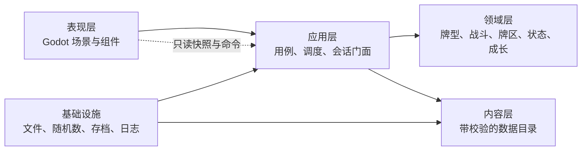

# 组合出招纵切代码架构审计

日期：2026-08-06
范围：`combo_duel_vslice/` 当前全部脚本、数据与测试
设计依据：`godot/docs/design-current/README.md` v0.30

> **2026-08-07 状态更新**
>
> 本文档记录 2026-08-06 的审计快照，下列结论已被后续改造推进，正文保留原判断以
> 便追溯：
>
> - 「P1：运行时字典契约仍缺少类型边界」—— core 与表现层之间的快照边界已完成
>   类型化。`BattleSnapshot`、`RunSnapshot` 与新增的 `BattleSideSnapshot` 改为
>   显式字段，`value(key, default)` 与 `section(key)` 已删除而非保留兼容。
>   S0 又在基线 `0555d0f` 完成 `CommandResult`、`RunProgressSnapshot`、`BattleEvent`、
>   `RunEvent` 与 `AiConversationSnapshot` 的当前边界类型化；旧 `BattleCommandResult`
>   已删除。规则结算层尚未形成稳定边界的内部字典不在本次清零范围。
> - 「P2：大型脚本式 UI 难维护」—— 表现层转发层已消除，`BattleValuePanel` 与
>   `ContentFailurePage` 已抽出组件，`ui/main.gd` 从 856 行降至 713 行。
> - 内容加载失败的静默降级已消除：组合根内容未通过校验时拒绝创建会话，
>   `BattleEffectPorts` 的四个依赖改为必需，删除全部 null 兜底分支。
> - `ContentValidator` 的效果规格校验已拆到 `EffectSpecValidator`。
> - 状态行为已采用数据绑定与小型处理器注册；`BattleEffectPorts._sides` 只由端口内部
>   持有，外部代码通过公开窄查询访问。
> - S0 最终验收已通过，当前执行阶段为 S1；大型战斗核心瘦身、状态系统继续拆分、
>   UI／美术、测试拆分和文档维护继续保留在长期轨道。
>
> 当前流程、门禁与剩余债务见 `docs/development-workflow.md`。

## 结论

### 高牌公共接口扩展（2026-08-12）

高牌池接入新增了可复用的 `HandGroupSnapshot` 冻结快照：分别保存实际打出、计值牌、额外牌、冻结基础值、当前有效值、可视属性、同气交集和实际成功打出时牌集合；主组与协同组不共享快照。`EffectValueResolver`、`EffectTargetQuery`、`DamageEffectHandler` 和 `CollectionEffectHandler` 通过稳定查询／捕获协议读取这些事实，不按功法 ID 分支。

行动事务新增 `BattleTimingSystem.ACTION_RESOLUTION_END`。`BattleEffectPorts` 在单方或同步行动开始／完成边界统计双方实际伤害、生命损失与防御损失；镇山只消费该次结果。自然防御衰减保留、反震来源 token、延迟 P₀/P 与目标捕获、临时普通真气、牌库检视／重排和条件真伤均通过公共端口完成。

高牌形成前修正由 `ActionPreviewService.recalculate_confirmed_power` 在正式确认边界重建快照并冻结随机目标，固定修正经 `PowerCalculator.apply_direct_power_fixed` 进入最终 P，不改变 P₀、C、M 或牌型基准值。预览只读，不推进正式 RNG；同组重触沿用已冻结值。

当前项目具备合格的纵切架构基础，但尚未达到适合长期承载完整功法池、完整三层内容和大量状态组合的生产架构。

功法规模必须使用两套不混淆的口径：v0.30 当前三个权威功法池模块分别记录风林蛊毒
29 门、风运转 38 门、火反击 40 门活跃候选；当前 Godot 运行数据是 9 门纵切测试样本。
当前架构工作的目标是根据完整设计审计通用能力，建立可承载条件、时点、效果、目标、延迟、
多段与特殊流程的数据平台；本阶段不逐门录入其余候选，也不继续创作替代功法。

- 纵切阶段适用性：良好。
- 规则核心可测试性：良好。
- 数据驱动程度：良好。
- 模块边界清晰度：中等。
- UI 与战斗／本局核心解耦：良好。
- 面向完整内容规模的可扩展性：中等。
- 综合判断：`9.0 / 10`，属于“战斗与本局表现边界、统一内容契约、真气实例身份、重塑／异状生命周期、效果能力注册、行动解析和远程 AI 协议边界已经形成，战斗回合中心职责仍需继续收口”的架构。

“现代游戏架构”没有唯一固定形式。对当前项目最合适的目标不是引入大型框架或全局事件总线，而是保持 Godot 场景层轻量、规则层纯净，并建立清楚的依赖方向：

领域层不应依赖 UI、场景树或文件路径；UI 不应直接修改战斗与本局对象内部字段。

## 当前已有模块

### 1. 真气与牌型规则

- `qi_card.gd`：真气实例；分离基础定义 ID 与唯一实例 ID，并分别记录本局重塑（强化、品相、印记、其他）、战斗异状（标记、毒、状态、其他）及净化暂存区。
- `deck_factory.gd`：从基础牌组数据创建 52 张真气。
- `card_instance_id_factory.gd`：为复制或生成的同定义真气分配确定性唯一实例 ID。
- `qi_card_instance_data.gd`：版本化真气实例 DTO，区分本局持久数据和可选战斗临时数据，并通过统一目录校验全部引用。
- `card_state_lifecycle.gd`：读取状态定义中的生命周期策略，统一执行实际进入弃牌堆和战斗结束清理。
- `hand_evaluator.gd`：九种牌型识别和参与牌选择。
- `power_calculator.gd`：基础值、牌型基准值和功法值计算。

评价：边界清楚、基本无 UI 依赖，是当前最健康的模块组。定义身份、实例身份、状态持续层和本局完整牌组已经分开，牌型识别与数值计算使用静态纯函数，适合确定性测试。真气生命周期由 `CardStateLifecycle` 提供兼容底座，并由 `StatusSystem` 作为正式战斗入口统一调用。

### 2. 战斗参与方与牌区

- `battle_side.gd`：生命、防御、四个牌区、层数、内功、功法库与消耗品。

评价：牌区操作集中是正确方向，但该对象同时承担战斗属性、背包、装备和成长数据，随着系统增加会变成第二个中心对象。

### 3. 功法、内功、消耗品与结算

- `content_catalog.gd`：统一加载十二份版本化内容，建立内容索引并提供深复制查询。
- `content_validator.gd`：集中校验必填字段、类型、ID、52 张真气、角色状态、重塑／异状类别与容量、标记生命周期、功法池、序列、操作码、递归数值规格和跨文件引用。
- `game_composition_root.gd`：应用组合根；创建共享内容目录、日志、初始构筑仓库、构筑装配器和战斗会话工厂，再为每局创建独立导航、成长和节点调度实例。
- `technique_definition.gd`、`technique_instance.gd`：所有功法共用的内容实体和运行时实例类型。
- `techniques.json`：独立功法资源清单与共用池映射；不再保存功法正文。
- `data/techniques/*.tres`：每门功法一个独立文件，当前 9 门可执行纵切样本从这里加载。
- `starter_builds.json`：当前唯一构筑显式声明 52 个基础真气 ID；`StarterBuildAssembler` 将其装配为 `RunDeck`，不再把构筑 ID 只当作快照标签。
- `node_rewards.json`：注册可扩展奖励类型，并只录入已确认的普通、精英、Boss 基础历练。
- `battle_statuses.json`：角色战斗状态定义；声明叠层、清理时点、数值修正与事件行为，不由战斗流程按状态 ID 分支。
- `card_states.json`：统一定义重塑、异状、单槽／多实例容量、标记生命周期、运行时身份修正与触发处理器。
- `technique_repository.gd`、`inner_skill_repository.gd`、`consumable_repository.gd`、`starter_build_repository.gd`：消费已校验定义并提供领域查询；独立文件读取仅作为兼容入口保留。
- `starter_build_assembler.gd`、`battle_session_factory.gd`：分别隔离构筑到本局牌组的装配和战斗会话的依赖创建。
- `reward_bundle.gd`、`node_reward_service.gd`：分别保存版本化待领取奖励并把整包交给一个本局原子事务；服务不按奖励类型或操作 ID 分支。
- `run_effects/`：战斗外本局效果的 Handler 协议、唯一注册表、事务上下文与完整成长库存工作副本；当前正式注册 `gain_experience` 和平台探针 `heal_life`。旧 `rewards/` 脚本只保留为路径兼容门面，不维护第二套分派。
- `sequence_book.gd`：精确牌型独立功法序列。
- `effect_executor.gd`：统一执行与预览汇总的 43 行兼容门面。
- `effects/technique_effect_context.gd`、`effects/battle_effect_ports.gd`：类型化功法上下文与窄修改端口；正式处理器通过伤害、牌区、状态、流程能力访问战斗，不再从上下文字典取得完整引擎。
- `effects/effect_target_query.gd`、`battle_choice_request.gd`：统一目标阵营、牌区、顺序、筛选、冻结候选、数量边界和目标不足策略；玩家与敌方效果使用同一选择结果契约。
- `effects/technique_effect_continuation.gd`、`technique_effect_result.gd`：统一成功、失败与等待选择结果，保存效果下标、已完成结果和上下文引用并从原位置恢复。
- `effects/effect_handler_registry.gd`：操作码到能力处理器的注册、重复保护与未知操作拒绝。
- `effects/`：伤害、防御、牌区、真气异状、层数、流程／延迟六类处理器及共用数值解析器。
- `trigger_queue.gd`：同一时点排序与结算，并写入战斗日志通道。
- `game_log.gd`：统一结构化日志记录、稳定序号、通道过滤和只读副本；战斗、本局与系统日志共用契约但保持语义隔离。

评价：功法没有按名称硬编码进战斗控制器，目录会在进入玩法前拒绝内容拼写、引用和操作码错误。原中央 `match op` 已拆成七类能力处理器，新增操作不必继续扩大单一解释器。Technique Runtime v1 已移除正式处理器对完整引擎上下文的依赖，并完成目标筛选、候选冻结、玩家／AI 共用选择结果契约、触发队列暂停及战斗行动事务恢复。`BattleEffectPorts` 现在只持有伤害解析器、状态系统、行动流和触发队列；`ActionResolver` 通过该端口完成同步伤害和牌上异状结算，`StatusSystem` 也不再弱引用完整 `CombatEngine`。初始构筑现在由 `StarterBuildAssembler` 真正生成 `RunDeck`；组合根统一内容、日志和会话工厂。剩余风险是预览尚不能表达交互选择后的多分支结果，且 continuation 目前只支持战斗内存恢复，尚未进入中途存档。

### 4. 战斗会话、敌方与测试场景

- `battle_session.gd`：应用层战斗门面，接受结构化命令并提供快照和事件流。
- `battle_command_dto.gd`、`command_result.gd`：统一战斗命令输入，以及战斗／本局会话跨 core 边界共用的类型化命令结果。
- `battle_snapshot.gd`：供表现层读取的深复制状态快照。
- `battle_event.gd`：从触发历史和命令拒绝产生的结构化事件。
- `action_preview_service.gd`：独立完成选牌校验、牌型与功法值、功法条件、内功预计效果和公开意图，不依赖 UI 或场景树。
- `hand_result_dto.gd`、`action_preview_dto.gd`：牌型结果与行动预览的 v1 类型化运行时契约；领域服务可直接取得 DTO，旧战斗门面继续通过 `to_dict()` 提供兼容字典。
- `action_resolver.gd`：独立编排牌型组三阶段触发、左右顺序、效果队列、牌上烈毒与蛊印回库、待出区提交和结算日志；只依赖 `BattleEffectPorts` 与行动记录，序列推进注册为牌型组结束处理器。
- `same_qi_rule.gd`：纯查询每组普通真气的有效属性身份全体交集与 `0/10/20/30/50%` 同气增幅，并组合冻结后的组结果建立行动级同气连动事实。
- `battle_action_service.gd`：统一编排玩家单方、敌我同步与敌方单方的行动事务，负责提案锁定、待出区提交、功法选择暂停／恢复和结算完成后的同气连动／其他连击推进；不生成内容或决定胜负。
- `battle_pending_action_transaction.gd`：保存等待功法选择时的可恢复行动事务，区分玩家单方、敌方单方和敌我同步三种形态，并提供版本化快照。
- `damage_resolver.gd`：独立完成普通伤害、真伤、连势增伤、防御／生命扣减、同步伤害 shadow 和攻击段存活判断，不依赖触发队列或 UI。
- `status_system.gd`、`status_change.gd`、`statuses/status_behavior_registry.gd`：统一敌我角色层数、真气异状、延迟快照、战斗时点清理和结构化状态变化历史；状态定义绑定通用处理器，复杂事件顺序留在注册处理器中，中央系统不再点名具体状态 ID。
- `battle_action_proposal.gd`：统一玩家、脚本敌人和策略敌人的 v1 选牌提案 DTO，不包含实际结算权限。
- `battle_action_record.gd`：统一实际行动执行记录 DTO，保存参与方、牌型预览、顺序、回合、触发状态和捕获表；内部结算仍可通过属性访问，日志使用 `snapshot()`。
- `battle_timing_event.gd`、`battle_timing_system.gd`：统一十类战斗生命周期边界，以 `order + 注册序号` 调度处理器并保存结构化时点历史；战斗快照可读取该历史，内建处理器采用弱目标引用避免与战斗核心形成引用环。
- `battle_round_service.gd`：承接回合开始、战斗开始时点、双方补牌、行动窗口、回合结束和外部敌方行动收束；通过少量回调连接敌方行动与胜负更新，不复制战斗结算规则。
- `battle_consumable_service.gd`：负责消耗品获得、目标校验、心得／功法获取、强化和品相效果；`CombatEngine` 只保留兼容入口。
- `battle_outcome_service.gd`：负责胜负状态、战斗结束时点、终局行动清零、敌方锁定清理和一次性战斗结束日志。
- `battle_observation.gd`：限制策略控制器可见信息，不公开对方手牌内容或任一牌库顺序。
- `player_action_controller.gd`、`enemy_action_controller.gd`：分别生成玩家与敌方行动，但共同复用 `ActionPreviewService` 并输出相同提案。
- `battle_setup_service.gd`：统一装配内容仓库、标准牌组、初始功法库与脚本场景；同时保留本局成长快照到战斗、战斗结果回写本局的边界。
- `enemy_action_planning_service.gd`：统一敌方观察、脚本／Utility／远程候选、本地复核、行动锁定和公开计划投影，不执行出牌结算。
- `combat_engine.gd`：战斗组合根与兼容门面；回合、行动事务、消耗品、胜负、战斗建立、敌方规划、预览、伤害及状态分别委托领域服务。
- `enemy_combat_ai.gd`：枚举选牌，按硬优先级和数据驱动 Utility 特征评分；当前包含连击后续手牌机会成本，但尚未建立完整状态克隆和两回合搜索。
- `ai/enemy_candidate_features.gd`、`enemy_candidate_feature_projector.gd`：把本地完整合法提案转换为一步战略画像，聚合即时伤防、牌流、剩余手牌、真气状态和被动来源明细。
- `ai/enemy_ai_value_query_service.gd`、`enemy_card_state_value_provider.gd`：提供 `ai_action_value_query`、`ai_card_play_value_query`、`ai_card_retention_value_query` 纯查询端口；默认零贡献并验证不修改战斗、卡牌、计数器或 RNG。
- `ai/enemy_candidate_dominance_filter.gd`、`enemy_candidate_direction_classifier.gd`、`enemy_candidate_reducer.gd`：依次执行关键候选保护、严格帕累托淘汰、六方向代表和 MMR 去相似，把完整集合压缩为 1～5 项；第一版只做一步启发式未来估值。
- `ai/enemy_intent_public_projector.gd`：把压缩记录投影为冻结顺序的玩家“可能意图”，去除候选 ID、手牌实例、评分、隐藏计数和选中状态。
- `scripted_battle_scenario.gd`：确定性测试敌人和牌库配置。
- `ai/ai_battle_context.gd`、`ai_decision_observation.gd`：版本化远程 AI 战斗上下文与单窗口观察；递归移除对手隐藏手牌、牌库顺序、选牌草稿和随机种子。
- `ai/ai_history_projector.gd`、`ai_history_compactor.gd`：把统一日志／战斗事件投影为公开历史，递归脱敏隐藏随机目标，并按默认五个完整回合建立确定性工作摘要；本地完整事件不删除。
- `ai/ai_candidate.gd`、`ai_response_validator.gd`、`ai_decision_gateway.gd`：公开本地合法候选的主组与协同组，只接受匹配协议版本、决策 ID、状态哈希和候选 ID 的回答；非法回答可以携带结构化纠错重试，成功后只返回候选绑定的 `BattleActionProposal`。
- `ai/ai_battle_conversation.gd`、`ai_conversation_snapshot.gd`、`ai_conversation_store.gd`：积压无敌方行动窗口的公开历史，保存请求、回答、摘要和 Provider epoch，并在编码时递归移除凭据；持久化结果只用于单次战斗尝试的审计与回放，不作为战斗续接状态。
- `ai/ai_settings_service.gd`：文件配置基础设施；自动生成并读取 `user://ai/ai_settings.cfg`，隔离含密钥运行配置与无密钥公开快照。
- `ai/action_window_ai_coordinator.gd`：应用层异步窗口状态机；统一思考、确认门禁、超时取消、远程候选锁定、本地复核和同集合 Utility 降级。锁定后只公开“已准备”，不投影实际选择。
- `ai/battle_ai_adapter.gd`：战斗核到 AI 协议的适配器；组装上下文、观察、状态哈希、压缩后的主组／协同组候选、冻结可能意图与公开历史，避免 `BattleSession` 同时承担 DTO 投影。完整候选不会进入远程请求。
- `ai/providers/`：Provider 端口、确定性 Mock、运行设置、工厂与通用 OpenAI Chat Completions HTTP 适配器；默认 DeepSeek Flash，允许覆盖兼容端点、模型和厂商附加参数，凭据只进入运行时认证头。当前由本机配置文件代替设置页，Anthropic 协议适配器不在当前范围。

评价：逻辑可脱离 UI 运行，随机源可注入种子，这是明显优点。第七轮已完成远程 AI 协议与行动窗口接入：`BattleSession` 只决定何时开窗、门禁和推进单方行动，协议状态由 `ActionWindowAiCoordinator` 管理，观察与候选组装由 `BattleAiAdapter` 管理。回合生命周期已移至 `BattleRoundService`，行动事务已移至 `BattleActionService`，消耗品与终局清理已移至 `BattleConsumableService`、`BattleOutcomeService`，战斗建立与敌方规划已分别移至 `BattleSetupService`、`EnemyActionPlanningService`，远程 Provider 没有进入战斗领域层。`combat_engine.gd` 现在主要作为服务组合根、效果端口实现和旧调用兼容门面。

### 5. 地图、本局与节点内容

- `map_generator.gd`：确定性路线与房间类型生成。
- `run_state.gd`：组合地图导航与成长库存的兼容门面。
- `run_session.gd`：本局应用层门面，统一建局、节点、奖励领取、Boss 宝箱、修习、跨战斗成长同步、节点调度和结构化日志。
- `run_snapshot.gd`：地图／修习表现层使用的深复制只读投影。
- `run_event.gd`：建局、节点、修习、成长同步与命令拒绝的一次性事件。
- `map_navigation_service.gd`：独立管理地图状态、可达节点、节点开始／完成与换层。
- `growth_inventory.gd`：独立管理历练、构筑库存、修习购买和成长导入导出。
- `run_progress_snapshot.gd`：战斗与本局之间的深复制成长 DTO，消除两个会话之间的领域对象传递。
- `node_dispatcher.gd`、`node_dispatch_result.gd`：将节点和本局上下文转换为 v1 调度结果 DTO；旧本局门面继续通过 `dispatch()` 转换为字典。
- `reward_bundle.gd`、`node_reward_service.gd`：建立确定性奖励包和一次性发放边界；节点完成后进入 `awaiting_reward`，领取后才推进地图或 Boss 宝箱。
- `map_rules.json`、`node_content.json`：地图规则和节点内容映射。

评价：地图生成已与 UI 分离。地图和修习 UI 不再访问 `run_state.gd`；节点调度、奖励领取与修习定价均由本局会话校验。`RunSession` 从统一目录装配地图、节点、奖励与修习，并创建共享同一目录的战斗会话。奖励生成与成长写入不在 UI 或地图导航中完成，重复领取会被拒绝。`MapNavigationService` 与 `GrowthInventory` 已把路线和成长职责拆开，`RunState` 只保留兼容组合门面。

### 6. 表现层

- `run_main.gd`：大地图、修习、节点页面、战斗场景挂载。
- `map_view.gd`：地图绘制与命中测试。
- `main.gd`：完整战斗界面、输入和刷新。
- `qi_card_view.gd`、`felt_background.gd`：可复用卡牌和背景组件。

评价：已有少量可复用组件，但主要页面仍以单个脚本动态创建全部控件。战斗 UI 对 `engine`、地图 UI 对 `run_state` 的直接访问都已降至 0；状态读取使用深复制快照，修改通过会话命令。

### 7. 测试

- `tests/test_runner.gd`：133411 条确定性断言，覆盖内容契约、初始构筑真实牌组装配、组合根依赖复用、真气定义／实例身份、角色状态、重塑／异状容量、重塑开战生成异状、真实牌区弃牌清理、净化暂存／替换／恢复生命周期、延迟快照与状态历史、版本化实例 DTO、效果处理器注册、牌型、数值、行动解析、伤害、日志、快照、功法、本地／远程 AI 协议、DeepSeek／OpenAI 兼容 Provider 合同、异步窗口门禁、超时降级、战斗、地图、修习、调度、本局会话、奖励包生成、奖励领取门禁、重复领取保护和成长传输边界。

评价：覆盖面和确定性很好，是当前重构的安全网。缺点是 1558 行测试集中在一个文件中，运行时脚本错误可能发生在最终 PASS 输出之前，因此仍必须扫描 Godot 日志。

## 客观耦合指标

- `combat_engine.gd`：约 670 行；保留兼容 API 与服务组合，不依赖 Provider 或远程协议；效果能力通过 `BattleEffectPorts` 暴露。
- `battle_effect_ports.gd`：约 170 行；组合伤害、状态、牌区、行动、延迟和触发日志的最小修改端口。
- `battle_setup_service.gd`：约 100 行；集中内容仓库、标准牌组、脚本场景与跨战斗成长装配。
- `enemy_action_planning_service.gd`：205 行；集中敌方候选生成、复核、锁定和公开计划投影。
- `battle_action_service.gd`：414 行；集中玩家单方、敌我同步、敌方单方及可恢复选择的行动事务，避免三套提交与连击规则留在兼容门面。
- `battle_consumable_service.gd`：135 行；集中消耗品目标校验和数据效果执行。
- `battle_outcome_service.gd`：119 行；集中胜负判定和一次性战斗结束清理。
- `status_system.gd`：440 行，统一角色状态、真气异状、延迟记录、状态历史与四个战斗时点处理器。
- `action_resolver.gd`：集中三阶段触发、牌上毒异状、待出区提交和序列推进，并在统一日志替换时同步重绑可见触发队列。
- `effect_executor.gd`：由 229 行中央分支降为 43 行门面；六类处理器与注册表合计约 400 行，职责按能力隔离。
- `action_preview_service.gd`：118 行，集中行动预览的纯规则编排。
- `hand_result_dto.gd`、`action_preview_dto.gd`：牌型与行动预览的 v1 DTO；只在兼容边界转换为字典。
- `battle_action_proposal.gd`、`battle_action_record.gd`、`node_dispatch_result.gd`：行动提案、实际行动记录和节点调度结果的 v1 DTO。
- `battle_command_dto.gd`、`command_result.gd`、`battle_pending_action_transaction.gd`：战斗命令、跨会话命令结果和待恢复行动事务的 v1 DTO。
- `damage_resolver.gd`：140 行，集中普通／真伤、同步缓冲与攻击段存活规则。
- `game_log.gd`：90 行，统一战斗／本局／系统日志结构和查询边界。
- `battle_session.gd`：约 550 行，包装命令、预览、只读快照、日志、事件流、成长 DTO 与 AI 窗口编排；AI DTO 投影已拆到 225 行的 `BattleAiAdapter`。
- `battle_round_service.gd`：约 180 行，承接回合生命周期；只通过回调触发敌方行动、胜负更新和表现层状态通知。
- `action_window_ai_coordinator.gd`：313 行，独立管理异步请求状态、门禁、超时、降级和会话结果。
- `main.gd`：1395 行，对 `engine` 的直接成员访问已由约 104 次降至 0。
- `run_session.gd`：约 430 行；包装本局命令、快照、事件、节点调度、核心定价和统一日志；基础依赖由组合根注入，默认构造仅保留兼容入口。
- `map_navigation_service.gd`：101 行；只管理地图导航与阶段。
- `growth_inventory.gd`：86 行；只管理经济和构筑成长。
- `run_state.gd`：136 行；组合两项领域服务并保留兼容属性。
- `run_progress_snapshot.gd`：16 行；负责成长数据深复制边界。
- `run_main.gd` 与 `map_view.gd`：对 `run_state` 的直接成员访问 0 次。
- `front_main.gd`：主菜单和初始构筑选择的 UI 适配器；从组合根读取构筑定义，确认后显式初始化注入依赖的 `RunMain`，避免同帧场景 `_ready` 时序造成未建局快照。
- `starter_build_repository.gd`：初始构筑查询边界；构筑定义来自 `ContentCatalog`，当前仅验证和提供 `standard_52`，不在控制器里硬编码牌组内容。
- 核心和 UI 脚本仍有大量字典 `.get()`；内容定义已在统一入口校验，但运行时命令、效果上下文与 DTO 仍需逐步收紧。
- 十二份内容文件已经由一个目录一次性加载和交叉校验；各仓库的文件读取仅为兼容入口，不再用于正式战斗／本局装配。

这些数字不单独代表错误，但共同说明当前依赖主要围绕少数中心对象和弱类型数据契约组织。

## 主要问题与风险排序

### 已完成：AI 信息协议 v3 与私有调优证据链

`BattleAiAdapter` 不再以少量手工字段和运行时 `hash()` 建立请求。`AiContentSemanticProjector` 只投影本场引用内容，`AiBattleStateProjector`／`AiVisibilityPolicy` 建立唯一敌我可见状态，`AiStableValueEncoder` 以规范 JSON + SHA-256 负责内容和决策指纹，`AiPublicThreatEstimator` 以公开构筑与历史为 F6B 保命画像提供非作弊近似。公开历史由白名单投影和状态差量组成，五回合压缩保留最近四次行动时序。

会话和调优数据物理分离：`user://ai/conversations/` 只保存发送给模型的公开上下文、历史、请求响应与规范化审计；`user://ai/traces/` 保存 F6B 完整候选诊断、公开／诊断候选映射、选择和实际结果，绝不进入远程请求、玩家快照或正式存档。`tools/run_ai_trace_report.gd` 只读汇总轨迹，空目录和损坏文件均有结构化结果。后续候选权重必须参考诊断、离线报告和试玩，不能只凭总胜率修改。

### 已完成 P0：战斗效果编排端口收窄

`CombatEngine` 的回合、行动、消耗品、终局、建立与敌方规划职责已经迁出；本轮已将 `ActionResolver` 和 `BattleEffectPorts` 与完整 `CombatEngine` 解耦。端口现在只组合以下能力：

- 同步伤害开始／刷新；
- 牌上真气异状结算；
- 角色状态与真气状态修改；
- 额外行动、延迟效果和结构化触发日志。

当前不需要继续增加一层全局事件总线。下一步应把牌型结果、预览、节点调度和应用命令中的运行时字典逐步替换为版本化 DTO，并为 DTO 增加字段契约测试。

### 已缓解：本局牌组已成为权威状态

`GrowthInventory` 已持有完整 `RunDeck`，不再使用基础真气 ID 到少量字段的 `deck_modifiers`。`RunDeck` 保存 `QiCardInstanceData v3` 列表、实例 ID 序列及全部重塑；`BattleSetupService` 从它创建独立战斗实例，并在战后同步已知实例、新增的非临时实例和明确登记的永久移出，异状不会进入本局快照。

牌区移动现已收口到 `CardZoneService`；`BattleSide` 只保留兼容门面。永久删除、燃尽、临时夺取、归还和战斗内生成均有独立接口，不能靠“战斗结束时没在四个牌区”推断永久删除。敌方基础真气使用独立战斗实例命名空间，脚本场景继续按定义 ID 指定内容，避免跨阵营夺取后与玩家实例 ID 冲突。

### P1（进行中）：运行时字典契约仍缺少类型边界

静态内容定义已经统一校验；功法效果上下文、牌型结果、行动预览、行动提案、实际行动记录、节点调度结果、待恢复行动事务以及战斗命令输入／结果已建立类型化对象。`ActionPreviewService.preview_dto()` 以 `ActionPreviewDto v1` 为正式结果，`ActionResolver` 使用 `BattleActionRecord v1`，`NodeDispatcher.dispatch_dto()` 使用 `NodeDispatchResult v1`，`BattleSession.execute_dto()` 使用命令 DTO；现有调用通过兼容方法转换为字典，因此没有一次性破坏战斗、AI 和 UI。剩余奖励、地图命令和部分效果结算结果仍以字符串字典传递，拼写错误、缺失字段与错误类型仍可能到执行时才暴露。

### 已缓解：效果执行器中央大分支

15 个当前操作码已注册到七类能力处理器，未知操作与重复注册会明确失败。处理器修改状态已通过窄端口，不再直接获得完整 `engine`；通用目标查询与可恢复选择协议已经建立。后续应逐步减少处理器对完整 `BattleSide` 读取面的依赖，并把细粒度攻击、受击响应和通用延迟统一为事件驱动的注册协议。

### P2：大型脚本式 UI 难维护

两个主页面把布局创建、样式、输入、展示转换和场景流程写在同一脚本中。后续卡图、动画、响应式布局和多分辨率适配会放大维护成本。

### P2：测试组织和存档边界尚未建立

测试应按领域、战斗、地图、内容契约和 UI 集成拆分。完整单局还需要节点入口存档 DTO 与版本迁移测试；战斗中间状态已确认不保存或恢复。

## 建议补齐的目标模块

### 内容与基础设施层

- `ContentCatalog`：已建立第一版，统一持有并索引当前十二份内容。
- `ContentValidator`：已建立第一版，校验版本、必填字段、ID、重塑／异状容量与生命周期、引用、功法池、操作码和数值规格。
- `QiCardInstanceData`：已建立第一版，为之后的 `RunDeck`、存档和回放提供版本化实例边界。
- `ContentLoader`：当前文件读取仍在目录内部；内容来源扩展到资源包或 Mod 之前无需单独抽象。
- `RandomSource`：包装固定种子及派生种子，避免各模块自行设计混种公式。
- `SaveRepository` 与版本化 `RunSaveData`：负责单局保存、读取和迁移。

### 战斗领域与应用层

- `BattleSession`：已经建立第一版；战斗 UI 现只使用命令、预览、只读快照、日志与事件流。
- `BattleSetupService`：已建立第一版；根据本局成长快照与 `RunDeck` 建立玩家牌组和成长装配，并捕获战后本局进度。
- `ActionPreviewService`：已经建立，负责牌型、数值、功法条件、内功预计效果与公开意图。
- `ActionResolver`：已经建立第一版，负责牌型组、触发时点、牌上毒异状、牌区移动和序列推进。
- `BattleActionService`：已建立第一版；负责行动提案到牌区提交的事务、单方／同步结算、连击推进和功法选择恢复，`CombatEngine` 只保留兼容调用。
- `ActorTurnState + BattleFlowCoordinator`：已建立第一版；通用管理参与者行动资格、行动次数、当前／后续禁用、零合法手牌放弃、连击占用、意图锁定，以及单方／同步结算模式。
- `BattleRoundService`：已建立第一版；承接战斗开始、回合开始／结束、正常补牌、行动窗口和外部敌方回合收束，`CombatEngine` 保留兼容门面。
- `BattleConsumableService`：已建立第一版；负责消耗品获得、目标校验、强化／品相／心得效果和功法获取。
- `BattleOutcomeService`：已建立第一版；负责胜负判定、战斗结束时点、行动清零和一次性清理。
- `BattleTimingSystem`：已建立第一版，统一十类生命周期时点、稳定处理器顺序、结构化历史、延迟到期、序列推进和战斗结束清理。
- `DamageResolver`：已建立第一版，负责普通伤害、真伤、连势、同步缓冲与攻击段存活判断；受击响应仍由 `StatusSystem`／`ActionResolver` 协调。
- `StatusSystem + StatusChange + StatusBehaviorRegistry`：已建立第一版，统一角色状态、真气异状、延迟记录、状态变化历史和战斗结束清理；角色状态与真气异状通过内容定义绑定处理器及数值修正，新增复杂公共状态只增加小型注册处理器，不回填中央状态分支。
- `EffectHandlerRegistry`：已建立第一版，按 `op` 注册六类小型处理器，效果数据继续保持数据驱动。
- `BattleSnapshot`：已经建立第一版，覆盖生命、牌区、公开计划、卡牌、内功、消耗品、预览、日志和行动状态；后续以有校验的 ViewModel 逐步替代裸字典。
- `AiBattleConversation + AiDecisionGateway + AiProvider`：已经建立第一版；负责脱敏公开信息、历史增量与压缩、合法候选选择、纠错、持久化和 Provider 适配，不拥有战斗状态。
- `ActionWindowAiCoordinator + BattleAiAdapter`：已经建立并接入 `BattleSession`；每个实际行动窗口独立请求，无敌方机会时只积压历史，玩家确认受门禁保护，超时／非法失败切换本地 Utility，敌方单方连击继续开启下一窗口。

### 本局与地图应用层

- `RunSession`：已经建立第一版；本局门面、状态机、命令、事件和日志边界。
- `MapNavigationService`：已经建立第一版；负责可达节点、开始节点、完成节点与换层。
- `NodeDispatcher`：已经建立，继续只返回调度结果。
- `RewardBundle + NodeRewardService + RunMutationService`：负责基础节点奖励包、领取门禁与整包原子提交；操作由 `RunEffectHandlerRegistry` 统一分派。节点奖励完成后由本局会话统一结算功行生息，奖励服务本身不复制经济算法。
- `GrowthInventory`：已经建立第一版；负责历练、功法库、消耗品、完整 `RunDeck` 和修习购买记录。
- `RunDeck`：已经建立第一版；负责完整本局真气实例、复制、永久移出、快照校验、战斗实例化与跨战斗同步。
- `CardZoneService`：已经建立第一版；统一牌区移动、弃牌生命周期、临时移出、夺取归还、生成与永久移出登记。
- `PracticeService`：报价、购买、冥想、刷新与容量校验。
- `RunSnapshot`：已经建立第一版，供地图和修习 UI 只读展示。

### 表现层

- `RunController` 与 `BattleController`：把按钮输入转换为应用层命令。
- `RunPresenter` 与 `BattlePresenter`：把快照转换成界面文本和可见状态。
- 独立场景组件：生命条、状态栏、牌区、功法槽、消耗品槽、触发队列、修习商品卡、节点占位页。
- 共享 `Theme` 资源：统一颜色、边框、字号和按钮状态，减少页面内重复 `_box()`。

## 推荐演进顺序

1. `ActionPreviewService`、`DamageResolver`、`BattleRoundService`、`BattleActionService`、`BattleConsumableService`、`BattleOutcomeService`、`BattleSetupService`、`EnemyActionPlanningService` 与 `BattleEffectPorts` 已完成第一版；行动预览、提案、行动记录、节点调度、待恢复事务和战斗命令 DTO 已建立，下一步收紧奖励与地图应用命令契约。
2. `RunSession`、`RunSnapshot`、`RunEvent`、`MapNavigationService`、`GrowthInventory` 与 `RunProgressSnapshot` 已完成第一轮。
3. `ContentCatalog + ContentValidator` 已完成第一版；后续新增内容类型必须先扩展目录契约与失败测试，再批量录入。
4. 效果处理器注册表与六类能力分组已完成第一版。
5. 真气内容骨架、定义／实例身份、重塑／异状生命周期、版本化 DTO、`RunDeck` 与 `BattleSetupService` 已完成第一版；完整本局牌组现为跨战斗权威状态。
6. `CardZoneService` 已完成第一版，普通弃置、明确弃掉、回收、蛊印回库、燃尽、临时夺取、归还、永久移出和战斗内生成现有统一语义，并接入 `RunDeck` 同步边界。
7. “战斗系统收口包”的通用行动调度、行动生成分层、`BattleTimingSystem` 与 `StatusSystem` 已完成第一版；敌我共享资源、预览、时点、状态与结算核，玩家输入、脚本敌人与 Utility AI 使用独立控制器。
8. 独立远程 AI 协议、应用层行动窗口门禁、本地复核、超时降级和 Mock 端到端闭环已完成第一版。
9. DeepSeek 默认设置、通用 OpenAI Chat Completions HTTP Provider、稳定战斗提示词和凭据隔离已完成第一版；下一步建立玩家 AI 设置页与非凭据配置持久化，再进行用户授权的真实网络联调。
10. 战斗 AI 会话的脱敏审计落盘已经完成；下一阶段按系统纵向推进正式功法、内功、物品与修习接口，UI 组件、回放和测试拆分随对应产品系统推进。

这个顺序允许每一步都由现有确定性测试保护，并避免为了追求架构形式而中断可玩纵切。
