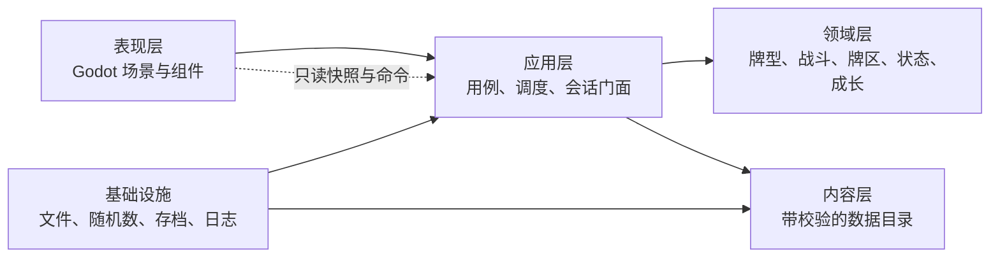

# 组合出招纵切代码架构审计

日期：2026-08-05
范围：`combo_duel_vslice/` 当前全部脚本、数据与测试
设计依据：`godot/docs/combo-duel-current.md` v0.27

## 结论

当前项目具备合格的纵切架构基础，但尚未达到适合长期扩展完整三层内容、110 门以上功法和大量状态组合的生产架构。

- 纵切阶段适用性：良好。
- 规则核心可测试性：良好。
- 数据驱动程度：良好。
- 模块边界清晰度：中等。
- UI 与战斗／本局核心解耦：良好。
- 面向完整内容规模的可扩展性：中等。
- 综合判断：`9.0 / 10`，属于“战斗与本局表现边界、统一内容契约、真气实例身份、重塑／异状生命周期、效果能力注册、行动解析和远程 AI 协议边界已经形成，战斗回合中心职责仍需继续收口”的架构。

“现代游戏架构”没有唯一固定形式。对当前项目最合适的目标不是引入大型框架或全局事件总线，而是保持 Godot 场景层轻量、规则层纯净，并建立清楚的依赖方向：

领域层不应依赖 UI、场景树或文件路径；UI 不应直接修改战斗与本局对象内部字段。

## 当前已有模块

### 1. 真气与牌型规则

- `qi_card.gd`：真气实例；分离基础定义 ID 与唯一实例 ID，并分别记录本局重塑（强化、品相、印记、其他）、战斗异状（标记、毒、状态、其他）及净化暂存区。
- `deck_factory.gd`：从基础牌组数据创建 52 张真气。
- `card_instance_id_factory.gd`：为复制或生成的同定义真气分配确定性唯一实例 ID。
- `qi_card_instance_data.gd`：版本化真气实例 DTO，区分本局持久数据和可选战斗临时数据，并通过统一目录校验全部引用。
- `card_state_lifecycle.gd`：读取状态定义中的生命周期策略，统一执行实际进入弃牌堆和战斗结束清理。
- `hand_evaluator.gd`：九种牌型识别和参与牌选择。
- `power_calculator.gd`：基础值、牌型基准值和功法值计算。

评价：边界清楚、基本无 UI 依赖，是当前最健康的模块组。定义身份、实例身份、状态持续层和本局完整牌组已经分开，牌型识别与数值计算使用静态纯函数，适合确定性测试。真气生命周期由 `CardStateLifecycle` 提供兼容底座，并由 `StatusSystem` 作为正式战斗入口统一调用。

### 2. 战斗参与方与牌区

- `battle_side.gd`：生命、防御、四个牌区、层数、内功、功法库与消耗品。

评价：牌区操作集中是正确方向，但该对象同时承担战斗属性、背包、装备和成长数据，随着系统增加会变成第二个中心对象。

### 3. 功法、内功、消耗品与结算

- `content_catalog.gd`：统一加载十份版本化内容，建立内容索引并提供深复制查询。
- `content_validator.gd`：集中校验必填字段、类型、ID、52 张真气、角色状态、重塑／异状类别与容量、标记生命周期、功法池、序列、操作码、递归数值规格和跨文件引用。
- `battle_statuses.json`：角色战斗状态定义；当前登记蛊印和连势，并声明叠层与战斗结束清理。
- `card_states.json`：统一定义重塑、异状、单槽／多实例容量、标记生命周期和进入弃牌堆的清理策略。
- `technique_repository.gd`、`inner_skill_repository.gd`、`consumable_repository.gd`：消费已校验定义并提供领域查询；独立文件读取仅作为兼容入口保留。
- `sequence_book.gd`：精确牌型独立功法序列。
- `effect_executor.gd`：统一执行与预览汇总的 43 行兼容门面。
- `effects/effect_handler_registry.gd`：操作码到能力处理器的注册、重复保护与未知操作拒绝。
- `effects/`：伤害、防御、牌区、真气异状、层数、流程／延迟六类处理器及共用数值解析器。
- `trigger_queue.gd`：同一时点排序与结算，并写入战斗日志通道。
- `game_log.gd`：统一结构化日志记录、稳定序号、通道过滤和只读副本；战斗、本局与系统日志共用契约但保持语义隔离。

评价：功法没有按名称硬编码进战斗控制器，目录会在进入玩法前拒绝内容拼写、引用和操作码错误。原中央 `match op` 已拆成六类能力处理器，新增操作不必继续扩大单一解释器。剩余风险是处理器仍通过无类型 `Dictionary` 上下文调用完整战斗引擎，端口边界仍偏宽。

### 4. 战斗会话、敌方与测试场景

- `battle_session.gd`：应用层战斗门面，接受结构化命令并提供快照和事件流。
- `battle_snapshot.gd`：供表现层读取的深复制状态快照。
- `battle_event.gd`：从触发历史和命令拒绝产生的结构化事件。
- `action_preview_service.gd`：独立完成选牌校验、牌型与功法值、功法条件、内功预计效果和公开意图，不依赖 UI 或场景树。
- `action_resolver.gd`：独立编排牌型组三阶段触发、左右顺序、效果队列、牌上烈毒与蛊印回库、待出区提交和结算日志；序列推进注册为牌型组结束处理器。
- `damage_resolver.gd`：独立完成普通伤害、真伤、连势增伤、防御／生命扣减、同步伤害 shadow 和攻击段存活判断，不依赖触发队列或 UI。
- `status_system.gd`、`status_change.gd`：统一敌我角色层数、真气异状、烈毒与蛊印续毒、延迟快照、战斗时点清理和结构化状态变化历史；保留 `BattleSide.stacks` 与 `CombatEngine.delayed_effects` 作为兼容读口。
- `battle_action_proposal.gd`：统一玩家、脚本敌人和策略敌人的选牌提案契约，不包含实际结算权限。
- `battle_timing_event.gd`、`battle_timing_system.gd`：统一十类战斗生命周期边界，以 `order + 注册序号` 调度处理器并保存结构化时点历史；战斗快照可读取该历史，内建处理器采用弱目标引用避免与战斗核心形成引用环。
- `battle_observation.gd`：限制策略控制器可见信息，不公开对方手牌内容或任一牌库顺序。
- `player_action_controller.gd`、`enemy_action_controller.gd`：分别生成玩家与敌方行动，但共同复用 `ActionPreviewService` 并输出相同提案。
- `combat_engine.gd`：战斗建立、回合外壳、消耗品、AI 和胜负；行动资格与单方／同步模式、预览、行动解析、伤害及状态分别委托领域服务。
- `enemy_combat_ai.gd`：枚举选牌，按硬优先级和数据驱动 Utility 特征评分；当前包含连击后续手牌机会成本，但尚未建立完整状态克隆和两回合搜索。
- `scripted_battle_scenario.gd`：确定性测试敌人和牌库配置。
- `ai/ai_battle_context.gd`、`ai_decision_observation.gd`：版本化远程 AI 战斗上下文与单窗口观察；递归移除对手隐藏手牌、牌库顺序、选牌草稿和随机种子。
- `ai/ai_history_projector.gd`、`ai_history_compactor.gd`：把统一日志／战斗事件投影为公开历史，递归脱敏隐藏随机目标，并按默认五个完整回合建立确定性工作摘要；本地完整事件不删除。
- `ai/ai_candidate.gd`、`ai_response_validator.gd`、`ai_decision_gateway.gd`：公开本地合法候选的主组与协同组，只接受匹配协议版本、决策 ID、状态哈希和候选 ID 的回答；非法回答可以携带结构化纠错重试，成功后只返回候选绑定的 `BattleActionProposal`。
- `ai/ai_battle_conversation.gd`、`ai_conversation_snapshot.gd`、`ai_conversation_store.gd`：积压无敌方行动窗口的公开历史，保存请求、回答、摘要和 Provider epoch，并在编码时递归移除凭据。
- `ai/providers/`：Provider 端口与确定性 Mock；真实 HTTP、厂商协议和玩家设置尚未实现。

评价：逻辑可脱离 UI 运行，随机源可注入种子，这是明显优点。第一轮门面改造建立命令、只读快照与事件流；第二轮抽出行动预览；第三轮抽出伤害结算；第四轮建立统一日志并让战斗 UI 完全通过会话快照读取状态；第五轮抽出行动解析；第六轮建立战斗时点与状态系统；第七轮建立独立远程 AI 协议、会话和 Provider 边界。`combat_engine.gd` 当前仍承担回合协调、消耗品、本地 AI 和结果，是当前首要架构风险。远程 AI 第一阶段骨架尚未接入战斗窗口，因此没有提前把异步状态塞回战斗引擎。

### 5. 地图、本局与节点内容

- `map_generator.gd`：确定性路线与房间类型生成。
- `run_state.gd`：组合地图导航与成长库存的兼容门面。
- `run_session.gd`：本局应用层门面，统一建局、节点、Boss 宝箱、修习、跨战斗成长同步、节点调度和结构化日志。
- `run_snapshot.gd`：地图／修习表现层使用的深复制只读投影。
- `run_event.gd`：建局、节点、修习、成长同步与命令拒绝的一次性事件。
- `map_navigation_service.gd`：独立管理地图状态、可达节点、节点开始／完成与换层。
- `growth_inventory.gd`：独立管理历练、构筑库存、修习购买和成长导入导出。
- `run_progress_snapshot.gd`：战斗与本局之间的深复制成长 DTO，消除两个会话之间的领域对象传递。
- `node_dispatcher.gd`：将节点和本局上下文转换为内容调度结果。
- `map_rules.json`、`node_content.json`：地图规则和节点内容映射。

评价：地图生成已与 UI 分离。地图和修习 UI 不再访问 `run_state.gd`；节点调度与修习定价均由本局会话校验。`RunSession` 从统一目录装配地图、节点与修习，并创建共享同一目录的战斗会话。`MapNavigationService` 与 `GrowthInventory` 已把路线和成长职责拆开，`RunState` 只保留兼容组合门面。

### 6. 表现层

- `run_main.gd`：大地图、修习、节点页面、战斗场景挂载。
- `map_view.gd`：地图绘制与命中测试。
- `main.gd`：完整战斗界面、输入和刷新。
- `qi_card_view.gd`、`felt_background.gd`：可复用卡牌和背景组件。

评价：已有少量可复用组件，但主要页面仍以单个脚本动态创建全部控件。战斗 UI 对 `engine`、地图 UI 对 `run_state` 的直接访问都已降至 0；状态读取使用深复制快照，修改通过会话命令。

### 7. 测试

- `tests/test_runner.gd`：133249 条确定性断言，覆盖内容契约、真气定义／实例身份、角色状态、重塑／异状容量、重塑开战生成异状、真实牌区弃牌清理、净化暂存／替换／恢复生命周期、延迟快照与状态历史、版本化实例 DTO、效果处理器注册、牌型、数值、行动解析、伤害、日志、快照、功法、本地／远程 AI 协议、战斗、地图、修习、调度、本局会话和成长传输边界。

评价：覆盖面和确定性很好，是当前重构的安全网。缺点是 1558 行测试集中在一个文件中，运行时脚本错误可能发生在最终 PASS 输出之前，因此仍必须扫描 Godot 日志。

## 客观耦合指标

- `combat_engine.gd`：947 行，20 个直接预加载依赖；预览、行动解析、伤害、状态、内容目录、效果注册表与共享日志均由战斗门面显式装配。
- `status_system.gd`：440 行，统一角色状态、真气异状、延迟记录、状态历史与四个战斗时点处理器。
- `action_resolver.gd`：集中三阶段触发、牌上毒异状、待出区提交和序列推进，并在统一日志替换时同步重绑可见触发队列。
- `effect_executor.gd`：由 229 行中央分支降为 43 行门面；六类处理器与注册表合计约 400 行，职责按能力隔离。
- `action_preview_service.gd`：118 行，集中行动预览的纯规则编排。
- `damage_resolver.gd`：140 行，集中普通／真伤、同步缓冲与攻击段存活规则。
- `game_log.gd`：90 行，统一战斗／本局／系统日志结构和查询边界。
- `battle_session.gd`：266 行，包装命令、预览、只读快照、日志、事件流和成长 DTO 适配。
- `main.gd`：1395 行，对 `engine` 的直接成员访问已由约 104 次降至 0。
- `run_session.gd`：335 行；包装本局命令、快照、事件、节点调度、核心定价和统一日志。
- `map_navigation_service.gd`：101 行；只管理地图导航与阶段。
- `growth_inventory.gd`：86 行；只管理经济和构筑成长。
- `run_state.gd`：136 行；组合两项领域服务并保留兼容属性。
- `run_progress_snapshot.gd`：16 行；负责成长数据深复制边界。
- `run_main.gd` 与 `map_view.gd`：对 `run_state` 的直接成员访问 0 次。
- 核心和 UI 脚本仍有大量字典 `.get()`；内容定义已在统一入口校验，但运行时命令、效果上下文与 DTO 仍需逐步收紧。
- 十份内容文件已经由一个目录一次性加载和交叉校验；各仓库的文件读取仅为兼容入口，不再用于正式战斗／本局装配。

这些数字不单独代表错误，但共同说明当前依赖主要围绕少数中心对象和弱类型数据契约组织。

## 主要问题与风险排序

### P0：战斗引擎职责过多

`combat_engine.gd` 当前仍承担：

- 内容仓库创建；
- 战斗建立与测试场景读取；
- 玩家与敌方回合协调及连击调度；
- AI 调用；
- 消耗品使用；
- 胜负判断。

行动解析、通用行动资格、战斗生命周期和状态生命周期已经移出；`ActorTurnState + BattleFlowCoordinator` 现支持任意参与者的行动次数、禁用、放弃、连击占用与意图锁定，只有实际存在两个意图时才同步结算。`BattleTimingSystem` 已统一战斗开始、回合、补牌、行动窗口、牌型组和战斗结束边界；`StatusSystem` 接管角色层数、真气异状、延迟记录、到期结算与战斗结束清理。剩余主要风险是 `ActionResolver` 与效果上下文仍通过较宽的 `combat_port` 接触完整战斗门面，端口还需要收窄。

### 已缓解：本局牌组已成为权威状态

`GrowthInventory` 已持有完整 `RunDeck`，不再使用基础真气 ID 到少量字段的 `deck_modifiers`。`RunDeck` 保存 `QiCardInstanceData v3` 列表、实例 ID 序列及全部重塑；`BattleSetupService` 从它创建独立战斗实例，并在战后同步已知实例、新增的非临时实例和明确登记的永久移出，异状不会进入本局快照。

牌区移动现已收口到 `CardZoneService`；`BattleSide` 只保留兼容门面。永久删除、燃尽、临时夺取、归还和战斗内生成均有独立接口，不能靠“战斗结束时没在四个牌区”推断永久删除。敌方基础真气使用独立战斗实例命名空间，脚本场景继续按定义 ID 指定内容，避免跨阵营夺取后与玩家实例 ID 冲突。

### P1：运行时字典契约仍缺少类型边界

静态内容定义已经统一校验；牌型结果、效果上下文、调度结果和战斗预览仍以字符串字典传递。应用命令和运行时 DTO 的拼写错误、缺失字段与错误类型仍可能到执行时才暴露。

### 已缓解：效果执行器中央大分支

14 个当前操作码已注册到六类能力处理器，未知操作与重复注册会明确失败。后续风险转为处理器接口仍直接获得完整 `engine`、`actor`、`target` 字典上下文；继续扩展前应逐步用伤害、牌区、状态和延迟端口替代完整引擎访问。

### P2：大型脚本式 UI 难维护

两个主页面把布局创建、样式、输入、展示转换和场景流程写在同一脚本中。后续卡图、动画、响应式布局和多分辨率适配会放大维护成本。

### P2：测试组织和存档边界尚未建立

测试应按领域、战斗、地图、内容契约和 UI 集成拆分。完整单局还需要存档 DTO、版本迁移和中途恢复测试。

## 建议补齐的目标模块

### 内容与基础设施层

- `ContentCatalog`：已建立第一版，统一持有并索引当前十份内容。
- `ContentValidator`：已建立第一版，校验版本、必填字段、ID、重塑／异状容量与生命周期、引用、功法池、操作码和数值规格。
- `QiCardInstanceData`：已建立第一版，为之后的 `RunDeck`、存档和回放提供版本化实例边界。
- `ContentLoader`：当前文件读取仍在目录内部；内容来源扩展到资源包或 Mod 之前无需单独抽象。
- `RandomSource`：包装固定种子及派生种子，避免各模块自行设计混种公式。
- `SaveRepository` 与版本化 `RunSaveData`：负责单局保存、读取和迁移。

### 战斗领域与应用层

- `BattleSession`：已经建立第一版；战斗 UI 现只使用命令、预览、只读快照、日志与事件流。
- `BattleSetupService`：已建立第一版；根据本局成长快照与 `RunDeck` 建立玩家牌组和成长装配，并捕获战后本局进度。
- `ActionPreviewService`：已经建立，负责牌型、数值、功法条件、内功预计效果与公开意图。
- `ActionResolver`：已经建立第一版，负责牌型组、触发时点、牌上毒异状、牌区移动和序列推进。
- `ActorTurnState + BattleFlowCoordinator`：已建立第一版；通用管理参与者行动资格、行动次数、当前／后续禁用、零合法手牌放弃、连击占用、意图锁定，以及单方／同步结算模式。
- `BattleTimingSystem`：已建立第一版，统一十类生命周期时点、稳定处理器顺序、结构化历史、延迟到期、序列推进和战斗结束清理。
- `DamageResolver`：已建立第一版，负责普通伤害、真伤、连势、同步缓冲与攻击段存活判断；受击响应仍由 `StatusSystem`／`ActionResolver` 协调。
- `StatusSystem + StatusChange`：已建立第一版，统一角色状态、真气异状、烈毒／蛊印、延迟记录、状态变化历史和战斗结束清理；后续新增公共状态只扩展此端口与小型处理器，不回填战斗控制器分支。
- `EffectHandlerRegistry`：已建立第一版，按 `op` 注册六类小型处理器，效果数据继续保持数据驱动。
- `BattleSnapshot`：已经建立第一版，覆盖生命、牌区、公开计划、卡牌、内功、消耗品、预览、日志和行动状态；后续以有校验的 ViewModel 逐步替代裸字典。
- `AiBattleConversation + AiDecisionGateway + AiProvider`：已经建立第一版独立骨架；负责脱敏公开信息、历史增量与压缩、合法候选选择、纠错、持久化和 Provider 适配，不拥有战斗状态。下一步由应用层行动窗口协调器接入，不能让 Provider 直接依赖 `CombatEngine`。

### 本局与地图应用层

- `RunSession`：已经建立第一版；本局门面、状态机、命令、事件和日志边界。
- `MapNavigationService`：已经建立第一版；负责可达节点、开始节点、完成节点与换层。
- `NodeDispatcher`：已经建立，继续只返回调度结果。
- `RewardResolver`：节点奖励、自我精进和奖励先后顺序；该先后顺序未确认前不能实现正式结算。
- `GrowthInventory`：已经建立第一版；负责历练、功法库、消耗品、完整 `RunDeck` 和修习购买记录。
- `RunDeck`：已经建立第一版；负责完整本局真气实例、复制、永久移出、快照校验、战斗实例化与跨战斗同步。
- `CardZoneService`：已经建立第一版；统一牌区移动、弃牌生命周期、临时移出、夺取归还、生成与永久移出登记。
- `PracticeService`：报价、购买、冥想、刷新与容量校验。
- `RunSnapshot`：已经建立第一版，供地图和修习 UI 只读展示。

### 表现层

- `RunController` 与 `BattleController`：把按钮输入转换为应用层命令。
- `RunPresenter` 与 `BattlePresenter`：把快照转换成界面文本和可见状态。
- 独立场景组件：生命条、状态栏、牌区、功法槽、消耗品槽、触发队列、修习商品卡、节点占位页。
- 共享 `Theme` 资源：统一颜色、边框、字号和按钮状态，减少页面内重复 `_box()`。

## 推荐演进顺序

1. `ActionPreviewService` 与 `DamageResolver` 已完成第一版；继续保留 `ComboCombatEngine` 作为兼容门面，不一次性重写战斗。
2. `RunSession`、`RunSnapshot`、`RunEvent`、`MapNavigationService`、`GrowthInventory` 与 `RunProgressSnapshot` 已完成第一轮。
3. `ContentCatalog + ContentValidator` 已完成第一版；后续新增内容类型必须先扩展目录契约与失败测试，再批量录入。
4. 效果处理器注册表与六类能力分组已完成第一版。
5. 真气内容骨架、定义／实例身份、重塑／异状生命周期、版本化 DTO、`RunDeck` 与 `BattleSetupService` 已完成第一版；完整本局牌组现为跨战斗权威状态。
6. `CardZoneService` 已完成第一版，普通弃置、明确弃掉、回收、蛊印回库、燃尽、临时夺取、归还、永久移出和战斗内生成现有统一语义，并接入 `RunDeck` 同步边界。
7. “战斗系统收口包”的通用行动调度、行动生成分层、`BattleTimingSystem` 与 `StatusSystem` 已完成第一版；敌我共享资源、预览、时点、状态与结算核，玩家输入、脚本敌人与 Utility AI 使用独立控制器。
8. 独立远程 AI 协议骨架已完成第一版；下一步把它接入应用层行动窗口门禁和本地 Utility 降级，但仍不在战斗规则核内实现 HTTP。
9. 再按系统纵向推进正式功法、内功、物品与修习接口；UI 组件、存档、回放和测试拆分随对应产品系统推进。

这个顺序允许每一步都由现有确定性测试保护，并避免为了追求架构形式而中断可玩纵切。
