# 项目架构图解（新手向）

> 面向不熟悉 Godot 的开发者。用你熟悉的 Java 概念对照理解：**类 → Godot 脚本（class_name）**，
> **包 → 目录**，**Service → core/ 下的服务类**，**Entity/DTO → 快照与 DTO 脚本**，
> **依赖注入容器 → GameCompositionRoot**，**单元测试 → tests/**。
> 工程入口在 `combo_duel_vslice/`，纯规则逻辑在 `core/`，界面在 `ui/`。
>
> 给 Java 开发者的四个关键定位：`GameCompositionRoot` 是装配入口（composition
> root，不是业务单例）；`RunSession` 是应用层门面，外部通过命令调用本局用例；
> 各类 `HandlerRegistry` 类似 SPI/策略注册中心；`data/*.json` 只是内容定义和参数，
> 不是业务流程代码，状态推进仍由 `RunSession` 与领域服务完成。

---

## 1. 层次架构图（Layered Architecture）

对应 Java 三层架构（Controller / Service / DAO）。本项目是五层，箭头方向即依赖方向
（下层不依赖上层）：

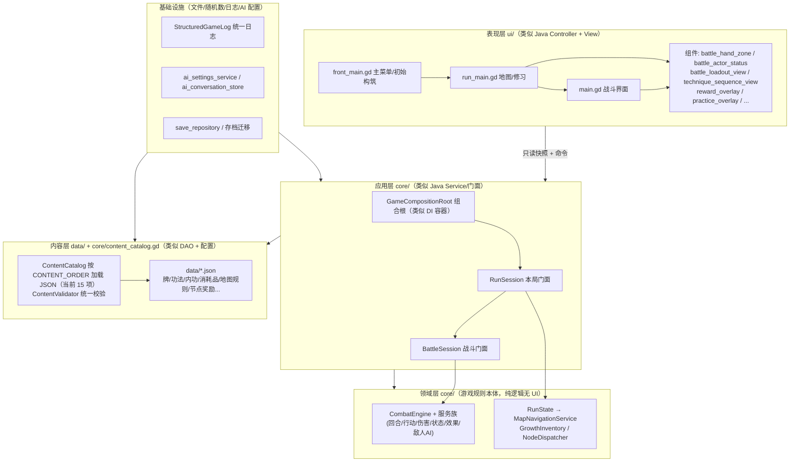

阅读提示：UI 不直接改领域对象内部字段；UI 只拿**深复制快照**（`BattleSnapshot`/
`RunSnapshot`）做展示，改状态必须发**命令**给会话门面，这是本项目的核心边界。

---

## 2. 目录结构图（Component / 文件组织）

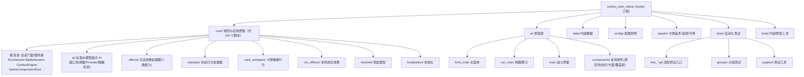

---

## 3. 类图（Class Diagram）—— 核心类与关系

### 3.1 装配关系（组合根 / Composition Root）

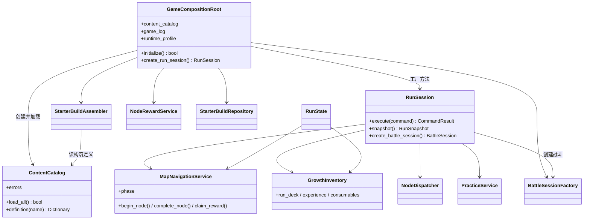

### 3.2 战斗核心类（域模型关系）

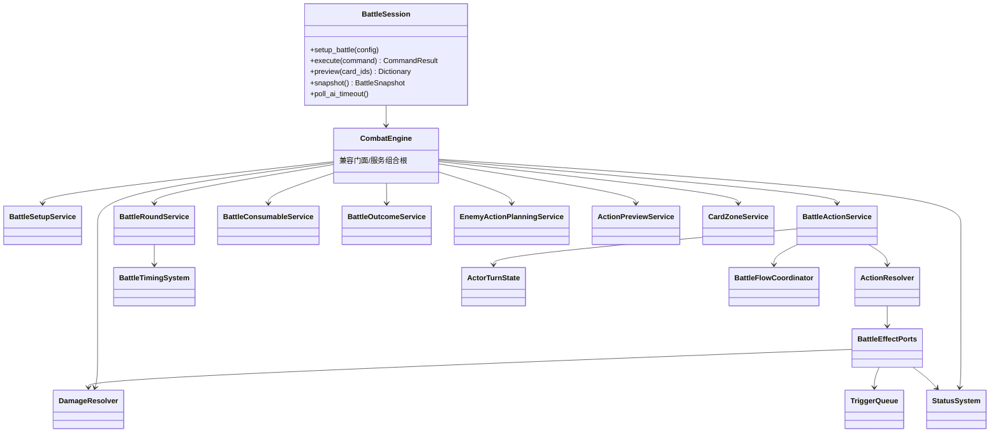

### 3.3 DTO / 快照边界（UI 与规则的“信封”）

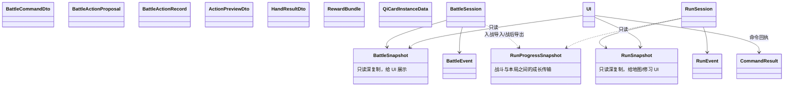

---

## 4. 状态图（State Diagram）

### 4.1 本局流程状态机（RunState / MapNavigationService）

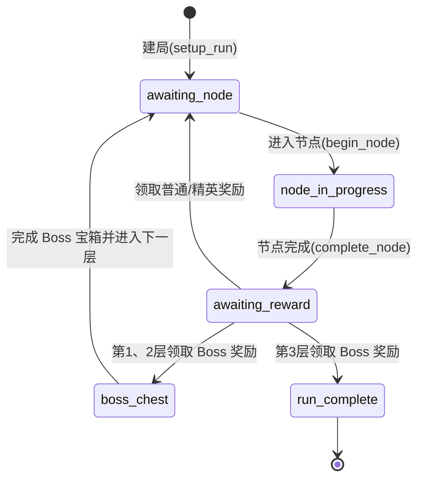

### 4.2 战斗核心状态机（回合与行动窗口）

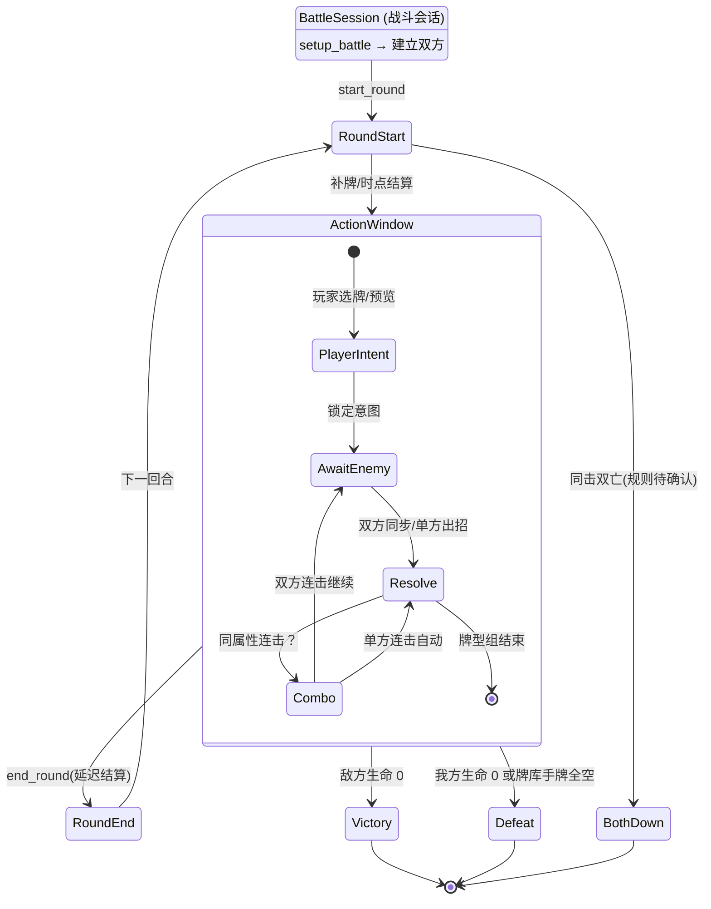

### 4.3 远程 AI 行动窗口状态机（ActionWindowAiCoordinator）

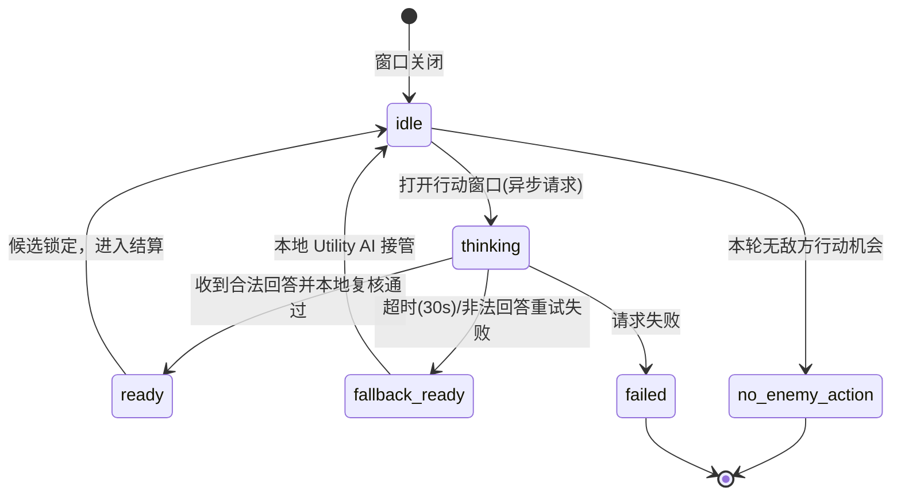

---

## 5. 时序图（Sequence Diagram）—— 玩家打一张牌会发生什么

这是游戏开发最常用的“一次操作怎么走完全流程”的图：

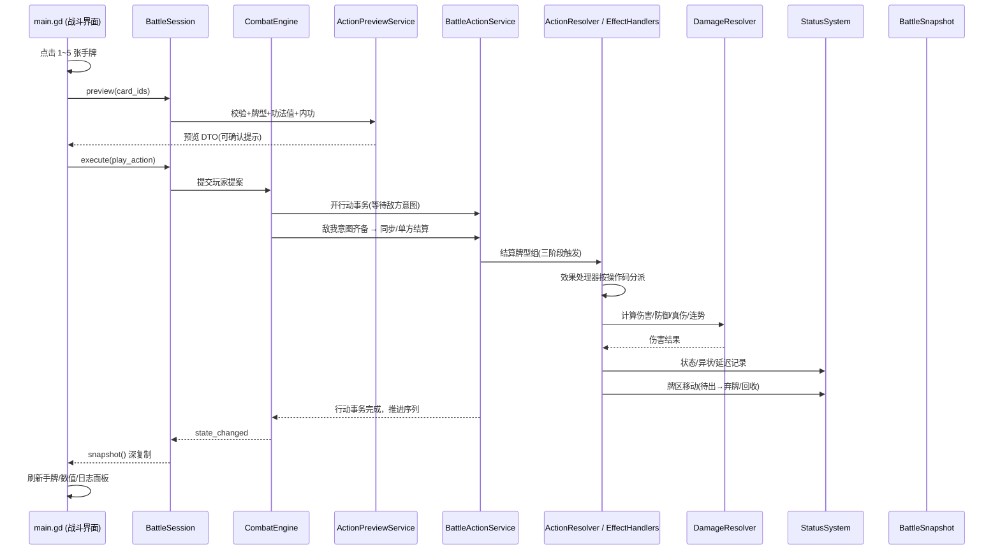

---

## 6. 游戏总流程（用例/流程图）

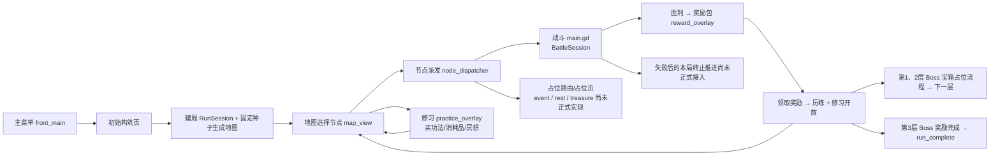

---

## 7. 数据流图（Data Flow）—— 数据从哪来到哪去

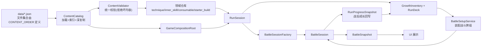

---

## 8. 一张表：Java 概念 ↔ Godot 本项目对照

| Java | 本项目对应 | 例子 |
|---|---|---|
| 类 | `class_name` 脚本 | `battle_session.gd` |
| 包 | 目录 | `core/`、`ui/`、`tests/` |
| Controller | `ui/` 场景脚本 | `main.gd`、`run_main.gd` |
| Service 层 | `core/` 服务类 | `BattleRoundService`、`NodeRewardService` |
| 实体 Entity | 领域对象 | `BattleSide`、`QiCard`、`TechniqueInstance` |
| DTO / VO | 快照与 DTO 脚本 | `BattleSnapshot`、`CommandResult` |
| Repository / DAO | 内容目录+仓库 | `ContentCatalog`、`TechniqueRepository` |
| 依赖注入容器 | 组合根 | `GameCompositionRoot` |
| 配置文件 | `data/*.json` | `base_deck.json`、`map_rules.json` |
| 状态机 | 显式 phase 字段 | `MapNavigationService.phase` |
| 策略/处理器模式 | 效果处理器注册表 | `EffectHandlerRegistry` |
| 单测 | `tests/` | `test_runner.gd` 13 万+ 断言 |
| 事件监听 | `signal` | `state_changed`、`battle_finished` |

---

## 9. 新手建议的阅读顺序

1. `combo_duel_vslice/README.md` — 游戏怎么玩、边界怎么分
2. 本文 1（分层）→ 2（目录）→ 3.1（装配）
3. `core/game_composition_root.gd` — 看“万物从哪里造出来”
4. 本文 4.1 状态机，对照 `core/map_navigation_service.gd`
5. 本文 5 时序图，对照 `core/battle_session.gd` 的 `execute()`
6. `tests/` 里跑 `./scripts/run_tests.sh quick` 看行为契约
