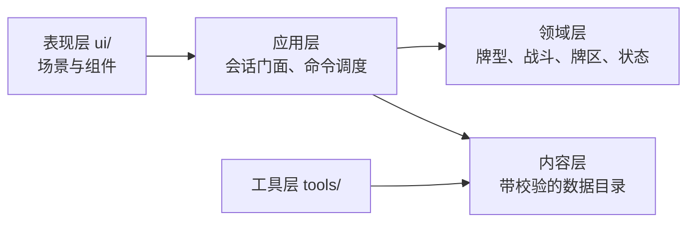

# 开发流程与重要节点

日期：2026-08-08
适用范围：`combo_duel_vslice/` 实现工程

本文件描述从设计变更到代码落地的流程、每个节点的质量门禁与验证方式。
不描述游戏规则本身，规则的唯一权威源是 `godot/docs/design-current/README.md`。

## 分层与依赖方向



依赖只能从左向右。当前实测状态：`core/` 不引用 `ui/` 或 `tools/`，`ui/` 只
preload 三个 core 文件（组合根、战斗会话、战斗引擎）。**新增跨层引用前先确认方向。**

## 节点一：设计变更

**入口**：`godot/docs/design-current/` 下对应模块文件。

规则先改文档，再改代码。文档是权威源，代码是它的实现，不是反过来。

**门禁**：功法池变更后运行设计一致性检查。

```bash
/Applications/Godot.app/Contents/MacOS/Godot --headless \
  --log-file /tmp/taiwu-design-check.log \
  --path combo_duel_vslice \
  --script res://tools/run_design_consistency_check.gd
```

它比对权威文档的活跃名单与 `data/techniques/` 实际接入内容，报出名称、池归属和废弃状态
问题。它不解析自然语言公式，也不证明条件、目标、时点或失败边界已经实现。

**当前结构基线：236门正式资源，其中2门基础通用功法与234门非内建正式功法。五个正式池分布为60／54／37／39／44；全部正式内容已经完成独立资源、公共底层与专项测试接入。**
正式资源的池归属、实现分类与行为证据见 `technique-content-status.md`。设计一致性检查必须保持结构错误 0 条，但不能用这个结果替代行为验收。

两门功法已按权威源移除：`清风过隙` 随风池重写移出活跃名单（提交 `d66b4a3` 同时
删除它并加入 `长风满袖`，两者效果不同，不是改名）；`百击归烬` 随同花池整体废弃。
它们承载的两个操作码保留并改由测试合成夹具覆盖，见下节。

## 节点二：内容数据变更

**入口**：`data/*.json` 与 `data/techniques/*.tres`。

内容不通过校验时游戏拒绝启动，不静默降级。这是刻意的：空定义向下游流动后会
表现为 `.get()` 默认值，把内容缺陷伪装成正常运行，定位成本远高于入口直接失败。

**门禁**：内容批量校验 + 内容契约测试。

```bash
./scripts/run_tests.sh quick      # 含 content-pipeline 与 content-contracts
```

`ContentValidator` 负责内容文件之间的整体形状和引用；效果规格本身由
`EffectSpecValidator` 负责，操作码新增时改后者。文件规模会随协议演进，不在流程文档记录行数。

内功或物品需要执行标准战斗写效果时，使用 `battle_effects` behavior：

```json
{
  "id": "battle_effects",
  "configuration": {
    "hook": "action_resolved",
    "effects": [{"op": "defense", "side": "owner", "amount": 2}]
  }
}
```

十个生命周期 Hook 还必须声明整数 `order`；`action_resolve` 与已提交事件 Hook 不声明
`order`。只有 `action_resolve` effects 可以声明 `phase`；其他 Hook 是单条有序链，显式 phase
会在加载期失败。效果规格与功法完全共用同一校验器、Handler、ValueSpec、ConditionSpec 和
TargetQuery。内容不得填写来源字段或事件／行动令牌，也不得用未登记 Hook。需要选择并等待
恢复的效果放在 `action_resolve`；已提交事件与生命周期效果链必须一次完成。

### 硬编码边界

- 功法、异状、角色状态、奖励和修习商品等**内容 ID**不得散落在会话、战斗流程或
  UI 中；定义、引用、处理器绑定与参数进入 `data/`，核心只按已校验协议分发。
- 操作码、触发时点、牌区名、命令类型、schema version 等属于**协议词汇**，继续由
  代码枚举并由校验器拒绝未知值；把它们移进配置只会失去静态约束。
- 扑克牌型识别、牌区不变量和伤害结算顺序属于**公共规则**。只有建立了完整的数据
  契约与执行器后才迁移，不以“源码中零字符串”为目标制造第二套规则语言。
- 显示名称从内容目录读取，不在业务服务里维护 ID 到中文名的重复映射。

## 节点三：领域规则实现

**入口**：`core/` 下对应服务。

写代码前先确认这条规则属于哪一层：

| 关注点 | 归属 |
|---|---|
| 牌型识别与数值 | `hand_evaluator.gd`、`power_calculator.gd` |
| 效果执行 | `core/effects/` 下对应处理器 |
| 效果如何修改战斗状态 | `core/effects/battle_effect_ports.gd`（唯一窄端口） |
| 伤害、防御与生命结算实现 | `core/effects/battle_survival_effect_service.gd`（Facade 内部服务） |
| 牌区、真气异状与临时重塑实现 | `core/effects/battle_card_effect_service.gd`（Facade 内部服务） |
| 来源标识、连势、同气与战斗来源写入 | `core/effects/battle_source_resource_effect_service.gd`（Facade 内部服务） |
| 效果上下文、即时嵌套与功法调用编排 | `core/effects/battle_invocation_effect_service.gd`（Facade 内部服务） |
| 延迟效果、动态响应与直接真气监听编排 | `core/effects/battle_response_effect_service.gd`（Facade 内部服务） |
| 毒真气触发、清毒与同步完成事件协调 | `core/effects/battle_poison_card_trigger_service.gd`（Facade 内部服务） |
| 额外行动、战斗历练、战斗消耗品与通用历史写入 | `core/effects/battle_action_resource_effect_service.gd`（Facade 内部服务） |
| 被动标准效果何时执行 | `passives/battle_effects_passive_handler.gd` 只建立普通效果计划 |
| 回合生命周期 | `battle_round_service.gd` |
| 行动事务顺序 | `battle_action_service.gd` |
| 配装顺序 | `battle_loadout_service.gd` |
| 牌区移动 | `card_zone_service.gd` |
| 心得增长规则 | `insight_growth_service.gd` |

**约束**：效果处理器只能通过 `BattleEffectPorts` 修改状态，不直接拿完整
`CombatEngine`。端口的四个依赖是必需的，不接受 null —— 允许缺依赖就意味着每个
方法都要带兜底分支，而兜底分支会在依赖真的缺失时静默改用另一套判定。

`InsightGrowthService` 是心得成长的唯一规则事实源：它统一负责精确牌型
校验、`insight_slot_gain_query` 被动查询、容量上限裁剪、候选过滤与稳定排序、
RNG 选择、已拥有／已在序列去重以及完整配装校验，只返回可提交方案。
`GrowthInventory.apply_insight_growth` 只把方案提交到本局
`hand_technique_progression` 与 `learned_technique_ids`；
`BattleSide.apply_insight_growth` 只把方案提交到战斗工作状态，再通过
`BattleEffectPorts.change_technique_slot_capacity` 立即同步 `SequenceBook`，不直接修改
序列内部数组，也不自动装备新获得的功法。

战斗内永久槽位不在开战时冻结。心得提交成功后，工作状态与
`SequenceBook` 容量在同一调用内完成同步，后续尚未确认的行动立即读取新容量。
已确认行动冻结的功法槽、P／P₀ 与牌型组快照只保护当前行动，不冻结后续永久成长。
容量端口或事件提交失败时，适配器必须立即恢复成长状态、已拥有集合、
`SequenceBook` 快照与本次候选抽取前的 RNG；不得等待下一次快照覆盖。

`ConsumableUseService` 是战斗内外唯一的消耗品用例编排：槽位与定义校验、
unique 限制、目标冻结、准备令牌、Handler 顺序、库存扣除、最近可溯忆记录、
`consumable_use_sequence` 推进及提交／回滚都只在该服务保留一份实现。
`RunConsumableUseContext` 负责把公共事务适配到 `GrowthInventory` 工作副本、
`RunDeck` 目标与本局种子派生随机源；`BattleConsumableUseContext` 负责把同一事务
适配到 `BattleSide`、当前手牌、战斗 RNG 以及战斗 Runtime 快照。不支持的战斗外
能力在 Battle 查询阶段拒绝，不会执行一半后失败。

`BattleConsumableService` 只保留战斗 active／待选择门禁、成功日志、一次
`state_changed` 与旧 UI 结果投影，不遍历 effects、不扣库存、不推进序号，也不维护
第二套补偿清单。战斗内消耗只修改 `BattleSide` 工作状态；退出节点时丢弃，正式
结算时才经 `RunProgressSnapshot` 提交。失败回滚同时覆盖双方战斗状态、牌区、
`SequenceBook`、来源标识、run／battle 计数器、`StatusSystem`、战斗 RNG、触发日志，
以及 `BattlePassiveCommittedEventService` 的 serial、receipt 和 execution history；
事务中的 committed event 延迟到成功提交后才对监听器发布。

`RunAggregateTransaction` 是正式战斗结果提交的完整本局聚合事务边界。
`BattleOutcomeCommitService` 只编排以下既有能力：把绝对 `RunProgressSnapshot`
提交到 `GrowthInventory`、触发一次 `battle_completed`、推进地图、建立奖励或终局、
写统一日志与 `RunEvent`，最后提交聚合事务。事务捕获成长完整 mutation state、
地图状态、`ComboRunState` 终局与被动附属状态、节点交互状态、待领取奖励、
胜利结果、日志、事件队列及序号；恢复只写状态，不重新执行效果或随机奖励。

战斗工作状态的实时变化不等于立即修改正式 `RunState`。胜利或战败的全部业务状态
成功后，`RunSession` 才统一发送一次 `changed`、关闭一次 `BattleSession`，随后由
命令边界产生一次 `persistence_boundary_reached("resolve_battle_result")`；数据库／JSON
保存只能发生在这个成功边界之后。任一步失败都恢复整个聚合并保留已终止的
`BattleSession` 与终局快照，不发送 changed、不触发自动存档，调用方可以重试同一正式
结果。玩家主动退出仍只丢弃战斗会话，并从既有节点入口检查点重新开始。

本局被动来源不再按节点长期冻结。`RunPassiveEventService` 在一次事件开始时从当前
`GrowthInventory` 捕获来源并建立唯一 `ExecutionPlan`；本次执行期间新增或失去的来源
不会加入或移除该计划，下一次事件则重新读取最新的内功、物品和来源标识状态。
`battle_completed` 在战斗进度合入后捕获，`node_completed` 在奖励应用前捕获，Boss 宝箱
在宝箱结算变更前捕获。节点存档不保存可派生来源列表；旧 schema v1 若带有旧字段只做
格式／内容校验，恢复时忽略，下一次保存自然移除。行动级功法槽、P／P₀、牌型组和选择
候选快照仍按原协议冻结，与事件级来源计划无关。

`BattleEffectPorts` 是公开协议 Facade，不是所有效果算法的永久归宿。伤害、防御与生命相关
公开方法继续保留原签名，但内部统一委托 `BattleSurvivalEffectService`。该服务只能接收完成
结算所需的明确依赖：`DamageResolver`、`StatusSystem` 的现有窄能力、战斗规则查询、committed
event 发布端口、双方集合、回合读取器和统一历史入口；禁止传入完整 `CombatEngine`、回指
Facade、复制 `BattleSide` 规则或按功法／内功／物品／状态 ID 分支。反震、格挡与邀战来源的
建立已经迁入 `BattleSourceResourceEffectService`；伤害发生时的查询、消费与正式结算仍只在
`BattleSurvivalEffectService` 保留一份实现。

结构优化批次允许采用分阶段门禁，但交付必须明确范围。BattleEffectPorts 伤害／防御／生命首批
只运行项目加载和 `res://tests/test_battle_survival_effects.gd` 专项；每次 Godot 调用使用独立
`/tmp/taiwu-battle-effect-damage-<用途>-<序号>.log`，并扫描 `Can't load script`、
`File not found`、`Parse Error` 与 `SCRIPT ERROR`。该批不运行 `quick`／`full`；完整回归统一留到
`BattleEffectPorts`、`BattleActionService` 和 `StatusSystem` 全部结构优化结束后执行，不能把
当前最小专项门禁描述为全部回归通过。

第二批牌区／真气／异状／临时重塑拆分同样保留 `BattleEffectPorts` 的全部公开签名。Facade
负责把 `source_kind`、`source_id`、`source_name`、`source_instance_key`、`trigger_mode` 与
`draw_reason` 规范化后委托 `BattleCardEffectService`。内部服务可以持有 `StatusSystem` 的真气
状态窄能力、双方只读集合、统一战斗 RNG 和 `CardReshapeBattleRuntime`，但不得持有完整
`CombatEngine`、回指 Facade、直接修改 `BattleSide` 牌区数组或自建随机源。牌区写操作必须经过
`CardZoneService`；明确弃牌沿用明确注入的 `BattlePermissionService`，同步移动和原子交换继续
先冻结完整合法目标集。异状继续经 `StatusSystem`／`CardStateLifecycle` 合法性与事件路径，临时
重塑只写战斗槽位，不改变基础身份或本局永久牌组。

`card_moved`现为唯一的牌区变化committed事实，同时仍在`DYNAMIC_RESPONSE_EVENTS`中供
`StatusSystem`既有动态响应使用。`CardZoneService`在真实写入和牌状态生命周期完成后集中冻结
同一份事件数据：事件/行动令牌、牌实例、逻辑from/to、reason、placement、移动前快照、双方持有方、
原始所有者、来源协议、牌区与手牌before/after，以及同步批次令牌和批次内序号。生成使用
`from_zone=generated`；临时与非临时生成分别保留`temporary_generate`、`permanent_generate`，
不得改写为笼统的`generated`原因，也不得新增平行生成事件。

事件顺序固定为：完成真实牌区写入和既有牌状态生命周期；执行`card_moved`被动Hook；提交既有
`card_drawn`、`card_entered_discard`、`card_explicitly_discarded`专项事实（专项事实之间的旧顺序
不变）；最后用同一份冻结数据分发现有动态响应。动态桥对带延迟标记的committed通知不立即重放，
由`CardZoneService`在专项事实后分发一次，因此committed与动态响应不会双触发或各自拼装字段。
行动stage与stage rollback只表示提案，不发布事实；正式确认按逐张逻辑
`hand→discard_pile/temporarily_removed`及`hand_count_before/after`提交。预览、失败请求、初始牌库
装载/洗牌、快照恢复、战斗结束临时牌清理和战后批量归还同样不发布。

`placement=bottom`由`CardZoneService.move_card`在目标数组写入时一次完成，事件发布时牌已经位于
底部；`BattleCardEffectService`不再在移动后第二次调用重排。同步移动、批量转移和原子交换先完成
全批移除与写入，再按冻结顺序逐牌发布；观察者不会读取半完成交换。`card_moved`使用
`observe_all_sides`让双方被动来源都建立计划，但每个Invocation的效果actor仍重绑定为该被动来源
owner，观察敌方移动不会把收益默认施加给敌方。

`card_state_changed`现为唯一的BattleRuntime真气状态committed事实。`CardAnomalyService`负责统一
冻结`anomalies + temporary_reshapes`的before/after，并在一处计算`changes`、added/removed/updated
分组、实际层数差、净化清除集合和转移批次；异状、层数、临时强化/属性/牌阶、单槽/全槽清除、
永久重塑要求的异状清除、经脉离手和入弃牌堆生命周期都经`StatusSystem`薄Facade进入该服务。
`BattleCardEffectService`、`CardZoneService`和`CardReshapeClearAnomaliesHandler`不得再直接调用
`QiCard` setter/remover。战斗结束清理、快照恢复、预览/校验和失败操作不发布事实。

一次同牌业务操作只发布一个canonical事实；净化把全部实际移除项和净化自身新增放进同一
`changes`，其中`removed_count`不包含净化自身。异状转移先完成来源移除和目标写入，再冻结两张牌，
以共享`transfer_batch_token/operation_token`按`transfer_out→transfer_in`发布。临时牌阶替换的
before/after都包含`rank_name/rank_order/base_qi`。进入弃牌堆或真实离手的顺序为
`card_state_changed(lifecycle_remove) → card_moved → 既有专项事件/响应`。

兼容事件`card_anomaly_changed`和`card_burned_out_changed`仍是response-only，但只在
`card_state_changed`实际发布后从同一冻结事实各投影一次：临时重塑不会误投异状响应，燃尽新增/
移除从对应change投影。投影挂在committed publication监听之后，因此外层发布事务回滚不会提前
泄露legacy响应；canonical动态响应先处理，legacy随后处理，不会把同一注册响应执行两次。
`observe_all_sides=true`让双方来源观察事实，事件`holder`表示实际持牌方，而Invocation效果actor
仍重绑定为各自被动来源owner。

`trigger_poison_card` 暂留 Facade，以现有卡牌服务和 `BattleSurvivalEffectService` 组合真气状态、
毒伤与事务事件，禁止复制毒伤算法。`notify_cards_played`、`notify_poison_triggered`、响应监听、
来源标识、连势／同气、延迟效果和功法调用留给后续批次。本批只运行项目加载与
`res://tests/test_battle_card_effects.gd`，每次调用使用独立
`/tmp/taiwu-battle-effect-card-<用途>-<序号>.log`，并扫描 `Can't load script`、
`File not found`、`Parse Error` 与 `SCRIPT ERROR`。专项当前覆盖牌区移动、虚无、临时真气、异状、
临时重塑、同步／原子移动和毒异状桥接；`quick`／`full` 延后到 `BattleEffectPorts`、
`BattleActionService` 与 `StatusSystem` 全部结构优化完成后统一执行。

第三批来源标识／连势／同气／战斗来源拆分继续保留 `BattleEffectPorts` 的公开签名。
`BattleSourceResourceEffectService` 负责来源 marker、`write_momentum`、同气预估／写入／回执、
直接功法值修正，以及反震／格挡／邀战来源建立和公开变化事件；`SameQiGaugeService` 仍是容量、
消费与同气额外行动的唯一事实源。服务只能通过窄接口读取当前行动窗口并关闭来源绑定窗口，不能
持有完整 `BattleFlowCoordinator`、`CombatEngine` 或回指 Facade。生存服务继续只在伤害发生时
读取和消费来源，`StatusSystem` 继续按既有生命周期推进到期与邀战结算，两边不得复制算法。

该批只运行项目加载与 `res://tests/test_battle_source_resources.gd`，每次调用使用独立
`/tmp/taiwu-battle-effect-source-<用途>-<序号>.log`，并扫描 `Can't load script`、
`File not found`、`Parse Error` 与 `SCRIPT ERROR`。专项覆盖来源标识、连势、同气、反震来源、
格挡来源、邀战来源和直接功法值修正；`quick`／`full` 继续延后到全部结构优化结束后统一执行。

第四批效果调用／延迟／响应拆分继续保持 `BattleEffectPorts` 的全部公开签名。当前上下文栈、即时
插入队列、`execute_effect_chain` 装配、功法调用与调用时点、序列变化事件和重触回调统一委托
`BattleInvocationEffectService`；该服务只弱引用 `EffectExecutor` 与
`TechniqueInvocationService`，并通过 committed event 端口与回合读取器发布序列变化，不接管
continuation、调用请求冻结、递归保护、P0/P 结算或槽位推进算法。延迟、响应和直接真气监听入口统一
委托 `BattleResponseEffectService`；该服务只调用 `StatusSystem` 当前公开注册／响应入口和
`CardReshapeBattleRuntime` 的窄监听端口，不移动 StatusSystem 记录、不重写匹配或到期扫描。

`trigger_poison_card`、`notify_cards_played`、`notify_poison_triggered`、
`resolve_played_card_anomalies` 的跨服务桥接、额外行动、战斗历练、消耗品生成与通用历史仍留在
Facade。本批只运行项目加载与 `res://tests/test_battle_effect_flow.gd`，每次 Godot 调用使用独立
`/tmp/taiwu-battle-effect-flow-<用途>-<序号>.log`，并扫描 `Can't load script`、
`File not found`、`Parse Error` 与 `SCRIPT ERROR`。专项覆盖自动功法、调用、即时嵌套、延后调用、
延迟效果、动态响应、功法重触、直接真气监听和等待选择恢复；`quick`／`full` 尚未运行，完整回归
继续延后到 `BattleEffectPorts`、`BattleActionService` 与 `StatusSystem` 全部结构优化完成后统一执行。

第五批完成 `BattleEffectPorts` 最终收口，公开方法继续保持原签名。`BattlePoisonCardTriggerService`
只组合既有卡牌状态服务和生存服务，集中毒触发冻结、成功后清毒与同步 flush 后完成事件；不得复制
毒伤、防御、异状或 receipt 算法。`BattleResponseEffectService` 统一“先结算打出异状、再通知
card_played 响应”的顺序。`BattleActionResourceEffectService` 只通过 `BattleFlowCoordinator`、
`BattleSide` 既有资源能力、已装配内容目录和 `VisibleTriggerQueue` 窄入口写入额外行动、战斗历练、
共享消耗品与历史，不推进 `BattleActionService` 状态机，不计算同气额外行动，也不重新加载内容。

Facade 允许保留来源结构规范化、旧字符串来源转换、`draw_reason` 独立适配、双方窄查询和公开方法
委托。`notify_poison_triggered` 与 `add_history` 仍有正式运行时调用方；`notify_cards_played` 是既有公开
能力的兼容委托，但打出后跨域顺序只在响应服务保留一份实现。新内部服务不得持有 `CombatEngine`、
回指 Facade、通过大量 Callable 模拟 Facade，或互相形成写状态循环。

第五批开发阶段先运行项目加载与 `res://tests/test_battle_effect_finalization.gd`；五批全部完成后已执行
最终统一验收：项目加载 670 项、第五批专项 50 条断言、`quick` 7/7、`full` 30/30、设计一致性
228/228／待接入0／错误0。项目加载与专项日志分别为
`/tmp/taiwu-battle-effect-final-acceptance-project-load-06.log`、
`/tmp/taiwu-battle-effect-final-acceptance-specialized-07.log`；quick／full 每组日志分别使用
`/tmp/taiwu-battle-effect-final-quick-<组名>-<序号>.log` 与
`/tmp/taiwu-battle-effect-final-full-<组名>-<序号>.log`；设计检查日志为
`/tmp/taiwu-battle-effect-final-design-consistency-08.log`。

全部 Godot 日志和 stdout 旁路必须扫描 `Can't load script`、`File not found`、`Parse Error`、
`SCRIPT ERROR`、ObjectDB／RID／资源泄漏、orphan `StringName`／`NodePath` 与退出阶段错误。当前最终验收
无上述匹配，仅有已知非阻塞 macOS CA 警告。BattleEffectPorts 阶段不得再写“quick／full延后”；
后续 `BattleActionService` 与 `StatusSystem` 重构必须保持本次 7/7 quick、30/30 full 基线。

`BattleActionService` 第一批已经建立 `BattleActionTransaction`，统一保存行动阶段、牌型组、暂停状态、
恢复游标、冻结／提交牌 ID、公开结果和结构化失败原因；运行时引用只保存在 `runtime_context`，版本化
snapshot 不公开 `Object`、`Callable` 或服务引用。第二批只合并玩家单方与敌方单方主组编排：两类入口
各自完成提案或锁定牌的 stage／finalize／confirm 后，建立含 actor、target、preview、record、sequence
book、稳定角色、协同组、累计提交牌和结果字段映射的 `solo_action` 上下文，再共同执行
`begin_action_resolution → resolve_action_records → commit_staging_for → post_commit →
finish_action_resolution → 同气 → complete_transaction`。等待选择和恢复只按事务 phase、group 与稳定游标
推进，不再按 initiator 调用两套玩家／敌方 resolution 或 post_commit 函数。

第二批保留必要角色差异：玩家入口继续使用 `ActionProposal`、玩家序列与可选协同，并在完成后发送
`emit_state_changed`；敌方入口继续读取锁定牌、敌方序列和行动索引，并在完成后递增索引、更新战斗
状态及清理行动锁。同步主组、同步协同和 `StatusSystem` 不在本批重构范围；玩家单方协同仍使用现有
协同牌型组阶段，只由统一单方管线识别并在协同完成后回到统一行动收尾。

第二批门禁只允许静态检查与项目脚本加载检查；每次 Godot 调用继续使用独立显式 `/tmp` 日志并扫描
`Can't load script`、`File not found`、`Parse Error` 与 `SCRIPT ERROR`。不运行 `quick`／`full`，也不把
本批最小加载门禁描述为完整回归；完整统一回归仍等 `BattleActionService` 与 `StatusSystem` 优化完成。
第二批项目加载实际覆盖 671 项，日志为 `/tmp/taiwu-battle-action-solo-project-load-02.log`；禁止错误关键字
无匹配，仅出现已知非阻塞 macOS CA 证书警告。

`BattleActionService` 第三批建立唯一 `_execute_current_group` 牌型组执行器。单方主组、同步主组、
单方协同和同步行动中的协同现在共用
`resolve_action_records → pending choice → committing_zones → pre_commit → commit → post_commit →
pending choice → finish_action_record` 顺序；`_continue_active_transaction` 只校验事务 phase 与稳定恢复游标，
随后回到这一入口，不再按 solo／synchronized × main／cooperation 维护分派矩阵。同步伤害开关冻结在
当前组上下文，只有实际同步主组为 true；协同组继续作为同步伤害层之后的独立普通组运行。

运行时上下文固定分成 `action_context` 与 `current_group_context`。行动级长期保存 resolution mode、双方
preview、主组触发结果、`enemy_will_act`、主组及整次行动累计提交牌、协同组和最终结果字段；当前组只
保存 group kind、records、previews、actor／target、同步伤害开关、窄提交策略、本组提交牌、协同定义与
等待选择展示字段。切换协同组只替换当前组上下文，行动上下文和主组提交牌 ID 继续保留；snapshot 仍
不公开 Object、Callable 或服务引用。提交差异只剩 actor staging、同步双方 staging 与现有
`commit_cooperation_staging` 三种窄策略，单方／同步最终 outcome 继续各自处理结果 DTO 与角色收尾。

第三批删除原单方协同、同步主组和同步协同的八个 resolution／post_commit 辅助路径；
`resolve_action_records`、`resolve_post_commit_phase` 和 `finish_action_record` 在服务内各只剩一个阶段调用点。
`BattleActionService` 当前约 1540 行。下一步只做该服务职责拆分或收尾检查，不再建立另一套阶段推进；
随后进入 `StatusSystem` 结构优化，二者完成后再执行延后的统一 `quick`／`full` 回归。

第三批门禁仍只允许静态检查与项目脚本加载检查。Godot 调用必须 headless、串行并使用独立显式
`/tmp` 日志，同时扫描 `Can't load script`、`File not found`、`Parse Error` 与 `SCRIPT ERROR`；本批不运行
`quick`／`full`，也不把最小加载门禁描述为完整回归。最终项目加载覆盖 671 项，日志为
`/tmp/taiwu-battle-action-group-project-load-final-02.log`；禁止错误关键字无匹配，仅出现已知非阻塞
macOS CA 证书警告。

`BattleActionService` 第四批新增 `BattleActionPreparationService`，只承接玩家行动在 staging 之后、
行动事务开始之前的准备边界。服务的窄公开接口为 `prepare_cooperation`、
`finalize_staged_proposal`、`confirm_finalized_proposal` 与 `rollback_power_formation`；内部统一完成协同
组牌数／重复牌／牌型／异状／共享属性／权限校验，使用玩家序列副本建立协同预览，冻结整次行动的
同气牌集合与投影，依次 finalize 主组和协同组，并提交或回滚各组功法值形成 receipt。正式确认失败时
由准备服务先回滚功法值形成事务，调用方随后按原顺序回滚玩家／敌方 staging。

准备服务只持有 player／enemy `BattleSide`、现有 `ActionResolver` 准备能力、玩家 `SequenceBook`、
统一预览回调与回合读取器；不持有 `CombatEngine`、`BattleActionService`、
`BattleActionTransaction`、`BattleFlowCoordinator`、`TriggerQueue`、UI 或 AI 控制器。同步行动顺序仍在
`BattleActionService` 明示：先冻结玩家提案，再冻结敌方锁定行动，双方均成功后才依次正式确认。
该服务不 stage／commit 牌区，不消费行动、不锁定意图、不开始事务、不执行 resolve／post_commit，也
不实际写入同气收益；`_apply_same_qi_gain` 继续留在行动完成边界。

迁移后 `BattleActionService` 删除原十个准备私有实现，当前 1223 行，只保留 stage、准备服务调用、
意图锁定／行动消费、事务建立、唯一牌型组执行器、等待恢复、单方／同步 outcome 和角色收尾；
`BattleActionPreparationService` 为 419 行。下一步先审计单方／同步 outcome 是否存在足够稳定的共同
边界；当前两者主要差异集中在敌方索引／行动锁／后续调度、状态通知和返回 DTO，继续拆成新服务很可能
反而扩大回调依赖，因此若审计没有发现新的阶段重复，就直接进入 `StatusSystem` 优化。

第四批仍不运行 `quick`／`full`，只执行静态检查和项目脚本加载。Godot 必须 headless、串行且每次使用
独立显式 `/tmp` 日志，并扫描 `Can't load script`、`File not found`、`Parse Error` 与 `SCRIPT ERROR`；
完整统一回归继续等 `BattleActionService` 收尾与 `StatusSystem` 优化全部完成后执行。最终项目加载覆盖
672 项，日志与 stdout 分别为 `/tmp/taiwu-battle-action-preparation-project-load-final-03.log` 和
`/tmp/taiwu-battle-action-preparation-project-load-final-03.stdout`；禁止错误关键字无匹配，仅出现已知
非阻塞 macOS CA 证书警告。

BattleEffectPorts 与 BattleActionService 两项结构优化完成后，于 2026-08-16 追加执行进入
`StatusSystem` 重构前的阶段性统一验收。该验收没有修改业务代码：`git diff --check` 通过；独立项目
加载覆盖 672 项；`BattleActionTransaction` 专项 117 条断言通过；`quick` 7/7 组通过；当前完整发现集
`full` 31/31 组通过；设计一致性为权威活跃 228 门、数据接入 228 门、待接入 0 门、错误 0 条。

阶段基线日志如下：项目加载使用
`/tmp/taiwu-stage-acceptance-project-load-01.log`（stdout 为同名前缀 `.stdout`）；事务专项使用
`/tmp/taiwu-stage-acceptance-battle-action-transaction-02.log`（stdout 为同名前缀 `.stdout`）；quick 每组
使用 `/tmp/taiwu-stage-acceptance-quick-<组名>-<序号>.log`，full 每组使用
`/tmp/taiwu-stage-acceptance-full-<组名>-<序号>.log`，两者 stdout 均为对应日志名追加 `.stdout`；设计
一致性使用 `/tmp/taiwu-stage-acceptance-design-consistency-03.log`（stdout 为同名前缀 `.stdout`）。
全部 Godot 进程均 headless、串行且使用独立显式 `/tmp` 日志；stdout 与日志复扫没有发现
`Can't load script`、`File not found`、`Parse Error`、`SCRIPT ERROR`、ObjectDB／RID 泄漏、orphan
`StringName`／`NodePath`、资源泄漏或退出阶段错误，只有已知非阻塞 macOS CA 证书警告。该结果是
`BattleEffectPorts` 与 `BattleActionService` 优化完成、进入 `StatusSystem` 重构前的稳定基线。

`StatusSystem` 第一批结构优化只迁出状态变化历史，不改真气异状、动态响应、延迟效果、战斗来源
生命周期或功法抽牌统计。新增 `core/statuses/status_history_service.gd` 作为后续状态子服务共用的
唯一历史记录器，集中持有同一个 `history` 数组、状态变化 serial、`StatusChange` 建立与快照、
状态名称查询、统一 `GameLog` 写入、历史只读快照，以及 reset／恢复后的 serial 重建。

`StatusSystem` 继续是公开 Facade：初始化时把 `history` 一次性绑定到历史服务持有的数组；
`history_snapshot`、`use_game_log`、`replace_history` 与 reset 中的历史清理只做薄委托。既有
`status_system.history`、`history.is_empty()`、`history.size()` 和直接 `history.assign(...)` 读取／兼容
能力仍引用同一个数组实例，reset 与正式恢复都不替换数组对象。系统内部全部状态变化写入点直接调用
`status_history.record_change(...)`，没有保留同内容的 `_record_change` 私有壳。

`BattleSide` 的状态快照恢复不再写入 `StatusSystem` 私有 serial，也不再直接 assign 历史；它调用
`status_system.replace_history(...)`。恢复接口原地替换内容，并按记录中的最大 serial 将下一值设为
`max_serial + 1`；空历史从 0 开始，恢复过程不写 `GameLog`、不生成新状态变化。迁移后
`status_system.gd` 为 1263 行，`status_history_service.gd` 为 76 行。下一批只拆真气异状变更服务，
继续保留 `CardStateLifecycle` 与当前异状合法性、层数、响应和事件顺序。

本批只执行 `git diff --check` 与 headless 项目脚本加载检查；Godot 串行运行并使用独立显式
`/tmp/taiwu-status-history-project-load-01.log`，扫描 `Can't load script`、`File not found`、
`Parse Error` 与 `SCRIPT ERROR`。最终加载覆盖 673 项，禁止错误关键字无匹配，仅有已知非阻塞
macOS CA 证书警告。不运行 `quick`／`full`，不能把该最小门禁描述为完整回归。

`StatusSystem` 第二批结构优化只迁出真气异状变更、数值查询和 `CardStateLifecycle` 编排，不改真气
行为分发、动态响应匹配、延迟记录、战斗来源到期或功法抽牌统计。新增
`core/statuses/card_anomaly_service.gd`，集中负责异状数值修正与有效真气值、施加／合法性／移除／转移／
层数设置、进入弃牌堆清理，以及单张真气的战斗开始／结束生命周期。该服务独占本条战斗状态路径的
`CardStateLifecycle` 实例，并通过已有 `StatusHistoryService` 写历史；长生命周期 metadata 只保留稳定
字符串字段，不保存 holder、actor 或 card 等领域对象。

`StatusSystem` 继续保留全部既有公开签名并作为薄 Facade。`card_numeric_modifier`、
`actor_hand_card_numeric_modifier`、`modify_card_contribution`、`effective_qi_value`、全部异状增删／查询／
转移／层数入口和 `on_card_enter_discard` 均直接委托新服务；旧 `_change_history_metadata`、
`_emit_card_anomaly_change`、`_card_anomaly_value`、`_effective_qi_value`、`CardStateLifecycle` preload 与
`lifecycle` 字段已经删除。`use_effect_ports` 同时更新新服务中的 `WeakRef`，异状事件继续经
`BattleEffectPorts.notify_response_event` 发布；缺少 holder 时也只通过该统一端口定位真气，避免形成
`StatusSystem → CardAnomalyService → BattleEffectPorts → StatusSystem` 强引用环。

战斗开始与结束的外层时点仍由 `StatusSystem` 注册并遍历双方及全部相关牌区，每张牌分别委托
`on_card_battle_start`／`on_card_battle_end`。施加、转移和移除仍保持原有“写牌后写历史、最后发布响应”
顺序；转移仍先成功写入目标、再移除来源、写两条历史并依次发布两次变化事件。层数设置只写历史，
进入弃牌堆只记录实际清除的 state；燃尽已在2026-08-19生命周期平台机械迁移为
`debuff/burned_out`，燃尽专用响应只投影该canonical变化，有效真气值继续下限为 0。
迁移后 `status_system.gd` 为 1048 行，`card_anomaly_service.gd` 为 357 行。下一批只拆真气行为分发服务，
不把动态响应、延迟记录或战斗来源生命周期一并迁移。

本批仍只执行 `git diff --check` 与 headless 项目脚本加载检查；Godot 必须串行并写入独立显式 `/tmp`
日志，同时扫描 `Can't load script`、`File not found`、`Parse Error` 与 `SCRIPT ERROR`。不运行
`quick`／`full`，该门禁不代表完整统一回归。最终项目加载使用
`/tmp/taiwu-status-anomaly-project-load-01.log`，覆盖 674 项；四类禁止错误关键字无匹配，仅出现已知
非阻塞 macOS CA 证书警告。

`StatusSystem` 第三批结构优化只迁出真气异状行为的收集、稳定排序、执行、合格触发重演与结果聚合，
不改动态响应、延迟记录、战斗来源到期或功法抽牌统计。新增
`core/statuses/card_status_behavior_service.gd`，集中负责 `play_attempt`、抽牌、明确弃牌、进入弃牌堆
早期／晚期、打出、回合结束与最终回合结束行为。服务独占 `StatusBehaviorRegistry`、行为运行 RNG 和
`CardTriggerReplayService` 引用，只持有 `CardAnomalyService` 窄能力与 `BattleEffectPorts` 弱引用；
`StatusBehaviorContext` 也由完整 `StatusSystem` 改为只保存 `card_anomaly_service`。

`StatusSystem` 继续保留 `can_play_card`、`can_play_cards`、`permission_query`、全部真气行为入口和三项
注入方法作为公开 Facade。已注入 `BattlePermissionService` 时仍优先走统一权限查询；权限服务回调或
未注入时才委托行为服务执行 `play_attempt`，避免递归。公开 `behavior_registry` 在初始化时一次性绑定
到行为服务实际持有的同一 Registry 实例。`_rng` 继续留在 Facade 供现有战斗快照读取／恢复，同时
同步传入行为服务；效果端口与重演服务注入也只由 Facade 转发。

行为顺序保持为 priority 升序、status ID、behavior index。普通执行仍在每项前确认异状尚存；重演只
复用首次成功执行的 entries，并忽略首次行为已经移除异状这一事实。毒伤行为在首次执行前冻结有效
真气值，重演复用同一 `frozen_amount`；`stop_card_behaviors`、blocked 与 reason 聚合规则均未改变。
只有 played／draw／explicit_discard／enter_discard／turn_end 映射到合格重演，晚期弃牌与最终回合结束
不自动重演。`CardZoneService` 现有早期行为、明确弃牌、重塑、异状清理、晚期行为调用顺序未调整。

迁移后 `status_system.gd` 为 866 行，`card_status_behavior_service.gd` 为 250 行。下一批只拆动态响应
注册与执行服务，不把延迟记录、战斗来源生命周期或功法抽牌统计一并迁移。本批仍不运行
`quick`／`full`，只执行 `git diff --check` 和使用独立显式 `/tmp` 日志的 headless 项目脚本加载，
并扫描 `Can't load script`、`File not found`、`Parse Error` 与 `SCRIPT ERROR`。最终项目加载使用
`/tmp/taiwu-status-behavior-project-load-01.log`，覆盖 675 项；四类禁止错误关键字无匹配，仅出现已知
非阻塞 macOS CA 证书警告。

`StatusSystem` 第四批结构优化只迁出动态响应注册、匹配、执行与到期，不改延迟效果执行算法、邀战、
战斗来源到期或功法抽牌统计。新增 `core/statuses/status_response_service.gd`，集中持有固定身份的
`response_records` 数组和独立 `ConditionSpecRegistry`，负责事件目录合法性检查、filters 注册时冻结、
响应上下文冻结、事件匹配、效果执行、防重入、成功后的 `max_triggers` 消费，以及 `turn_end`／
`next_round_turn_end` 到期和 `expiry_effects`。事件 captures 继续保留完整 `event` 副本，并按现有规则补充
`event_card` 与 `event_snapshot`；`BattleEffectPorts` 只以弱引用保存，响应服务不反向依赖 Facade。

`StatusSystem` 继续保留 `register_response`、`handle_response_event` 与
`on_committed_event_for_responses` 原签名作为薄 Facade，并在初始化时把公开 `response_records` 一次性绑定
到响应服务持有的同一个 Array。reset、战斗结束清理和响应到期只原地清空或移除记录，不替换数组对象。
TURN_END 顺序仍是：先结算 turn_end 延迟效果，再结算真气 turn_end 行为，随后移除本回合手牌上限修正，
最后委托响应服务处理到期；到期遍历先冻结候选，新注册响应不参与当前批次。

新增 `core/statuses/status_record_id_allocator.gd` 作为响应和未迁移延迟记录共用的唯一运行时记录 ID
分配器。`response`、`delay`、`hand-limit`、`decay-return`、`reflection` 与 `window-check` 继续使用原
`prefix-%06d` 格式，但共享同一递增 serial。`StatusSystem` 删除 `_delay_serial`，新增
`runtime_record_serial`／`restore_runtime_record_serial` 正式接口；`BattleSide` 存档字段仍名为
`delay_serial`，但捕获与恢复不再直接访问私有字段。

`BattleResponseEffectService` 与新服务职责不同：前者仍是
`Effect Handler → BattleEffectPorts → BattleResponseEffectService → StatusSystem Facade` 的公开适配层；
后者才是响应记录、匹配、执行和到期的实际所有者。迁移后 `status_system.gd` 为 756 行，
`status_response_service.gd` 为 204 行，`status_record_id_allocator.gd` 为 22 行。下一批只拆延迟效果调度
服务，不把邀战、战斗来源到期或功法抽牌统计一并迁移。

本批仍不运行 `quick`／`full`，只执行 `git diff --check` 与 headless 项目脚本加载。Godot 串行运行并
使用独立显式 `/tmp` 日志；首次日志 `/tmp/taiwu-status-response-project-load-01.log` 正确捕获动态返回值
缺少显式类型造成的 Parse Error，修正后最终日志 `/tmp/taiwu-status-response-project-load-02.log` 覆盖
677 项，`Can't load script`、`File not found`、`Parse Error` 与 `SCRIPT ERROR` 无匹配，仅有已知非阻塞
macOS CA 证书警告。

`StatusSystem` 第五批结构优化只迁出四类 `delayed_records` 的注册、冻结、调度、执行和清理，不改邀战、
行动窗口反震／格挡来源到期、回合末战斗来源到期、战斗结束角色资源清理或功法抽牌统计。新增
`core/statuses/status_delay_service.gd`，集中持有固定身份的延迟记录数组，并唯一编排 `effect_chain`、
`next_round_hand_limit`、`defense_decay_return` 与 `no_life_loss_disruption`。该服务通过既有
`StatusHistoryService` 写入 turn_end 延迟结算历史，和动态响应共用 `StatusRecordIdAllocator`，只以
`WeakRef` 保存 `BattleEffectPorts`，并直接持有统一 `EffectExecutor`；不依赖 `StatusSystem`、
`CombatEngine`、`TimingSystem`、响应／异状／行为服务、战斗流或来源生命周期实现。

`StatusSystem.delayed_records` 在构造时一次性绑定到 `StatusDelayService.records()` 返回的同一个 Array。
`CombatEngine` 的 `delayed_effects`、`BattleSide` 快照复制与恢复时的 `assign` 均继续使用该共享实例；
reset 和战斗结束清理只调用服务的原地 `clear()`，不会替换公开数组。既有
`register_delayed_effects`、`register_next_round_hand_limit`、`register_defense_decay_return` 与
`register_no_life_loss_disruption` 原签名保留为薄 Facade，`register_reflection_expiry` 及来源记录仍留在
Facade。`use_effect_ports`／`use_effect_executor` 同步更新延迟服务，运行时记录 ID 仍由响应与四类延迟
记录共享同一 serial，存档字段 `delay_serial` 无需改变。

延迟链继续冻结 P、P₀、直接固定／百分比修正、连势前功法值、已用连势、actor／target、牌型结果、
打出牌、牌型组快照、captures／frozen targets、功法与来源身份、sequence book 和来源 action token；
执行时重建 `<source_action_token>:delay:<record_id>` 独立 token，`trigger_mode` 固定为 `delayed`。
turn_end 的夹层顺序继续由 Facade 显式保证：先 `resolve_turn_end_effects`，再执行真气 turn_end 行为，
随后 `expire_turn_end_modifiers`，最后处理动态响应到期。正常补牌后延迟不新增历史；延迟链即使执行结果
失败仍按现有规则消费 occurrence。下一回合手牌上限、防御自然衰减返还和行动结束无生命损失判断的
激活、捕获、匹配、移除语义均未改变。

迁移后 `status_system.gd` 为 569 行，`status_delay_service.gd` 为 320 行。下一批只拆邀战与战斗来源
生命周期，不迁移功法抽牌统计或修改内容数值。本批不运行 `quick`／`full`，只执行静态检查和 headless
项目加载。首次 `/tmp/taiwu-status-delay-project-load-01.log` 正确捕获战斗结束清理计数缺少显式类型的
Parse Error；修正后 `/tmp/taiwu-status-delay-project-load-02.log` 覆盖 678 项，四类禁止错误关键字无匹配，
仅有已知非阻塞 macOS CA 证书警告。

`StatusSystem` 第六批结构优化只迁出邀战结算和角色级战斗来源生命周期，不改邀战建立／累计、反震／
格挡伤害、真气战斗结束、临时真气移除、临时转移真气归还、动态响应／延迟记录清理、功法抽牌统计或
时点注册。新增 `core/statuses/combat_source_lifecycle_service.gd`，集中负责反震临时来源注册、行动窗口
邀战结算、行动窗口反震／格挡来源到期、回合限时反震／反震真伤来源到期，以及战斗结束角色级来源、
直接功法值修正、连势、上一成功牌型和 battle scope 来源标识清理。

新服务只持有 `StatusRecordIdAllocator`、`BattleEffectPorts` 弱引用和统一 `EffectExecutor`，并用
`BattleEffectContext` 重建邀战延迟效果上下文；不持有 `StatusSystem`、`CombatEngine`、`TimingSystem`、
`StatusDelayService`、`StatusResponseService`、真气异状／行为服务或内容 Repository。反震注册继续使用
共享分配器生成 `reflection-%06d` token，再调用既有 `BattleEffectPorts.grant_reflection_source(...)`，
不建立延迟或响应记录。邀战记录仍由来源写入服务建立并保存在 `BattleSide.challenge_records`，新服务
只读取冻结 threshold／current 和上下文，执行达标／未达标分支，写公开历史与 `challenge_resolved`，
最后移除原记录。

行动窗口结束顺序继续由 `StatusSystem` 明示为：无生命损失延迟记录 → `action_resolution_end` 动态响应 →
来源生命周期服务。服务内部必须先按参与方顺序结算所有邀战，再按参与方顺序清理所有行动窗来源；
禁止改成单个参与方“邀战后立即清来源”。行动窗到期继续调用
`BattleSide.expire_action_window_sources(window_id)`，逐条发布既有反震／格挡来源变化事件，并且只有
实际到期时才写一条 `source_expiry`／`战斗来源` 历史。回合到期继续调用
`tick_round_limited_sources()`；`StatusSystem._on_combat_source_turn_end` 只保留 actor 空检查和委托。

战斗结束时，`StatusSystem._on_card_battle_end` 在处理每个参与方真气前先委托新服务清理角色级战斗
来源；随后仍由 Facade 遍历不重复真气、调用 `CardAnomalyService.on_card_battle_end` 并永久移除
`temporary_card`。转移真气归还和延迟／响应记录清理仍留在原 BATTLE_END 处理器。迁移后
`status_system.gd` 为 475 行，`combat_source_lifecycle_service.gd` 为 176 行。下一步进行
`StatusSystem` 收尾审计，只评估功法抽牌统计和剩余时点编排，不重建已经迁出的状态服务算法。

本批不运行 `quick`／`full`，只执行 `git diff --check` 和 headless 项目加载。首次
`/tmp/taiwu-status-combat-source-project-load-01.log` 虽退出码为 0 且打印 PASS，但扫描发现新服务四处
动态计数缺少显式整数类型的 Parse Error，因此按规则判定失败；修正后
`/tmp/taiwu-status-combat-source-project-load-02.log` 覆盖 679 项，`Can't load script`、
`File not found`、`Parse Error` 与 `SCRIPT ERROR` 无匹配，仅有已知非阻塞 macOS CA 证书警告。

`StatusSystem` 收尾批不再建立新服务。功法抽牌统计继续由 Facade 持有：
`record_technique_card_flow`、`technique_draw_count`、`_on_turn_start` 与
`_technique_draw_counts` 只是少量跨事件战斗统计，同时已经是正式公开查询能力；单独抽服务会增加装配和
恢复间接层，却没有可独立演进的算法边界。Facade 最终只保留子服务装配与公开委托、TimingSystem
处理器注册、严格跨服务时点顺序、功法抽牌统计、BattlePermissionService 兼容入口、战斗开始／结束
跨双方遍历，以及正式运行状态快照／恢复。

新增 `capture_runtime_state()` 与 `restore_runtime_state(state)`，统一承接 `BattleSide` 被动纯查询回滚所需
的状态协议。快照字段继续使用 `delayed_records`、`response_records`、`history`、`delay_serial`、
`technique_draw_counts` 与 `rng_state`，前三项和统计字典均为深副本。恢复时延迟和响应数组原地 assign，
历史通过 `replace_history` 原地恢复并重建历史 serial，共享记录序号通过
`restore_runtime_record_serial` 恢复；通过显式`has_rng`区分未注入随机源，合法的有符号64位
`rng_state`（包括负值）均会恢复。整个恢复过程不执行
记录、不发布事件、不写日志，也不替换三个公开 Array 实例。

`BattleSide.capture_passive_query_state()` 与 `replace_passive_query_state()` 现在只调用上述两个正式接口，
不再读取或写入 `StatusSystem._technique_draw_counts`、`StatusSystem._rng`，也不再逐项操作状态子服务公开
数组。`StatusSystem` 同时删除仅在构造阶段转交给子服务的 `content_catalog` 成员；`timing_system` 仍作为
明确装配与注册依赖保留。最终 `status_system.gd` 为 494 行；状态目录中的实际职责组件为：历史服务
76 行、异状服务 357 行、行为服务 250 行、行为处理器 186 行、行为上下文 58 行、行为注册表 44 行、
响应服务 204 行、延迟服务 320 行、战斗来源生命周期服务 176 行、共享记录 ID 分配器 22 行。

至此 `StatusSystem` 全部结构优化完成。下一阶段不再以减少 Facade 行数为目标继续拆分；状态相关变更
应进入已经明确拥有该职责的服务，跨服务严格顺序仍留在 Facade。本批完成后执行项目加载、行动事务、
BattleEffectPorts、状态契约专项以及统一 `quick`／`full` 和设计一致性完整回归，最终结果记录在本节
后续验收说明中。

最终统一回归已经完成：独立项目加载 679 项；`BattleActionTransaction` 117 条断言；
BattleEffectPorts 五项专项分别为 59／56／46／42／50 条，共 253 条；`battle-contracts` 845 条，包含本批
运行状态协议与三个公开 Array 身份断言；山系专项 460 条，包含既有响应／来源快照恢复；`quick` 7/7，
当前完整发现集 `full` 31/31；设计一致性为权威活跃 228 门、数据接入 228 门、待接入 0 门、错误 0 条。

独立最终日志依次为 `/tmp/taiwu-status-final-project-load-01.log`、
`/tmp/taiwu-status-final-battle-action-transaction-02.log`、
`/tmp/taiwu-status-final-battle-survival-effects-03.log`、
`/tmp/taiwu-status-final-battle-card-effects-04.log`、
`/tmp/taiwu-status-final-battle-source-resources-05.log`、
`/tmp/taiwu-status-final-battle-effect-flow-06.log`、
`/tmp/taiwu-status-final-battle-effect-finalization-07.log`、
`/tmp/taiwu-status-final-mountain-techniques-09.log`、
`/tmp/taiwu-status-final-battle-contracts-retry-10.log` 与
`/tmp/taiwu-status-final-design-consistency-11.log`；对应 stdout 均为同名前缀 `.stdout`。quick／full 每组
最终日志分别使用 `/tmp/taiwu-status-final-quick-<组名>-<序号>.log` 与
`/tmp/taiwu-status-final-full-<组名>-<序号>.log`，stdout 为 `.log.stdout`，汇总为
`/tmp/taiwu-status-final-quick-summary.stdout` 与 `/tmp/taiwu-status-final-full-summary.stdout`。

状态契约首次专项 `/tmp/taiwu-status-final-battle-contracts-08.log` 只暴露新增测试夹具使用了负 RNG state，
后续真实随机回滚验证确认Godot的合法RNG state可能为负，因此协议已改用显式`has_rng`，不再以数值
符号判断是否存在随机源；正负state均按原值恢复。所有最终验收日志
与 stdout 排除已知 macOS CA 警告后，`Can't load script`、`File not found`、`Parse Error`、
`SCRIPT ERROR`、ObjectDB／RID 泄漏、orphan `StringName`／`NodePath`、资源泄漏和退出阶段错误均无匹配。
本批没有修改玩法数值、功法／内功／物品／异状内容、时点优先级、记录结构或 RNG 推进规则。

`PassiveRuleHandler` 负责 Hook、触发条件、计数器、Invocation、计划，以及查询、权限、复制、
压制等被动专属语义。可以由普通 EffectSpec 表达的抽牌、弃牌、伤害、防御、牌区、异状、
额外行动、同气和连势不得在 Handler 中重新包装；旧 `BattlePassiveEffectPorts` 已删除。
功法 `action_resolve` 可以继续参与四阶段编排，其他被动 Hook 执行单条有序效果链，不复制阶段
目录或 Effect Handler。

**门禁**：

```bash
./scripts/run_tests.sh full
```

### 当前功法扩展契约

- 伤害类型使用独立的 `normal`、`true`、`poison` 协议；`source_kind` 只描述来源，不能代替伤害类型。
- 功法效果通过值规格、目标查询、成功捕获、能力 Handler 与 `BattleEffectPorts` 组合；中央流程、AI 和 UI 不按功法 ID 分支。
- 跨步骤依赖读取实际成功结果；目标、移动或生成失败时，不预扣来源牌层数、防御或异状。
- 选择请求冻结候选、数量、顺序与恢复位置；预览、等待恢复、同组重触不得推进正式随机源或重放已完成效果。
- 跨时点效果使用来源安全响应记录，冻结 P／P₀、牌实例、行动令牌与派生值；后来的覆盖来源不能被旧记录到期误删。
- 批量毒触发先冻结双方目标和数值，再同步提交；牌区响应读取清理前快照或清理完成事件，不从移动后的牌状态反推。

## 节点四：表现层实现

**入口**：`ui/` 与 `ui/components/`。

**约束**：

- 表现层只通过 `BattleSnapshot` / `RunSnapshot` 的**字段**读状态，不用字典键。
  这两个类不提供 `value(key, default)` 或 `section(key)`，键名写错会在解析期暴露。
- 新增快照字段必须同时改三处：会话的快照构造、快照类的字段声明、`from_dict`
  与 `to_dict`。漏改 `from_dict` 会让字段永远是默认值。
- 组件 `present()` 收类型化对象，不收 `Dictionary`。在调用处转回字典等于把
  类型边界又打开一个口。
- 地图“本局构筑”使用 `RunSession.execute({"type": "get_run_build"})`，由
  `RunBuildQueryService` 组合完整牌组、共享消耗品槽、八种功法序列、现有
  `InnerSkillLoadoutDTO` 与独立物品区。UI 只接收 `RunBuildDTO`；消耗品的动态
  选择继续只读取 `query_consumable_use` 返回的协议对象。
- 构筑子组件不持有 `RunSession`。它们只维护未提交草稿并发出 signal，
  `run_main.gd` 是唯一命令转发者；成功后重新查询 DTO，失败后保留草稿并重新查询，
  不做乐观库存修改。
- 共享控件工厂放 `ui/ui_design.gd`，不在页面里写第二份实现。
- `ui/main.gd` 优先接收 `RunMain` 在 `_ready` 前注入的共享 `BattleSession`；只有独立启动
  战斗场景时才延迟创建默认会话，避免正式流程重复加载内容。

**已知反面样本**：`battle_loadout_view.gd` 曾读 `inner_skill_limit`，而该字段
从未被任何快照产出，界面一直显示硬编码默认值 6。真正的上限是 `battle_side.gd`
的魔法数，两个 6 互不相关地碰巧一致。这类缺陷正是字段化边界要消除的。

## 节点五：测试

**结构**：`tests/groups/*.gd` 只声明用例名，断言实现在 `tests/test_runner.gd`
与 `tests/test_technique_runtime.gd`。`scripts/run_tests.sh` 的
`verify_group_coverage` 会 diff 两边，防止漏注册。

**新增测试要改两处**：runner 的 `_initialize()` 调用列表 + 对应 group 文件的
名字列表。只改一处会被覆盖检查拒绝。

**当前基线：完整测试组全部通过。** 断言数量会随内容批次变化，不把精确总数写入流程文档；
提交验收以测试脚本当次输出、0 失败和日志无脚本／资源加载错误为准。

**门禁分级**：

```bash
./scripts/run_tests.sh quick   # 7 组：项目加载、运行档、内容、牌型、功法契约、确定性
./scripts/run_tests.sh full    # 当前 31 组：加上存档、功法运行时、战斗、AI、地图、UI 与独立专项
./scripts/verify_test_runner.sh  # 验证运行器本身能检出失败（防止测试假绿）
```

`verify_test_runner.sh` 存在的原因：Godot 在脚本无法加载时仍可能返回退出码 0。
运行器把 stdout 里的 `Can't load script` 与 `File not found` 也当失败。

## 节点六：提交前

按顺序：

1. `./scripts/run_tests.sh full` —— 必须全绿
2. 新增了 `class_name`？先重扫类缓存，否则继承解析会失败并报误导性错误：
   ```bash
   /Applications/Godot.app/Contents/MacOS/Godot --headless \
     --log-file /tmp/taiwu-rescan.log --path combo_duel_vslice --editor --quit
   ```
3. 改了共享常量？回扫全部引用方，确认没有第二处硬编码同一个值
4. 提交信息说明**为什么**这样改，不只说改了什么

## Godot 进程约束（macOS）

见 `AGENTS.md`。要点：

- 每次调用必须显式指定 `--log-file` 到 `/tmp` 下的独立路径
- 默认串行运行测试；并行时每个进程必须用不同日志文件
- 不要写默认 `user://logs`，该日志未轮转会让 Godot 4.7.1 崩溃并弹出 macOS 崩溃框
- 退出码 0 不代表成功，必须扫 stdout 的错误关键字

## CI

`.github/workflows/combo-duel-tests.yml` 在 `combo_duel_vslice/**` 或
`scripts/**` 变更时触发，固定 Godot 4.7.1，先跑 `verify_test_runner.sh` 再跑
`run_tests.sh full`，日志作为构件保留 14 天。

## 当前架构债务

S0 已在基线 `0555d0f` 完成验收。旧 `BattleCommandResult`、裸的跨会话命令结果，以及
`BattleEvent`、`RunEvent`、`RunProgressSnapshot`、`AiConversationSnapshot` 四个字典包装器
不再列为债务。当前仍真实存在的债务按优先级如下：

1. **`RunSaveData` 仍是裸字典包装**：事件、成长快照与 AI 对话快照已经字段化，
   持久化边界仍需与 `RunSession` 的显式保存 payload 一并收口。
2. **`core/` 仍有大量 `.get(key, default)`**：分布在内容定义读取、效果参数
   与命令字典上。这不是单一边界，需要按边界逐条处理，不宜一次性替换。
3. **规则结算层的内部结果仍大量使用字典**：战斗与本局会话的跨 core 命令结果已经统一为
   `CommandResult`，这里仅指尚未定义稳定类型边界的领域内部结果；不能把它误记为命令边界
   债务，也不应为追求 Dictionary 清零而让门面 DTO 反向渗透。
4. **`content_validator.gd` 仍集中承载多域形状校验**：按内容类型进一步拆分
   的收益需要评估 —— 多个域校验器共享增量建立的索引，切分后耦合会变显式
   但不会减少。
5. **两个操作码当前零内容承载**：`register_attack_counter_delay` 与
   `draw_if_captured_attribute` 随两门功法移除后不再有真实功法使用，目前由
   `test_runner.gd` 的合成夹具（`probe_attack_counter_delay`、
   `probe_draw_discard_chain`）覆盖运行时行为。前者的替代设计在火池「待确认」中
   明确列出；替代功法落地后应把测试换回真实功法。
6. **扩展功法仍需持续数值验收**：228 门正式资源已经完成结构与专项行为门禁，但随机目标、同步毒爆、成长转移、跨回合响应、反震覆盖、格挡／邀战、连势／同气额外行动和协同组合仍需通过长期战斗样本验证收益分布；行为测试不能替代平衡数据。

## 不做什么

- 不引入全局事件总线。当前依赖方向清晰，事件总线会让调用链变成运行期才可知。
- 不为「将来可能需要」加抽象层。`ContentLoader` 之类的抽象等到内容来源真的扩展到
  资源包或 Mod 时再建。
- 不保留兼容旁路。上一次 DTO 迁移因为兼容层与新路径并存而停在半路：仍有少量
  `*_dto()` 调用和大量字典读取。本轮快照边界改造删掉了
  `value()` / `section()` 而不是留着它们，就是为了不重复这个结果。

## 五批战斗事务底层改造：最终验收（2026-08-17）

最终验收在保留各批“当批未运行 quick/full”历史记录的前提下重新执行。顺序为
`verify_test_runner.sh`、`run_tests.sh quick`、`run_tests.sh full`，以及设计一致性检查；所有
Godot 进程串行运行并使用独立 `/tmp` 日志。运行器自检的缺失脚本与缺失资源探针均按预期失败，
证明 Godot 可能的退出码 0 不会掩盖加载错误。

- quick：7/7，通过项目加载 684 个脚本／场景／资源／JSON 文件。
- full：32/32；报告断言合计 140,130 条。
- design consistency：权威活跃 228 门、数据接入 228 门、待接入 0 门、错误 0 条。
- 最终成功 stdout 与 Godot 日志没有 `Can't load script`、`File not found`、解析／脚本错误、
  ObjectDB／RID／资源泄漏、orphan 或退出阶段错误；仅保留已知的 macOS CA 证书警告。

日志路径前缀为 `/tmp/taiwu-run-transaction-final-quick-*` 与
`/tmp/taiwu-run-transaction-final-full-*`；设计检查日志为
`/tmp/taiwu-run-transaction-final-design-capture.log`（此前同一检查的指定日志为
`/tmp/taiwu-run-transaction-final-design.log`）。五批链路已达到进入功法、内功和物品内容接入阶段
的门槛；下一步应由内容与数值验收驱动，不因架构形式继续拆分。

## 有效真气值阶段查询协议（2026-08-17）

战斗层读取单张真气“当前算多少”时，统一调用
`BattleRuleQueryService.resolve_effective_qi(owner, card, context)`。该方法先让
`QiCard/CardReshapeRuleService`完成基础值、永久/临时重塑、异状与燃尽的卡牌自身阶段，再派发来源中立
`effective_qi_query`，最后统一截断到不低于0。内容Handler只能改写查询当前值，不能复制卡牌自身
算法；`effective_qi`与`PowerCalculator`中的`card_contribution`、牌型倍率和功法增幅是不同概念。

正式上下文必须使用`purpose`（`power_calculation/effect_value/target_query/event_snapshot`）和
`evaluation_mode`（`preview/confirm/runtime/ai`），并由查询服务统一构造逐牌事实、完整参与集合、实际
出牌数、精确牌型和稳定请求指纹。调用方不得自行拼装`effective_qi_query`字典。预览捕获一次来源
快照；确认以同一快照重验并把逐牌回执写入`HandGroupSnapshot`。未明确要求current的行动内效果优先
读取确认快照；明确current时才走runtime查询。

纯查询沿用战斗状态快照检查，并额外守卫战斗RNG和committed事件发布。失败不得回退到另一套算法：
能够返回结果对象的边界直接失败；只返回整数的窄端口报告scenario error并返回0。合法保留的直接
`card.effective_qi_value()`仅限查询服务内部的卡牌自身阶段、`CardReshapeRuleService/PowerCalculator`
内部数值包，以及未装配BattleRuntime查询服务的兼容/测试fallback。

## 生命写入前干预协议（2026-08-18）

正式伤害段统一执行：伤害值修正 → 卸力来源 → 格挡来源 → `ComboDamageResolver.plan_to_target`计算防御吸收与
`proposed_life_loss` → `BattleRuleQueryService.resolve_pre_life_loss` →
`ComboDamageResolver.commit_plan`一次提交防御与生命 → `damage_resolved` → 反震及后续响应。
普通伤害、真伤、毒伤和反震共用这一写入边界；`cause=cost`明确跳过查询。初始化、存档恢复、
最大生命变化截断以及单纯设置/清空防御不属于该协议。

`pre_life_loss_query`是来源中立的纯整数查询。请求由查询服务统一构造，公开伤害段令牌、行动窗口、
来源身份、伤害类型、直接攻击/反震/同步标志、请求/最终伤害、防御与生命前后计划、预计损失和致命
标志。Handler只能把当前值改到`0..proposed_life_loss`；越界即失败，不能借保护查询放大伤害。查询
不得写状态、推进RNG、发送事件、消费来源或写历史，并保留source breakdown、source fingerprint和
request fingerprint。后续需要支付代价的保护必须以伤害段令牌绑定独立支付事务，不能在纯查询内支付。

同步伤害的shadow只预览攻击取消投影，不执行生命干预、不消费毒/卸力/格挡等来源、不发送事件。真实flush按缓冲顺序
逐段重新查询，并只返回`{success, resolutions, reason, rolled_back}`结构；不存在旧数组协议。
flush开始时复用BattleSide状态快照、`BattlePassiveCommittedEventService`事务状态与publication
transaction、触发队列/结构化日志快照。任一后段或反震段失败时恢复整批生命、防御、被动状态、
receipt、事件序号、待发布事件、行动统计与日志；`ActionResolver`必须把失败升级为当前行动失败。

## 功法执行汇总事实协议（2026-08-18）

每门功法的一次实际执行只由`TechniqueResolutionService`建立稳定
`technique_execution_token`并在完成边界提交一次`technique_execution_resolved`。手动执行由根行动
token、精确牌型和槽位实例组成token；调用/自动复用`invocation_token`；回响使用父token加稳定序号；
retrigger使用根行动、重触序号和槽位实例。等待选择恢复复用原token，committed receipt重放不得建立
第二份汇总。预览和AI候选枚举不建立累计器。

汇总不使用整次行动的角色净变化，而是弱监听已经提交的`damage_resolved/attack_canceled`、
`defense_gained/defense_reduced`与`life_recovered`，并同时校验execution token、
`source_kind=technique`、source ID和稳定实例键。伤害吸收只读取`damage_resolved.defense_lost`，忽略随后
`cause=damage_absorption`的防御事件；直接削防只接受`cause=direct_effect`，cost/decay/reset不算收益。
内功、物品、异状响应及嵌套子功法因此不会污染父执行。

固定顺序为：本次效果与自身连势/同气收尾 → `technique_execution_resolved` → 按稳定计划执行每次回响
并各自汇总 → 当前槽位推进 → 既有`technique_succeeded/technique_invocation_resolved`。汇总Handler失败
必须阻止槽位推进并向行动边界传播。行动中止、效果失败、战斗重置和战斗结束都清除未完成累计器。
本协议没有新增执行器、回响Service或事件总线；其后`technique_echo_plan_mutation`已按本时序接入，见文末“功法回响计划与序列推进”。

## 卸力与统一攻击取消协议（2026-08-18）

`BattleSide.block_sources`是格挡与卸力的兼容统一集合。所有新记录必须声明
`cancel_kind=block|deflection`，共用`source_token`、`established_order`、`target_owner_id`、`window_id`、
`waiting_for_action`、公开label和EffectSourceProtocol身份；卸力另在建立时冻结非负`threshold`。
新增类型时不得重命名整个存档字段或建立第二套行动窗口生命周期。对外必须分别调用
`public_block_sources()`和`public_deflection_sources()`，后者保留阈值与顺序。

正式攻击取消只能调用`BattleSurvivalEffectService.resolve_attack_cancellation`。资格固定为
`blockable=true`的敌方直接普通／真伤：先按建立顺序检查卸力，每个被检查来源无论成功或击穿均消费；
A≤N立即取消，A>N继续。全部卸力击穿后才使用既有ConditionSpec检查格挡。取消后不得执行承伤计划、
`pre_life_loss_query`、`damage_resolved`或反震。毒、自毒、反震、cost及其他非直接伤害不得查询来源；
`blockable=false`同时跳过卸力和格挡但继续正常承伤。

每次卸力消费提交`deflection_resolved`；真正取消另提交`attack_canceled(cancel_kind=...)`。格挡继续发送
`damage_blocked`兼容事实后再发送canonical取消事实，卸力不得发送`damage_blocked`。后续同时关心两类
取消的内容只能监听`attack_canceled`，只关心旧格挡语义的内容继续监听`damage_blocked`，不得由投影层
重复执行业务效果。`technique_execution_resolved`按canonical事实统计block/deflection/total三种取消段。

普通伤害段与同步flush必须复用同一解析函数。同步shadow只能调用纯预览投影；真实flush才消费和发布。
来源消费、source changed、取消事件、最终伤害及反震位于既有BattleSide/committed/publication/日志事务；
事件Handler或后段失败时必须恢复整段／整批状态并返回结构化失败。测试夹具可以建立假来源，但正式
Handler不得识别具体内功、物品或功法ID。本批没有接入任何具体卸力消费者。

## 真气消耗事务协议（2026-08-18）

“消耗真气”统一使用`BattleEffectPorts.prepare_qi_consumption`与
`commit_qi_consumption`。prepare只读冻结调用方给定顺序中的精确实例、当前持有者、来源活动牌区、
原持有者、临时牌标记和`pre_move_snapshot`，校验重复ID及最低／精确数量，并生成不依赖Object地址的
`operation_token/consumption_batch_token`；它不移动牌、不发事件且不推进RNG。commit重新校验整批，
任一实例离开冻结牌区或更换持有者即整批失败。

真实提交继续复用`CardZoneService`唯一临时移出内部步骤：先把全批从手牌、牌库、待出区或弃牌堆移除，
全部加入既有`temporarily_removed_cards`，再按冻结输入顺序执行`CardStateLifecycle`、逐牌`card_moved`、
逐牌canonical `qi_consumed`及后效。两类事实共享批次token和索引；`qi_consumed`另公开批量大小、
`reason/cause=cost`、离手前快照、当前／原持有者、临时牌标记、EffectSourceProtocol、行动根token和执行
token。第一份事实触发时，同批其余真气也已经离开活动牌区。旧单卡Facade收到`reason=cost`会转入该
事务，CardZone直绕则明确拒绝。

`BattleRuntimeMutationTransaction`是生命结算、战斗消耗品和真气支付共用的窄事务工具，只管理双方
BattleSide运行时快照、committed serial/receipt/execution history、publication transaction、
TriggerQueue/GameLog及RNG。移动、生命周期、任一事件Handler或后效失败都会恢复全批；重复
operation token只复用回执。虚无正常打出／明确弃置、主动或敌方消散、永久移出和战后清理只产生其
各自移动事实，不发送`qi_consumed`。通用`consume_captured`只消费既有capture，并支持最低实际数量、
整批要求和result capture；等待选择仍由既有continuation冻结候选，恢复不重选也不重复支付。

本协议只提供未来致命保护在正式生命提交事务中绑定支付计划的接口；`pre_life_loss_query`仍是纯查询。
《耗气补垣》《万木代命》《折枝生根》《炽种承继》《耗烬催芽》《灰烬化形》等具体消费者均未接入。

## 功法实例主要蓄力值协议（2026-08-18）

蓄力不是角色资源，也不是序列外槽位。功法通过`TechniqueDefinition.charging`声明唯一主要值：
`primary_marker_id/display_name/scope/public/allowed_operations/minimum/maximum`；primary marker必须是
本功法公开的battle marker。实际活跃条件固定为“定义声明charging，且该实际`slot_instance_id`地址下
存在primary marker条目”。条目值可以为0；`set 0`不结束，`clear`才结束。倒计时、观察次数与完成条件
继续由`StatusDelayService/StatusResponseService`和既有自动功法流程维护，charging声明不得包含公式或
倒计时。

效果和业务代码统一经`BattleEffectPorts.begin_technique_charging/write_charging_primary_value/
end_technique_charging/write_all_charging_primary_values`与`charging_technique_instances`。这些入口只是
`SourceMarkerStore`的类型化适配。主要marker通过
`SourceMarkerAddressResolver.resolve_charging_for_slot`强制使用实际slot身份，即使临时副本声明
`share_origin`也互不合并；普通marker仍保持原share-origin规则。批量写先按八种精确牌型及当前槽位
顺序冻结目标，再在`BattleRuntimeMutationTransaction`内逐个提交，中途失败恢复marker、延迟/响应、
被动状态、RNG、event serial/receipt/execution history、TriggerQueue与GameLog。

`SourceMarkerStore`现在把零值条目的建立和移除视为真实生命周期变化，回执及
`source_marker_changed`公开`created/removed/existed_before/exists_after`；charging事件另公开
`marker_role=charging_primary`、slot、technique与hand身份。已有条目重复set同值和不存在条目clear不发送
事件。`write_source_marker`本身也检查committed提交失败并回滚，不再由charging包装层掩盖失败。

`ConditionSpec.charging_active`可与`trigger_mode`组合，并可读取当前、指定或已捕获slot；只能调用统一
只读查询。`SourceMarkerEffectHandler`承载begin/write/write-all/capture/end通用op，capture冻结slot和读取
快照，等待选择恢复不重新枚举。延迟与响应记录保存并恢复slot、root action、invocation与technique
execution token。`BattleSession`和AI状态仅公开声明为public的`charging_techniques`槽位投影，不推进
倒计时、不写marker、不移动序列或推进RNG。

首次manual触发和蓄力期间再次manual触发都继续走正常P₀/P、连势、同气、效果与序列推进；正文通过
`charging_active`分支决定差异，协议不默认引爆、重置值或改变倒计时。automatic、invoked、echo、
retrigger不会满足manual分支；蓄力完成仍由现有自动调用移动并结算同一slot。本协议未接入风·长风蓄海、
火·三劫悬炉、山·悬岳待敌或《伏火延烧》，也不存在角色级charging字段。

## 物品来源标识与最大生命协议（2026-08-18）

物品来源不得自行拼接实例键。所有Runtime、效果、Run事务和投影统一调用
`SourceMarkerAddressResolver`，格式为`item:<stable_owner_id>:<content_id>`；玩家
`GrowthInventory`与玩家`BattleSide`都解析为`player`。`item_index`只用于`source_order`，移动或删除
库存前项不会迁移marker。item、inner_skill和technique共用`SourceMarkerStore`，但不同source kind与
实例地址天然隔离；只允许持有中的物品读写自身声明的marker。

Run内容通过`GrowthInventory.grant_item/remove_item`执行物品原语，并由既有Run Handler和
`RunMutationService`包裹。获得必须先完成价格/资格并把ID写入工作副本，再初始化run marker、调用
`SourceContributedStatService`重算最大生命并原子提交；失去按`clear/retain`处理后重算。存档恢复只
恢复状态，不执行获得效果。失败必须同时恢复item_ids、marker、life/max_life/base_max_life、committed
事件、receipt/token与持久快照；preview/query/AI路径不得调用写原语。

有效最大生命只通过`recalculate_effective_max_life`进入`SourceContributedStatService`，公式为
`base_max_life + active source max_life markers`。活跃来源包含配装功法、配装内功和当前持有物品；
物品压制复用`PassiveRuleRuntime`并只暂停贡献。增加上限不治疗，降低上限立即截断当前生命，绝不能
把来源贡献反写进`base_max_life`。marker变化仍只发布`source_marker_changed`，UI/AI只读取public投影。
延寿玉、纳气养命及其他具体内容不属于该公共协议批次；纳气养命在后续永久真气事实批次单独接入。

## 九项核心C2完成后的内容接入门禁（2026-08-18）

九项核心C2均已完成，剩余C2为0；`run_combat_history_facts`与卫星接入后的当时矩阵为B 13、C1 21、D 1。后续任务必须按
`merge_family`组织同类消费者，不再把一个`capability_key`机械等同于一个新Service或一个独立批次。

内容接入前先选择下列唯一边界：

- 牌区真实变化只走`BattleEffectPorts/BattleCardEffectService/CardZoneService`，事实只认`card_moved`；
- 异状、临时重塑、成长和离场清理只走`CardAnomalyService/CardStateLifecycle`，事实只认
  `card_state_changed`；Run／Battle永久重塑只认`qi_reshape_committed`；
- 战斗有效真气只走`BattleRuleQueryService.resolve_effective_qi`，确认值写现有`HandGroupSnapshot`；
- 伤害取消、生命干预和防御／生命提交只走`BattleSurvivalEffectService`与`ComboDamageResolver`；
- 每次功法汇总只由`TechniqueResolutionService`提交`technique_execution_resolved`；
- 真气支付只用`prepare_qi_consumption/commit_qi_consumption`和公共运行时事务；
- 蓄力和物品marker都复用`SourceMarkerStore/SourceMarkerAddressResolver/source_marker_changed`；
- 最大生命贡献只由`SourceContributedStatService`重算；Run变化只在`RunMutationService`工作副本提交，
  战斗永久改牌只修改`BattleSide`工作实例并通过既有战果绝对同步。

Handler只解释通用op和条件，不得直接改牌区、生命／防御、功法序列、marker或最大生命，也不得自行拼
`source_instance_key`。preview/query/freeze、AI与UI观察必须使用peek／projection入口，不能覆盖正式查询
回执、推进RNG或建立committed事实。任何新兼容入口都必须先证明存在仍无法迁移的调用方；无调用的旧
旁路直接删除，不能为旧测试保留第二套生产实现。

跨协议内容至少补一条组合回归，验证事件顺序、恰好一次发布和事务失败后的完整恢复。通用顺序按领域
事实决定，例如真气支付中的状态生命周期先于`card_moved/qi_consumed`，伤害段先取消判定、再承伤计划、
再生命干预和一次提交，功法汇总最后读取已提交的实际结果。Run来源内容还必须覆盖战斗建立、战果提交、
退出回滚与存档恢复，并确认来源贡献不修改基础值。

本次统一门禁的验收基线为：`quick` 7/7，`full` 42/42（140,873条断言），项目加载695项；设计一致性
为228门权威活跃、228门数据接入、0门待接入、0错误。最终日志前缀分别是
`/tmp/taiwu-c2-final-quick-final3-*`、`/tmp/taiwu-c2-final-full-final3-*`，设计检查为
`/tmp/taiwu-c2-final-design-consistency-02.log`。运行器和额外扫描均未发现脚本／资源加载、解析、泄漏、
orphan或退出阶段错误。

## 功法回响计划与序列推进（2026-08-18）

`technique_execution_resolved`是唯一计划修改窗口。该committed事实的Invocation同步获得当前窄
execution state引用；`TechniqueResolutionService`之后依次消费该槽位待用回响、原子取出当前计划、
执行不可递归的回响，最后把正常/额外推进请求交给序列Service。禁止Handler直接读写
`pending_echo_plans`、`next_echo_index`或`extra_sequence_advance_requests`。

通用effect op只有`append_current_technique_echo`、`grant_pending_slot_echo`和
`request_extra_sequence_advance`。`repeat_effects`必须委托第一个op，不得在集合Handler里自行构造计划。
内功使用单一`technique_execution_plan`被动Handler，由mode、counter、marker和Context事实表达差异；
新内容不得在核心Service按content ID分支。preview只运行Handler的summarize空操作，不建计划、marker、
counter或RNG事实。

跨execution待用回响使用产生奖励的来源地址，例如
`inner:<stable_owner_id>:<source_index>:<content_id>`，不伪装成目标功法来源。其`pending_slot_echoes`是
battle/public/clear marker，record必须含稳定目标槽位、次数、来源实例、授予事件token与插入序号。
只能通过`BattleEffectPorts`转到`BattleSourceResourceEffectService/SourceMarkerStore.consume_matching_records`
过滤消费；槽位删除时在同一运行时事务中清理失效record。

序列事实仍只在`TechniqueSequenceBook`。`BattleTechniqueSequenceEffectService.complete_and_advance`
先按冻结`slot_instance_id`完成正常推进，再对同一精确牌型完成汇总后的额外推进，最后只发布
一次`technique_sequence_changed`。manual、automatic与invoked路径共用该入口，echo不请求任何推进。
任一Invocation、待用record消费、回响执行或推进失败都必须复用`BattleRuntimeMutationTransaction`
恢复双方状态、counter/marker、RNG、committed receipt/publication、触发队列、日志和execution state。

本批已正式接入二转余音、初鸣复唱、六转成章、双位同鸣、应机复响、烬法重鸣、受阻愈烈、临诀燃灯和烬步催轮。
它们的A/B/C标签只保留为历史复杂度，不再表示未实现。卫星随后通过统一Run历史接入；其他156门内功、20件物品和8门暂缓功法仍未接入。

## 本局战斗成功历史与卫星（2026-08-18）

`RunCombatHistory`是`run_combat_history_facts`唯一结构所有者，固定保存按字典序去重的稳定功法ID和八种
精确牌型的完整非负计数。它提供记录、查询、并列最高牌型、快照、恢复、绝对替换与合并；
`BattleSide`、`GrowthInventory`、`RunProgressSnapshot`和`RunSaveData`只传递其完整snapshot，不复制默认值、
排序或校验算法。ValueSpec使用`kind=run_combat_history`读取整数指标，列表候选直接读取值对象，不解析日志、
不推进RNG，也不发布事件。

玩家`BattleSide`通过`BattlePassiveCommittedEventService`弱监听已经成功提交的
`technique_execution_resolved`：非echo执行按稳定`technique_id`去重；只有manual执行按自身`hand_id`增加
牌型次数，automatic与invoked只记功法。预览、AI、失败、等待未完成、echo及receipt重放都不会形成新增
历史。publication仍受`BattleRuntimeMutationTransaction`控制，因此后续Handler或回响失败时历史与双方状态、
counter/marker、receipt、事件和RNG一起恢复，不另建历史token仓库。

战斗建立从`GrowthInventory`经`RunProgressSnapshot`复制累计历史到玩家工作副本；胜利战果先把工作副本
绝对写回，再冻结`battle_completed`计划。战败只同步既有终局字段并恢复战前历史，退出、重新挑战、技术
终止不提交本场历史。Run存档schema维持v1，新增字段是可选向后兼容字段；旧存档缺失时恢复为空历史，
不会根据牌组或配装伪造，恢复也不重演功法事件。

卫星（`satellite`）以罕见formal内功接入单一`run_value_effect`来源中立Handler。胜利时Handler通过通用
`run_combat_history` ValueSpec读取累计不同功法数，再经`RunPassiveEffectPorts`与`RunMutationService`提交
`gain_experience`；不直接修改experience，也不在RunSession或战果Service按卫星ID分支。多个副本按
ExecutionPlan独立执行，晚获得副本可读取此前历史。本批没有实现望远镜或`practice_strategy_query`；
望远镜所需八牌型次数与稳定并列集合已可只读使用。

本能力的提交门禁为：项目加载702项；历史专项115条、功法汇总79条、战斗事务117条、保存契约133条、
Run地图／战果1,136条、Run Save v1 202条、内功内容124条、内容契约1,080条断言全部通过；`quick` 7/7。
独立日志使用`/tmp/taiwu-run-combat-history-*.log`，quick使用
`/tmp/taiwu-run-combat-history-quick-02-*`。stdout与日志扫描未发现加载、解析、脚本、ObjectDB/RID、
orphan、资源泄漏或退出阶段错误。本批按约束不运行`full`。

## 修习策略查询与动态商品工作流（2026-08-18）

修习内容只能扩展`PracticeService`现有生成、preparation和购买流程。普通商品策略必须依次执行：固定
`PassiveRuleSource`快照、查询normal有效槽位、查询类别启用、调用数据声明的candidate provider、过滤合法
候选、查询类别权重、使用修习确定性RNG选择并冻结offer。查询键只能通过
`PassiveIntPolicyResolver`执行，禁止在Handler里消费RNG、修改`GrowthInventory/practice_shop_state`或发布事件。

当前正式键是`practice_normal_slot_count_query`、`practice_offer_weight_query`、
`practice_offer_category_enabled_query`和`practice_pack_candidate_priority_query`。同类新消费者优先复用
`run_int_query_modifier`的operation与精确metadata filters；不得按物品ID新增hook或在`PracticeService`写ID分支。
当前商店的`normal_slot_count`和动态offer一经生成即冻结；物品晚获得只影响之后的新商店、冥想或补充包
准备，不能反过来改变自己的候选、价格或购买事件。

动态卡牌offer必须保存完整`QiCardInstanceData`、稳定`offer_instance_id/purchase_key`和公开预览。购买端不得
按definition重新生成，只能走`PracticeService → RunMutationService(add_run_card_instances) →
RunDeck.add_card_instance`。扣费、精确实例新增、槽位清空、购买键和既有`practice_purchase_committed`要在
同一Run工作副本提交；失败不得遗留牌、历练、事件token或商店变化。

心得包保证计划只在pack preparation建立。来源快照、`RunCombatHistory`快照指纹、保证候选、breakdown与
pack RNG输入都必须冻结；确认发现来源或历史改变时明确失效并重新准备。历史只能调用
`most_successful_hand_ids()`，不能扫描GameLog或增加监听器。并列和无历史都使用该包自己的确定性RNG，
保证候选占一个展示位且从普通候选去重。

首批正式内容为库存过剩、焕彩、望远镜、塔罗大亨、星球牌商人和幻象；物品基础价格8点，动态觉醒真气
价格4点、类别基础权重5。该批完成时计数为已有/合并17、B 12、C1 18、C2 0、D 1，剩余156门内功、
14件物品和8门暂缓功法。后续仍按merge family扩展，不机械新增底层Service。

## 本局永久真气变更与内容消费工作流（2026-08-19）

永久真气变化不得由内容Handler直接写`RunDeck`或`QiCard`。Run侧统一调用`RunMutationService`已登记的
新增／复制／生成／购买／重塑效果；Service在独立`GrowthInventory`工作副本中比较每个操作的牌组
before/after，再生成canonical事实。新增只对实际出现的新实例逐张提交`run_qi_permanently_added`；永久
重塑只对持久快照实际变化的卡实例提交`qi_reshape_committed(scope=run,persistence=permanent)`。多字段
变化仍是一张牌一份事实。事实及其来源中立被动后效在正式Growth提交成功后才对外可见；后效失败时丢弃
工作副本，不泄漏牌、生命、marker、事实或token。消耗品自己的RNG／库存事务通过窄adapter提供同一
before/after，不能另发一套事件。

战斗侧永久改牌统一经`BattleEffectPorts.advance_permanent_qi_rank`进入
`BattleCardEffectService.advance_permanent_qi_rank`。共享`PermanentQiMutationService`只负责稳定持久快照
转换；端口负责所有权、临时牌／夺取牌拒绝、稳定请求指纹、同一根行动+卡实例幂等、工作实例写入及
`qi_reshape_committed(scope=battle,persistence=permanent)`发布。内部与外层行动均使用现有
`BattleRuntimeMutationTransaction`状态和publication边界；Handler、事件或后续功法阶段失败时恢复卡牌、
来源状态、receipt、事件、日志和RNG。战斗胜利沿`BattleSetupService/RunProgressSnapshot`绝对同步，
战败、退出与重开不提交战斗永久改牌。临时重塑继续使用`card_state_changed(persistence=temporary)`。

《机缘不空》只能监听canonical `technique_execution_resolved`，不得监听较晚的兼容
`technique_succeeded`再补写。行动确认将机缘`multiplier_success/experience_success`逐牌冻结在现有
`HandGroupSnapshot.reshape_action_results`；原执行完成、回响开始前的Invocation只读取冻结结果，两项均为
false才调用通用升阶效果。操作token绑定根行动和卡实例，所以同根行动的功法回响、卡牌回响、等待恢复和
receipt重放不重复升阶；新的独立行动可再次满足。

Run committed事实的来源中立消费者使用`run_fact_effects`与收窄后的`RunPassiveEffectPorts`；来源身份、
marker声明和transaction token由当前Invocation注入，Handler不得拼`source_instance_key`。因此《纳气养命》
只声明三条数据规则：逐张永久新增令自身`permanent_qi_growth` run marker `+1`；Run／Battle永久重塑实际
变化逐牌恢复1；战斗临时重塑实际apply/replace逐牌恢复1。marker经既有
`SourceContributedStatService`增加最大生命但不恢复当前生命、不反写`base_max_life`；治疗只走统一
`heal_life`端口。机缘升阶只发布永久重塑事实，所以与该物品形成一次且仅一次回血。

本批完成后能力矩阵为已有／合并19、B 12、C1 16、C2 0、D 1；剩余155门内功、13件物品和8门暂缓
功法。后续继续按`merge_family`接入，不新增Run卡牌事件总线、内容专用监听器、永久改牌Service或物品
marker运行时。

## 自然防御衰减策略查询工作流（2026-08-19）

新增战斗整数Hook时只修改`BattleIntQueryCatalog.HOOKS`。`BattleRuleQueryService.QUERY_HOOKS`与
`PassiveRuleHandlerRegistry.BATTLE_INT_QUERY_HOOKS`是同一目录的兼容别名；Handler校验、Registry已知
Hook和测试必须从该目录读取，禁止维护另一份字符串数组。普通来源中立整数修正优先使用
`battle_int_query_modifier`的`rules`数据配置；它支持`add/multiply/minimum/maximum/set`，operand必须是
整数，精确过滤只能读取稳定请求字段或metadata，不得按内容ID分支，也不得在查询中写状态。

自然防御衰减固定调用`DefenseRetentionPolicy.plan_decay`：先查询最终保留率并计算比例结果，再以预计损失
查询`defense_decay_max_loss_query`，最后以0查询`defense_decay_minimum_remaining_query`。每个结果按本层
边界限制，任一查询失败时返回结构化失败且不写防御、不发布事件。计划成功后，Policy只调用组合根注入的
窄防御减少Callable；该Callable继续转发现有`BattleEffectPorts.remove_defense`，携带
`cause=decay/source_kind=rule/source_id=round_end_defense_decay`。实际损失为0不发布事件；大于0只发布一次
canonical `defense_reduced`。`defense_decay_resolved`仍由回合编排在提交后发送，双方完成后才进入
`turn_end`。

攻击吸收、直接削防、防御代价、清空与战斗重置不得调用两个自然衰减查询，仍可把防御降到0。自然衰减
本身不走伤害、生命写入、反震或攻击取消。内容只能声明通用Handler规则：《重岳不崩》使用最大损失
`minimum(25)`，《孤垒不灭》使用最低剩余`maximum(1)`；两门formal内容未进入商店、修习随机池、
starter build或production内功池。

本批门禁为独立自然衰减专项、battle-contracts、防御／回合与山系相关专项、项目加载、内容和设计一致性、
quick；不运行full。完成后口径为已有／合并20、B 12、C1 15、C2 0、D 1，正式内功13门、剩余153门，
物品仍剩13件，暂缓功法仍为8门。

## 牌区与真气状态生命周期平台工作流（2026-08-19）

本批九项能力必须作为三个既有领域族维护，不能按内容或能力键继续建立平行Service：

- **牌区事务族**：`CardZoneService`仍是牌区规则和写入的唯一公开Facade。入弃牌堆前处置替换、牌库耗尽
  洗回继续抽牌均先由来源中立`card_lifecycle_policy` Handler解释冻结上下文，再由
  `CardZoneService + BattleRuntimeMutationTransaction`提交。Handler不得直接移动卡牌、写RunDeck、消费
  RNG或发布事实；虚无消散永远先于弃牌处置替换。
- **真气状态族**：`QiCard`只持有普通异状、重塑和按`source_instance_key`分层的临时炽气；
  `CardAnomalyService/CardStateLifecycle`统一状态提交、净化、入弃牌堆清理、移除状态claim、快照恢复与
  战斗结束清理；`CardStatusBehaviorService`把成长额外触发接入既有`PassiveRuleRuntime/ExecutionPlan`。
  有效值仍只由`QiCard/CardReshapeRuleService`计算，顺序为加减与来源层、焕发倍乘、燃尽最终置0。
- **效果执行事实族**：`TechniqueEffectExecutor`只为单个EffectSpec分配稳定`effect_execution_token`并建立
  公共运行时事务；逐牌移动仍由`CardZoneService`提交，`BattleCardEffectService`仅从已提交条目发布一次
  `effect_card_batch_committed`。它不重新扫描牌区，也不替代`card_moved/card_explicitly_discarded`。

新增的`CardLifecyclePolicyPassiveHandler`只是181行的来源中立计划适配器，不具有牌区或状态写入权。
截至本批，重点文件实际行数为：`CardZoneService`2028、`CardAnomalyService`1114、
`CardStatusBehaviorService`380、`CardStateLifecycle`137、`TechniqueEffectExecutor`204、
`BattleCardEffectService`1023。`CardZoneService`虽已较大，但写入权、移动准备、同步批量事务及事件组装高度
耦合；本次没有发现两个独立移动实现，因此不为追求行数机械拆分。后续若继续增长，只能把无写入权的
纯计划／payload组装下沉为内部协作者，公开移动入口仍保持唯一。

canonical事实新增`growth_trigger_resolved`和`effect_card_batch_committed`。前者只能从实际成长产出的
状态提交结果生成；后者只能从同一效果令牌下已提交的逐牌结果生成。失败、回滚、预览和恢复均不得留下
这两类事实、来源counter、claim、批次条目或RNG推进。临时炽气进入BattleSide及battle DTO快照，但不得
写入Run DTO；临时克隆保留永久重塑，不复制战斗异状、临时重塑或临时炽气，默认带虚无。

燃尽已从`mark`机械迁移为`debuff`，覆盖状态定义、正式功法资源、条件／目标查询、有效值、快照与测试；
legacy `card_burned_out_changed`只投影同一canonical `card_state_changed`中的debuff变化，不保留旧分类双轨。
焕发为非叠层buff，跨牌区保留、可净化并在战斗结束清理。本批没有新增正式内容：正式内功仍为13门、
物品仍为7件，剩余153门内功、13件物品和8门暂缓功法不变。矩阵更新为已有／合并30、B 8、C1 9、
C2 0、D 1；下一平台批次按剩余`merge_family`选择，不按单项内容复制生命周期或事务。

## 选择与续跑事务工作流（2026-08-19）

战斗选择继续只使用`BattleChoiceRequest`。生命周期Hook产生pending时，
`BattleTimingSystem`冻结当前`TimingEvent`、处理器游标、请求和外层
`BattleRuntimeMutationTransaction`；`BattlePassiveTimingBridge`冻结稳定ExecutionPlan中的Invocation游标、
当前`TechniqueEffectContinuation`和receipt token；`BattleRoundService`冻结回合启动阶段。恢复必须先验证
原request_id和冻结候选，再从原游标继续，禁止重新调用`start_player_turn`、重放已完成Invocation或提前
执行正常补牌。只有被该时点事务接管的生命周期选择可以pending；其他非action调用仍应明确失败。

战斗UI和命令层只调用`CombatEngine/BattleSession`的统一
`has_pending_choice/pending_choice_snapshot/resolve_choice`。路由顺序为生命周期选择、行动确认支付、已有
功法效果选择；等待期间confirm_play、消耗品、结束回合及敌方驱动均受现有门禁阻止。生命周期失败必须
恢复BattleSide、被动计数、效果receipt、committed publication、TriggerQueue/GameLog、Bridge游标／历史
和RNG；成功后每个时点和Invocation只记一次。战斗pending不写存档，退出后仍重开本场。

行动确认资源支付只在`BattleActionPreparationService`实现：staging完成后读取正式牌型的计值牌集合，按
来源Invocation、主组／协同组和计划序号建立稳定请求；支付目标查询可以复用`EffectTargetQuery`，但最终
必须与该组`contributing`实例求交。状态移除只能走`BattleEffectPorts → CardAnomalyService`，实际支付量
以现有直接功法值固定修正参与最终P/P0重算并写入`HandGroupSnapshot`。没有候选时只按计划的
insufficient_policy跳过或失败；多来源读取前一来源支付后的最新状态。支付、最终确认及其失败补偿共用
现有战斗运行事务，不新增资源Store或power字段。

Run节点选择的唯一会话所有者仍是`NodeInteractionService`。默认单选最大值为1，多选上限只从
`rest_multi_select_count_query`获得；初始候选ID、已选顺序、min/max、finish资格、策略指纹与session serial
必须进入pending schema 2。每个`commit_node_interaction`通过`RunMutationService`和
`RunAggregateTransaction`独立提交，后项重新准备并读取前项后的GrowthInventory，但不得引入初始集合外
的新选项。`finish_node_interaction`达到minimum后完成一次节点；cancel只取消当前草稿。RunSaveData恢复
pending时只验证并恢复冻结DTO，不重放已提交选项，schema 1明确迁移为最大1次。

该平台批次只使用合成来源验证，不录入《易手换气》《观脉知机》《炽火炼功》《重构》。限定回归运行项目
加载、统一选择续跑专项、BattleActionTransaction、battle-contracts、run-map与RunSaveData；不运行
quick/full。完成后矩阵为已有／合并33、B 8、C1 6、C2 0、D 1，正式内容数量保持内功13门、物品7件、
暂缓功法8门。

## Run资源与命令事务工作流（2026-08-19）

Run资源修改只允许沿既有所有者流动：Handler把请求交给`RunMutationService`，后者在调用方提供的
`GrowthInventory`工作副本上修改历练、库存、marker或免费冥想机会并派生canonical事实／类型化command
request；跨Growth、地图、节点、日志和事件的正式命令由`RunSession`编排，并继续使用
`RunAggregateTransaction`一次提交或恢复。`GrowthInventory`只保存资源，`MapNavigationService`只保存地图，
两者不得互相调用。

历练统一写入口为Run侧`RunMutationService.change_experience_in_place`和Battle侧
`BattleActionResourceEffectService`。获得量先经来源中立`experience_gain_query`限制到请求区间，花费不走
获得阻止；非零请求即使完全阻止也提交`experience_change_resolved(changed=false)`。Battle胜利同步只提交
工作历练，不再发布第二份获得事实。operation token既包含来源实例、behavior、执行序号和效果序号，又由
receipt保证幂等；`RunPassiveEffectPorts`在响应分支中清除父operation token并累积
`experience_response_ancestry`，因此当前来源不能响应自身后代，其他来源仍按ExecutionPlan稳定执行。

免费冥想机会是`GrowthInventory`内0/1类型化Run状态。`grant_free_meditation_charge`只能设为1；
`PracticeService.meditate`成功提交时优先消费。`meditation_operation_sequence`表示全部成功冥想并负责稳定
RNG/token，`meditation_count`只表示付费次数并决定下一次基础费用；来源修正到0的普通冥想仍属于付费。
失败、取消和预览均不消费机会或推进任一序号。

共享消耗品基础容量固定为2，唯一结果来自`GrowthInventory.effective_consumable_capacity_result`及
`consumable_capacity_query`。购买、奖励、补充包、Run effect、使用预留、战斗映射、DTO、UI和AI只消费
该结果；容量下降保留原库存并记录overflow，直到库存回落前禁止新获得。旧容量3存档迁移同样保留内容，
不能把overflow当作额外空位。

节点功行生息统一调用`RunMutationService.settle_experience_interest_in_place`：先结算节点奖励，再从当前
历练计算`floor(experience/5)`，本次只查询一次基础5的`experience_interest_cap_query`，随后将完整查询和
结果冻结到settlement receipt。普通节点与Boss路径使用同一入口；重复token直接复用回执，不重新查询或
增加历练。

内容获得后命令只通过`RunCommandRequest`白名单DTO传递。`grant_items`先在Growth工作副本完成获得，随后
产生`regenerate_current_act_map`请求；`RunSession`验证阶段和幂等receipt后调用
`MapNavigationService.regenerate_current_act_map`。地图生成确定性输入为seed、act、generation_serial；
初次为0，每次成功重建+1，新层从0开始。成功保留已提交成长并废弃旧graph、路线和节点pending；失败由
外层聚合事务同时恢复物品、价格、商店、旧图、事件、日志与receipt。

本批只使用测试目录注入的合成来源和物品，不修改正式JSON或生产池。限定回归为项目加载、统一专项、
RunMutation／修习／消耗品／节点／地图／存档／战果同步相关专项，不运行quick/full。能力矩阵为
已有／合并38、B 7、C1 2、C2 0、D 1；正式内容仍为内功13门、物品7件和8门暂缓功法。

## 最后两个 B 类薄适配（2026-08-20）

`card_trigger_target_policy_query` 只在状态行为冻结候选后改写顺序，继续由原状态行为调用
`BattleEffectPorts` 完成牌区移动；`pre_effect_operation_event` 只在功法抽牌操作前开放，禁止把所有
效果泛化为可任意拦截的脚本钩子。嵌套前置响应通过 `BattleEffectContext.effect_transaction` 复用外层
`EffectSpec` 事务，因此前置效果部分成功、后续失败时不会提前提交牌区、committed publication、receipt
或 RNG。被动标准效果以稳定Invocation receipt隔离EffectSpec令牌。失败回滚专项位于
`tests/test_technique_lifecycle_adapters.gd`。

本批不录入正式内容，也不建立新 Service；能力矩阵当前为已有／合并45、B 0、C1 2、C2 0、D 1。两个
B 类薄适配已全部完成，下一阶段只剩 C1 内容接入和最终统一回归。

本批专项验证为生命周期适配85条、功法运行442条、选择续跑76条断言；quick为7/7，项目加载统计741项。
所有Godot调用使用独立`/tmp/taiwu-last-b-*.log`，日志扫描未发现脚本／资源加载、解析、SCRIPT ERROR、
ObjectDB／RID、orphan或资源泄漏问题，仅有已知macOS CA警告。

## 被动行为复制投影工作流（2026-08-20）

复制类内容只声明`passive_behavior_projection`及模式，不注册内容ID专用Handler。可用模式为
`live_left_adjacent`、`battle_locked_random_other`和`battle_locked_leftmost_repeat`。普通Handler默认可复制；
全局Invocation计划提供者自动不可复制，内容或behavior还可用`copyable=false`显式排除。复制类内功自身必须
整体不可复制，避免复制链。

投影必须沿`PassiveRuleRuntime.effective_sources/build_execution_plan`进入既有Invocation链。复制者负责公开
来源、效果归属和压制，目标只提供行为正文；不得复制目标内容Dictionary、直接调用目标Handler或建立新的
效果／计数器执行器。锁定投影只在战斗生命周期装配时写入
`BattleSide.passive_behavior_projection_store`，并与战斗事务和RNG一起恢复；所有查询、预览和AI路径只能读。

同内容多副本和换位使用`content_instance_ordinal`确认锁定身份。投影计数器通过现有CounterKey的可选
`counter_instance_key`隔离，目标定义字段只用于从目录恢复计数器声明；非投影来源必须继续产生旧四段键，
不得借本能力升级存档schema或建立投影Store的Run持久化。

本批不录入《左右互搏》《镜花水月》《虚位养神》，矩阵更新为已有／合并46、B 0、C1 1、C2 0、D 1。
最终投影专项71条、battle-contracts 871条、Run Save v1 202条断言、项目加载744项、quick 7/7、日志诊断
扫描和`git diff --check`均通过。最后一个C1 `source_behavior_transformation`完成后再运行最终full。

## Run永久来源行为替换工作流（2026-08-20）

声明此能力的内容使用`source_behavior_transformation`行为、稳定`state_key`与正整数
`progress_required`。进度只通过Invocation的持久计数器Port更新；达到阈值后Handler只调用
`source_behavior_transformation_port.transform_current_source()`，不得自行扫描`equipped_inner_skill_ids`、
拼目标索引或修改Store。

候选资格统一使用Registry的`allows_behavior_copy`：复制／计划类内容、显式`copyable=false`行为和已投影来源
均不可选。成功记录只保存provider内容ID、副本序号、target内容ID、behavior ID及索引。来源Resolver负责把
这些稳定字段恢复为双身份`PassiveRuleSource`；内容、Handler和UI不得缓存目标definition或建立专用执行分支。

该状态属于Run committed数据，必须同时经过`GrowthInventory.capture/replace_mutation_state`、
`RunProgressSnapshot`、`BattleSetupService`和`RunSaveData`。新增字段缺失按旧存档空状态兼容，字段存在则绝对
校验与替换；战果完整快照必须携带该字段。查询和预览不得选择目标，正式`battle_completed`事件使用稳定事件
身份选择一次，失败沿现有Run事务恢复。

`BattleSide`还要保留部分快照的字段存在语义：只有入口`RunProgressSnapshot`实际携带替换状态时，战果捕获
才输出该字段。旧版或局部快照缺失字段时不得凭空补出空状态；正式`GrowthInventory`入口始终携带完整字段，
因此不会削弱正常战斗的实时提交。该存在标志必须随战斗事务快照一起恢复。

本批不录入《无影藏功》正式数据。能力矩阵收口为已有／合并47、B 0、C1 0、C2 0、D 1。最终验证通过
化影专项48条、save-contracts 137条、Run Save v1 202条、battle-contracts 871条、content-contracts
1081条、项目加载748项及quick 7/7。该批当时执行full为46/54，并确认其余8组也能在未含该批改动的干净
`HEAD e99c4e4`中复现，因此没有把它们误归因于本能力。后续统一收口已经修正嵌套EffectSpec与动态响应的
执行作用域碰撞，并同步连势容量夹具、整数查询目录数量及事务化事件观察口径；最终quick为7/7、full为54/54。

## 纯查询与事务快照工作流（2026-08-20）

战斗整数、权限、牌型识别和卡牌身份查询必须由组合根注入同一个 `BattlePureQueryGuard`。新增只读入口
不得自行复制“快照→执行→比较→恢复”，也不得新建私有 RNG 或 committed 事件守卫。嵌套查询调用
`guard.evaluate(...)`，仅补充新出现的 BattleSide、Run mutation owner 或独立卡牌；最外层统一判定状态
写入、战斗 RNG 推进和 committed 事件发送。Run 侧 `PassiveIntPolicyResolver` 没有战斗组合根时可使用
独立 Guard，但仍通过 `capture_mutation_state/replace_mutation_state`遵守同一纯度协议。

完整战斗回滚只使用 `BattleSide.capture_transaction_state/restore_transaction_state`；旧 passive-query 名称
是兼容 Facade，禁止新生产代码继续依赖。`BattleRuntimeMutationTransaction`捕获双方时会识别共享
`StatusSystem`，只让一个 side 携带该状态。不要用纯查询 Guard 承担正式效果原子性，也不要在所有写入口
尚未统一前添加全局 mutation revision。将来若要继续降低查询成本，应先建立只读 Query DTO 或由真实状态
所有者维护可靠 revision，再替换完整快照比较。

本批专项为 `tests/test_battle_pure_query_guard.gd`。当前验证另覆盖有效真气、防御衰减、生命写入前、
真气消耗事务、战斗来源资源和 battle-contracts；没有运行 quick/full 或远程 AI。Godot 必须串行并
显式写独立 `/tmp` 日志。

## 正式战斗 mutation 事务作用域（2026-08-20）

一场战斗只由 `CombatEngine` 装配一个 `BattleMutationTransactionScopeService`。底层快照、恢复与
committed publication 算法仍只属于 `BattleRuntimeMutationTransaction`；作用域服务只管理当前根事务、
嵌套加入、后进先出校验和 rollback-only。禁止使用全局静态 active transaction，也禁止 Handler 自行判断
当前是否已有事务。

最外层 `begin` 捕获双方 `BattleSide`、共享 `StatusSystem`、committed event、`TriggerQueue/GameLog`、
战斗 RNG 及已登记事务参与者；同一调用链的内层 `begin` 只返回 joined scope。`CardZoneService`、
`BattleCardEffectService`、`BattleSourceResourceEffectService`、`BattleTechniqueSequenceEffectService`、
`TechniqueEffectExecutor`、`TechniqueResolutionService` 收尾、战斗消耗品和伤害段均使用这一入口。
伤害服务不再为每个伤害段手工完整捕获双方状态或另开 publication；它把行动伤害统计、行动窗口和伤害段
序号作为事务参与状态，与 `SameQiGaugeService` 一起由根快照保存。同步伤害 flush 也只建立或加入同一
作用域。

任一 joined scope 回滚会立即恢复根快照并把根标记为 rollback-only；仍未退出的外层调用栈即使在观察到
失败前又产生写入，根收口时也会再次按原快照恢复；第二次只恢复值状态，不重复回滚已经关闭的
publication事务。joined commit 不发布事件；根 commit 遇到
rollback-only 必须明确失败，`TechniqueEffectExecutor`和功法收尾不得把该失败改写成成功。等待选择时，
同一 `EffectSpec` 的根／joined scope 保存于既有 continuation，恢复后沿原作用域提交一次，不重拍快照、
不重选随机结果。

牌区、临时真气生成、真气消耗与永久重塑、来源资源、功法序列、临时功法清理和成长状态行为等公开写入口
都必须检查scope commit结果；rollback-only不能被包装成业务成功。服务可以保留自己的结果DTO，但事务
失败时必须返回`success=false`和`rolled_back=true`，上层不得继续发布成功结果。

快照中的战斗方和额外参与者使用 `WeakRef`，作用域服务常驻参与者也只存弱引用；快照保存值状态而不反向
拥有组合根，避免 `BattleSide → CardZoneService → scope → snapshot → BattleSide` 环。测试销毁组合根前
必须 `abort_active` 并解除注入。运行时替换 committed event、TriggerQueue 或战斗 RNG 只允许在没有活动
根事务时同步到作用域服务。

本能力不合并 `BattleActionTransaction`、节点／Run事务或战果聚合事务。行动阶段、选择路由和
`RunAggregateTransaction`继续拥有各自的业务游标与提交边界；它们内部调用正式战斗 mutation 时只加入
当时存在的根事务。预览与纯查询仍使用 `BattlePureQueryGuard`，不能借用 mutation scope。

专项 `test_battle_mutation_transaction_scope.gd` 以60条断言覆盖单次根捕获、joined提交、内层回滚、
rollback-only、残余写入二次恢复、publication单次回滚、公开写入口失败传播、EffectExecutor加入、伤害段
加入、选择续接和同气参与者恢复；牌效果98条、伤害121条、行动事务117条、功法运行444条、来源资源121条
及 battle-contracts 872条通过。最终battle-contracts详细退出类型与干净HEAD逐项一致。本批不修改内容、
数值或远程AI，也未运行 quick/full。
