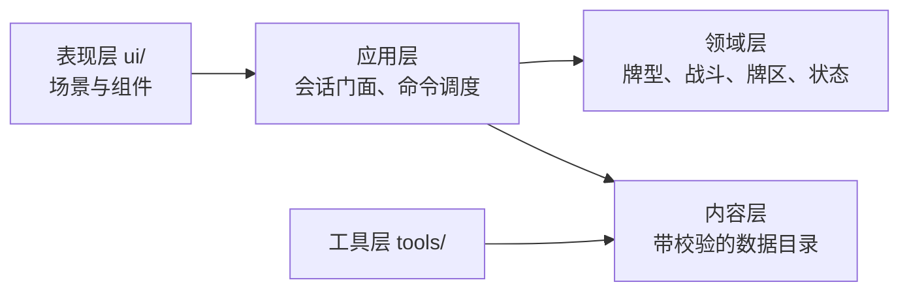

# 开发流程与重要节点

日期：2026-08-07
适用范围：`combo_duel_vslice/` 实现工程

本文件描述从设计变更到代码落地的流程、每个节点的质量门禁与验证方式。
不描述游戏规则本身，规则的唯一权威源是 `godot/docs/design-current/README.md`。

## 分层与依赖方向



依赖只能从左向右。当前实测状态：`core/` 不引用 `ui/` 或 `tools/`，`ui/` 只
preload 三个 core 文件（组合根、战斗会话、战斗引擎）。**新增跨层引用前先确认方向。**

## 节点一：设计变更

**入口**：`godot/docs/design-current/` 下对应模块文件。

规则先改文档，再改代码。文档是权威源，代码是它的实现，不是反过来。

**门禁**：功法池变更后运行设计一致性检查。

```bash
/Applications/Godot.app/Contents/MacOS/Godot --headless \
  --log-file /tmp/taiwu-design-check.log \
  --path combo_duel_vslice \
  --script res://tools/run_design_consistency_check.gd
```

它比对权威文档的活跃名单与 `data/techniques/` 实际接入内容，报出三类问题：
数据里有但权威名单查无此名、已废弃功法仍活跃、功法挂在已废弃牌型池上。

**当前基线：权威活跃 107 门，数据接入 47 门，待接入 62 门，错误 3 条。**
这 3 条是既有数据问题（清风过隙不在活跃名单；百击归烬已废弃但仍活跃且挂在
已废弃的 flush 池上），尚未处理。**新增变更不应让错误数增加。**

## 节点二：内容数据变更

**入口**：`data/*.json` 与 `data/techniques/*.tres`。

内容不通过校验时游戏拒绝启动，不静默降级。这是刻意的：空定义向下游流动后会
表现为 `.get()` 默认值，把内容缺陷伪装成正常运行，定位成本远高于入口直接失败。

**门禁**：内容批量校验 + 内容契约测试。

```bash
./scripts/run_tests.sh quick      # 含 content-pipeline 与 content-contracts
```

`ContentValidator`（945 行）负责十二份内容文件的整体形状；效果规格本身由
`EffectSpecValidator`（287 行）负责，操作码新增时改后者。

## 节点三：领域规则实现

**入口**：`core/` 下对应服务。

写代码前先确认这条规则属于哪一层：

| 关注点 | 归属 |
|---|---|
| 牌型识别与数值 | `hand_evaluator.gd`、`power_calculator.gd` |
| 效果执行 | `core/effects/` 下对应处理器 |
| 效果如何修改战斗状态 | `core/effects/battle_effect_ports.gd`（唯一窄端口） |
| 回合生命周期 | `battle_round_service.gd` |
| 行动事务顺序 | `battle_action_service.gd` |
| 配装顺序 | `battle_loadout_service.gd` |
| 牌区移动 | `card_zone_service.gd` |

**约束**：效果处理器只能通过 `BattleEffectPorts` 修改状态，不直接拿完整
`CombatEngine`。端口的四个依赖是必需的，不接受 null —— 允许缺依赖就意味着每个
方法都要带兜底分支，而兜底分支会在依赖真的缺失时静默改用另一套判定。

**门禁**：

```bash
./scripts/run_tests.sh full
```

## 节点四：表现层实现

**入口**：`ui/` 与 `ui/components/`。

**约束**：

- 表现层只通过 `BattleSnapshot` / `RunSnapshot` 的**字段**读状态，不用字典键。
  这两个类不提供 `value(key, default)` 或 `section(key)`，键名写错会在解析期暴露。
- 新增快照字段必须同时改三处：会话的快照构造、快照类的字段声明、`from_dict`
  与 `to_dict`。漏改 `from_dict` 会让字段永远是默认值。
- 组件 `present()` 收类型化对象，不收 `Dictionary`。在调用处转回字典等于把
  类型边界又打开一个口。
- 共享控件工厂放 `ui/ui_design.gd`，不在页面里写第二份实现。

**已知反面样本**：`battle_loadout_view.gd` 曾读 `inner_skill_limit`，而该字段
从未被任何快照产出，界面一直显示硬编码默认值 6。真正的上限是 `battle_side.gd`
的魔法数，两个 6 互不相关地碰巧一致。这类缺陷正是字段化边界要消除的。

## 节点五：测试

**结构**：`tests/groups/*.gd` 只声明用例名，断言实现在 `tests/test_runner.gd`
与 `tests/test_technique_runtime.gd`。`scripts/run_tests.sh` 的
`verify_group_coverage` 会 diff 两边，防止漏注册。

**新增测试要改两处**：runner 的 `_initialize()` 调用列表 + 对应 group 文件的
名字列表。只改一处会被覆盖检查拒绝。

**当前基线：17 组，133891 断言，全绿。**

**门禁分级**：

```bash
./scripts/run_tests.sh quick   # 7 组：项目加载、运行档、内容、牌型、功法契约、确定性
./scripts/run_tests.sh full    # 17 组：加上存档、功法运行时、战斗、AI、地图、UI
./scripts/verify_test_runner.sh  # 验证运行器本身能检出失败（防止测试假绿）
```

`verify_test_runner.sh` 存在的原因：Godot 在脚本无法加载时仍可能返回退出码 0。
运行器把 stdout 里的 `Can't load script` 与 `File not found` 也当失败。

## 节点六：提交前

按顺序：

1. `./scripts/run_tests.sh full` —— 必须全绿
2. 新增了 `class_name`？先重扫类缓存，否则继承解析会失败并报误导性错误：
   ```bash
   /Applications/Godot.app/Contents/MacOS/Godot --headless \
     --log-file /tmp/taiwu-rescan.log --path combo_duel_vslice --editor --quit
   ```
3. 改了共享常量？回扫全部引用方，确认没有第二处硬编码同一个值
4. 提交信息说明**为什么**这样改，不只说改了什么

## Godot 进程约束（macOS）

见 `AGENTS.md`。要点：

- 每次调用必须显式指定 `--log-file` 到 `/tmp` 下的独立路径
- 默认串行运行测试；并行时每个进程必须用不同日志文件
- 不要写默认 `user://logs`，该日志未轮转会让 Godot 4.7.1 崩溃并弹出 macOS 崩溃框
- 退出码 0 不代表成功，必须扫 stdout 的错误关键字

## CI

`.github/workflows/combo-duel-tests.yml` 在 `combo_duel_vslice/**` 或
`scripts/**` 变更时触发，固定 Godot 4.7.1，先跑 `verify_test_runner.sh` 再跑
`run_tests.sh full`，日志作为构件保留 14 天。

## 当前架构债务

按优先级：

1. **四个类仍是字典包装**：`RunProgressSnapshot`、`BattleEvent`、`RunEvent`、
   `AiConversationSnapshot` 仍提供 `value(key, default)`。它们分别是存档、事件流
   与 AI 传输边界，与已完成的快照边界同类问题。
2. **`core/` 仍有 1417 处 `.get(key, default)`**：分布在内容定义读取、效果参数
   与命令字典上。这不是单一边界，需要按边界逐条处理，不宜一次性替换。
3. **裸 `{"success": ..., "reason": ...}` 353 处**：`BattleCommandResult` 已存在
   但只有 5 处引用。命令结果边界尚未收口。
4. **`content_validator.gd` 945 行**：形状校验仍在单文件内，按内容类型进一步拆分
   的收益需要评估 —— 十二个域校验器共享 9 个增量建立的索引，切分后耦合会变显式
   但不会减少。
5. **设计一致性检查 3 条既有错误**：见节点一。

## 不做什么

- 不引入全局事件总线。当前依赖方向清晰，事件总线会让调用链变成运行期才可知。
- 不为「将来可能需要」加抽象层。`ContentLoader` 之类的抽象等到内容来源真的扩展到
  资源包或 Mod 时再建。
- 不保留兼容旁路。上一次 DTO 迁移因为兼容层与新路径并存而停在半路：至今
  `*_dto()` 只有 8 处调用，而字典读取有上千处。本轮快照边界改造删掉了
  `value()` / `section()` 而不是留着它们，就是为了不重复这个结果。
