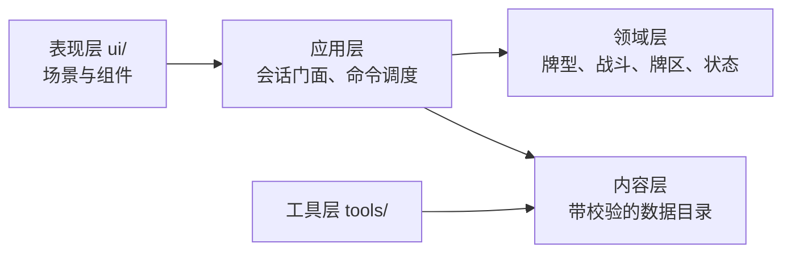

# 开发流程与重要节点

日期：2026-08-08
适用范围：`combo_duel_vslice/` 实现工程

本文件描述从设计变更到代码落地的流程、每个节点的质量门禁与验证方式。
不描述游戏规则本身，规则的唯一权威源是 `godot/docs/design-current/README.md`。

## 分层与依赖方向



依赖只能从左向右。当前实测状态：`core/` 不引用 `ui/` 或 `tools/`，`ui/` 只
preload 三个 core 文件（组合根、战斗会话、战斗引擎）。**新增跨层引用前先确认方向。**

## 节点一：设计变更

**入口**：`godot/docs/design-current/` 下对应模块文件。

规则先改文档，再改代码。文档是权威源，代码是它的实现，不是反过来。

**门禁**：功法池变更后运行设计一致性检查。

```bash
/Applications/Godot.app/Contents/MacOS/Godot --headless \
  --log-file /tmp/taiwu-design-check.log \
  --path combo_duel_vslice \
  --script res://tools/run_design_consistency_check.gd
```

它比对权威文档的活跃名单与 `data/techniques/` 实际接入内容，报出名称、池归属和废弃状态
问题。它不解析自然语言公式，也不证明条件、目标、时点或失败边界已经实现。

**当前结构基线：228 门正式资源，其中 2 门基础通用功法与 226 门非内建正式功法。五个正式池分布为60／54／35／37／40；全部正式内容已经完成独立资源、公共底层与专项测试接入。**
正式资源的池归属、实现分类与行为证据见 `technique-content-status.md`。设计一致性检查必须保持结构错误 0 条，但不能用这个结果替代行为验收。

两门功法已按权威源移除：`清风过隙` 随风池重写移出活跃名单（提交 `d66b4a3` 同时
删除它并加入 `长风满袖`，两者效果不同，不是改名）；`百击归烬` 随同花池整体废弃。
它们承载的两个操作码保留并改由测试合成夹具覆盖，见下节。

## 节点二：内容数据变更

**入口**：`data/*.json` 与 `data/techniques/*.tres`。

内容不通过校验时游戏拒绝启动，不静默降级。这是刻意的：空定义向下游流动后会
表现为 `.get()` 默认值，把内容缺陷伪装成正常运行，定位成本远高于入口直接失败。

**门禁**：内容批量校验 + 内容契约测试。

```bash
./scripts/run_tests.sh quick      # 含 content-pipeline 与 content-contracts
```

`ContentValidator` 负责内容文件之间的整体形状和引用；效果规格本身由
`EffectSpecValidator` 负责，操作码新增时改后者。文件规模会随协议演进，不在流程文档记录行数。

内功或物品需要执行标准战斗写效果时，使用 `battle_effects` behavior：

```json
{
  "id": "battle_effects",
  "configuration": {
    "hook": "action_resolved",
    "effects": [{"op": "defense", "side": "owner", "amount": 2}]
  }
}
```

十个生命周期 Hook 还必须声明整数 `order`；`action_resolve` 与已提交事件 Hook 不声明
`order`。只有 `action_resolve` effects 可以声明 `phase`；其他 Hook 是单条有序链，显式 phase
会在加载期失败。效果规格与功法完全共用同一校验器、Handler、ValueSpec、ConditionSpec 和
TargetQuery。内容不得填写来源字段或事件／行动令牌，也不得用未登记 Hook。需要选择并等待
恢复的效果放在 `action_resolve`；已提交事件与生命周期效果链必须一次完成。

### 硬编码边界

- 功法、异状、角色状态、奖励和修习商品等**内容 ID**不得散落在会话、战斗流程或
  UI 中；定义、引用、处理器绑定与参数进入 `data/`，核心只按已校验协议分发。
- 操作码、触发时点、牌区名、命令类型、schema version 等属于**协议词汇**，继续由
  代码枚举并由校验器拒绝未知值；把它们移进配置只会失去静态约束。
- 扑克牌型识别、牌区不变量和伤害结算顺序属于**公共规则**。只有建立了完整的数据
  契约与执行器后才迁移，不以“源码中零字符串”为目标制造第二套规则语言。
- 显示名称从内容目录读取，不在业务服务里维护 ID 到中文名的重复映射。

## 节点三：领域规则实现

**入口**：`core/` 下对应服务。

写代码前先确认这条规则属于哪一层：

| 关注点 | 归属 |
|---|---|
| 牌型识别与数值 | `hand_evaluator.gd`、`power_calculator.gd` |
| 效果执行 | `core/effects/` 下对应处理器 |
| 效果如何修改战斗状态 | `core/effects/battle_effect_ports.gd`（唯一窄端口） |
| 伤害、防御与生命结算实现 | `core/effects/battle_survival_effect_service.gd`（Facade 内部服务） |
| 牌区、真气异状与临时重塑实现 | `core/effects/battle_card_effect_service.gd`（Facade 内部服务） |
| 来源标识、连势、同气与战斗来源写入 | `core/effects/battle_source_resource_effect_service.gd`（Facade 内部服务） |
| 效果上下文、即时嵌套与功法调用编排 | `core/effects/battle_invocation_effect_service.gd`（Facade 内部服务） |
| 延迟效果、动态响应与直接真气监听编排 | `core/effects/battle_response_effect_service.gd`（Facade 内部服务） |
| 毒真气触发、清毒与同步完成事件协调 | `core/effects/battle_poison_card_trigger_service.gd`（Facade 内部服务） |
| 额外行动、战斗历练、战斗消耗品与通用历史写入 | `core/effects/battle_action_resource_effect_service.gd`（Facade 内部服务） |
| 被动标准效果何时执行 | `passives/battle_effects_passive_handler.gd` 只建立普通效果计划 |
| 回合生命周期 | `battle_round_service.gd` |
| 行动事务顺序 | `battle_action_service.gd` |
| 配装顺序 | `battle_loadout_service.gd` |
| 牌区移动 | `card_zone_service.gd` |
| 心得增长规则 | `insight_growth_service.gd` |

**约束**：效果处理器只能通过 `BattleEffectPorts` 修改状态，不直接拿完整
`CombatEngine`。端口的四个依赖是必需的，不接受 null —— 允许缺依赖就意味着每个
方法都要带兜底分支，而兜底分支会在依赖真的缺失时静默改用另一套判定。

`InsightGrowthService` 是心得成长的唯一规则事实源：它统一负责精确牌型
校验、`insight_slot_gain_query` 被动查询、容量上限裁剪、候选过滤与稳定排序、
RNG 选择、已拥有／已在序列去重以及完整配装校验，只返回可提交方案。
`GrowthInventory.apply_insight_growth` 只把方案提交到本局
`hand_technique_progression` 与 `learned_technique_ids`；
`BattleSide.apply_insight_growth` 只把方案提交到战斗工作状态，再通过
`BattleEffectPorts.change_technique_slot_capacity` 立即同步 `SequenceBook`，不直接修改
序列内部数组，也不自动装备新获得的功法。

战斗内永久槽位不在开战时冻结。心得提交成功后，工作状态与
`SequenceBook` 容量在同一调用内完成同步，后续尚未确认的行动立即读取新容量。
已确认行动冻结的功法槽、P／P₀ 与牌型组快照只保护当前行动，不冻结后续永久成长。
容量端口或事件提交失败时，适配器必须立即恢复成长状态、已拥有集合、
`SequenceBook` 快照与本次候选抽取前的 RNG；不得等待下一次快照覆盖。

`ConsumableUseService` 是战斗内外唯一的消耗品用例编排：槽位与定义校验、
unique 限制、目标冻结、准备令牌、Handler 顺序、库存扣除、最近可溯忆记录、
`consumable_use_sequence` 推进及提交／回滚都只在该服务保留一份实现。
`RunConsumableUseContext` 负责把公共事务适配到 `GrowthInventory` 工作副本、
`RunDeck` 目标与本局种子派生随机源；`BattleConsumableUseContext` 负责把同一事务
适配到 `BattleSide`、当前手牌、战斗 RNG 以及战斗 Runtime 快照。不支持的战斗外
能力在 Battle 查询阶段拒绝，不会执行一半后失败。

`BattleConsumableService` 只保留战斗 active／待选择门禁、成功日志、一次
`state_changed` 与旧 UI 结果投影，不遍历 effects、不扣库存、不推进序号，也不维护
第二套补偿清单。战斗内消耗只修改 `BattleSide` 工作状态；退出节点时丢弃，正式
结算时才经 `RunProgressSnapshot` 提交。失败回滚同时覆盖双方战斗状态、牌区、
`SequenceBook`、来源标识、run／battle 计数器、`StatusSystem`、战斗 RNG、触发日志，
以及 `BattlePassiveCommittedEventService` 的 serial、receipt 和 execution history；
事务中的 committed event 延迟到成功提交后才对监听器发布。

`RunAggregateTransaction` 是正式战斗结果提交的完整本局聚合事务边界。
`BattleOutcomeCommitService` 只编排以下既有能力：把绝对 `RunProgressSnapshot`
提交到 `GrowthInventory`、触发一次 `battle_completed`、推进地图、建立奖励或终局、
写统一日志与 `RunEvent`，最后提交聚合事务。事务捕获成长完整 mutation state、
地图状态、`ComboRunState` 终局与被动附属状态、节点交互状态、待领取奖励、
胜利结果、日志、事件队列及序号；恢复只写状态，不重新执行效果或随机奖励。

战斗工作状态的实时变化不等于立即修改正式 `RunState`。胜利或战败的全部业务状态
成功后，`RunSession` 才统一发送一次 `changed`、关闭一次 `BattleSession`，随后由
命令边界产生一次 `persistence_boundary_reached("resolve_battle_result")`；数据库／JSON
保存只能发生在这个成功边界之后。任一步失败都恢复整个聚合并保留已终止的
`BattleSession` 与终局快照，不发送 changed、不触发自动存档，调用方可以重试同一正式
结果。玩家主动退出仍只丢弃战斗会话，并从既有节点入口检查点重新开始。

本局被动来源不再按节点长期冻结。`RunPassiveEventService` 在一次事件开始时从当前
`GrowthInventory` 捕获来源并建立唯一 `ExecutionPlan`；本次执行期间新增或失去的来源
不会加入或移除该计划，下一次事件则重新读取最新的内功、物品和来源标识状态。
`battle_completed` 在战斗进度合入后捕获，`node_completed` 在奖励应用前捕获，Boss 宝箱
在宝箱结算变更前捕获。节点存档不保存可派生来源列表；旧 schema v1 若带有旧字段只做
格式／内容校验，恢复时忽略，下一次保存自然移除。行动级功法槽、P／P₀、牌型组和选择
候选快照仍按原协议冻结，与事件级来源计划无关。

`BattleEffectPorts` 是公开协议 Facade，不是所有效果算法的永久归宿。伤害、防御与生命相关
公开方法继续保留原签名，但内部统一委托 `BattleSurvivalEffectService`。该服务只能接收完成
结算所需的明确依赖：`DamageResolver`、`StatusSystem` 的现有窄能力、战斗规则查询、committed
event 发布端口、双方集合、回合读取器和统一历史入口；禁止传入完整 `CombatEngine`、回指
Facade、复制 `BattleSide` 规则或按功法／内功／物品／状态 ID 分支。反震、格挡与邀战来源的
建立已经迁入 `BattleSourceResourceEffectService`；伤害发生时的查询、消费与正式结算仍只在
`BattleSurvivalEffectService` 保留一份实现。

结构优化批次允许采用分阶段门禁，但交付必须明确范围。BattleEffectPorts 伤害／防御／生命首批
只运行项目加载和 `res://tests/test_battle_survival_effects.gd` 专项；每次 Godot 调用使用独立
`/tmp/taiwu-battle-effect-damage-<用途>-<序号>.log`，并扫描 `Can't load script`、
`File not found`、`Parse Error` 与 `SCRIPT ERROR`。该批不运行 `quick`／`full`；完整回归统一留到
`BattleEffectPorts`、`BattleActionService` 和 `StatusSystem` 全部结构优化结束后执行，不能把
当前最小专项门禁描述为全部回归通过。

第二批牌区／真气／异状／临时重塑拆分同样保留 `BattleEffectPorts` 的全部公开签名。Facade
负责把 `source_kind`、`source_id`、`source_name`、`source_instance_key`、`trigger_mode` 与
`draw_reason` 规范化后委托 `BattleCardEffectService`。内部服务可以持有 `StatusSystem` 的真气
状态窄能力、双方只读集合、统一战斗 RNG 和 `CardReshapeBattleRuntime`，但不得持有完整
`CombatEngine`、回指 Facade、直接修改 `BattleSide` 牌区数组或自建随机源。牌区写操作必须经过
`CardZoneService`；明确弃牌沿用明确注入的 `BattlePermissionService`，同步移动和原子交换继续
先冻结完整合法目标集。异状继续经 `StatusSystem`／`CardStateLifecycle` 合法性与事件路径，临时
重塑只写战斗槽位，不改变基础身份或本局永久牌组。

`card_moved`现为唯一的牌区变化committed事实，同时仍在`DYNAMIC_RESPONSE_EVENTS`中供
`StatusSystem`既有动态响应使用。`CardZoneService`在真实写入和牌状态生命周期完成后集中冻结
同一份事件数据：事件/行动令牌、牌实例、逻辑from/to、reason、placement、移动前快照、双方持有方、
原始所有者、来源协议、牌区与手牌before/after，以及同步批次令牌和批次内序号。生成使用
`from_zone=generated`；临时与非临时生成分别保留`temporary_generate`、`permanent_generate`，
不得改写为笼统的`generated`原因，也不得新增平行生成事件。

事件顺序固定为：完成真实牌区写入和既有牌状态生命周期；执行`card_moved`被动Hook；提交既有
`card_drawn`、`card_entered_discard`、`card_explicitly_discarded`专项事实（专项事实之间的旧顺序
不变）；最后用同一份冻结数据分发现有动态响应。动态桥对带延迟标记的committed通知不立即重放，
由`CardZoneService`在专项事实后分发一次，因此committed与动态响应不会双触发或各自拼装字段。
行动stage与stage rollback只表示提案，不发布事实；正式确认按逐张逻辑
`hand→discard_pile/temporarily_removed`及`hand_count_before/after`提交。预览、失败请求、初始牌库
装载/洗牌、快照恢复、战斗结束临时牌清理和战后批量归还同样不发布。

`placement=bottom`由`CardZoneService.move_card`在目标数组写入时一次完成，事件发布时牌已经位于
底部；`BattleCardEffectService`不再在移动后第二次调用重排。同步移动、批量转移和原子交换先完成
全批移除与写入，再按冻结顺序逐牌发布；观察者不会读取半完成交换。`card_moved`使用
`observe_all_sides`让双方被动来源都建立计划，但每个Invocation的效果actor仍重绑定为该被动来源
owner，观察敌方移动不会把收益默认施加给敌方。

`trigger_poison_card` 暂留 Facade，以现有卡牌服务和 `BattleSurvivalEffectService` 组合真气状态、
毒伤与事务事件，禁止复制毒伤算法。`notify_cards_played`、`notify_poison_triggered`、响应监听、
来源标识、连势／同气、延迟效果和功法调用留给后续批次。本批只运行项目加载与
`res://tests/test_battle_card_effects.gd`，每次调用使用独立
`/tmp/taiwu-battle-effect-card-<用途>-<序号>.log`，并扫描 `Can't load script`、
`File not found`、`Parse Error` 与 `SCRIPT ERROR`。专项当前覆盖牌区移动、虚无、临时真气、异状、
临时重塑、同步／原子移动和毒异状桥接；`quick`／`full` 延后到 `BattleEffectPorts`、
`BattleActionService` 与 `StatusSystem` 全部结构优化完成后统一执行。

第三批来源标识／连势／同气／战斗来源拆分继续保留 `BattleEffectPorts` 的公开签名。
`BattleSourceResourceEffectService` 负责来源 marker、`write_momentum`、同气预估／写入／回执、
直接功法值修正，以及反震／格挡／邀战来源建立和公开变化事件；`SameQiGaugeService` 仍是容量、
消费与同气额外行动的唯一事实源。服务只能通过窄接口读取当前行动窗口并关闭来源绑定窗口，不能
持有完整 `BattleFlowCoordinator`、`CombatEngine` 或回指 Facade。生存服务继续只在伤害发生时
读取和消费来源，`StatusSystem` 继续按既有生命周期推进到期与邀战结算，两边不得复制算法。

该批只运行项目加载与 `res://tests/test_battle_source_resources.gd`，每次调用使用独立
`/tmp/taiwu-battle-effect-source-<用途>-<序号>.log`，并扫描 `Can't load script`、
`File not found`、`Parse Error` 与 `SCRIPT ERROR`。专项覆盖来源标识、连势、同气、反震来源、
格挡来源、邀战来源和直接功法值修正；`quick`／`full` 继续延后到全部结构优化结束后统一执行。

第四批效果调用／延迟／响应拆分继续保持 `BattleEffectPorts` 的全部公开签名。当前上下文栈、即时
插入队列、`execute_effect_chain` 装配、功法调用与调用时点、序列变化事件和重触回调统一委托
`BattleInvocationEffectService`；该服务只弱引用 `EffectExecutor` 与
`TechniqueInvocationService`，并通过 committed event 端口与回合读取器发布序列变化，不接管
continuation、调用请求冻结、递归保护、P0/P 结算或槽位推进算法。延迟、响应和直接真气监听入口统一
委托 `BattleResponseEffectService`；该服务只调用 `StatusSystem` 当前公开注册／响应入口和
`CardReshapeBattleRuntime` 的窄监听端口，不移动 StatusSystem 记录、不重写匹配或到期扫描。

`trigger_poison_card`、`notify_cards_played`、`notify_poison_triggered`、
`resolve_played_card_anomalies` 的跨服务桥接、额外行动、战斗历练、消耗品生成与通用历史仍留在
Facade。本批只运行项目加载与 `res://tests/test_battle_effect_flow.gd`，每次 Godot 调用使用独立
`/tmp/taiwu-battle-effect-flow-<用途>-<序号>.log`，并扫描 `Can't load script`、
`File not found`、`Parse Error` 与 `SCRIPT ERROR`。专项覆盖自动功法、调用、即时嵌套、延后调用、
延迟效果、动态响应、功法重触、直接真气监听和等待选择恢复；`quick`／`full` 尚未运行，完整回归
继续延后到 `BattleEffectPorts`、`BattleActionService` 与 `StatusSystem` 全部结构优化完成后统一执行。

第五批完成 `BattleEffectPorts` 最终收口，公开方法继续保持原签名。`BattlePoisonCardTriggerService`
只组合既有卡牌状态服务和生存服务，集中毒触发冻结、成功后清毒与同步 flush 后完成事件；不得复制
毒伤、防御、异状或 receipt 算法。`BattleResponseEffectService` 统一“先结算打出异状、再通知
card_played 响应”的顺序。`BattleActionResourceEffectService` 只通过 `BattleFlowCoordinator`、
`BattleSide` 既有资源能力、已装配内容目录和 `VisibleTriggerQueue` 窄入口写入额外行动、战斗历练、
共享消耗品与历史，不推进 `BattleActionService` 状态机，不计算同气额外行动，也不重新加载内容。

Facade 允许保留来源结构规范化、旧字符串来源转换、`draw_reason` 独立适配、双方窄查询和公开方法
委托。`notify_poison_triggered` 与 `add_history` 仍有正式运行时调用方；`notify_cards_played` 是既有公开
能力的兼容委托，但打出后跨域顺序只在响应服务保留一份实现。新内部服务不得持有 `CombatEngine`、
回指 Facade、通过大量 Callable 模拟 Facade，或互相形成写状态循环。

第五批开发阶段先运行项目加载与 `res://tests/test_battle_effect_finalization.gd`；五批全部完成后已执行
最终统一验收：项目加载 670 项、第五批专项 50 条断言、`quick` 7/7、`full` 30/30、设计一致性
228/228／待接入0／错误0。项目加载与专项日志分别为
`/tmp/taiwu-battle-effect-final-acceptance-project-load-06.log`、
`/tmp/taiwu-battle-effect-final-acceptance-specialized-07.log`；quick／full 每组日志分别使用
`/tmp/taiwu-battle-effect-final-quick-<组名>-<序号>.log` 与
`/tmp/taiwu-battle-effect-final-full-<组名>-<序号>.log`；设计检查日志为
`/tmp/taiwu-battle-effect-final-design-consistency-08.log`。

全部 Godot 日志和 stdout 旁路必须扫描 `Can't load script`、`File not found`、`Parse Error`、
`SCRIPT ERROR`、ObjectDB／RID／资源泄漏、orphan `StringName`／`NodePath` 与退出阶段错误。当前最终验收
无上述匹配，仅有已知非阻塞 macOS CA 警告。BattleEffectPorts 阶段不得再写“quick／full延后”；
后续 `BattleActionService` 与 `StatusSystem` 重构必须保持本次 7/7 quick、30/30 full 基线。

`BattleActionService` 第一批已经建立 `BattleActionTransaction`，统一保存行动阶段、牌型组、暂停状态、
恢复游标、冻结／提交牌 ID、公开结果和结构化失败原因；运行时引用只保存在 `runtime_context`，版本化
snapshot 不公开 `Object`、`Callable` 或服务引用。第二批只合并玩家单方与敌方单方主组编排：两类入口
各自完成提案或锁定牌的 stage／finalize／confirm 后，建立含 actor、target、preview、record、sequence
book、稳定角色、协同组、累计提交牌和结果字段映射的 `solo_action` 上下文，再共同执行
`begin_action_resolution → resolve_action_records → commit_staging_for → post_commit →
finish_action_resolution → 同气 → complete_transaction`。等待选择和恢复只按事务 phase、group 与稳定游标
推进，不再按 initiator 调用两套玩家／敌方 resolution 或 post_commit 函数。

第二批保留必要角色差异：玩家入口继续使用 `ActionProposal`、玩家序列与可选协同，并在完成后发送
`emit_state_changed`；敌方入口继续读取锁定牌、敌方序列和行动索引，并在完成后递增索引、更新战斗
状态及清理行动锁。同步主组、同步协同和 `StatusSystem` 不在本批重构范围；玩家单方协同仍使用现有
协同牌型组阶段，只由统一单方管线识别并在协同完成后回到统一行动收尾。

第二批门禁只允许静态检查与项目脚本加载检查；每次 Godot 调用继续使用独立显式 `/tmp` 日志并扫描
`Can't load script`、`File not found`、`Parse Error` 与 `SCRIPT ERROR`。不运行 `quick`／`full`，也不把
本批最小加载门禁描述为完整回归；完整统一回归仍等 `BattleActionService` 与 `StatusSystem` 优化完成。
第二批项目加载实际覆盖 671 项，日志为 `/tmp/taiwu-battle-action-solo-project-load-02.log`；禁止错误关键字
无匹配，仅出现已知非阻塞 macOS CA 证书警告。

`BattleActionService` 第三批建立唯一 `_execute_current_group` 牌型组执行器。单方主组、同步主组、
单方协同和同步行动中的协同现在共用
`resolve_action_records → pending choice → committing_zones → pre_commit → commit → post_commit →
pending choice → finish_action_record` 顺序；`_continue_active_transaction` 只校验事务 phase 与稳定恢复游标，
随后回到这一入口，不再按 solo／synchronized × main／cooperation 维护分派矩阵。同步伤害开关冻结在
当前组上下文，只有实际同步主组为 true；协同组继续作为同步伤害层之后的独立普通组运行。

运行时上下文固定分成 `action_context` 与 `current_group_context`。行动级长期保存 resolution mode、双方
preview、主组触发结果、`enemy_will_act`、主组及整次行动累计提交牌、协同组和最终结果字段；当前组只
保存 group kind、records、previews、actor／target、同步伤害开关、窄提交策略、本组提交牌、协同定义与
等待选择展示字段。切换协同组只替换当前组上下文，行动上下文和主组提交牌 ID 继续保留；snapshot 仍
不公开 Object、Callable 或服务引用。提交差异只剩 actor staging、同步双方 staging 与现有
`commit_cooperation_staging` 三种窄策略，单方／同步最终 outcome 继续各自处理结果 DTO 与角色收尾。

第三批删除原单方协同、同步主组和同步协同的八个 resolution／post_commit 辅助路径；
`resolve_action_records`、`resolve_post_commit_phase` 和 `finish_action_record` 在服务内各只剩一个阶段调用点。
`BattleActionService` 当前约 1540 行。下一步只做该服务职责拆分或收尾检查，不再建立另一套阶段推进；
随后进入 `StatusSystem` 结构优化，二者完成后再执行延后的统一 `quick`／`full` 回归。

第三批门禁仍只允许静态检查与项目脚本加载检查。Godot 调用必须 headless、串行并使用独立显式
`/tmp` 日志，同时扫描 `Can't load script`、`File not found`、`Parse Error` 与 `SCRIPT ERROR`；本批不运行
`quick`／`full`，也不把最小加载门禁描述为完整回归。最终项目加载覆盖 671 项，日志为
`/tmp/taiwu-battle-action-group-project-load-final-02.log`；禁止错误关键字无匹配，仅出现已知非阻塞
macOS CA 证书警告。

`BattleActionService` 第四批新增 `BattleActionPreparationService`，只承接玩家行动在 staging 之后、
行动事务开始之前的准备边界。服务的窄公开接口为 `prepare_cooperation`、
`finalize_staged_proposal`、`confirm_finalized_proposal` 与 `rollback_power_formation`；内部统一完成协同
组牌数／重复牌／牌型／异状／共享属性／权限校验，使用玩家序列副本建立协同预览，冻结整次行动的
同气牌集合与投影，依次 finalize 主组和协同组，并提交或回滚各组功法值形成 receipt。正式确认失败时
由准备服务先回滚功法值形成事务，调用方随后按原顺序回滚玩家／敌方 staging。

准备服务只持有 player／enemy `BattleSide`、现有 `ActionResolver` 准备能力、玩家 `SequenceBook`、
统一预览回调与回合读取器；不持有 `CombatEngine`、`BattleActionService`、
`BattleActionTransaction`、`BattleFlowCoordinator`、`TriggerQueue`、UI 或 AI 控制器。同步行动顺序仍在
`BattleActionService` 明示：先冻结玩家提案，再冻结敌方锁定行动，双方均成功后才依次正式确认。
该服务不 stage／commit 牌区，不消费行动、不锁定意图、不开始事务、不执行 resolve／post_commit，也
不实际写入同气收益；`_apply_same_qi_gain` 继续留在行动完成边界。

迁移后 `BattleActionService` 删除原十个准备私有实现，当前 1223 行，只保留 stage、准备服务调用、
意图锁定／行动消费、事务建立、唯一牌型组执行器、等待恢复、单方／同步 outcome 和角色收尾；
`BattleActionPreparationService` 为 419 行。下一步先审计单方／同步 outcome 是否存在足够稳定的共同
边界；当前两者主要差异集中在敌方索引／行动锁／后续调度、状态通知和返回 DTO，继续拆成新服务很可能
反而扩大回调依赖，因此若审计没有发现新的阶段重复，就直接进入 `StatusSystem` 优化。

第四批仍不运行 `quick`／`full`，只执行静态检查和项目脚本加载。Godot 必须 headless、串行且每次使用
独立显式 `/tmp` 日志，并扫描 `Can't load script`、`File not found`、`Parse Error` 与 `SCRIPT ERROR`；
完整统一回归继续等 `BattleActionService` 收尾与 `StatusSystem` 优化全部完成后执行。最终项目加载覆盖
672 项，日志与 stdout 分别为 `/tmp/taiwu-battle-action-preparation-project-load-final-03.log` 和
`/tmp/taiwu-battle-action-preparation-project-load-final-03.stdout`；禁止错误关键字无匹配，仅出现已知
非阻塞 macOS CA 证书警告。

BattleEffectPorts 与 BattleActionService 两项结构优化完成后，于 2026-08-16 追加执行进入
`StatusSystem` 重构前的阶段性统一验收。该验收没有修改业务代码：`git diff --check` 通过；独立项目
加载覆盖 672 项；`BattleActionTransaction` 专项 117 条断言通过；`quick` 7/7 组通过；当前完整发现集
`full` 31/31 组通过；设计一致性为权威活跃 228 门、数据接入 228 门、待接入 0 门、错误 0 条。

阶段基线日志如下：项目加载使用
`/tmp/taiwu-stage-acceptance-project-load-01.log`（stdout 为同名前缀 `.stdout`）；事务专项使用
`/tmp/taiwu-stage-acceptance-battle-action-transaction-02.log`（stdout 为同名前缀 `.stdout`）；quick 每组
使用 `/tmp/taiwu-stage-acceptance-quick-<组名>-<序号>.log`，full 每组使用
`/tmp/taiwu-stage-acceptance-full-<组名>-<序号>.log`，两者 stdout 均为对应日志名追加 `.stdout`；设计
一致性使用 `/tmp/taiwu-stage-acceptance-design-consistency-03.log`（stdout 为同名前缀 `.stdout`）。
全部 Godot 进程均 headless、串行且使用独立显式 `/tmp` 日志；stdout 与日志复扫没有发现
`Can't load script`、`File not found`、`Parse Error`、`SCRIPT ERROR`、ObjectDB／RID 泄漏、orphan
`StringName`／`NodePath`、资源泄漏或退出阶段错误，只有已知非阻塞 macOS CA 证书警告。该结果是
`BattleEffectPorts` 与 `BattleActionService` 优化完成、进入 `StatusSystem` 重构前的稳定基线。

`StatusSystem` 第一批结构优化只迁出状态变化历史，不改真气异状、动态响应、延迟效果、战斗来源
生命周期或功法抽牌统计。新增 `core/statuses/status_history_service.gd` 作为后续状态子服务共用的
唯一历史记录器，集中持有同一个 `history` 数组、状态变化 serial、`StatusChange` 建立与快照、
状态名称查询、统一 `GameLog` 写入、历史只读快照，以及 reset／恢复后的 serial 重建。

`StatusSystem` 继续是公开 Facade：初始化时把 `history` 一次性绑定到历史服务持有的数组；
`history_snapshot`、`use_game_log`、`replace_history` 与 reset 中的历史清理只做薄委托。既有
`status_system.history`、`history.is_empty()`、`history.size()` 和直接 `history.assign(...)` 读取／兼容
能力仍引用同一个数组实例，reset 与正式恢复都不替换数组对象。系统内部全部状态变化写入点直接调用
`status_history.record_change(...)`，没有保留同内容的 `_record_change` 私有壳。

`BattleSide` 的状态快照恢复不再写入 `StatusSystem` 私有 serial，也不再直接 assign 历史；它调用
`status_system.replace_history(...)`。恢复接口原地替换内容，并按记录中的最大 serial 将下一值设为
`max_serial + 1`；空历史从 0 开始，恢复过程不写 `GameLog`、不生成新状态变化。迁移后
`status_system.gd` 为 1263 行，`status_history_service.gd` 为 76 行。下一批只拆真气异状变更服务，
继续保留 `CardStateLifecycle` 与当前异状合法性、层数、响应和事件顺序。

本批只执行 `git diff --check` 与 headless 项目脚本加载检查；Godot 串行运行并使用独立显式
`/tmp/taiwu-status-history-project-load-01.log`，扫描 `Can't load script`、`File not found`、
`Parse Error` 与 `SCRIPT ERROR`。最终加载覆盖 673 项，禁止错误关键字无匹配，仅有已知非阻塞
macOS CA 证书警告。不运行 `quick`／`full`，不能把该最小门禁描述为完整回归。

`StatusSystem` 第二批结构优化只迁出真气异状变更、数值查询和 `CardStateLifecycle` 编排，不改真气
行为分发、动态响应匹配、延迟记录、战斗来源到期或功法抽牌统计。新增
`core/statuses/card_anomaly_service.gd`，集中负责异状数值修正与有效真气值、施加／合法性／移除／转移／
层数设置、进入弃牌堆清理，以及单张真气的战斗开始／结束生命周期。该服务独占本条战斗状态路径的
`CardStateLifecycle` 实例，并通过已有 `StatusHistoryService` 写历史；长生命周期 metadata 只保留稳定
字符串字段，不保存 holder、actor 或 card 等领域对象。

`StatusSystem` 继续保留全部既有公开签名并作为薄 Facade。`card_numeric_modifier`、
`actor_hand_card_numeric_modifier`、`modify_card_contribution`、`effective_qi_value`、全部异状增删／查询／
转移／层数入口和 `on_card_enter_discard` 均直接委托新服务；旧 `_change_history_metadata`、
`_emit_card_anomaly_change`、`_card_anomaly_value`、`_effective_qi_value`、`CardStateLifecycle` preload 与
`lifecycle` 字段已经删除。`use_effect_ports` 同时更新新服务中的 `WeakRef`，异状事件继续经
`BattleEffectPorts.notify_response_event` 发布；缺少 holder 时也只通过该统一端口定位真气，避免形成
`StatusSystem → CardAnomalyService → BattleEffectPorts → StatusSystem` 强引用环。

战斗开始与结束的外层时点仍由 `StatusSystem` 注册并遍历双方及全部相关牌区，每张牌分别委托
`on_card_battle_start`／`on_card_battle_end`。施加、转移和移除仍保持原有“写牌后写历史、最后发布响应”
顺序；转移仍先成功写入目标、再移除来源、写两条历史并依次发布两次变化事件。层数设置只写历史，
进入弃牌堆只记录实际清除的 state，燃尽专用事件仍只对应 `mark/burned_out`，有效真气值继续下限为 0。
迁移后 `status_system.gd` 为 1048 行，`card_anomaly_service.gd` 为 357 行。下一批只拆真气行为分发服务，
不把动态响应、延迟记录或战斗来源生命周期一并迁移。

本批仍只执行 `git diff --check` 与 headless 项目脚本加载检查；Godot 必须串行并写入独立显式 `/tmp`
日志，同时扫描 `Can't load script`、`File not found`、`Parse Error` 与 `SCRIPT ERROR`。不运行
`quick`／`full`，该门禁不代表完整统一回归。最终项目加载使用
`/tmp/taiwu-status-anomaly-project-load-01.log`，覆盖 674 项；四类禁止错误关键字无匹配，仅出现已知
非阻塞 macOS CA 证书警告。

`StatusSystem` 第三批结构优化只迁出真气异状行为的收集、稳定排序、执行、合格触发重演与结果聚合，
不改动态响应、延迟记录、战斗来源到期或功法抽牌统计。新增
`core/statuses/card_status_behavior_service.gd`，集中负责 `play_attempt`、抽牌、明确弃牌、进入弃牌堆
早期／晚期、打出、回合结束与最终回合结束行为。服务独占 `StatusBehaviorRegistry`、行为运行 RNG 和
`CardTriggerReplayService` 引用，只持有 `CardAnomalyService` 窄能力与 `BattleEffectPorts` 弱引用；
`StatusBehaviorContext` 也由完整 `StatusSystem` 改为只保存 `card_anomaly_service`。

`StatusSystem` 继续保留 `can_play_card`、`can_play_cards`、`permission_query`、全部真气行为入口和三项
注入方法作为公开 Facade。已注入 `BattlePermissionService` 时仍优先走统一权限查询；权限服务回调或
未注入时才委托行为服务执行 `play_attempt`，避免递归。公开 `behavior_registry` 在初始化时一次性绑定
到行为服务实际持有的同一 Registry 实例。`_rng` 继续留在 Facade 供现有战斗快照读取／恢复，同时
同步传入行为服务；效果端口与重演服务注入也只由 Facade 转发。

行为顺序保持为 priority 升序、status ID、behavior index。普通执行仍在每项前确认异状尚存；重演只
复用首次成功执行的 entries，并忽略首次行为已经移除异状这一事实。毒伤行为在首次执行前冻结有效
真气值，重演复用同一 `frozen_amount`；`stop_card_behaviors`、blocked 与 reason 聚合规则均未改变。
只有 played／draw／explicit_discard／enter_discard／turn_end 映射到合格重演，晚期弃牌与最终回合结束
不自动重演。`CardZoneService` 现有早期行为、明确弃牌、重塑、异状清理、晚期行为调用顺序未调整。

迁移后 `status_system.gd` 为 866 行，`card_status_behavior_service.gd` 为 250 行。下一批只拆动态响应
注册与执行服务，不把延迟记录、战斗来源生命周期或功法抽牌统计一并迁移。本批仍不运行
`quick`／`full`，只执行 `git diff --check` 和使用独立显式 `/tmp` 日志的 headless 项目脚本加载，
并扫描 `Can't load script`、`File not found`、`Parse Error` 与 `SCRIPT ERROR`。最终项目加载使用
`/tmp/taiwu-status-behavior-project-load-01.log`，覆盖 675 项；四类禁止错误关键字无匹配，仅出现已知
非阻塞 macOS CA 证书警告。

`StatusSystem` 第四批结构优化只迁出动态响应注册、匹配、执行与到期，不改延迟效果执行算法、邀战、
战斗来源到期或功法抽牌统计。新增 `core/statuses/status_response_service.gd`，集中持有固定身份的
`response_records` 数组和独立 `ConditionSpecRegistry`，负责事件目录合法性检查、filters 注册时冻结、
响应上下文冻结、事件匹配、效果执行、防重入、成功后的 `max_triggers` 消费，以及 `turn_end`／
`next_round_turn_end` 到期和 `expiry_effects`。事件 captures 继续保留完整 `event` 副本，并按现有规则补充
`event_card` 与 `event_snapshot`；`BattleEffectPorts` 只以弱引用保存，响应服务不反向依赖 Facade。

`StatusSystem` 继续保留 `register_response`、`handle_response_event` 与
`on_committed_event_for_responses` 原签名作为薄 Facade，并在初始化时把公开 `response_records` 一次性绑定
到响应服务持有的同一个 Array。reset、战斗结束清理和响应到期只原地清空或移除记录，不替换数组对象。
TURN_END 顺序仍是：先结算 turn_end 延迟效果，再结算真气 turn_end 行为，随后移除本回合手牌上限修正，
最后委托响应服务处理到期；到期遍历先冻结候选，新注册响应不参与当前批次。

新增 `core/statuses/status_record_id_allocator.gd` 作为响应和未迁移延迟记录共用的唯一运行时记录 ID
分配器。`response`、`delay`、`hand-limit`、`decay-return`、`reflection` 与 `window-check` 继续使用原
`prefix-%06d` 格式，但共享同一递增 serial。`StatusSystem` 删除 `_delay_serial`，新增
`runtime_record_serial`／`restore_runtime_record_serial` 正式接口；`BattleSide` 存档字段仍名为
`delay_serial`，但捕获与恢复不再直接访问私有字段。

`BattleResponseEffectService` 与新服务职责不同：前者仍是
`Effect Handler → BattleEffectPorts → BattleResponseEffectService → StatusSystem Facade` 的公开适配层；
后者才是响应记录、匹配、执行和到期的实际所有者。迁移后 `status_system.gd` 为 756 行，
`status_response_service.gd` 为 204 行，`status_record_id_allocator.gd` 为 22 行。下一批只拆延迟效果调度
服务，不把邀战、战斗来源到期或功法抽牌统计一并迁移。

本批仍不运行 `quick`／`full`，只执行 `git diff --check` 与 headless 项目脚本加载。Godot 串行运行并
使用独立显式 `/tmp` 日志；首次日志 `/tmp/taiwu-status-response-project-load-01.log` 正确捕获动态返回值
缺少显式类型造成的 Parse Error，修正后最终日志 `/tmp/taiwu-status-response-project-load-02.log` 覆盖
677 项，`Can't load script`、`File not found`、`Parse Error` 与 `SCRIPT ERROR` 无匹配，仅有已知非阻塞
macOS CA 证书警告。

`StatusSystem` 第五批结构优化只迁出四类 `delayed_records` 的注册、冻结、调度、执行和清理，不改邀战、
行动窗口反震／格挡来源到期、回合末战斗来源到期、战斗结束角色资源清理或功法抽牌统计。新增
`core/statuses/status_delay_service.gd`，集中持有固定身份的延迟记录数组，并唯一编排 `effect_chain`、
`next_round_hand_limit`、`defense_decay_return` 与 `no_life_loss_disruption`。该服务通过既有
`StatusHistoryService` 写入 turn_end 延迟结算历史，和动态响应共用 `StatusRecordIdAllocator`，只以
`WeakRef` 保存 `BattleEffectPorts`，并直接持有统一 `EffectExecutor`；不依赖 `StatusSystem`、
`CombatEngine`、`TimingSystem`、响应／异状／行为服务、战斗流或来源生命周期实现。

`StatusSystem.delayed_records` 在构造时一次性绑定到 `StatusDelayService.records()` 返回的同一个 Array。
`CombatEngine` 的 `delayed_effects`、`BattleSide` 快照复制与恢复时的 `assign` 均继续使用该共享实例；
reset 和战斗结束清理只调用服务的原地 `clear()`，不会替换公开数组。既有
`register_delayed_effects`、`register_next_round_hand_limit`、`register_defense_decay_return` 与
`register_no_life_loss_disruption` 原签名保留为薄 Facade，`register_reflection_expiry` 及来源记录仍留在
Facade。`use_effect_ports`／`use_effect_executor` 同步更新延迟服务，运行时记录 ID 仍由响应与四类延迟
记录共享同一 serial，存档字段 `delay_serial` 无需改变。

延迟链继续冻结 P、P₀、直接固定／百分比修正、连势前功法值、已用连势、actor／target、牌型结果、
打出牌、牌型组快照、captures／frozen targets、功法与来源身份、sequence book 和来源 action token；
执行时重建 `<source_action_token>:delay:<record_id>` 独立 token，`trigger_mode` 固定为 `delayed`。
turn_end 的夹层顺序继续由 Facade 显式保证：先 `resolve_turn_end_effects`，再执行真气 turn_end 行为，
随后 `expire_turn_end_modifiers`，最后处理动态响应到期。正常补牌后延迟不新增历史；延迟链即使执行结果
失败仍按现有规则消费 occurrence。下一回合手牌上限、防御自然衰减返还和行动结束无生命损失判断的
激活、捕获、匹配、移除语义均未改变。

迁移后 `status_system.gd` 为 569 行，`status_delay_service.gd` 为 320 行。下一批只拆邀战与战斗来源
生命周期，不迁移功法抽牌统计或修改内容数值。本批不运行 `quick`／`full`，只执行静态检查和 headless
项目加载。首次 `/tmp/taiwu-status-delay-project-load-01.log` 正确捕获战斗结束清理计数缺少显式类型的
Parse Error；修正后 `/tmp/taiwu-status-delay-project-load-02.log` 覆盖 678 项，四类禁止错误关键字无匹配，
仅有已知非阻塞 macOS CA 证书警告。

`StatusSystem` 第六批结构优化只迁出邀战结算和角色级战斗来源生命周期，不改邀战建立／累计、反震／
格挡伤害、真气战斗结束、临时真气移除、临时转移真气归还、动态响应／延迟记录清理、功法抽牌统计或
时点注册。新增 `core/statuses/combat_source_lifecycle_service.gd`，集中负责反震临时来源注册、行动窗口
邀战结算、行动窗口反震／格挡来源到期、回合限时反震／反震真伤来源到期，以及战斗结束角色级来源、
直接功法值修正、连势、上一成功牌型和 battle scope 来源标识清理。

新服务只持有 `StatusRecordIdAllocator`、`BattleEffectPorts` 弱引用和统一 `EffectExecutor`，并用
`BattleEffectContext` 重建邀战延迟效果上下文；不持有 `StatusSystem`、`CombatEngine`、`TimingSystem`、
`StatusDelayService`、`StatusResponseService`、真气异状／行为服务或内容 Repository。反震注册继续使用
共享分配器生成 `reflection-%06d` token，再调用既有 `BattleEffectPorts.grant_reflection_source(...)`，
不建立延迟或响应记录。邀战记录仍由来源写入服务建立并保存在 `BattleSide.challenge_records`，新服务
只读取冻结 threshold／current 和上下文，执行达标／未达标分支，写公开历史与 `challenge_resolved`，
最后移除原记录。

行动窗口结束顺序继续由 `StatusSystem` 明示为：无生命损失延迟记录 → `action_resolution_end` 动态响应 →
来源生命周期服务。服务内部必须先按参与方顺序结算所有邀战，再按参与方顺序清理所有行动窗来源；
禁止改成单个参与方“邀战后立即清来源”。行动窗到期继续调用
`BattleSide.expire_action_window_sources(window_id)`，逐条发布既有反震／格挡来源变化事件，并且只有
实际到期时才写一条 `source_expiry`／`战斗来源` 历史。回合到期继续调用
`tick_round_limited_sources()`；`StatusSystem._on_combat_source_turn_end` 只保留 actor 空检查和委托。

战斗结束时，`StatusSystem._on_card_battle_end` 在处理每个参与方真气前先委托新服务清理角色级战斗
来源；随后仍由 Facade 遍历不重复真气、调用 `CardAnomalyService.on_card_battle_end` 并永久移除
`temporary_card`。转移真气归还和延迟／响应记录清理仍留在原 BATTLE_END 处理器。迁移后
`status_system.gd` 为 475 行，`combat_source_lifecycle_service.gd` 为 176 行。下一步进行
`StatusSystem` 收尾审计，只评估功法抽牌统计和剩余时点编排，不重建已经迁出的状态服务算法。

本批不运行 `quick`／`full`，只执行 `git diff --check` 和 headless 项目加载。首次
`/tmp/taiwu-status-combat-source-project-load-01.log` 虽退出码为 0 且打印 PASS，但扫描发现新服务四处
动态计数缺少显式整数类型的 Parse Error，因此按规则判定失败；修正后
`/tmp/taiwu-status-combat-source-project-load-02.log` 覆盖 679 项，`Can't load script`、
`File not found`、`Parse Error` 与 `SCRIPT ERROR` 无匹配，仅有已知非阻塞 macOS CA 证书警告。

`StatusSystem` 收尾批不再建立新服务。功法抽牌统计继续由 Facade 持有：
`record_technique_card_flow`、`technique_draw_count`、`_on_turn_start` 与
`_technique_draw_counts` 只是少量跨事件战斗统计，同时已经是正式公开查询能力；单独抽服务会增加装配和
恢复间接层，却没有可独立演进的算法边界。Facade 最终只保留子服务装配与公开委托、TimingSystem
处理器注册、严格跨服务时点顺序、功法抽牌统计、BattlePermissionService 兼容入口、战斗开始／结束
跨双方遍历，以及正式运行状态快照／恢复。

新增 `capture_runtime_state()` 与 `restore_runtime_state(state)`，统一承接 `BattleSide` 被动纯查询回滚所需
的状态协议。快照字段继续使用 `delayed_records`、`response_records`、`history`、`delay_serial`、
`technique_draw_counts` 与 `rng_state`，前三项和统计字典均为深副本。恢复时延迟和响应数组原地 assign，
历史通过 `replace_history` 原地恢复并重建历史 serial，共享记录序号通过
`restore_runtime_record_serial` 恢复；只有已注入 RNG 且保存值非负时才恢复 RNG。整个恢复过程不执行
记录、不发布事件、不写日志，也不替换三个公开 Array 实例。

`BattleSide.capture_passive_query_state()` 与 `replace_passive_query_state()` 现在只调用上述两个正式接口，
不再读取或写入 `StatusSystem._technique_draw_counts`、`StatusSystem._rng`，也不再逐项操作状态子服务公开
数组。`StatusSystem` 同时删除仅在构造阶段转交给子服务的 `content_catalog` 成员；`timing_system` 仍作为
明确装配与注册依赖保留。最终 `status_system.gd` 为 494 行；状态目录中的实际职责组件为：历史服务
76 行、异状服务 357 行、行为服务 250 行、行为处理器 186 行、行为上下文 58 行、行为注册表 44 行、
响应服务 204 行、延迟服务 320 行、战斗来源生命周期服务 176 行、共享记录 ID 分配器 22 行。

至此 `StatusSystem` 全部结构优化完成。下一阶段不再以减少 Facade 行数为目标继续拆分；状态相关变更
应进入已经明确拥有该职责的服务，跨服务严格顺序仍留在 Facade。本批完成后执行项目加载、行动事务、
BattleEffectPorts、状态契约专项以及统一 `quick`／`full` 和设计一致性完整回归，最终结果记录在本节
后续验收说明中。

最终统一回归已经完成：独立项目加载 679 项；`BattleActionTransaction` 117 条断言；
BattleEffectPorts 五项专项分别为 59／56／46／42／50 条，共 253 条；`battle-contracts` 845 条，包含本批
运行状态协议与三个公开 Array 身份断言；山系专项 460 条，包含既有响应／来源快照恢复；`quick` 7/7，
当前完整发现集 `full` 31/31；设计一致性为权威活跃 228 门、数据接入 228 门、待接入 0 门、错误 0 条。

独立最终日志依次为 `/tmp/taiwu-status-final-project-load-01.log`、
`/tmp/taiwu-status-final-battle-action-transaction-02.log`、
`/tmp/taiwu-status-final-battle-survival-effects-03.log`、
`/tmp/taiwu-status-final-battle-card-effects-04.log`、
`/tmp/taiwu-status-final-battle-source-resources-05.log`、
`/tmp/taiwu-status-final-battle-effect-flow-06.log`、
`/tmp/taiwu-status-final-battle-effect-finalization-07.log`、
`/tmp/taiwu-status-final-mountain-techniques-09.log`、
`/tmp/taiwu-status-final-battle-contracts-retry-10.log` 与
`/tmp/taiwu-status-final-design-consistency-11.log`；对应 stdout 均为同名前缀 `.stdout`。quick／full 每组
最终日志分别使用 `/tmp/taiwu-status-final-quick-<组名>-<序号>.log` 与
`/tmp/taiwu-status-final-full-<组名>-<序号>.log`，stdout 为 `.log.stdout`，汇总为
`/tmp/taiwu-status-final-quick-summary.stdout` 与 `/tmp/taiwu-status-final-full-summary.stdout`。

状态契约首次专项 `/tmp/taiwu-status-final-battle-contracts-08.log` 只暴露新增测试夹具使用了负 RNG state，
而正式协议按既定要求仅恢复非负值；生产实现未调整，夹具固定为正 state 后重跑通过。所有最终验收日志
与 stdout 排除已知 macOS CA 警告后，`Can't load script`、`File not found`、`Parse Error`、
`SCRIPT ERROR`、ObjectDB／RID 泄漏、orphan `StringName`／`NodePath`、资源泄漏和退出阶段错误均无匹配。
本批没有修改玩法数值、功法／内功／物品／异状内容、时点优先级、记录结构或 RNG 推进规则。

`PassiveRuleHandler` 负责 Hook、触发条件、计数器、Invocation、计划，以及查询、权限、复制、
压制等被动专属语义。可以由普通 EffectSpec 表达的抽牌、弃牌、伤害、防御、牌区、异状、
额外行动、同气和连势不得在 Handler 中重新包装；旧 `BattlePassiveEffectPorts` 已删除。
功法 `action_resolve` 可以继续参与四阶段编排，其他被动 Hook 执行单条有序效果链，不复制阶段
目录或 Effect Handler。

**门禁**：

```bash
./scripts/run_tests.sh full
```

### 当前功法扩展契约

- 伤害类型使用独立的 `normal`、`true`、`poison` 协议；`source_kind` 只描述来源，不能代替伤害类型。
- 功法效果通过值规格、目标查询、成功捕获、能力 Handler 与 `BattleEffectPorts` 组合；中央流程、AI 和 UI 不按功法 ID 分支。
- 跨步骤依赖读取实际成功结果；目标、移动或生成失败时，不预扣来源牌层数、防御或异状。
- 选择请求冻结候选、数量、顺序与恢复位置；预览、等待恢复、同组重触不得推进正式随机源或重放已完成效果。
- 跨时点效果使用来源安全响应记录，冻结 P／P₀、牌实例、行动令牌与派生值；后来的覆盖来源不能被旧记录到期误删。
- 批量毒触发先冻结双方目标和数值，再同步提交；牌区响应读取清理前快照或清理完成事件，不从移动后的牌状态反推。

## 节点四：表现层实现

**入口**：`ui/` 与 `ui/components/`。

**约束**：

- 表现层只通过 `BattleSnapshot` / `RunSnapshot` 的**字段**读状态，不用字典键。
  这两个类不提供 `value(key, default)` 或 `section(key)`，键名写错会在解析期暴露。
- 新增快照字段必须同时改三处：会话的快照构造、快照类的字段声明、`from_dict`
  与 `to_dict`。漏改 `from_dict` 会让字段永远是默认值。
- 组件 `present()` 收类型化对象，不收 `Dictionary`。在调用处转回字典等于把
  类型边界又打开一个口。
- 地图“本局构筑”使用 `RunSession.execute({"type": "get_run_build"})`，由
  `RunBuildQueryService` 组合完整牌组、共享消耗品槽、八种功法序列、现有
  `InnerSkillLoadoutDTO` 与独立物品区。UI 只接收 `RunBuildDTO`；消耗品的动态
  选择继续只读取 `query_consumable_use` 返回的协议对象。
- 构筑子组件不持有 `RunSession`。它们只维护未提交草稿并发出 signal，
  `run_main.gd` 是唯一命令转发者；成功后重新查询 DTO，失败后保留草稿并重新查询，
  不做乐观库存修改。
- 共享控件工厂放 `ui/ui_design.gd`，不在页面里写第二份实现。
- `ui/main.gd` 优先接收 `RunMain` 在 `_ready` 前注入的共享 `BattleSession`；只有独立启动
  战斗场景时才延迟创建默认会话，避免正式流程重复加载内容。

**已知反面样本**：`battle_loadout_view.gd` 曾读 `inner_skill_limit`，而该字段
从未被任何快照产出，界面一直显示硬编码默认值 6。真正的上限是 `battle_side.gd`
的魔法数，两个 6 互不相关地碰巧一致。这类缺陷正是字段化边界要消除的。

## 节点五：测试

**结构**：`tests/groups/*.gd` 只声明用例名，断言实现在 `tests/test_runner.gd`
与 `tests/test_technique_runtime.gd`。`scripts/run_tests.sh` 的
`verify_group_coverage` 会 diff 两边，防止漏注册。

**新增测试要改两处**：runner 的 `_initialize()` 调用列表 + 对应 group 文件的
名字列表。只改一处会被覆盖检查拒绝。

**当前基线：完整测试组全部通过。** 断言数量会随内容批次变化，不把精确总数写入流程文档；
提交验收以测试脚本当次输出、0 失败和日志无脚本／资源加载错误为准。

**门禁分级**：

```bash
./scripts/run_tests.sh quick   # 7 组：项目加载、运行档、内容、牌型、功法契约、确定性
./scripts/run_tests.sh full    # 当前 31 组：加上存档、功法运行时、战斗、AI、地图、UI 与独立专项
./scripts/verify_test_runner.sh  # 验证运行器本身能检出失败（防止测试假绿）
```

`verify_test_runner.sh` 存在的原因：Godot 在脚本无法加载时仍可能返回退出码 0。
运行器把 stdout 里的 `Can't load script` 与 `File not found` 也当失败。

## 节点六：提交前

按顺序：

1. `./scripts/run_tests.sh full` —— 必须全绿
2. 新增了 `class_name`？先重扫类缓存，否则继承解析会失败并报误导性错误：
   ```bash
   /Applications/Godot.app/Contents/MacOS/Godot --headless \
     --log-file /tmp/taiwu-rescan.log --path combo_duel_vslice --editor --quit
   ```
3. 改了共享常量？回扫全部引用方，确认没有第二处硬编码同一个值
4. 提交信息说明**为什么**这样改，不只说改了什么

## Godot 进程约束（macOS）

见 `AGENTS.md`。要点：

- 每次调用必须显式指定 `--log-file` 到 `/tmp` 下的独立路径
- 默认串行运行测试；并行时每个进程必须用不同日志文件
- 不要写默认 `user://logs`，该日志未轮转会让 Godot 4.7.1 崩溃并弹出 macOS 崩溃框
- 退出码 0 不代表成功，必须扫 stdout 的错误关键字

## CI

`.github/workflows/combo-duel-tests.yml` 在 `combo_duel_vslice/**` 或
`scripts/**` 变更时触发，固定 Godot 4.7.1，先跑 `verify_test_runner.sh` 再跑
`run_tests.sh full`，日志作为构件保留 14 天。

## 当前架构债务

S0 已在基线 `0555d0f` 完成验收。旧 `BattleCommandResult`、裸的跨会话命令结果，以及
`BattleEvent`、`RunEvent`、`RunProgressSnapshot`、`AiConversationSnapshot` 四个字典包装器
不再列为债务。当前仍真实存在的债务按优先级如下：

1. **`RunSaveData` 仍是裸字典包装**：事件、成长快照与 AI 对话快照已经字段化，
   持久化边界仍需与 `RunSession` 的显式保存 payload 一并收口。
2. **`core/` 仍有大量 `.get(key, default)`**：分布在内容定义读取、效果参数
   与命令字典上。这不是单一边界，需要按边界逐条处理，不宜一次性替换。
3. **规则结算层的内部结果仍大量使用字典**：战斗与本局会话的跨 core 命令结果已经统一为
   `CommandResult`，这里仅指尚未定义稳定类型边界的领域内部结果；不能把它误记为命令边界
   债务，也不应为追求 Dictionary 清零而让门面 DTO 反向渗透。
4. **`content_validator.gd` 仍集中承载多域形状校验**：按内容类型进一步拆分
   的收益需要评估 —— 多个域校验器共享增量建立的索引，切分后耦合会变显式
   但不会减少。
5. **两个操作码当前零内容承载**：`register_attack_counter_delay` 与
   `draw_if_captured_attribute` 随两门功法移除后不再有真实功法使用，目前由
   `test_runner.gd` 的合成夹具（`probe_attack_counter_delay`、
   `probe_draw_discard_chain`）覆盖运行时行为。前者的替代设计在火池「待确认」中
   明确列出；替代功法落地后应把测试换回真实功法。
6. **扩展功法仍需持续数值验收**：228 门正式资源已经完成结构与专项行为门禁，但随机目标、同步毒爆、成长转移、跨回合响应、反震覆盖、格挡／邀战、连势／同气额外行动和协同组合仍需通过长期战斗样本验证收益分布；行为测试不能替代平衡数据。

## 不做什么

- 不引入全局事件总线。当前依赖方向清晰，事件总线会让调用链变成运行期才可知。
- 不为「将来可能需要」加抽象层。`ContentLoader` 之类的抽象等到内容来源真的扩展到
  资源包或 Mod 时再建。
- 不保留兼容旁路。上一次 DTO 迁移因为兼容层与新路径并存而停在半路：仍有少量
  `*_dto()` 调用和大量字典读取。本轮快照边界改造删掉了
  `value()` / `section()` 而不是留着它们，就是为了不重复这个结果。

## 五批战斗事务底层改造：最终验收（2026-08-17）

最终验收在保留各批“当批未运行 quick/full”历史记录的前提下重新执行。顺序为
`verify_test_runner.sh`、`run_tests.sh quick`、`run_tests.sh full`，以及设计一致性检查；所有
Godot 进程串行运行并使用独立 `/tmp` 日志。运行器自检的缺失脚本与缺失资源探针均按预期失败，
证明 Godot 可能的退出码 0 不会掩盖加载错误。

- quick：7/7，通过项目加载 684 个脚本／场景／资源／JSON 文件。
- full：32/32；报告断言合计 140,130 条。
- design consistency：权威活跃 228 门、数据接入 228 门、待接入 0 门、错误 0 条。
- 最终成功 stdout 与 Godot 日志没有 `Can't load script`、`File not found`、解析／脚本错误、
  ObjectDB／RID／资源泄漏、orphan 或退出阶段错误；仅保留已知的 macOS CA 证书警告。

日志路径前缀为 `/tmp/taiwu-run-transaction-final-quick-*` 与
`/tmp/taiwu-run-transaction-final-full-*`；设计检查日志为
`/tmp/taiwu-run-transaction-final-design-capture.log`（此前同一检查的指定日志为
`/tmp/taiwu-run-transaction-final-design.log`）。五批链路已达到进入功法、内功和物品内容接入阶段
的门槛；下一步应由内容与数值验收驱动，不因架构形式继续拆分。
